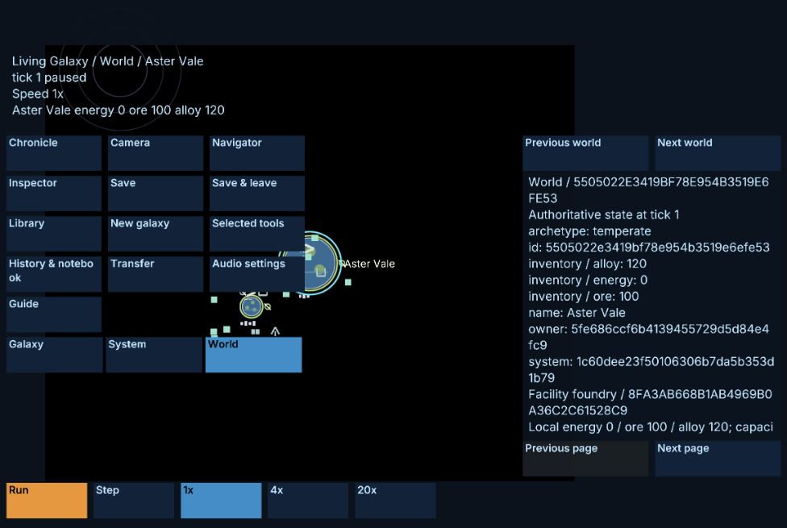
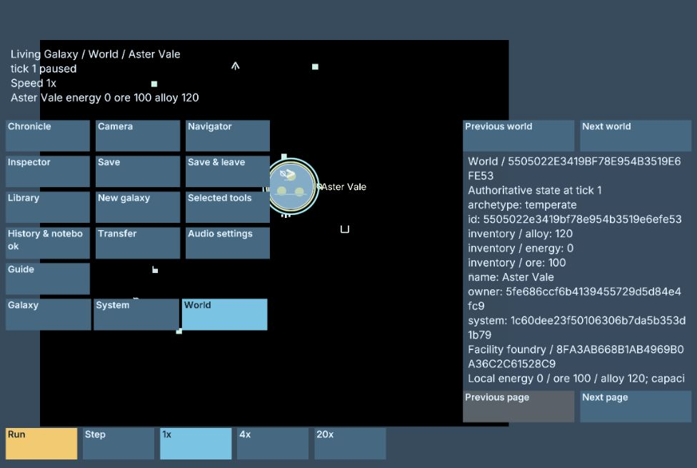

# NYON integration checkpoint — 2026-10-08

## Current

Consolidated the existing uncommitted Living V2 engine work and proposed V3
planning/corpus material into the canonical `main` checkout. A fresh fetch found
no incoming `origin/main` changes; no other local branches or worktrees existed.
The seven pre-existing local commits remain intact. This checkpoint is local;
it does not establish a push, remote CI result or distribution.

The integrated engine work covers bounded production, queued creator edits and
removals, retained storage, event-fact/receipt preparation, and archive retirement.
Existing synchronous compatibility paths remain; this is not complete resident
runtime or whole-path latency qualification. Proposed V3 documents and corpora
retain their existing approval and implementation status.

Rust is pinned to `nightly-2026-10-08` (rustc 1.101.0-nightly,
1d81eb4ad, 2026-10-07) in the toolchain file, all CI jobs and both browser build
scripts. The declared Rust 1.100 minimum remains unchanged. Cargo updated 14
compatible packages in the main lockfile and nine in the independent fuzz
lockfile. Existing exact dependency pins remain intentional constraints.

Player-facing corrections distinguish no-refund facility scrapping from paid job
cancellation refunds and suppress a camera zoom jump when pinch contacts collapse.
Regression coverage checks the preview against actual alloy inventories and checks
pinch collapse, reopening and subsequent normal zoom.

Integration repairs remove an exhaustive match's unreachable fallback, retain
unused fleet retirement adapters consistently with existing preparatory adapters,
add nonbreaking FromStr implementations, and correct a test to use the public
recovery actor accessor. The lifetime observer now rejects ambiguous exhausted
iterator endpoints as evidence of a released allocation reappearing. Original
forward lifetime deadlines, cleanup visit totals, nonempty iterator/base checks,
terminal release checks and exhaustive cut schedules remain asserted. The stale
removal-tail test checks state, cursor, sequence high-water and pending count
rather than trying to archive a pending queue; it explicitly checks archive refusal
and still compares completed archives against the synchronous reference.

## Verified

All commands below succeeded on macOS ARM64 with the pinned toolchain. The final
workspace run passed **1,779 tests**, zero failed and zero ignored, across 101
Cargo result summaries (including zero-test targets). Overlapping focused tests
and artifact suites are not added to that total.

- `cargo fmt --all --check`
- `cargo clippy --workspace --all-targets --all-features -- -D warnings`
- `cargo test --workspace --all-targets`
- `cargo build --release`
- `cargo fmt --manifest-path crates/nyon-workshop-core/fuzz/Cargo.toml --all --check`
- `cargo clippy --locked --manifest-path crates/nyon-workshop-core/fuzz/Cargo.toml --all-targets -- -D warnings`
- `./tools/build-web.sh`
- `cargo check --target wasm32-unknown-unknown --lib`
- `cargo check -p nyon-workshop-core --target wasm32-unknown-unknown`
- `cargo clippy --target wasm32-unknown-unknown --lib -- -D warnings`
- `./tools/check-workshop.sh`
- `python3 tools/validate-vertex-layout.py`
- `python3 tools/living-v2-vectors.py verify`
- `python3 tools/cross-build-fingerprint.py --skip-tests`
- `python3 -m unittest discover -s tools/tests` — 24 tests passed
- `PYTHONDONTWRITEBYTECODE=1 python3 docs/superpowers/specs/fixtures/living-v3-complete-proposed/derive.py verify` — consistency verification passed; not V3 mechanics approval

Focused regression runs passed both exhaustive removal lifetime tests and all 27
`living_queue` tests. The first full runs exposed test-accessor, lifetime-observer
and pending-archive fixture defects; the final workspace gate was rerun after
repairs. No passing historical count was substituted for this current gate.

The unchanged staged tree before this evidence document and screenshots was
`950e7055d7a56c2f124f7e0e5daec97907cebb28`. No product source changed after the
final gate began. Existing frozen proposal/helper whitespace was preserved:
the whitespace scan still reports three Markdown hard-break lines and three
extra final blank lines in inherited files; it is not reported as a clean scan.

## Browser smoke evidence

The rebuilt WebGPU and forced `?backend=webgl2` artifacts initialized, opened
Living Galaxy V2, rendered the scene and controls, and advanced from paused tick
0 to paused tick 1 through Step. This was an in-app browser smoke test of the
rebuilt production paths. No save, import or deletion journey was performed.
The temporary tab and loopback server were closed afterward.

## Partial / unverified

Whole NYON remains Partial. Complete resident/executor integration, sealing and
unified replay, performance/endurance budgets, full storage recovery journeys,
accessibility acceptance, native manual acceptance and V3 mechanics approval /
implementation are not established by this checkpoint. Fuzz compilation is not
fuzz execution; the fingerprint helper is not live cross-backend digest extraction.
Windows/Linux runtime and remote CI were not run in this local checkpoint.
