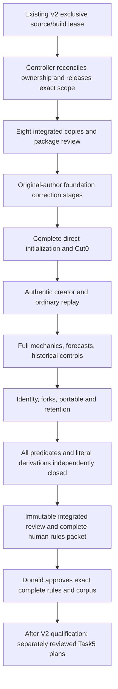

# Living V3 Initialization Amendment and Complete Corpus Implementation Plan

> **For agentic workers:** REQUIRED SUB-SKILL: Use superpowers:subagent-driven-development, preserving the selected 6.4.2 original-author correction and independent combined task-review workflow. Execute sequentially under the controller's explicit file lease; no overlapping writers. Steps use checkbox (`- [ ]`) syntax. This document releases no producer.

**Goal:** Refine master Task 4 into a complete, independently reviewed, immutable V3 rules-and-corpus submission containing the richer initialization amendment and authentic full mechanics histories, ready for Donald's required complete-rules approval.

**Architecture:** Create eight coherently integrated normative copies in a new package, with exact provenance back to the preserved eight-source freeze and reviewed initializer. Derive a new standard-library Python corpus from that package, separating general validation, direct initialization, actual creator/ordinary replay, information-limited forecasts, and portable-document admission. Preserve the original foundation author's F2/F5/R1 correction ownership; accept each finite slice only at its declared evidence strength, and require an independent integrated derivation-and-literal review before requesting human rules approval.

**Tech Stack:** Existing Python 3 standard library for independent derivation, JSON/UTF-8/SHA-256, Markdown and Mermaid; existing Rust edition 2024 / nightly-2026-09-01 remains a later implementation context. No dependencies, Rust or application implementation in this plan's execution scope.

**Spec:** `docs/superpowers/specs/2026-10-03-living-v3-initialization-design.md` (I), 93,676 bytes, SHA-256 `d305e685b58f37a3fadfb31325de48513a9e4b0fcdcb8a7faabe833e67c9b147`; master `docs/superpowers/plans/2026-10-03-complete-nyon-v2-then-v3.md`, Tasks 1–5 and Acceptance. I's independent review is `task-3-review.md`, 13,608 bytes, SHA-256 `a101ff41484669e78a49c160ae84cb2509ee4b847e04be5a997cc84aa6fba615`, under `.superpowers/sdd/2026-10-03-complete-nyon-v2-then-v3/`.

Author: Abbey; owner/reviewer assignments are controller records. Date: 2026-10-03. Status: **Draft / Proposed plan, original-author submission; not an implementation release, full corpus, rules approval or product completion.**

## Global Constraints

- Canonical `/Users/donaldfilimon/dev/active/NYON`, dirty `main`; preserve others' edits. No branches, worktrees, commits, pushes, PRs, publication, new dependencies or instruction-file changes.
- During the current V2 source/build lease, only this plan and its two named author artifacts may be written. No package/helper/corpus generation, verification execution, builds, tests, qualification writes or launches are authorized by plan authorship.
- The direct 2026-10-03 09:45 EDT continuation permits this planning handoff only, as recorded in `task-3-written-spec-planning-handoff-ruling.json`. Preserve historical pending text in frozen artifacts; do not reinterpret it as current refusal or silently rewrite it as approval.
- The controller owning “Integrate Living step job” holds V2 Task 2D.9, with Task 2E.1 reserved. A future writer starts only after that controller reconciles and releases actual source/build/helper ownership and adopts a complete scoped brief. Saving or reviewing this plan does not release that lease.
- Preserve all 152 paths and exact identities in `task-4-plan-protected-baseline.json`, the old eight source documents, all freezes, old corpora and helpers. Future corrections use new files; no pin refresh or old literal replacement to obtain a passing check.
- I: “Every field remains required”; compare complete submitted values; no sorting, default fill, normalization, implicit migration or regeneration-on-read.
- I: “Direct Genesis: the only direct tick is0”; headers/high-waters zero, counters `{}`, no ordinary tick-zero Receipt, payment, negotiation, production, objective outcome or branch-bound Shipment.
- I: initial `paid_alloy=0`; real completion carries zero; cancellation/scrap refunds zero; grants are capabilities, not earlier laboratory payment. Preserve all adopted numerical mechanics, including capacity-only Resilient Formula A; Farm scaling is unchanged.
- Preserve the thirty State fields, eighteen issued kinds, canonical order/domains/caps, and the two post-root construction paths. Seventeen kinds are directly reachable; Shipment kind13 needs genuine post-root provenance.
- Inherited work limits are `1..=1024` visits per poll, one scalar/reference/key or at most4096 bounded bytes per visit. Tests may model these limits; this corpus does not prove Rust scheduling or named-device performance.
- Independent derivation, independent literal reconstruction, automated product gates, live native/WebGPU/WebGL2/storage journeys and measured performance are distinct evidence classes. A helper's exit0 is never complete rules or runtime approval.
- Complete corpus review and explicit human approval of exact full mechanics/formulas/initialization/corpus identities, plus V2 qualification, precede master Task5's V3 authority/runtime/storage implementation plans and implementation.

## Review Focus

1. An original-source exception survives removal/fork only through authentic lineage; a same-key replacement or unrelated currently installed row cannot supply it. Tests: Tasks4,7,14,16.
2. Final Offers/Demands/DefenseRequests/shares and the Defense Commitment companion cannot enter Cut0 or cause a second wave. Tests: Task6.
3. Endowed zero-credit jobs and Ark cohorts retain capacity/conservation through completion, cancellation, founding, Return and capture without invented debits/refunds. Tests: Tasks5,8,9,14.
4. Actual P/R/B/O/H/K/M/F/A order, retained H7 and live holds can disagree with phase-sorted receipt presentation; replayers must reproduce causes before comparing reports. Tests: Tasks7,11,12,13.
5. Valid outer hashes, cache hits, selected-head admission and generated row counts do not authenticate every retained source/branch or close semantic coverage. Tests: Tasks3,15,16,17.

---

## 1. Authority, source precedence and current evidence

Use these aliases only for exact pinned sources under `docs/superpowers/specs/`. They are source inputs, not mutable targets of this plan.

| Alias | Baseline filename | Bytes | SHA-256 |
| --- | --- | ---: | --- |
| A | `2026-10-01-living-expansion-architecture.md` | 15023 | `55905f9c45ff32bfe645d79ee450ab6330a1793ad3590588549c6d8a7b5b1087` |
| S | `2026-10-01-living-societies-rules.md` | 16833 | `1b79c491dc38122c410bcb1a3157ffdcc3208a37478bdae1c1bb5182a60ce2bb` |
| E | `2026-10-01-living-ecology-rules.md` | 18964 | `7219bbbf35b3ee50ce8b1f270584e0b05445ab20f944703d4e037d54059a9acf` |
| D | `2026-10-01-living-diplomacy-expansion.md` | 27289 | `350badd8e5197df1f8d30991401dd950a5d2efbcd2aa8eb6f273d85063abb97a` |
| W | `2026-10-01-living-expansion-wire.md` | 27883 | `1fba0ff89f795c3cdf4df970ec7e5728bc82b2ea250e9f803450d87eaa2f74e7` |
| X | `2026-10-01-living-expansion-experience.md` | 16562 | `7e12c533085af8f67de9523902b547b307c0dd023134817e3553367704828980` |
| C | `2026-10-01-living-v3-complete-schema.md` | 339293 | `bf77dc1237e4f8717143a3ca04c6d20db4632cf8cbe4645a00d21f3de023339a` |
| Q | `2026-10-02-living-v3-scoring.md` | 110834 | `911410cee5f10229e4471c18154a2e7f821aff2d6645fba1222cc41091fa487f` |

The corrected authority manifest is `.superpowers/sdd/2026-10-01-sandbox-completion-and-expansion/v3-ia2-completion-lane-freeze-2/manifest.json`, SHA-256 `55ca0ede26a284142f6d1208fa57ebe83ecd6bcce59a99751751332d42d6d1eb`. Verify both frozen and live source bytes. I and its independent review are separately pinned above. The Task3 handoff ruling changes planning permission, not these bytes or full-rules status.

**Chosen amendment strategy: eight integrated copies, not a ninth normative overlay.** Create the new directory `docs/superpowers/specs/packages/living-v3-initialization-2026-10-03-r1/` (P below). Its `sources/` contains the eight filenames above, coherently amended for I01–I10. Copy I byte-exact into `provenance/2026-10-03-living-v3-initialization-design.md`, with its exact review and a machine-readable I-section → integrated-clause map. The preserved copy records the adopted input; it is not a competing ninth precedence layer. The new C contains the complete constructor tables and diagnostic specialization, while the other seven own their amended subsystem text. No “read the old rule unless absent” or runtime overlay fallback is permitted.

Within P: C owns effective field/union/key/encoding/domain/identity/diagnostic declarations; Q owns exact scoring/counterfactual/priority/tie formulas; E owns actual ordinary phase/subpass ordering; S and D own society and diplomacy mechanics; A/X own architectural/experience boundaries. I's selected specialization is integrated into those owners using `amendment-map.json`. Each copied inherited declaration is explicitly composed with mandatory V3 overrides. A conflict is a package-review defect, not permission for helper authors to choose by load order. C's documentary V2 inventory never overrides its V3 envelope/Food/industry/Hull/technology changes.

Pin any actually normative inherited V2 clauses to an exact copy/hash of `docs/superpowers/specs/2026-09-04-nyon-living-galaxy-rules.md` under P/provenance during Task1. Record clause-level incorporation in the source map. Moving V2 Rust is a pattern reference only, never an expected-value oracle. `genesis.rs::{build,check_genesis_boundary,check_clocks}` and `model.rs::check_colonies_and_industry` under `crates/nyon-workshop-core/src/living/` illustrate explicit V2 validation/ownership, not V3 admission.

**Current foundation is Partial.** The existing namespace `docs/superpowers/specs/fixtures/living-v3-complete-proposed/` is F0 below. Its `catalog.admit`, `genesis.validate`, `genesis.needs_reserved_semantics`, `genesis.installed`, `genesis.sealed`, `profiles.build`, `richer_schema.declare`, `richer_references.collect`, `predicate_matrix.matrix`, `fix1_cases.derive`, `provenance.check_sources`, and `derive.products/main` exist. They are useful audited prior work, not complete general admission. `genesis.validate` currently gates several general semantics behind `if not richer`; `richer_references.collect` uses a live resolver at historical positions. F2's local predicate exists but is not connected everywhere. Its all18 frames are framing-only. Its `generate`/`verify` CLI is documented in F0/README.md; do not run or change it as a shortcut for this plan.

The complete original-author chain is under `.superpowers/sdd/2026-10-01-sandbox-completion-and-expansion/` (H below):

- `v3-completion-lane-foundation-report.md`, `v3-completion-lane-foundation-task-review.md` (F1–F5), `v3-completion-lane-foundation-fix1-report.md`, `v3-completion-lane-foundation-fix1-rereview.md` (R1 introduced), and their computation/receipt/freeze artifacts.
- `v3-completion-lane-foundation-fix2-queued-brief.md` remains **NOT RELEASED**. The next original-author correction round is2/5; do not start it from this document or discard its complete finding set.
- `v3-foundation-semantic-ledger-draft.json` is corrected pending-proof input: 16,287,127 bytes, SHA-256 `e3aae41e201d062d0c1777084d9e004f5a1a49dbc3b5193d10a06478da369321`. Its 7,301 nodes/152 headings are inventory, not completion. Read the full report and `v3-foundation-semantic-ledger-draft-fix1-rereview.md`; D1–D6 accepted evidence corrections do not close F2/F5/R1.
- `docs/superpowers/specs/2026-10-02-living-v3-rules-approval.md` remains a historical preparation checkpoint. Create a new exact approval packet later; do not edit it into apparent acceptance.

## 2. Files, ownership and sequential handoffs

All paths below other than explicitly named baseline inputs are **proposed new files/interfaces**. Their names are not claims that helpers, types, commands or results already exist.

| Owner / lease | New target | Responsibility |
| --- | --- | --- |
| Package original author | P `sources/` eight copies; `provenance/`; `README.md`, `amendment-map.json`, `manifest.json` | Coherent I01–I10 integration, complete pins and immutable reviewed submission |
| Original foundation author, FIX2 chain | `docs/superpowers/specs/fixtures/living-v3-initialization-complete-proposed/` (N): `catalog.py`, `codec.py`, `schema.py`, `semantics.py`, `references.py`, `coverage.py`, `contracts.py`, `provenance.py`, `derive.py`, `tests/support.py`; `ledger/` | Preserve/rework copied foundation where documented, exact general validator, F2/F5/R1; owns corrections to these modules throughout |
| Initializer slice author after explicit scoped handoff | N `initialize.py`, `initial_projection.py`, `cases/initialization/`, `tests/test_initialization.py`, `tests/test_initial_sources.py` | Entire I contract, with no ordinary producer hidden inside admission |
| History/producer slice author after explicit handoff | N `history.py`, `creator.py`, `ordinary.py`, `production.py`, `conflict.py`, `diplomacy.py`, `dispatch.py`, `ecology.py`, `actor.py`, `forecast.py`, `scoring.py` and respective tests/cases | Normative independent mathematical replay, authentic sources and complete controls |
| Identity/portable slice author after handoff | N `identity.py`, `portable.py`, `retention.py`, `cases/identity/`, `cases/portable/`, respective tests | Framing, all retained branches, original issuance, exact Catalog/Anchor/Notebook/transfer semantics |
| Controller | `.superpowers/sdd/2026-10-03-complete-nyon-v2-then-v3/task-4-execution/` (R) | Future lease/adoption/STOP records, command receipts, immutable slice freezes, complete known findings and one scoped rereview per correction submission |
| Independent task reviewer | R `reviews/task-NN.md`, independent audit files | Review specified task diff, derivation and literal outputs; never edit author outputs or run generation to repair them |
| Final integrated reviewer / controller | R `complete-freeze-1/`, `complete-review.md`; P sibling approval packet | Complete-source audit and immutable identity-pinned presentation; human approval remains Donald's action |

No two owners mutate N concurrently. Before a new task, the controller verifies the previous writer stopped, hashes its exact delta, records adoption scope/remaining findings and gives the next owner explicit files. An owner needing `semantics.py`/`references.py` changes returns the full finding set to the original foundation author, not an alternate fixer. Each author owns partial buffers/temporary outputs until a coherent success or cleanup; no stale generation publishes an output prefix. Dispose only that author's disposable staging after evidence is retained. Never remove another owner's scratch, queue, output or freeze.

If the original author's exact running context cannot be resumed, the controller must record that availability limitation and an explicit ownership resolution before work; this plan neither substitutes a new author nor silently resets round counts. Independent reviewers stop at their assigned review and do not release the next producer.



The internal foundation stages below are finite checkpoints within the same unfinished correction chain. They do not declare F2/F5/R1 closed before authentic later witnesses exist. Before releasing later producer work, the controller must verify all load-bearing validator/resolver defects are corrected and explicitly adopt the prerequisite scope with remaining producer-dependent evidence listed. If the original FIX2 release contract still requires full foundation closure before that release, the controller keeps the original author responsible for the necessary support replay/control tasks until the complete original contract can be rereviewed; it does not waive the contract by renaming a checkpoint.

## 3. Proposed corpus interfaces and evidence format

N is a pure independent reference artifact, not the production engine. Use standard-library dataclasses/typing/unittest and small modules. These Python boundary names are proposed here; portable structures continue to use C's exact names/fields.

| Module API | Consumes | Produces / invariant |
| --- | --- | --- |
| `provenance.check_inputs() -> dict[str,dict]` | P manifest plus exact protected baseline and frozen source identities | Verified immutable input roster; raises on missing/drift; no repinning |
| `codec.decode(raw: bytes, entry: str) -> dict` | Entry `catalog`, `genesis`, `archive`, `notebook`, `transfer`, `coordinator`, or private `state_wrapper` | Submitted schema-ordered value after stages0–6; private wrapper is never a new import endpoint |
| `semantics.validate_general(document: dict, context: dict) -> list[dict]` | Effective schema + available typed context | Ordered check results; general predicates never skipped for richer families |
| `references.resolve(edge: dict, context: dict) -> dict` | Exact kind, JSON Pointer, position policy and source locator | Typed live/preliminary/historical result; no current-map historical substitution |
| `initialize.admit(raw: bytes, catalog: dict) -> dict` | Fully explicit Genesis and independently admitted exact Catalog | Complete result or exact existing diagnostic; no mutation/defaults |
| `initial_projection.expected(state: dict, catalog: dict) -> dict` | Primary declared valid records | Direct observations, threat frames, Cut0 bytes, expected final wave; no ordinary history |
| `history.replay(inputs: dict, allowance: int) -> dict` | Root, ordered actual submissions/advances/forks and exact Catalog | Full per-publication state/receipts/journal/queue/marks/fault/source transcript; allowance affects work partition only |
| `actor.capture(state: dict, actor_id: str, source: dict) -> dict` | Actual immutable H7 and authenticated source | Exact32 permitted fields/bytes/digest; no live future read |
| `forecast.run(capture: dict, candidate: dict | None) -> dict` | Same actor input and optional C | T+1..T+200 private trace, accounts/holds/exposure/features; no authority publication |
| `portable.admit(raw: bytes, entry: str, catalogs: dict) -> dict` | Exact raw container, exact-Catalog resolver | Full graph/replay/attachment validated result; no cached-success authority |
| `derive.derive_case(case_id: str) -> dict` | Versioned case recipe and pinned sources | Independently derived named literal outputs + outcome |
| `coverage.audit(complete: bool) -> dict` | Effective ledger, derivation paths, literal files and independent review assertions | Exact missing predicates/variants/proof strengths; complete=true fails on any open semantic obligation |

`context`, `edge` and result dictionaries are **private harness interfaces**, defined in `contracts.py`; they are not extension bags in canonical documents. Required `edge` fields: `path,expected_kind,policy,source_locator,id`; policy is exactly `live`, `preliminary_history`, `original_observation`, `original_objective`, `original_paid_manifest`, `original_genesis`. Required result fields: `status,diagnostic,outputs,unexamined`; status is `admitted`, `rejected`, `derived`, or `unexamined`. `derived` means a fully checked mathematical/private operator result with its stated input domain; it is never whole-document admission, an authentic producer source or a wire result. Rejected diagnostics carry `stage,error,path,details` only as private evidence; details include source-required offset/actual/limit when applicable. Unexamined is never a wire error or a successful admission. Complete runs allow no unexamined in required admitted/rejected cases.

Each `cases/<slice>/<id>.json` records `id,source_clauses,input_files,recipe,expected,asserted_fields,strength,derivation,independent_review`. `expected` is authored from clauses **before executing the implementation under test**. Canonical inputs/outputs are separate raw UTF-8 files, not JSON pretty-printer reconstructions. `expected` lists exact output relative paths, lengths and hashes plus expected full values/diagnostics. Hand calculations and independently written reconstruction scripts live under R/reviews; reviewer scripts must not import the author encoder, projector, validator or replay implementation as an oracle.

Ledger rows have stable `predicate_id`, exact source file/hash/heading/line/span hash, effective replacement/composition links, `role`, ordered operands/domain, positive case IDs, distinct negative/multidefect IDs, derived-output paths, exact asserted fields, review disposition and open dependency list. Preserve original IDs where requirements persist; add I01–I10 nodes with explicit old→new mappings. Documentary provenance earns transcription credit only. Mathematical cardinalities need numerical proof, not fabricated fields/tags. Aggregate nodes do not duplicate leaf coverage credit. A rejected malformed document is not an admitted maximum. Required unreachable controls name the stronger limiting predicate and prove why it dominates.

Task2 introduces the proposed new CLI, preserving the old two-mode concept but making slice scope explicit:

```python
import argparse
parser = argparse.ArgumentParser(description="Independent amended V3 corpus")
parser.add_argument("mode", choices=("generate", "verify", "audit"))
parser.add_argument("--through", choices=("foundation", "initialization", "initial_sources",
    "history", "production", "movement", "actor", "forecast", "diplomacy",
    "conflict", "creator", "identity", "portable", "complete"), required=True)
```

`generate` writes only declared N outputs after all input checks and complete in-memory derivation. It never writes source pins from observed values. `verify` derives to memory, compares every declared byte, rejects missing/extra generated artifacts, checks helper hashes and checks all input identities before/after; no repair or bytecode. `audit` verifies ledger/coverage/review linkage; `--through complete` additionally requires all obligations independently closed. A slice result always prints its exact Partial scope. `tests/support.py::assert_cases(testcase, ids)` loads predeclared literals and runs `derive_case`, comparing **all expected output bytes/values and asserted diagnostic fields**, rejecting `unexamined`; it also verifies each input is unchanged. It never regenerates expected files.

All commands below are **future execution commands for files introduced by this plan**. Do not execute them in the plan-authoring lease. Run from the canonical repository. The first run after a newly written regression must fail for the intended missing predicate or mismatched literal; if it fails for imports/pins/absent fixtures, repair setup and reproduce the meaningful failure before implementing the predicate. Save stdout/stderr/exits and input/output identities under the task's R directory. An original-author submission then stops for independent review; do not commit.

**Producer dependency rule:** Tasks5 and8–13 introduce mathematical operators before every consumer/ordinary phase is complete. Their immediately executable tests compare complete private operator outputs (`status=derived`) and any genuinely closed short histories; they must not claim authentic completed long histories by skipping unfinished phases. For example, phase5 values at100 cannot become a completed100-boundary history until the real Active-actor50/100 planning and all intervening producers exist. `history.replay` stops `unexamined` at the first unimplemented reachable producer; it never treats it as a no-op. A direct primary constructor test before Task6 similarly checks primary output only, not admitted rich Genesis.

Each task predeclares the exact long-history inputs and expected derivation before coding. Its local case and final authenticated counterpart have distinct stable IDs: append `.full_history` to the base ID for the latter, with separate literal paths and source strength. A synthetic/local input is labelled mathematical input, never a fabricated SnapshotReference or creator capture. Promotion is governed by the explicit partition below: Task13 closes the command-free ordinary cohort; Task14 closes every creator-deferred counterpart of Tasks8–13; the separately identified composite save/fork/readback witness closes at Task16 after Tasks15/16 implement its additional prerequisites. Neither Task13 nor Task14 may claim the later cohort's full-history coverage. Preserve the earlier finite freeze and add the new literal proof rather than rewriting its old strength. Task17 rejects every remaining local-only substitute.

### Exact history-promotion inventory and gates

Task3 creates `N/ledger/history-promotion.json`; Task7 wires it into `derive.py`, `coverage.py` and `tests/support.py`. Every `.full_history` case and each expanded variant has one explicit row with `case_id,source_task,creator_dependencies,other_dependencies,promotion_task,expected_output_paths,asserted_fields,independent_review`. Dependencies name actual C operations plus source-specific arguments/positions; no wildcard creator dependency or implicit “already implemented” assumption is accepted. Task7 supplies ordered creator publication/capture plumbing, not blanket implementation of every creator operation. All creator operations in the deferred roster below remain Task14 responsibilities.

The following table is the complete **named creator-deferred roster** from Tasks8–13, including concrete IDs for the previously prose-only creator controls. Every ID below is the final authenticated case ID; its base ID without `.full_history` remains local mathematical evidence until promotion. The source task predeclares literal expectations and complete command inputs; Task14 supplies and verifies the actual dependency implementations before replay. Each operation's existing V3 overrides and exact reviewed cascades apply; the table invents no command or semantic shortcut.

| Source task | Deferred case ID, promotion at14 | Exact creator dependencies / authentic source being tested |
| --- | --- | --- |
|8|`production.zero_credit_completion_and_scrap.full_history`|`ScrapFacility` after genuine endowed-job completion, with its exact cascade; original paid0 survives until scrap |
|8|`production.endowed_building_cancel.full_history`|`CancelConstructionJob` on original endowed job; zero refund and promise release |
|8|`production.endowed_hull_cancel.full_history`|`CancelHullJob` on original endowed job; zero refund and Fleet/Hull promise release |
|8|`production.creator_workforce_triggers.full_history`|`SetPopulation`, `SetSpecialization`, `SetFacilityEnabled`, `CreateFacility`, `RemoveEntity` targeting Facility, `BoardPassengers`, `UnloadPassengers`; exact per-operation immediate assignment companion |
|8|`needs.historical_owner_private.full_history`|`SetWorldOwner` with required ownership companions AFTER a real guard; current owner cannot inherit old private stock proof |
|8|`research.grant_then_real_completion.full_history`|`GrantTechnology` before genuine later lab work; grant provenance remains creator while subsequent completion is paid ordinary source |
|8|`research.revoke_dependents.full_history`|`RevokeTechnology` with exact dependent roster and `SetResearchTarget`; no silent prerequisite repair |
|9|`movement.endowed_first_departure_return.full_history`|`SetFleetOrder` to Return after actual first paid nonReturn trip; no initializer origin or automatic creator unload |
|9|`movement.original_path_after_graph_edit.full_history`|`EditLane` after paid departure; original itinerary remains authenticated |
|9|`movement.original_path_after_technology_edit.full_history`|`GrantTechnology`/`RevokeTechnology` for efficient_logistics after paid departure; original payment is not recomputed |
|9|`movement.cohort_split_merge_owner.full_history`|`SplitFleet`, `MergeFleets`, `EditFleet` ownership change; cohort count/origin and source lineage retained |
|9|`movement.passenger_reset_and_origin_removal.full_history`|`SetPassengers`; separate `RemoveEntity` targeting original World with exact reviewed closure and necessary prior `EditFleet`/`CancelHullJob`; each reset/removal owns its actual source |
|9|`shipment.removed_route_original_paid_source.full_history`|`RemoveEntity` targeting original Route after paid dispatch with exact reviewed closure; original manifest binding survives |
|9|`shipment.removed_commitment_original_paid_source.full_history`|`RemoveCommitment` after paid dispatch with exact companion cleanup; original paid Commitment binding survives |
|9|`shipment.creator_cannot_fulfill.full_history`|`CreateShipment` in both legal paused/running profiles, genuine operation capture and creator provenance; no paid credit |
|9|`shipment.creator_override_cannot_fulfill.full_history`|`SetShipmentDisposition` on genuine paid parcel, preserving original producer but disqualifying subsequent credit even for same-tag stamp |
|9|`shipment.current_route_cannot_replace_origin.full_history`|`RemoveEntity` old Route followed by `CreateRoute` with comparable terms; newly issued/current row cannot authenticate original paid origin |
|9|`claims.original_cohort_not_recreated_key.full_history`|`RemoveEntity` original claimant Hull/Fleet with exact closure, then genuine `CreateFleet`/`CreateHull` and `SetFleetOrder` producing later same `(world,actor)` participation; fresh IDs never reclaim old Genesis cohort source |
|10|`scope.original_geometry_after_move.full_history`|`EditWorld` System relocation and a separate `EditStar` System relocation after original observation; dependency cleanup authenticates original geometry |
|10|`scope.removed_child_authentic.full_history`|`CancelHazard` and separate `CancelStellarEvent` after original scope capture; absence from current schedule does not erase original child source |
|10|`scope.creator_schedule_edit_not_refresh.full_history`|`EditHazard` and separate `EditStellarEvent`; old source timestamps/children remain exact, no current-map substitution |
|10|`actor.future_war_replacement_source.full_history`|`ForceWar` replacing a future original War before crossing; old instance crossing is suppressed, no early active effect |
|11|`forecast.creator_input_provenance.full_history`|`SetWorldInventory`, `SetEnvironment`, `SetResearchTarget`, `EditRoute`, `SetFleetOrder` in distinct coherent histories BEFORE actual H7; forecasts consume the resulting authentic capture, not edited private input represented as history |
|12|`diplomacy.route_true_false_recovery.full_history`|`SetRouteSuspended(false)` on authentic true Route/C latch after exact current eligibility recovery, using `EditRoute`/`SetWorldOwner` when the recipe requires those actual causes |
|12|`diplomacy.false_false_no_recovery.full_history`|Repeated `SetRouteSuspended(false)` at its genuine operation position; equality cannot clear unrelated C latch |
|12|`diplomacy.creator_commitment_instance.full_history`|`CreateCommitment`, `EditCommitment`, `RemoveCommitment`; original instance/companion effects and later ordinary responses remain distinct |
|12|`diplomacy.creator_war_crossing_companions.full_history`|`ForceWar` active/future/replacement and `ForcePeace`; exact Request→Fleet→C source groups, no fake ordinary negotiation |
|13|`objective.secure_original_direction_after_delete.full_history`|`RemoveEntity` terminal target Lane / endpoint World in separately legal exact cascades, with prior `EditFleet`/`CancelHullJob` only where required to preserve strict live locations; historical endpoint exception remains position-specific |
|13|`objective.same_byte_new_instance.full_history`|`SetWarObjective` same submitted objective bytes; new indexed instance clears/cancels exactly the prior dependencies |
|13|`objective.same_byte_war_new_instance.full_history`|`ForceWar` equal resulting War bytes; two new objective instances and exact old binding cancellation |
|13|`objective.creator_geometry_invalidation.full_history`|`EditWorld`/`EditLane` invalidating pending geometry, contrasted with true `SetWarObjective` replacement; original terminal source and Peace behavior follow C |
|13|`witness.paused_no_handoff.full_history`|A real `SetWorldInventory` paused creator publication after an ordinary outcome but before the next advancing boundary; no objective/Defense/Supply witness handoff on paused publication |

For the **remaining named cases in Tasks8–13**, promotion is Task13 and their recipe must contain no creator operation after root. Concretely these are:

- Task8: `production.promise_conversion_once`, `needs.facility_denied`, `needs.repair_denied`, `needs.supply_denied_preserves_success`, `needs.hub_single_event`, `needs.battery_repair_denied`, `needs.farm_only_waiver`, `ecology.resilient_formula_a_farm_unchanged`.
- Task9: `movement.same_world_no_unload`, `shipment.one_return_once_per_i3`, `shipment.nominal_zero_before_stock`.
- Task10: `actor.t50_full32`, `actor.same_h7_for_8_and_9`, `actor.private_rival_invariant`, `actor.own_incoming_union_once`, `scope.empty_negative_wins`, `scope.newest_expired_suppresses`, `scope.no_received_tick_refresh`. Natural-expiry controls remain separate from the explicitly creator-removed-child control above.
- Task11: `forecast.t_plus_1_through_200`, `forecast.first_needs_100_edge`, `forecast.endowed_job_promise`, `forecast.hidden_capacity_not_zero`, `forecast.known_release_once`, `score.category0_protects_funded_needs`, `score.request_opportunity_not_delivery`, `score.all_tie_tuple_separators`, `admission.r_before_old_offers`, `admission.no_rescore_or_retry`, `admission.declaration_lock_through_dispatch`.
- Task12: `diplomacy.fresh_offer_waits`, `diplomacy.older_offer_after_r`, `diplomacy.initial_request_real_acceptance`, `diplomacy.no_recursive_share`, `diplomacy.future_war_not_early_suspend`, `diplomacy.full_treaty_wait_exact_reason`.
- Task13: `conflict.initial_occupation_100_real_ticks`, `conflict.third_party_noncombatant`, `defense.acceptance_not_fulfillment`, `defense.realized_supply_qualified_action`, `witness.no_current_receipt_cycle`, `peace.exact_leaf_event_retry`, `war.reserved_truce_conversion`.

Append `.full_history` to each listed base ID. Directly authored initial grants/rights/orders are permitted inputs to this cohort only under the admitted I constructor, not fake creator history. If a feasible source-correct recipe cannot meet the stated no-creator constraint, that is a failed dependency-plan assertion: stop the case, return the complete dependency finding to the original owner/controller and review a concrete amended inventory BEFORE promoting it. Never quietly add a creator call, substitute mathematical output or mark the row passed.

The existing aggregate `witness.paused_save_fork_no_handoff.full_history` has additional, non-creator prerequisites. Its paused segment is the Task14 `witness.paused_no_handoff.full_history` row above. Task15 supplies `witness.fork_no_handoff.full_history` using its genuine fork transition. Task16 supplies `witness.save_readback_no_handoff.full_history` and then the original aggregate using actual export/independent import plus the already implemented paused/fork paths. Both Task16 cases compare unchanged prior Anchor pointers before the next ordinary owning phase. The aggregate remains explicitly pending16 at Tasks13/14; do not claim save/import/fork coverage merely from no-op harness calls. Task14 must close **every creator-deferred row**, while these named later container/fork dependencies remain assigned to their actual owning tasks.

The complete semantic ledger will expand the named recipes into additional source-required variant/boundary/rejection cases. Before executing a source task's cases, enumerate each exact final case ID and its actual operation list in `history-promotion.json`; the admitted task review freezes that full inventory, with child IDs derived from stable predicate ID plus explicit variant, not a wildcard. Every Task8–13 creator-dependent expansion is assigned14; command-free expansions are assigned13; only the specifically named fork/readback aggregate above is assigned15/16. Empty dependency list is allowed only after checking the complete recipe. New undiscovered dependencies require an original-author inventory correction and scoped review, not an automatic fallback to a later gate. All rows retain their exact full-document/source obligation through Task17.

`tests/support.py::assert_promotions(testcase, task_number)` is a proposed helper: load the frozen inventory, reject missing/duplicate/unclassified IDs, compare each mature case (`promotion_task<=task_number`) through `assert_cases` against its independently formed **full** outputs, and assert that every later case is explicitly deferred with its dependency/owner and zero full-history credit. It also checks actual creator operations in a recipe are a subset of its declared dependencies and no earlier task claims them implemented. The helper never creates expectations or accepts `derived`/`unexamined` as a mature result. Task13 invokes it with13, Task14 with14, Task15 with15, Task16 with16, and Task17 requires no deferred row at all.

CLI scope follows this same inventory. `generate/verify --through conflict` includes full-history outputs assigned13 and local controls through Task13, and records later cases as explicit pending ledger rows; `--through creator` includes **all** mature earlier and creator-deferred outputs assigned14, wherever their source-task directory lives. Declared later-scope outputs are not “extra” errors in an earlier scoped verify, but an undeclared output is always an error. Verify never demotes or deletes later-scope files. Both gates run the affected focused suites, the promotion tests, cumulative verification and scoped audit. A passing Partial gate with exact later dependencies is not a full foundation/history/corpus closure claim.

## 4. Sequential implementation tasks

### Task 1: Integrate and independently freeze the amended eight-source package

**Files:** Create P `sources/` (exact eight basenames), `provenance/` (I, review, inherited normative input copies, baseline manifest and handoff record), `README.md`, `amendment-map.json`, `manifest.json`; R `task-01/` evidence. No baseline edits.

**Interfaces:** Consumes the pinned eight + I/review/ruling; produces P's explicit normative roster, exact provenance and coherent I01–I10 integrated clauses. P is immutable after acceptance; corrections before adoption use separately named candidate/freeze revisions with a parent-manifest link, never overwrite an accepted freeze.

- [ ] Reconcile lease first; verify P/N do not unexpectedly exist, check all152 protected files and old freeze entries, and capture the additional inherited-input hash. Unexpected existing output is a controller ownership question, not permission to overwrite.
- [ ] Copy the eight baseline files into P; integrate I01 general constructor; I02 zero-credit jobs/promises/forecast completion; I03 research/status/workforce/damage; I04 passenger forward ancestry and future intent; I05 political companions; I06 initial claims/occupation; I07 direct observations/threat; I08 Cut0/wave; I09 diagnostics; I10 corpus/experience/rollout. Add the complete tables to their owning integrated clauses, including zero refund through later cleanup, initial no-attempt inspector wording and masked Defense companion. Preserve old B0–B7 as a named historical profile.
- [ ] For each I01–I10 row, record old source span/hash, adopted I span/hash, new owning span/hash, every dependent changed clause and a no-numerical-delta assertion except the exact explicit initialization decisions already in I. Verify every “paid job” qualifier in C/Q/S/E admits authenticated Genesis jobs where required; keep genuine payment predicates strict elsewhere.
- [ ] Review eight-way consistency before freezing: complete30-field roster/18 kinds; fixed Farm20/Agronomy25; Formula A cap-only; first clocks/reservations; no new direct Shipment or source document; exact diagnostic dependency scheduling; original-source forward semantics. A new undecided mechanic blocks the affected package row and is routed for a written ruling with clause, alternatives and observable cost. Do not make a balance choice to make a fixture pass.
- [ ] Freeze exact copies and manifest after all edits; independent reviewer checks the integrated diff and I map, not just matching filenames. Original author corrects the complete finding set once per scoped round; controller adopts the immutable package only after review. STOP.

Read-only preservation check used before/after every task (existing paths; this is not corpus/helper execution):

```sh
python3 - <<'PY'
import hashlib,json,pathlib
root=pathlib.Path.cwd()
baseline=root/'.superpowers/sdd/2026-10-03-complete-nyon-v2-then-v3/task-4-plan-protected-baseline.json'
rows=json.loads(baseline.read_text())['files']
assert len(rows)==152
for row in rows:
    raw=(root/row['source_path']).read_bytes()
    assert len(raw)==row['bytes'], row['source_path']
    assert hashlib.sha256(raw).hexdigest()==row['sha256'], row['source_path']
print('152 protected inputs unchanged')
PY
```

Package manifest checks must additionally verify every source/provenance copy, exact expected roster and byte count, and reject path escape/symlinks outside its owned package. SHA-256 values for new copies are computed after edits, never predicted in this plan.

### Task 2: Start original-author FIX2 in the new corpus and establish exact evidence plumbing

**Files:** Create N `README.md`, `provenance.md`, `contracts.py`, `provenance.py`, `derive.py`, `source_hashes.json`, `helper_hashes.json`, `ledger/source-map.json`, `tests/support.py`, `tests/test_foundation.py`; later generated files are declared in `outputs.json`. R `task-02/` and refreshed original-author FIX2 brief are controller-owned.

**Interfaces:** Consumes adopted P and complete original F1–F5/R1 reports/queued brief/ledger; produces proposed APIs/CLI in §3 and immutable input validation. The controller refreshes source applicability from old8 to amended8 without deleting the original finding set or claiming the old queued brief was already released.

- [ ] Original foundation author reads the full existing code and reports, including all source-dependent limitations; copies only explicitly selected helper modules into N with source hashes/reuse notes. Retain F0 byte-exact. Pin P manifest, original eight freeze, I/review, protected152 and original helper/ledger evidence. Never copy old `source_hashes.json` and merely replace the expected hash.
- [ ] Write failure controls `pins.source_drift`, `pins.roster_missing`, `pins.helper_drift`, `verify.literal_corruption`, `verify.extra_output`, `verify.no_repair`. Tamper only disposable in-memory or writer-owned test-directory copies. An intentional corrupt literal must remain corrupt after verify failure.
- [ ] Implement the CLI and contracts exactly as §3, with no automatic pin-writing in verify/audit. Generate in-memory complete output map before any generation write, verify expected target namespace, and only then replace owned outputs; log aborted generation with no success receipt. Helper changes require a new reviewed helper-hash candidate, not verifier repair.
- [ ] Run the focused test and new commands below after the release. Every run records complete before/after namespace identities; generation is authorized mutation only in N. No legacy helper execution.
- [ ] Freeze the stopped infrastructure slice, verify protected152, independently review preservation and failure controls, and record exact unresolved F2/F5/R1. This is not foundation acceptance.

```python
def test_pin_and_nonmutation_controls(self):
    assert_cases(self, ["pins.source_drift", "pins.roster_missing", "pins.helper_drift",
                        "verify.literal_corruption", "verify.extra_output", "verify.no_repair"])
```

```sh
PYTHONDONTWRITEBYTECODE=1 python3 -m unittest discover -s docs/superpowers/specs/fixtures/living-v3-initialization-complete-proposed/tests -p test_foundation.py
PYTHONDONTWRITEBYTECODE=1 python3 docs/superpowers/specs/fixtures/living-v3-initialization-complete-proposed/derive.py generate --through foundation
PYTHONDONTWRITEBYTECODE=1 python3 docs/superpowers/specs/fixtures/living-v3-initialization-complete-proposed/derive.py verify --through foundation
```

### Task 3: Complete effective grammar, general semantics and the exhaustive predicate ledger

**Files:** Original foundation owner creates/updates N `catalog.py`, `codec.py`, `schema.py`, `semantics.py`, `coverage.py`, `ledger/effective-predicates.json`, `ledger/registry.json`, `ledger/history-promotion.json`, `cases/foundation/`, `cases/history-promotion/`, `tests/test_foundation.py`, `tests/test_history_promotion.py`. Reuse existing catalog/parser/schema code only with documented source comparison.

**Interfaces:** Consumes P effective sources, corrected pending-proof ledger and §3 result contract; produces complete effective grammar and stage0–9 general validator, inventory-to-semantic coverage map, exact negative matrix. Initialization-specific and stage10 source predicates remain separately owned.

- [ ] Read all eight integrated sources end-to-end; reconcile every inherited declaration with mandatory overrides and each I map entry. Decompose every record/union payload/enum/key/required leaf/reference/formula/allocator/diagnostic/operation into effective rows. Audit original7,301 nodes for true semantic splits and documentary-only entries; never use the number as a goal or completeness proof.
- [ ] Materialize §3's full history-promotion roster and source-specific expansion rows. Write `promotion.unclassified_case_fails`, `promotion.undeclared_creator_dependency_fails`, `promotion.derived_cannot_promote`, `promotion.pending14_at13_has_no_credit` and `promotion.pending14_at14_fails` controls. Validate all expected source-task/operation/gate bindings; an earlier Partial scope records later work without treating it as completed. Preserve the original foundation owner's stage/source/ledger correction responsibility.
- [ ] Before refactoring the richer bypass, write complete-document controls that add a valid richer row then violate fertility<=maximum, colony/world owner agreement, distinct Lane endpoints, quantity/fraction domains and capacities. These must reject identically to their base-family equivalents when the same general predicate owns the error. Add equivalent-but-not-identical finite Catalog ratios, metadata-linked fresh IDs and valid literal U+FFFD/Unicode nonnormalization.
- [ ] Implement general semantics before any coverage classification: full required/null fields; signed/unsigned exact widths and spellings; enum payload order; array keys; Catalog finite mechanics vs metadata; allocation installed correspondence including nested Hulls; graph/reference/kind/cap/overflow checks. Keep bootstrap-only zero/clock/history rules out of generic validation. Unexamined predicates cannot mask independently decidable earlier faults or be reported as production `unsupported_rules_version`.
- [ ] Complete meaningful single/multidefect controls for all decoder stages: bytes vs encoding; first syntax vs depth65; decoded duplicate vs header; unknown-before-missing; collection cap-before-child; nonissued duplicate vs issued duplicate7; canonical whitespace vs local fraction; stage8 missing before wrong-kind with numeric indices2/10; source-dependent clock behind missing definition; allocation hash9 before projection10. Record first byte offset/containing pointer and actual/limit. Include overflow at arithmetic operation order, never host wraparound.
- [ ] Generate/verify foundation; independent reviewer reconstructs complete Catalog and representative full positives/negative classifications from source, plus exhaustively checks registry/ledger mapping. Freeze scope and report all unexamined source predicates explicitly. Original F1/F3/F4 focused acceptance must remain reproduced; F5 is still open until every required derivation/literal/independent review obligation closes in Task17.

```python
def test_general_semantics_cannot_disappear_in_richer_documents(self):
    assert_cases(self, ["general.richer_fertility_exceeds_max", "general.richer_wrong_colony_owner",
        "general.richer_self_lane", "diagnostic.missing_before_wrong_kind",
        "diagnostic.numeric_2_before_10", "diagnostic.missing_definition_before_due",
        "catalog.metadata_changes_all_linked_frames", "catalog.fixed_ratio_not_equivalent_ratio"])
```

Use Task2's exact foundation unittest/generate/verify commands. Also run:

```sh
PYTHONDONTWRITEBYTECODE=1 python3 docs/superpowers/specs/fixtures/living-v3-initialization-complete-proposed/derive.py audit --through foundation
```

Expected: scoped checks pass; audit prints exact open source dependencies and remains Partial. No independent review credit is created by generation.

### Task 4: Integrate F2 at every occurrence and correct R1 with typed source policies

**Files:** Original foundation owner updates N `semantics.py`, `references.py`, `schema.py`, foundation cases/tests and ledger; creates `ledger/reference-positions.json` and `ledger/needs-guard-occurrences.json`.

**Interfaces:** Consumes full effective grammar/source positions; produces `resolve` policy matrix, complete nested `needs_reserved` local enforcement and stage ownership. Historical authentic witnesses are supplied by Tasks7–16 and returned to the same original author for final validation closure.

The local F2 predicate is exactly this mathematical conjunction, independently of later source authentication; enumerate every false conjunct with otherwise-valid operands:

```python
def valid_needs_reserved_local(physical_stock, held, required):
    return (0 <= physical_stock <= 10000
            and 0 <= held <= physical_stock
            and 0 <= required <= 2**32 - 1
            and required > physical_stock - held)
```

The effective grammar owns u32 type checks before this predicate (Python bool must not pass as an integer). The source-position policy table, not heuristic field-name matching, chooses full-document diagnostic path/stage and authenticates the operation separately.

- [ ] Enumerate every BlockedReason/DecisionReason/RecipeFacts/Event fact and copied nested carrier in complete documents. Create a valid source-bearing containing document plus distinct bad physical_stock>10000, held>stock and required<=stock-held controls for each reachable occurrence; separate shape-only controls where a direct Genesis prior-attempt rule forbids the containing history. Do not accept standalone local probes as F2 completion.
- [ ] Dispatch local checks by effective union variant during full traversal, even in richer documents. Keep field order `world,resource,physical_stock,held,required`. Capture preliminary typed subject/world source edges at8, framed integrity9, and actual producer-prefix/link/cardinality/privacy authentication10. Missing replay prerequisites and reproduced mismatches retain their specified different diagnostics.
- [ ] Replace unconditional current-live resolution at historical positions with explicit policies: original observation children/geometry/timestamp/observer; terminal succeeded/invalid objective target/Secure directional endpoints; original paid Route/Commitment/endpoint origins and Supply source Worlds after removal. Prove original typed issuance and then original source formation/topology/instance; missing historical proof is unexamined until replay exists, never a false live-map missing_reference or silent admission.
- [ ] Keep new/pending objectives, live motion/location/order/request endpoints, live C/Route bindings and direct Genesis references strict. Add same-key replacement, foreign-kind historical ID, never-issued terminal target, current unrelated matching bytes and missing-ancestor controls. Preserve actual source selection across repeated forks without rewriting parent origins.
- [ ] Freeze the complete resolver/local-domain delta for the original FIX2 scoped review. Record which authentic replay obligations remain; do not mark F2/R1 fully closed until Tasks8/13/14/16 supply complete genuine histories, all five NeedsGuardOperation/cardinality/privacy paths and positive plus rejection literals.

```python
def test_local_and_historical_reference_policies(self):
    assert_cases(self, ["needs.nested_physical_10001", "needs.nested_held_above_stock",
        "needs.nested_required_not_denied", "refs.pending_target_missing_is_live_error",
        "refs.terminal_never_issued_rejects", "refs.observation_current_absence_is_not_source_absence",
        "refs.paid_removed_origin_needs_original_source", "refs.same_key_is_not_same_instance"])
```

Use the exact Task2/3 foundation commands; scope-only resolver probes must assert unexamined explicitly in their dedicated probe tests, not call `assert_cases` as if they were admitted cases. This exception never supplies a positive/rejection ledger witness.

### Task 5: Implement complete direct primary construction and zero-credit forward source

**Files:** N `initialize.py`, `identity.py` (Genesis/STATE/ROOT functions only), `cases/initialization/`, `tests/test_initialization.py`; original foundation owner reviews any required validator changes.

**Interfaces:** Consumes P/I §§3–7,10–11 and corrected general validation; produces primary initial truth and independently sealed complete roots after Task6 supplies projection. A private producer fixture builder may compute records before serialization; admission only recomputes/compares.

- [ ] Write full explicit inputs for all30 State fields and seventeen directly reachable issued kinds; combine nonempty compatible families and include distinct source alternatives. All empty arrays/nulls/false fields are present. Test Generator0/max, positive noncontiguous/u64max ordinals, exact17-kind allocation correspondence and nested Hulls; keep kind13 framing-only until actual history.
- [ ] Implement every I primary table: topology/owner/inventory/deposit; status iff owned Colony; research prerequisite/completed/progress closure; all four workforce priorities/ties; every facility/job/Hull variant; zero credit/no prior facts; period clocks; reservations and first future completion identity. Initial facilities enabled operational means no attempt yet; disabled means blocked/[disabled]. Permit eligible unstaffed endowed jobs and zero stock; reject disabled/missing shipyard, moving/reserved target Fleet, extra queue/slot/global promise.
- [ ] Implement fresh fleets/endowed passengers/damaged repair10, future seven-kind orders and exact public shortest path/objective/Blockade bindings; Docked only, supply never_supplied, credits false/origins null. Positive Ark count can reach u32max but cannot claim settlement above10000. Political records enforce exact0/300/1200 clocks, future intervals, active rights vs intent, union treaty reservations, C/Route/R consistency and no forged attempts/witnesses/Peace. Environmental schedules use exact active/future/warning ranges and Genesis provenance.
- [ ] Implement eligible authored claim subsets arrival0/close50 and occupation0; do not infer membership from all present Arks, precompute winners, perform combat or transfer ownership. Add all I§13 family boundary negatives, inaccessible maxima with stronger predicate proofs, complete direct wrong-derived comparisons and no-history rejections. Track inventory/population+passengers independently; upper endowed people check is8,796,098,140,160.
- [ ] Record original Genesis source anchors privately by exact typed issuance and uninterrupted lineage; no new portable origin registry. Task8/9 will prove completion/refund/cohort transitions. Review full primary literals and exact rejection strengths, then STOP. Initialization is not fully admitted until Task6 closes expected projection/sealing.

```python
def test_direct_primary_records(self):
    assert_cases(self, ["init.all_reachable_kinds", "init.zero_alloy_endowed_jobs",
        "init.research_grants_closed", "init.ark_u32max_no_claim", "init.claim_eligible_subset",
        "init.occupation_zero", "init.no_shipment", "init.no_travelling",
        "init.false_credit_rejects", "init.hull_promise_exceeds_2048",
        "init.treaty_union_257", "init.missing_definition_beats_derived_clock"])
```

```sh
PYTHONDONTWRITEBYTECODE=1 python3 -m unittest discover -s docs/superpowers/specs/fixtures/living-v3-initialization-complete-proposed/tests -p test_initialization.py
PYTHONDONTWRITEBYTECODE=1 python3 docs/superpowers/specs/fixtures/living-v3-initialization-complete-proposed/derive.py generate --through initialization
PYTHONDONTWRITEBYTECODE=1 python3 docs/superpowers/specs/fixtures/living-v3-initialization-complete-proposed/derive.py verify --through initialization
```

### Task 6: Complete pure observations, Cut0, one request/share wave and root sealing

**Files:** N `initial_projection.py`, `initialize.py`, `cases/initial_sources/`, `tests/test_initial_sources.py`; full Genesis/wrapper/frames and wave literals in generated `documents/initialization/` and `frames/initialization/`.

**Interfaces:** Consumes fully validated primary records; produces exact direct observations/THREAT/Cut0/final-wave comparisons and complete `initialize.admit`. No source SnapshotReference, ordinary actor forecast or receipt exists at this point.

- [ ] Write each visibility clause independently, including Dormant owned noncolony/mixed scout/docked observations; missing/extra/self-authorizing/stale/share-origin negatives. Project complete positive and empty stellar/hazard scopes with warning0 vs hidden future, current original observer/tick, checked Ore aggregate and exact summaries. Threat derives only I§8.1's actual pair/escort/occupation rule; reject nonwar foreign docking as a fabricated threat.
- [ ] Construct exact32-field Cut0 with `offers`, `demands`, `defense_requests`, `shared_intelligence`, `own_shipments`, `incoming_shipments` empty; mask only Defense C request/status/reasons to null/ready/[], retaining other full fields and Supply companion. Hash canonical32 under `NYON_LIVING_V3_OBSERVATION\0`; hash THREAT under its exact independent payload/domain excluding itself/root/State/requests.
- [ ] Independently derive allowed Demand shortages: Food/Energy ceil needs minus stock; earliest eligible staffed enabled Foundry/Lab with other present physical guards, no future simulation. Compare selected eligible subset,0/200 clocks and CutDigest0. Construct pending Defense requests from exact direct source; require one per C, exact threat and C.waiting companion, and exact deduplicated required shares. Compare Offers after Demand/C sources without acceptance.
- [ ] Mutation controls must prove changing a submitted wave output never alters expected Cut0; the document instead rejects. Add Offer→Demand loop, C.request self-inclusion, reciprocal/transitive sharing, private rival input, missing/extra/coalesced share, wrong timestamp/digest and final Actor32-for-Cut0 substitution. Compare every authored/derived field; never encode a repaired document.
- [ ] Seal PACK/STATE/GENESIS/ROOT/allocation frames, root branch/null HistoryView and highwaters0. Store exact UTF-8/length/preimages/full digest/ID literals and no ordinary Receipt. Independently reconstruct complete projections and frames without importing author code; close every I§13 direct row and diagnostic pair before accepting the initializer slice.

Critical constructor logic must have this dependency order (private pseudocode names are implemented in `initial_projection.py`, not new wire fields):

```text
base := validated explicit primary records
observations := derive_complete_direct_observations(base)
cut[A] := Actor32(base, observations[A], wave_arrays=[], defense_companion=ready)
cut_digest[A] := SHA256(OBSERVATION_DOMAIN || canonical32(cut[A]))
expected_demands := derive_only_submitted_eligible_demand_keys(base, cut_digest)
expected_requests := derive_only_submitted_eligible_request_choices(base, observations)
expected_shares := exact_deduplicated_request_transport(expected_requests)
expected_companions := pending_request_companions(expected_requests)
compare_all_submitted_fields_in_schema_order()
seal_submitted_unmodified_canonical_bytes()
```

```python
def test_source_cut_has_no_wave_back_edge(self):
    assert_cases(self, ["cut.literal32", "cut.final_actor_differs", "cut.offer_demand_loop_rejects",
        "cut.defense_companion_mask", "cut.changed_share_same_expected_cut",
        "cut.no_transitive_wave", "cut.private_rival_invariant", "root.no_receipt_or_highwater"])
```

```sh
PYTHONDONTWRITEBYTECODE=1 python3 -m unittest discover -s docs/superpowers/specs/fixtures/living-v3-initialization-complete-proposed/tests -p test_initial_sources.py
PYTHONDONTWRITEBYTECODE=1 python3 docs/superpowers/specs/fixtures/living-v3-initialization-complete-proposed/derive.py generate --through initial_sources
PYTHONDONTWRITEBYTECODE=1 python3 docs/superpowers/specs/fixtures/living-v3-initialization-complete-proposed/derive.py verify --through initial_sources
```

### Task 7: Build authentic ordered creator/ordinary history and complete publication evidence

**Files:** N `history.py`, `creator.py`, `ordinary.py`, `identity.py`, `cases/history/`, `tests/test_history.py` and private `traces/history/` outputs; wire the previously defined promotion inventory into `derive.py`/`tests/support.py` with the original foundation owner's reviewed coverage contract. No blanket creator-variant implementation is attributed to this plumbing task.

**Interfaces:** Consumes sealed original roots; produces genuine post-root paused creator and advancing ordinary paths, source-prefix index/reconstruction, complete state/three receipt views/journal/queue/marks/fault histories. The three evidence views are sealed tick Receipt plus derived decision and event-facts receipt views; use exact V3 registered payloads, not three invented top-level transport kinds.

- [ ] Start a positive history from admitted root bytes. Use real accepted command envelopes/captures/effects/Revision parents and actual operation order; never insert hand-authored intermediate State/Receipt as authority. Ordinary phases run in E's twelve-phase order, with phase2's twelve subpasses, immutable I3, per-production prefixes, immutable H7 and actual mixed order. Early slices can implement a closed scenario only if it cannot reach an unimplemented producer; otherwise stop unexamined.
- [ ] Write paused multiple-revisions-at-tick0 and running ordered two-command cases whose full RevisionID lexical order differs from acceptance order. Queue submission computes private prefix at T and durable accepted mark; committed State/head/Receipt stays unchanged. Execution replays each accepted capture/effect exactly; fault preserves accepted queue/marks and commits no prefix. Paused accepted publications have their genuine tick0 creator receipts; they are not direct Genesis ordinary receipts.
- [ ] Derive EventPayload groups, full Changes/records, decision/facts views, journals, queue before/after, latest logical creator cursor and all clocks/marks. `Receipt.applied_revisions` sorts IDs, while causal execution and event groups preserve accepted order. Seal ReceiptDigest before Event IDs; no current receipt/Anchor self-reference. Store every boundary required by source authentication, not only chosen final digest.
- [ ] Model remaining-allowance continuation at1/2/64/1024/mixed, internal0 continuation and public0/1025 rejection. Test ready repeated zero work, extraction once, cancellation/stale at each phase/inner source loop, failure before publication and retained cleanup ownership. These are reference traces and future Rust oracle inputs, not measured runtime proof.
- [ ] Independently review authentic creator capture and ordinary-source chronology; prove no edited result-State shortcuts. Export reusable history inputs for downstream tasks; any unsupported producer keeps corresponding cases Partial. Implement `assert_promotions` and inventory-aware scoped generate/verify behavior from §3, with explicit deferred status and zero full-history credit. STOP before the next released slice.

```python
def test_real_publication_and_accepted_order(self):
    assert_cases(self, ["history.paused_two_same_tick", "history.running_reversed_revision_ids",
        "history.accepted_queue_fault_no_prefix", "history.cancel_no_new_marks",
        "history.same_full_results_all_allowances", "history.event_hash_after_receipt",
        "history.creator_capture_not_future_receipt"])
```

```sh
PYTHONDONTWRITEBYTECODE=1 python3 -m unittest discover -s docs/superpowers/specs/fixtures/living-v3-initialization-complete-proposed/tests -p test_history.py
PYTHONDONTWRITEBYTECODE=1 python3 docs/superpowers/specs/fixtures/living-v3-initialization-complete-proposed/derive.py generate --through history
PYTHONDONTWRITEBYTECODE=1 python3 docs/superpowers/specs/fixtures/living-v3-initialization-complete-proposed/derive.py verify --through history
```

### Task 8: Derive all production, Needs, workforce, research, repair and conservation histories

**Files:** N `production.py`, `ecology.py` (environment portion), history phase wiring, `cases/production/`, `tests/test_production.py`; original foundation owner closes related F2 source checks.

**Interfaces:** Consumes authentic replay/prefix evidence; produces full phase5/6 transitions and all five genuine guard variants, exact conservation accounts and endowed-job forward proofs.

- [ ] Predeclare full histories for first1/9/10/19/20/49/50/99/100/149/150/199/200/299/300/999/1000 boundaries as applicable. Every initial job definition completes once at its true duration; first operation is completion+period. Test paid0 completion/cancel/scrap/capture/refund-discard and genuine paid-job alternatives separately, with exact capacity promise conversion.
- [ ] Execute job completions, then due Needs holds, World-ID Energy/Ore/fallback, Solar/Extractor/Foundry/Farm, global repair IDs, Lab and Supply ordering. Each producer authenticates its original actual full prefix and source cursor. Recompute holds after real mutations; physical stock P, held stock and required amount remain separate. Preserve no-input solar, finite deposits, storage guards, disabled/unassigned/no-Colony cases and blocked-clock advancement.
- [ ] For facility, repair, supply, hub_fallback and battery_repair guards, generate full source documents and all legal denied/Farm-only food_waiver counterparts. Assert exact typed operation/world links, selected Hull, event cardinality, guard-first group order, Lab extra research event, denial atomicity and preservation of prior Supply success/readiness. Farm waiver must reduce combined imminent exposure and preserve each already-funded resource; zero output is not a waiver.
- [ ] Execute exact Needs/growth/capacity decline and workforce recomputation after every source-defined trigger; research target switch/free selection, prerequisites, grant/revoke cascading,99→100 completion and resilience Formula A. Separate recipe production counters, transported resources, passenger transfers, resource sinks/losses and refund discard; conservation is per-resource/people, never summed incompatible units. Test Formula A/B separating arithmetic and unchanged Farm e/output.
- [ ] Authenticate private Needs guard viewing at historical producer ownership, not current ownership or direct sight. Missing proof removes the entire private guard; no canonical redaction or new Actor32 quantities. Feed every nested genuine positive/distinct-negative back to original foundation author, then independently review full literals and close only proven F2 portions.

```python
def test_needs_guard_and_endowments(self):
    assert_cases(self, ["production.zero_credit_completion_and_scrap", "production.promise_conversion_once",
        "needs.facility_denied", "needs.repair_denied", "needs.supply_denied_preserves_success",
        "needs.hub_single_event", "needs.battery_repair_denied", "needs.farm_only_waiver",
        "needs.historical_owner_private", "research.grant_then_real_completion",
        "ecology.resilient_formula_a_farm_unchanged"])
```

```sh
PYTHONDONTWRITEBYTECODE=1 python3 -m unittest discover -s docs/superpowers/specs/fixtures/living-v3-initialization-complete-proposed/tests -p test_production.py
PYTHONDONTWRITEBYTECODE=1 python3 docs/superpowers/specs/fixtures/living-v3-initialization-complete-proposed/derive.py generate --through production
PYTHONDONTWRITEBYTECODE=1 python3 docs/superpowers/specs/fixtures/living-v3-initialization-complete-proposed/derive.py verify --through production
```

### Task 9: Derive paid movement, endowed cohorts, freight and arrival disposition

**Files:** N `dispatch.py`, `history.py`, `cases/movement/`, `tests/test_movement.py`; original foundation owner retains historical manifest validator changes.

**Interfaces:** Consumes actual command/ordinary source prefixes and production funding; produces all paid/creator movement/Shipment profiles, immutable original origins/duration and genuine conservation outcomes.

- [ ] Cover every Fleet order and roster: pure/mixed scout formation vs standing dispatch, unknown current ownership, owned noncolonized departure, permission-before-path first cause, shortest direct-final itinerary/lexicographic ties/overflow, T+1 departure, logistics per-Hull rounding, once-only debit/return credit and immutable paid original path after topology/technology edits. Same-World no arrival; distinct same-System paid duration follows D's10.
- [ ] Trace endowed Ark first genuine nonReturn origin assignment, stranded no-credit Return, partial Return unload to original matching owned capacity, cohort preservation through split/merge/capture, actual SetPassengers reset, destruction/loss and World removal. Test direct claim close with original eligible cohort, departure49, real late arrival50, lowest eligible Hull/rank and one founding award. No equal-byte recreated Hull obtains old Genesis source.
- [ ] Derive internal/Aid/unbound Trade/bound Supply Routes and paid dispatch, all four resources, reserve/MAX floors, cadenceT+10, zero nominal freight before stock, capacity and environmental modifiers, positive holds/own entitlement/other locks. Shipment kind13 must be actually allocated with genuine source, not merely framed. Creator cargo comes from authentic paused/running CreateShipment and cannot earn paid fulfillment.
- [ ] Execute immutable phase3 I3: prior Supply handoff, Fleet/Hull arrivals, then each Shipment exactly once; owner change before War/storage, outbound one return with original duration, waiting retained leg and exact all-or-none delivery, no same-phase second attempt. Include Route/Commitment removal after paid departure with still-authentic original binding; strict current physical endpoints remain required or undergo explicit creator resolution.
- [ ] Store complete state, all receipts/frames and ledger deltas; independently reconstruct paid withdrawals and cohort conservation. Reject forged current-world origin, origin rebinding, repeated return, altered immutable duration, creator override masquerading as paid and current matching Route replacing original paid source. Return resolver changes to original owner; STOP.

```python
def test_paid_sources_survive_later_changes(self):
    assert_cases(self, ["movement.endowed_first_departure_return", "movement.same_world_no_unload",
        "movement.original_path_after_graph_edit", "shipment.removed_route_original_paid_source",
        "shipment.creator_cannot_fulfill", "shipment.one_return_once_per_i3",
        "shipment.nominal_zero_before_stock", "claims.original_cohort_not_recreated_key"])
```

```sh
PYTHONDONTWRITEBYTECODE=1 python3 -m unittest discover -s docs/superpowers/specs/fixtures/living-v3-initialization-complete-proposed/tests -p test_movement.py
PYTHONDONTWRITEBYTECODE=1 python3 docs/superpowers/specs/fixtures/living-v3-initialization-complete-proposed/derive.py generate --through movement
PYTHONDONTWRITEBYTECODE=1 python3 docs/superpowers/specs/fixtures/living-v3-initialization-complete-proposed/derive.py verify --through movement
```

### Task 10: Derive actual observations, Actor32 and complete environmental scope selection

**Files:** N `actor.py`, remainder of `ecology.py`, `cases/actor/`, `tests/test_actor.py`; literal captures/scopes/frames.

**Interfaces:** Consumes genuine phase2/7 history; produces immutable H7 captures, actual automatic environmental events and source-authenticated retained observations, distinct from direct Cut0.

- [ ] Derive phases1–49 and genuine T50/T100 Actor32 from replay, with all32 fields and source predicates in C§Actor32. Own/incoming manifest roles may repeat once each but union counts once; differing bytes for same ID reject. Test owner-vs-recorded owner for jobs/routes/shipments, owned noncolony deposits, all public System/Lane and World-id/system-only geometry, own claims/occupations even without sight, bilateral Demand visibility and no transitive allies.
- [ ] Create actual Hazard/Stellar warning/start/end and due-Star selection1000 controls using source formulas/counters; do not read seed for actor prediction. Apply exact twelve lifecycle subpasses, retained future-War crossings vs replacements, once-only overdue clocks and no catch-up on import. Preserve own quantities while hiding rival private state.
- [ ] Select scopes from all permitted retained Observation/shared/request facts **before** world projection. Exercise complete empty negative assertions, competing observer/tick/source ties, then newest child including expired before expiry filter, then each-family128 cap. Original geometry/observer/tick is source-bound after moves/deletion; received_tick or fleet travel cannot refresh it.
- [ ] Add private-rival perturbation pairs with byte-identical permitted capture, hidden warning, stale observation<=300 attack boundary, source forgery, child absent only in current schedule, duplicate/disagreeing child, selected expired newest suppressing old active child, family cap128/+1 and precise diagnostic output. False current-map R1 error must be absent while wrong original source still rejects.
- [ ] Independently reconstruct full32 bytes/digest and all selected scopes from literal replay sources; review exact privacy and source-position ledger, not shape counts. STOP.

```python
def test_actor_source_and_scope_history(self):
    assert_cases(self, ["actor.t50_full32", "actor.same_h7_for_8_and_9", "actor.private_rival_invariant",
        "actor.own_incoming_union_once", "scope.empty_negative_wins", "scope.newest_expired_suppresses",
        "scope.original_geometry_after_move", "scope.removed_child_authentic", "scope.no_received_tick_refresh"])
```

```sh
PYTHONDONTWRITEBYTECODE=1 python3 -m unittest discover -s docs/superpowers/specs/fixtures/living-v3-initialization-complete-proposed/tests -p test_actor.py
PYTHONDONTWRITEBYTECODE=1 python3 docs/superpowers/specs/fixtures/living-v3-initialization-complete-proposed/derive.py generate --through actor
PYTHONDONTWRITEBYTECODE=1 python3 docs/superpowers/specs/fixtures/living-v3-initialization-complete-proposed/derive.py verify --through actor
```

### Task 11: Derive complete200-boundary B/F, candidate enumeration, ranking and live reservations

**Files:** N `forecast.py`, `scoring.py`, private `traces/forecast/`, `cases/forecast/`, `tests/test_forecast.py`.

**Interfaces:** Consumes exact actor H7 and Q's all F1–F5/§§1–8 definitions; produces all private candidate/baseline traces, features, eligible roster/complete identity/ties and actual central admission evidence. Private F never substitutes for actual replay outcomes.

- [ ] Build B and F over inclusive T+1..T+200, with first-needs window(T,T+100], exact signed feature deltas/exposure/shortage loss and unchanged Farm/Formula A mechanics. Endowed retained jobs enter the same promise equations with zero credit. Retain authentic source records and separate projected working motion/cargo/held unknown claim/combat outcomes; no predicted rival action, negotiation, hidden release or seeded unannounced event.
- [ ] Implement all14 Account types and fifteen actual/three promised Token variants from Q's finite registry, typed equality, known K/hidden H upper occupancy, exact release/conversion, local floors/locks and self-entitlement. Handle own/incoming dedup, initial zero-credit promises, future Truce union reservation, unsupported unknown award no-release, and predicted AUTO IDs using the frozen capture/domain without publishing them.
- [ ] Enumerate every candidate family and eligible variant in frozen policy order with complete candidate identity, every numeric component including zero and all checked arithmetic. Compute category0 strict imminent improvement/combined-exposure protection/funded-resource preservation, public-request opportunity exception without promised delivery, other three categories, lane heads/global stable merge, force selection/ties, empty-roster audit and family_bests omission. Ineligible diagnostics never enter eligible trace.
- [ ] Derive central P physical account, H summed cargo/payment holds, B MAX-coalesced linked floor, H+B<=P, structural locks and exact ownership→physical→competition cause order. At100 execute P/R/B/O/H/K/M/F/A on one W/ledger and original H7; at50 off100 execute R/M/F/A. R rejected candidate is not retried; new rights do not rescore; accepted declaration locks survive phase10, and phase-sort of final receipts cannot drive mutation.
- [ ] Store all200 per-boundary states/features/private holds and exact trace bytes/ActorInputContext/audits as private evidence, plus actual final published output. Independently rederive arithmetic and tie-separating cases; verify no source/root omniscience or shared-generator-only proof. STOP.

```python
def test_forecast_is_bounded_information_and_exact_priority(self):
    assert_cases(self, ["forecast.t_plus_1_through_200", "forecast.first_needs_100_edge",
        "forecast.endowed_job_promise", "forecast.hidden_capacity_not_zero", "forecast.known_release_once",
        "score.category0_protects_funded_needs", "score.request_opportunity_not_delivery",
        "score.all_tie_tuple_separators", "admission.r_before_old_offers", "admission.no_rescore_or_retry",
        "admission.declaration_lock_through_dispatch"])
```

```sh
PYTHONDONTWRITEBYTECODE=1 python3 -m unittest discover -s docs/superpowers/specs/fixtures/living-v3-initialization-complete-proposed/tests -p test_forecast.py
PYTHONDONTWRITEBYTECODE=1 python3 docs/superpowers/specs/fixtures/living-v3-initialization-complete-proposed/derive.py generate --through forecast
PYTHONDONTWRITEBYTECODE=1 python3 docs/superpowers/specs/fixtures/living-v3-initialization-complete-proposed/derive.py verify --through forecast
```

### Task 12: Derive negotiated rights, Demand/Offer/Defense lifecycle and exact protocol carriers

**Files:** N `diplomacy.py`, `ordinary.py`, `cases/diplomacy/`, `tests/test_diplomacy.py`.

**Interfaces:** Consumes genuine H7/central ledger/source prefixes; produces authentic free protocol and older-response histories, C/Route/R/share lifecycle and exact successful/blocked carriers, independent of initial declarations.

- [ ] Derive original selected Demand0 refresh/expiry versus actual free request_supply posting from H7, every resource/purpose owning clause, positive units/no duplicate key and no same-capture enrichment. Implement inherited bilateral Trade/Nonaggression handshake, pair order and all exact reason/literal alternatives.
- [ ] Cover every Offer kind/Terms, valid/invalid demand binding, older acceptance/refusal/wait/expiry, renewal exact same Terms and route recovery, global/per-actor limits, treaty union full/available cases, and dormant/source restrictions. Fresh Offer atT cannot be considered atT. Acceptance does not make an unmanifested contract stock or change original scores.
- [ ] Derive mutual Defense creation/sharing and old-request response with original observer/threat bytes, frozen old-pending roster, one R/C, compatibility with third-party War, own-current funding/held locks and exact ID-free consideration/attempt carriers. Direct pending R can only gain real acceptance/binding through this ordinary producer. No same-pass recursive sharing/new response.
- [ ] Authenticate continuing C rights/current cause groups: expiry, party/world change, future-War install vs actual crossing, active War/Truce, exact Request→Fleet→C companion order, suspended endpoints and actual SetRouteSuspended(true→false) recovery. Repeating false has no dependent recovery. Paid Supply/Defense fulfillment remains based on actual producers, not agreement/Offer shape.
- [ ] Emit all Decisions/PolicyScore/ProtocolFailure/OfferConsideration/ObligationReason variants with exact phase7 captures and actual producer8/9, private holder/stock access filtered by source. Independent reviewer checks complete canonical histories and distinct negative source/clock/instance controls; STOP.

```python
def test_actual_protocol_lifecycles(self):
    assert_cases(self, ["diplomacy.fresh_offer_waits", "diplomacy.older_offer_after_r",
        "diplomacy.initial_request_real_acceptance", "diplomacy.no_recursive_share",
        "diplomacy.future_war_not_early_suspend", "diplomacy.route_true_false_recovery",
        "diplomacy.false_false_no_recovery", "diplomacy.full_treaty_wait_exact_reason"])
```

```sh
PYTHONDONTWRITEBYTECODE=1 python3 -m unittest discover -s docs/superpowers/specs/fixtures/living-v3-initialization-complete-proposed/tests -p test_diplomacy.py
PYTHONDONTWRITEBYTECODE=1 python3 docs/superpowers/specs/fixtures/living-v3-initialization-complete-proposed/derive.py generate --through diplomacy
PYTHONDONTWRITEBYTECODE=1 python3 docs/superpowers/specs/fixtures/living-v3-initialization-complete-proposed/derive.py verify --through diplomacy
```

### Task 13: Derive conflict, real action/fulfillment, objectives, Peace and delayed witnesses

**Files:** N `conflict.py`, `diplomacy.py`, `ordinary.py`, `cases/conflict/`, `tests/test_conflict.py`.

**Interfaces:** Consumes actual Supply/motion/War instances and prior published receipts; produces full phase4 causal combat/action/settlement/occupation and later objective/Defense/Supply witness handoffs. Its full-history exit covers only §3's command-free promotion13 cohort; creator-dependent and container/fork-dependent cases retain the explicit14/15/16 owners and pending status.

- [ ] Execute due10 Fleet-ID retreat, one globally atomic combat round, World-ID combat groups, Request/C-ID action groups, global destroyed IDs, occupation then settlement with exact immediate status/workforce/dependency companions. Test disabled battery targetability vs eligibility, hostile third-party noncombatants, multiple claimants, unsupplied units, initial occupation0→1 and100 qualifying boundaries, combat invalidation before progress, direct claims closure50 before new entrants.
- [ ] Derive paid Supply successful/unavailable/renewal and authentic action contribution using current exact eligible Supply before combat; retain earlier successful deadline on failure. Defense accepted does not imply fulfilled: require actual bound arrival/action/contribution and original instance. Supply credit requires original paid outbound/null override/exact original parties/C binding; creator cargo grants none.
- [ ] Derive Defend/Occupy/Secure objectives including directional endpoints, exact100 samples/consecutive count/tie/rank, terminal invalid/succeeded historical target authentication, source instances after same-byte replacement and removal. Current HP or convenient current geometry never rewrites an old witness. No current Receipt Anchor can occur in its own State.
- [ ] Execute delayed handoffs only on next advancing owning phase: objective/Defense phase2, paid Supply phase3. Paused creator/save/fork/read performs none. Peace fresh/older/refused/retry entry semantics use exact semantic comparison, one pair+complete Peace leaf event, no invented War Change; natural end and accepted Peace consume reserved/coalesced Truce with exact interval/overlap/disjoint-future guards.
- [ ] Independently reconstruct full damage/resource/person conservation, source Action/THREAT/frame/Receipt/Anchor bytes, privacy, all success/failure/retry alternatives available in the promotion13 cohort. Return authentic completed witnesses and the complete deferred source-position list to the original foundation owner; R1/F2/F5 remain open where14/15/16 evidence is still required. Complete the following scoped integration gate, then STOP.

Before that STOP, execute **all promotion13 rows**, and only those rows, from original roots through every intervening phase, including real actor planning50/100. Compare full state/three receipt views/journals/queues/faults/marks/identities, mathematical expectations and reconstructed sources. For these mature rows, skipped producers, `derived`/`unexamined`, fabricated source State and missing independent literal reconstruction fail the gate. Run all Tasks8–13 focused suites plus `test_history_promotion.py`, cumulative `verify --through conflict` and scoped audit. `assert_promotions(self, 13)` must prove every exact14 row and the named15/16 aggregate prerequisites remain visibly deferred with no full-history credit. The independent review includes the complete promotion13 integration delta **and the frozen deferred inventory**, not just `conflict.py`. This is a scoped ordinary-cohort adoption, not full Task4/history/foundation closure, and it does not require any Task14 creator operation to execute early.

```python
def test_real_outcomes_and_prior_witnesses(self):
    assert_cases(self, ["conflict.initial_occupation_100_real_ticks", "conflict.third_party_noncombatant",
        "defense.acceptance_not_fulfillment", "defense.realized_supply_qualified_action",
        "objective.secure_original_direction_after_delete", "objective.same_byte_new_instance",
        "witness.no_current_receipt_cycle", "witness.paused_save_fork_no_handoff",
        "peace.exact_leaf_event_retry", "war.reserved_truce_conversion"])

def test_ordinary_cohort_promotion(self):
    assert_promotions(self, 13)
```

```sh
PYTHONDONTWRITEBYTECODE=1 python3 -m unittest discover -s docs/superpowers/specs/fixtures/living-v3-initialization-complete-proposed/tests -p test_production.py
PYTHONDONTWRITEBYTECODE=1 python3 -m unittest discover -s docs/superpowers/specs/fixtures/living-v3-initialization-complete-proposed/tests -p test_movement.py
PYTHONDONTWRITEBYTECODE=1 python3 -m unittest discover -s docs/superpowers/specs/fixtures/living-v3-initialization-complete-proposed/tests -p test_actor.py
PYTHONDONTWRITEBYTECODE=1 python3 -m unittest discover -s docs/superpowers/specs/fixtures/living-v3-initialization-complete-proposed/tests -p test_forecast.py
PYTHONDONTWRITEBYTECODE=1 python3 -m unittest discover -s docs/superpowers/specs/fixtures/living-v3-initialization-complete-proposed/tests -p test_diplomacy.py
PYTHONDONTWRITEBYTECODE=1 python3 -m unittest discover -s docs/superpowers/specs/fixtures/living-v3-initialization-complete-proposed/tests -p test_conflict.py
PYTHONDONTWRITEBYTECODE=1 python3 -m unittest discover -s docs/superpowers/specs/fixtures/living-v3-initialization-complete-proposed/tests -p test_history_promotion.py
PYTHONDONTWRITEBYTECODE=1 python3 docs/superpowers/specs/fixtures/living-v3-initialization-complete-proposed/derive.py generate --through conflict
PYTHONDONTWRITEBYTECODE=1 python3 docs/superpowers/specs/fixtures/living-v3-initialization-complete-proposed/derive.py verify --through conflict
PYTHONDONTWRITEBYTECODE=1 python3 docs/superpowers/specs/fixtures/living-v3-initialization-complete-proposed/derive.py audit --through conflict
```

### Task 14: Close every creator operation, extension, cascade and source-instance transition

**Files:** N `creator.py`, `history.py`, `cases/creator/`, `tests/test_creator.py`, `ledger/creator-operation-matrix.json`; add the §3 deferred `.full_history` inputs/outputs in their original Tasks8–13 case/literal directories and their source-task tests. The original foundation author owns necessary validator/reference/coverage corrections in a separately handed-off, nonoverlapping correction slice; no replacement fixer edits those modules.

**Interfaces:** Consumes all ordinary producers/validators plus Task13's frozen promotion/deferred inventory; produces complete inherited46-operation and V3 extension/override matrix, actual paused/running operation-prefix sources, cleanup/refund/recovery evidence and **all** earlier Tasks8–13 promotion14 full-history counterparts. The explicitly named15/16 fork/readback aggregate remains pending its separate prerequisites.

- [ ] Enumerate C's frozen inherited CreatorOperation declarations plus every §Complete command additions override and new variant; preserve exact names/field order and required options. Do not assume “46” equals the final V3 count. Map each effective operation to positive, rejection, unchanged neighbors, Changes/events/marks and removed dependent owners.
- [ ] Test Target existing/earlier-local only, unique u16 local keys, forward/self/wrong-kind rejection and Terms/Pair/Demand existing-only constraints. Genuine transient CreateFleet empty-prefix E admits only same-batch created Fleet until populated/removed; completed State/Genesis/view always nonempty. Source prefixes are operation-indexed; equal current row cannot invent E membership.
- [ ] Derive every removal/replacement cascade, reservation release, paid/zero credit refund/discard, population/passenger transfer/loss, research dependent revoke, hazard/event replacement, C/War/objective instance cancellation and genuine value no-op. Equal-byte semantic replacements retain their actual reviewed instance policy; same-key recreation never reacquires Genesis/paid original exemptions.
- [ ] Cover all ten successful SetShipmentDisposition cells and two return-reset failures with actual CreatorCapture stamps, immutable duration/clocks/provenance and permanent paid-credit disqualification. Waiting intervention may attempt before retained arrival clock; O/R restoring the old clock does not restart. Include actual traveller-to-Docked EditFleet resolution, immutable Shipment endpoint-loss removal, last-Hull cascades and failed-Supply historical reference cleanup.
- [ ] Exercise each operation in paused and running capture contexts wherever legal, plus preview-invalid/cancel/stale/fault/accepted abandonment, undo/redo via authentic history and deferred owner reclamation. Independently review complete full Changes and aggregate creator intervention/cascade cardinality; no synthetic ordinary events from creator mutations. Complete the cross-task promotion gate below before STOP.

- [ ] Load the exact Task13 deferred inventory, assert its case-ID set matches §3 plus every reviewed explicit expansion, and implement **every** named actual creator dependency under its original source contract. Replay every promotion14 `.full_history` recipe from its original admitted root through each real command/publication/ordinary phase. Compare complete state/three receipts/journals/queues/faults/marks/identities and source bindings against the predeclared independently derived literals; preserve earlier local-only files/freeze strengths. A missing operation, creator-capture shortcut, mathematical-only counterpart, unexamined result or missing expected literal blocks this gate.
- [ ] Rerun every affected earlier suite (`test_production.py`, `test_movement.py`, `test_actor.py`, `test_forecast.py`, `test_diplomacy.py`, `test_conflict.py`), the creator and promotion suites, then cumulative `generate/verify/audit --through creator`. Cumulative verification includes all matured earlier outputs, not just creator-directory fixtures. `assert_promotions(self, 14)` requires zero outstanding promotion13/14 rows, with only the exact named15/16 rows still pending. Return the full genuine F2/R1 source witnesses to the original foundation owner for scoped correction and adjudication; do not globally close F5/R1 from local portions.
- [ ] Freeze one complete creator **and earlier-history promotion delta**, retaining full known findings and all earlier immutable freezes. The independent reviewer reconstructs every promoted source/capture/literal and the cross-task results, including each registered deferred earlier counterpart, in the same task review. Original owners correct the complete finding set before one scoped rereview. STOP only after this complete submission; Task17 still independently closes every remaining full-source/foundation obligation.

```python
def test_creator_source_instances_and_cascades(self):
    assert_cases(self, ["creator.registry_all_effective_variants", "creator.same_batch_empty_fleet_closed",
        "creator.existing_empty_fleet_rejects", "creator.zero_credit_cascade_refund",
        "creator.same_key_not_original_genesis", "creator.shipment_ten_cells_two_rejections",
        "creator.traveller_endpoint_resolution", "creator.last_hull_exact_cleanup",
        "creator.running_fault_preserves_accepted_marks"])

def test_all_creator_deferred_earlier_histories_promoted(self):
    assert_promotions(self, 14)
```

```sh
PYTHONDONTWRITEBYTECODE=1 python3 -m unittest discover -s docs/superpowers/specs/fixtures/living-v3-initialization-complete-proposed/tests -p test_production.py
PYTHONDONTWRITEBYTECODE=1 python3 -m unittest discover -s docs/superpowers/specs/fixtures/living-v3-initialization-complete-proposed/tests -p test_movement.py
PYTHONDONTWRITEBYTECODE=1 python3 -m unittest discover -s docs/superpowers/specs/fixtures/living-v3-initialization-complete-proposed/tests -p test_actor.py
PYTHONDONTWRITEBYTECODE=1 python3 -m unittest discover -s docs/superpowers/specs/fixtures/living-v3-initialization-complete-proposed/tests -p test_forecast.py
PYTHONDONTWRITEBYTECODE=1 python3 -m unittest discover -s docs/superpowers/specs/fixtures/living-v3-initialization-complete-proposed/tests -p test_diplomacy.py
PYTHONDONTWRITEBYTECODE=1 python3 -m unittest discover -s docs/superpowers/specs/fixtures/living-v3-initialization-complete-proposed/tests -p test_conflict.py
PYTHONDONTWRITEBYTECODE=1 python3 -m unittest discover -s docs/superpowers/specs/fixtures/living-v3-initialization-complete-proposed/tests -p test_creator.py
PYTHONDONTWRITEBYTECODE=1 python3 -m unittest discover -s docs/superpowers/specs/fixtures/living-v3-initialization-complete-proposed/tests -p test_history_promotion.py
PYTHONDONTWRITEBYTECODE=1 python3 docs/superpowers/specs/fixtures/living-v3-initialization-complete-proposed/derive.py generate --through creator
PYTHONDONTWRITEBYTECODE=1 python3 docs/superpowers/specs/fixtures/living-v3-initialization-complete-proposed/derive.py verify --through creator
PYTHONDONTWRITEBYTECODE=1 python3 docs/superpowers/specs/fixtures/living-v3-initialization-complete-proposed/derive.py audit --through creator
```

### Task 15: Close identities, allocators, exhaustion, repeated forks and collision universe

**Files:** N `identity.py`, `history.py`, `cases/identity/`, `tests/test_identity.py`, full frame literals and scanner traces; the exact earlier `witness.fork_no_handoff.full_history` case/literal counterpart in its source-task directory and its promotion row. No general earlier-suite ownership transfer is implied.

**Interfaces:** Consumes all genuine creator/AUTO issuances and retained branch graph; produces all18 issued-kind provenance, exact highwaters, full/truncated digest frames and all-branch original-issuance proof.

- [ ] Independently encode every PACK/GENESIS_ENTITY/STATE/GENESIS/ROOT_BRANCH/creator/AUTO/Revision/Receipt/Event/fork domain with exact byte order/lengths/null fields and source-dependent snapshot frames. Retain full32 digest and ID16; do not infer kind from opaque bits. All18 kinds require actual admitted installed/history examples, with Shipment post-root.
- [ ] Exercise accepted_sequence/branch_sequence/Notebook marks lower/equal/upper, abandoned gaps, rejected private attempts consuming none, accepted queue abandonment not recycling, positive u64max initial ordinal and checked next-value exhaustion. Fault before publication preserves exact old heads/marks except marks already genuinely accepted.
- [ ] Derive original-view fork with child-only branch_sequence=F, parent pre-fork digest in fork metadata, inherited cursor and no fork Receipt. Repeated siblings/child forks preserve original issued branch and historical IDs; new child issuances bind child. Atomic fork+edit failure consumes neither F nor S; separately accepted fork remains after later edit rejects.
- [ ] Promote `witness.fork_no_handoff.full_history` from §3 using the genuine fork-only transition after an actual pending objective/Defense/Supply handoff source. Compare the retained prior witness pointers before any advancing boundary; no fake fork receipt or handoff. `assert_promotions(self, 15)` requires zero remaining13/14/15 rows; the exact save/readback and aggregate16 rows remain pending. Include this earlier Task13 witness in the identity slice's full literal review.
- [ ] Implement bounded reference collision scan over retained branches sorted ID and exact ancestry, including transient removed entities/nonselected sibling tips; repeated same origin/full frame is one issuance. Batch<=1024, entry<=256 bytes, cache<=65536/16MiB, workspace<=64MiB; cache miss scans, no lifetime map or recursive scan. Earlier source/replay fault stops incomplete scan; cache eviction/stale capture cannot certify absence.
- [ ] Derive duplicate-origin/live-ID rejections and explicit synthetic full-digest/truncated-ID collision seam tests without claiming a genuine SHA collision. Keep seam results separate from admitted canonical collision evidence. Independently rederive frames and fork/mark history, then STOP.

```python
def test_issuance_and_history_identity(self):
    assert_cases(self, ["identity.all18_genuine_origins", "identity.u64_exhaustion_atomic",
        "fork.child_only_branch_sequence", "fork.repeated_preserves_original_issuer",
        "fork.combined_failure_no_marks", "collision.transient_sibling_scanned",
        "collision.same_origin_reencounter", "collision.earlier_source_fault_stops_scan"])

def test_fork_witness_promotion(self):
    assert_promotions(self, 15)
```

```sh
PYTHONDONTWRITEBYTECODE=1 python3 -m unittest discover -s docs/superpowers/specs/fixtures/living-v3-initialization-complete-proposed/tests -p test_identity.py
PYTHONDONTWRITEBYTECODE=1 python3 docs/superpowers/specs/fixtures/living-v3-initialization-complete-proposed/derive.py generate --through identity
PYTHONDONTWRITEBYTECODE=1 python3 docs/superpowers/specs/fixtures/living-v3-initialization-complete-proposed/derive.py verify --through identity
```

### Task 16: Close Archive, Notebook, exact Catalog, retention and portable readback

**Files:** N `portable.py`, `retention.py`, `cases/portable/`, `tests/test_portable.py`, populated literal Catalog/Archive/Notebook/Transfer/Coordinator documents and readback witnesses; continuation recipes/literals in `cases/portable/continue-1000/` and `documents/portable/continue-1000/`; exact earlier save/readback and aggregate witness counterparts from §3. The independent Task16 reviewer owns a separate reconstruction script and its receipts under R `reviews/task-16-independent-continuation.py` and `reviews/task-16-continuation-audit.json` when that review is released.

**Interfaces:** Consumes complete admitted roots/branches/receipts/source histories; produces independent full-container admission with exact attachments and all retained branches, plus explicitly modeled transport/store outcomes. No `verified=true` field is invented in portable authority.

- [ ] Derive empty and fully populated Archive shapes from genuine input history, all exact branch tips/cursors/marks/Anchors, then independently replay **every retained tip**, selected view and attached witness. No serialized decoded checkpoint/receipt bytes/private success flag is portable authority. Same Catalog hash/name lookup must resolve exact independently validated bytes, no version/current fallback.
- [ ] Construct Notebook global Bookmark/Experiment/Evidence ordinal issuance/holes/exhaustion, labels vs digest, exact equal comparison_tick and authored_difference full RevisionID symmetric difference from actually applied ancestry. Exercise all seven ExperimentKind, every metric/reference/value pairing and absent-vs-zero/null owner, same-state/different ancestry and different ordinary result with empty authored_difference. Kinds alone do not establish activity success.
- [ ] Authenticate Evidence at exact Bookmark/Anchor branch/revision/tick/wrapped State/receipt/Event view; removed entity resolves there, never current state. Anchor membership in exact attached Archive and Experiment.witnesses must be checked. Fork-only bookmark can exist but cannot invent a Receipt witness. Reattachment validates all retained descriptors and atomically binds new archive integrity.
- [ ] Exercise cache/receipt eviction and rederivation, pinned ancestry removal/cascade, branch/root/active protection, incremental cleanup/retirement16 owners/128MiB, replay segment1000 boundaries/16,777,216 visits, comparison64KiB/256 pages plus indivisible record exception/16MiB total, export4096-byte chunks/1MiB buffering. Distinguish OutputCapacity/resumable filtered query from equality and overflow from truncated output.
- [ ] Complete raw caps Catalog1MiB, Genesis/STATE8MiB, Archive64MiB, Notebook/Receipt8MiB, Transfer96MiB, Coordinator504/null-revision442, +1/depth64/65 and first diagnostic precedence. Independently import freshly exported bytes with a separate reader/reconstruction; compare full selected and nonselected states, sources, marks, attachments and identities. Model CAS success/stale/cancel-after-won-CAS and failed import preserving resident/new-slot-only successful import; live IndexedDB/file/download proof remains later qualification.
- [ ] Promote `witness.save_readback_no_handoff.full_history` and `witness.paused_save_fork_no_handoff.full_history` with real source inputs, the Task14 paused creator path, Task15 fork-only transition and this task's validated export→independent import/readback. Compare exact prior Anchor pointers after each non-advancing operation and before the next real owning phase. `assert_promotions(self, 16)` requires every earlier row mature with full independently reviewed outputs; no local-only or deferred13–16 row can remain for apparent acceptance.
- [ ] Add the distinct case `portable.export_import_continue_1000`: start from a genuine populated retained-history artifact with exact Catalog/Archive/Notebook/selected view atT, export coherent bytes, independently import/read back into a separate in-memory document/slot model, and advance **both original source continuation and imported continuation through T+1,T+2,...,T+1000 inclusive**. At export require no pending accepted creator queue (or explicitly abandon it on the source first while preserving durable marks); Archive has no serialized queue field. Use the same predeclared continuation schedule with no additional authored interventions for this positive case, rather than copying a hidden source queue into the imported document. Choose actual prior histories that require retained original sources for later paid cargo/claim/job/objective/Defense/Supply transitions; record which bindings are exercised, not just elapsed ticks.
- [ ] Before executing that case, the portable author predeclares its exact complete output contract and formula/source-based candidate literals. For **each of all1,000 boundaries**, retain canonical full State, sealed tick/derived decision/event-facts receipts, journal/application order, queues before/after (including exact empty state), faults or explicit absence, allocator marks/IDs/digests and relevant original producer/Anchor/manifest/instance bindings. Compare source and imported continuations independently to those literals **and** to each other; initial equality or final digest alone is insufficient. Record boundary index/expected byte hashes so omissions/duplicate boundaries are detectable. No rehash/rebaseline from the imported result may set expectations.
- [ ] The independent Task16 reviewer reconstructs the entire1,000-boundary expected sequence from pinned normative formulas and original serialized inputs using the separately owned reconstruction script; it must not import the author's encoder, validator, replay or continuation implementation as an oracle. Independently validate input artifact/attachments, inspect every asserted full output/source binding and retain exact expected/reconstructed literal identities, not a sample. Review this continuation together with the ordinary independent import-equality case and earlier witness promotions, then run focused portable/promotion suites and cumulative `generate/verify/audit --through portable`. A corpus pass proves canonical artifact continuation under the modeled transport only: actual browser download/IndexedDB interruption/CAS/native durability and live1,000-boundary behavior remain later product qualification.

```python
def test_portable_independent_readback(self):
    assert_cases(self, ["portable.all_retained_branches", "portable.exact_catalog_no_fallback",
        "notebook.common_ordinal_holes", "notebook.applied_ancestry_difference",
        "evidence.original_anchor_removed_entity", "evidence.fork_only_no_receipt",
        "retention.evicted_receipt_replayed", "portable.export_import_full_equality",
        "portable.export_import_continue_1000",
        "coordinator.505_bytes_before_kind", "store.cancel_after_won_cas_reports_generation"])

def test_all_prior_history_promotions_and_readback(self):
    assert_promotions(self, 16)
```

```sh
PYTHONDONTWRITEBYTECODE=1 python3 -m unittest discover -s docs/superpowers/specs/fixtures/living-v3-initialization-complete-proposed/tests -p test_portable.py
PYTHONDONTWRITEBYTECODE=1 python3 -m unittest discover -s docs/superpowers/specs/fixtures/living-v3-initialization-complete-proposed/tests -p test_history_promotion.py
PYTHONDONTWRITEBYTECODE=1 python3 docs/superpowers/specs/fixtures/living-v3-initialization-complete-proposed/derive.py generate --through portable
PYTHONDONTWRITEBYTECODE=1 python3 docs/superpowers/specs/fixtures/living-v3-initialization-complete-proposed/derive.py verify --through portable
PYTHONDONTWRITEBYTECODE=1 python3 docs/superpowers/specs/fixtures/living-v3-initialization-complete-proposed/derive.py audit --through portable
```

### Task 17: Close every predicate, all known findings and independent complete literal proof

**Files:** Original foundation author updates N validator/ledger only for the complete assigned correction set; slice authors correct their own modules sequentially. Create N `ledger/complete-coverage.json`, `complete-manifest.json`, `tests/test_coverage.py`, `cases/coverage/`; R final source/derivation/literal audit, full original-finding response matrix and integrated review.

**Interfaces:** Consumes every reviewed slice and literal; produces complete semantically closed corpus or an exact Partial list. No module author can self-award independent review.

- [ ] Re-read all effective normative sources and compare every paragraph/table/registry to the final ledger. Check all Catalog definitions, records, unions, Command/CreatorOperation, EventKind/Facts/Change, Intent/Decision/Reason, operation/account/token, error and transport variants. Maintain source-derived inventory and explicit stronger-bound/unreachable cases, not a hardcoded “enough cases” counter. All required I§13 and original F5 rows need full witnesses.
- [ ] For each semantic obligation, require independently verified derivation **and literal outputs**, meaningful admitted positive, distinct semantic rejection, reachable lower/equal/upper/cap boundary and decided multidefect first-error controls. Documentary-only and mathematical rows use their proper proof, with zero admission credit. No row closes solely because source lines were indexed, type appeared, helper passed, family was unsupported, or a global outer hash matched.
- [ ] Require `history-promotion.json` to contain zero deferred/unclassified/unexamined required rows, with full independent literal/source review for every13/14/15/16 counterpart and expansion. Explicitly verify `portable.export_import_continue_1000` contains all1,000 sequential boundary outputs and required independent comparisons; its source/receipt/binding obligations cannot close from the import-equality case. Earlier scoped adoption leaves this complete gate unchanged.
- [ ] Original foundation author adjudicates complete original F2/F5/R1 plus regression status F1/F3/F4, feeding authentic histories into all nested validator/source positions. Freeze one complete correction set then STOP for one scoped original-author rereview; carry every still-open finding into the next allowed round. If any load-bearing or complete-task obligation remains, report Partial and do not release approval/Task5.
- [ ] An independent complete reviewer reconstructs expected literal bytes/values from formulas and original inputs, without author-module oracle imports: all positives, every exported exact diagnostic assertion, every frame, every admitted history/source/receipt, all source-position and private-projection alternatives. Large raw corpora may be machine-reconstructed with independently written scripts, but all script/source dependencies and unexamined assertions must be explicit. Sampling does not close an exhaustive row. A meaningful disagreement returns to original owner with exact case/clause.
- [ ] Run complete focused-suite discovery, generation, nonmutating verification and complete audit only after all rows are ready; pin source/helper/literal/review identities and output roster; verify protected152 and all earlier freezes. Full audit fails closed on any pending/missing/unexamined review/coverage/source dependency. Freeze complete package/corpus/evidence after the last edit; no post-STOP metadata fixes. STOP for integrated review/adoption.

```python
def test_no_unproved_predicate_gets_completion_credit(self):
    assert_cases(self, ["coverage.missing_literal_fails", "coverage.missing_independent_review_fails",
        "coverage.documentary_no_admission_credit", "coverage.unsupported_is_unexamined",
        "coverage.registry_variant_omission_fails", "coverage.weaker_assertion_not_upgraded",
        "coverage.source_span_drift_fails", "coverage.all_known_findings_retained"])
```

```sh
PYTHONDONTWRITEBYTECODE=1 python3 -m unittest discover -s docs/superpowers/specs/fixtures/living-v3-initialization-complete-proposed/tests
PYTHONDONTWRITEBYTECODE=1 python3 docs/superpowers/specs/fixtures/living-v3-initialization-complete-proposed/derive.py generate --through complete
PYTHONDONTWRITEBYTECODE=1 python3 docs/superpowers/specs/fixtures/living-v3-initialization-complete-proposed/derive.py verify --through complete
PYTHONDONTWRITEBYTECODE=1 python3 docs/superpowers/specs/fixtures/living-v3-initialization-complete-proposed/derive.py audit --through complete
```

No Cargo/build/web/vector-old-helper gate is substituted here. This completes a rules/corpus task only after independent review. Future Rust changes use repository native/workspace, separate locked fuzz, wasm/paired-backend gates and independent live/performance qualification.

### Task 18: Freeze and present the complete rules decision, retaining the Task5 barrier

**Files:** Create `docs/superpowers/specs/packages/living-v3-initialization-2026-10-03-r1/rules-approval-packet.md` as a separately identity-pinned presentation artifact (not part of the already sealed normative manifest); R `complete-freeze-1/manifest.json`, `complete-review.md`, `approval-submission.json`. Future actual human response is recorded by the controller after it occurs.

**Interfaces:** Consumes independently approved full source/corpus/finding set; produces exact complete human-review packet and current gaps, never inferred approval. Packet and package/corpus/independent review get one enclosing immutable submission manifest without self-hashing recursion.

- [ ] Include the complete integrated mechanics, formulas and source links: all finite Catalog values, society/research/Needs/workforce, ecology capacity/Farm rounding, movement/passengers/freight, diplomacy/War/Supply/Defense/Peace, all scoring weights/horizons/tiers/ties/visibility/reservations, creator temporal/cascade choices, identities/limits/retention, and I01–I10 full tables/source-cut/diagnostics. A short summary supplements rather than replaces the complete documents.
- [ ] Explain concrete costs/choices that need Donald's full-rules acceptance: capacity-only Formula A with separating example; unchanged Farm; endowed assets/no refunds; stranded Arks;0-progress occupations/claim source; authored disabled/operational-no-attempt rights/status; suspension reason specialization; Cut0 mask and one wave; hidden-capacity conservative forecasts; mixed actual order; delayed witnesses; creator Shipment override consequences; expensive complete retained collision scans. No new numerical choice is introduced by the packet.
- [ ] Attach complete coverage and independent derivation/literal reports with exact package/helper/corpus/output hashes and all current gaps. Reconcile the prior six gaps as Written, Vector and Runtime separately. If any required Written/Vector obligation remains, keep packet preparation-only and state the exact blocker; do not ask for approval of “complete” work that is Partial. Runtime/live/performance remain explicitly future even when complete corpus passes.
- [ ] Present exact full package and request the required human rules decision through the controller. Record only the actual response and its exact scope/hashes. General “continue plans,” historical scoped approval or helper passes never become full rules approval. A requested change returns to original owner and creates a new coherent package/corpus/review revision.
- [ ] Only after full rules approval **and V2 qualification**, hand off to master Task5 for separately authored/reviewed versioned pure V3 authority, bounded jobs, runtime/UI/storage/portable implementation and qualification plans. This plan neither writes those product changes nor claims their gates. Final Task4 state is Complete only when its corpus/rules approval obligations actually hold; otherwise retain an explicit Partial ledger and STOP.

## 5. Validation, risks and operational boundaries

**Validation ladder:** (1) source/protected nonmutation; (2) meaningful red→green focused predicate tests; (3) generation consistency and nonmutating verify; (4) complete-source semantic ledger audit; (5) independent mathematical and literal reconstruction; (6) integrated immutable package review; (7) exact human complete-rules approval. Later Rust/native/fuzz/wasm/browser/storage/accessibility/performance gates are a different ladder. No helper time or Python memory profile proves target Rust latency.

Cases must preserve exact schema numeric-index ordering, actor/branch/operation source ownership, all original diagnostics and original bytes on failure. Compare full state, sealed tick/decision/facts receipts, accepted-order journal, queue, fault, highwaters, IDs and relevant cleanup owners; digest-only equality cannot hide unexamined fields. Budget1/64/1024/mixed requires exact result equality and accounting traces, not wall-clock extrapolation. Record serialized bytes for reachable cases and analytically classify unreachable simultaneous maxima; no storage-size claim is made before generation. The normative limits are exact caps, not promises that all maxima fit together.

| Risk | Severity | Mitigation / blocking condition |
| --- | --- | --- |
| New package contains conflicting old/current mechanics | High | Eight integrated copies, source precedence and I map; independent integrated diff review blocks generation |
| Foundation source/current-map defect reused by later helpers | High | Original author owns F2/F5/R1; explicit source-position policy and authentic replay witnesses; no resolver shortcut |
| Circular proof from shared builder/validator/encoder | High | Independently formed expectations and reviewer reconstruction without author-module oracle imports |
| Cut0 is influenced by submitted output or recursive intelligence | High | Explicit masks/one wave and metamorphic submitted-field controls; compare complete final records |
| Historical IDs/paid truth reconstructed from final State | High | Exact original creator/ordinary prefix, original root lineage, all retained branches and removal/replacement controls |
| Giant matrix hides missing predicates or false capacity positives | High | Per-clause effective ledger, distinct assertion strength, mathematical unreachable proof; counts never close a row |
| V2 shared writer overlap or unreviewed execution release | High | Explicit current lease reconciliation, narrow ownership, author STOP, immutable review/adoption; no build/helper activity in planning |
| Exhaustive source reveals an actually absent mechanic | High | Pin exact clause and observable consequence, bounded Ruling with cost and written spec review; no invented balance or silent fallback; full-mechanics approval blocked until resolved |
| Collision scans/complete projections miss future latency targets | Medium | Keep precise bounded work model and acceptance risk visible; later named-device measurements, no performance claim here |

No external services, credentials or data export are needed. Corpus inputs may be adversarial canonical documents: enforce byte/depth/cap checks before allocation; diagnostics store bounded pointers/offsets, not arbitrary unbounded names/doc dumps. Actor privacy tests compare exactly permitted source bytes, including original ownership for private guard/audit carriers. Local logs contain command exits and hashes, source identities and bounded diagnostics. They are noncanonical evidence, not gameplay state.

Rollout is package/adoption staging, not a runtime feature flag. Before human acceptance, withdraw an unaccepted candidate without deleting historical evidence. After an accepted freeze, revisions use a new versioned package/manifest; saved V3 bytes must never be reinterpreted by older semantics as rollback. Future failed admission preserves its active resident.

## 6. Cross-task self-review and exit checklist

- [ ] Every I§3–9 State family/record leaf and I§13 matrix row has Tasks5/6 plus authentic forward coverage in8–16; first-clock and source-wave tests are explicit.
- [ ] I01–I10 all map into eight integrated sources; original initializer/review remain byte-identical; no competing ninth default overlay or modified old pins.
- [ ] F2 every nested local occurrence and five authentic operation/cardinality/privacy paths are closed by4/8/17; F5 grammar/generic semantics/multidefect/source ledger by3/17; R1 historical source distinctions by4/10/13/16/17; original F1/F3/F4 controls remain preserved.
- [ ] All record/command/event/error/operation registries, Actor32/environment scope,200-boundary forecasts/category/ties/holds and real phase ordering have source-exact derivations and literal witnesses in3/7–17.
- [ ] Genuine paid/creator publications, all18 issuance, repeated forks/original IDs, Archive/Notebook/Anchor/exact Catalog/retention/readback are covered without invented history/success flags.
- [ ] Every proposed API/name in §3 has one owner; later tasks use the same `check_inputs`, `decode`, `validate_general`, `resolve`, `admit`, `expected`, `replay`, `capture`, `run`, `derive_case`, `audit`, `assert_cases`, `assert_promotions` boundaries. Dictionary harness contracts never expand canonical wire schemas.
- [ ] Every named Tasks8–13 full-history case and every reviewed expanded ID has one dependency/promotion row. Task13 adopts only command-free13, Task14 authenticates/reviews all creator-deferred14, Task15 supplies the named genuine fork witness and Task16 closes save/readback plus the aggregate and all1,000 imported-continuation outputs. Every deferred stage carries zero full-history credit; Task17 allows none remaining.
- [ ] All five Review Focus conditions have named tests; no helper, fixture, count or existing review is promoted above its proof strength.
- [ ] Source/protected checks run before/after each future task; final outputs/report/audit are hashed after final edits and followed by author STOP. Changes during review invalidate that submission and require a new frozen delta.
- [ ] No production implementation, builds, qualification, publication or full-rules approval follows from this planning submission. Final controller handoff honors the selected workflow and existing authorization without introducing worktree/commit/permission rituals.

## 7. References and plan-author handoff

Primary: master completion plan Tasks1–5/Acceptance; I §§1–14 and its exact independent task review; eight corrected freeze2 sources and manifest; current handoff ruling/protected baseline. Foundation: original report/task review/FIX1 report/FIX1 rereview/FIX2 queued brief and corrected semantic-ledger draft/rereview under H. Existing helper API/source references are in §1; all new implementation paths and interfaces are explicitly proposed.

This plan's author report and full protected-input audit are `.superpowers/sdd/2026-10-03-complete-nyon-v2-then-v3/task-4-plan-author-report.md` and `task-4-plan-author-audit.json`. The author writes only this plan and those two files, then returns exact bytes/hashes and self-review for the controller's independent combined specification/plan-quality review. No package, corpus or product source lease is released here.

## Revision Summary — original-author correction round1

| Issue | Status | Response |
| --- | --- | --- |
| P1 Important / major | addressed in this author submission; scoped independent rereview pending | Reconciled shared dependency rule and Tasks13/14 with a concrete creator-deferred case/operation roster, explicit command-free cohort, expanded-case inventory, maturity-aware verification and separate promotion helpers. Task14 must replay and independently review every creator-deferred earlier counterpart, rerun all six affected earlier suites and cumulative verification/audit. The composite paused/save/fork witness is explicitly decomposed through genuine14/15/16 prerequisites; no missing producer is skipped or granted coverage. Task17 full-source/F2/F5/R1 closure remains mandatory. |
| P2 Minor | addressed in the same author submission; scoped independent rereview pending | Task16 adds `portable.export_import_continue_1000`, exact T+1..T+1000 full state/three receipt/journal/queue/fault/mark/identity/source-binding outputs, source-versus-imported-versus-independent-literal comparison and a separately owned independent reconstruction/review. Existing import-equality proof remains distinct, as does later live/native/browser durability qualification. |

The original plan/report/audit and first review remain immutable in their controller-owned freeze1 directories. This revision changes planning only; it adds no mechanics, source/helper/corpus implementation, human rules approval or producer release.
