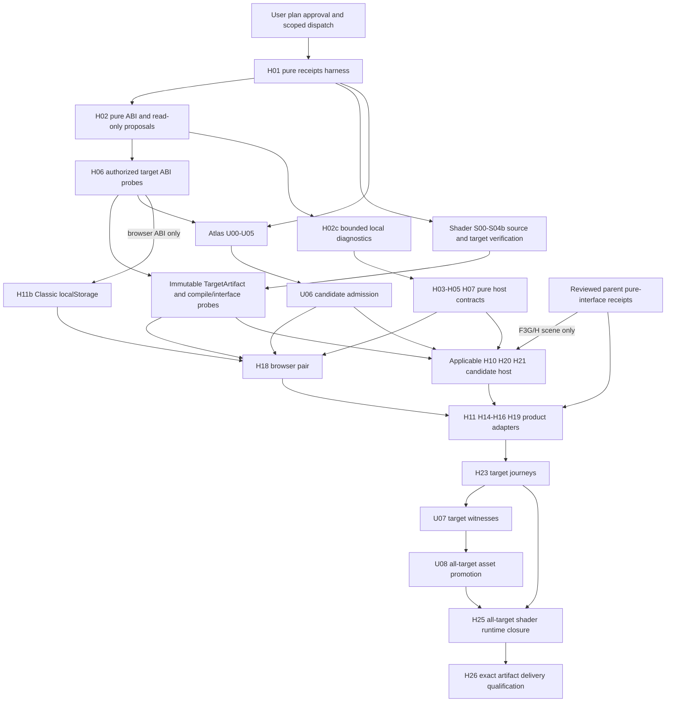

# NYON Zig Platform Bindings Implementation Plan

> **For agentic workers:** REQUIRED SUB-SKILL: Use superpowers:subagent-driven-development (recommended) or superpowers:executing-plans to implement this plan task-by-task. Steps use checkbox (`- [ ]`) syntax for tracking.

**Goal:** Deliver the complete native/browser game through bounded Zig hosts, durable adapters and independently qualified exact artifacts.

**Architecture:** Pure game authority remains in the reviewed Zig domain modules; small typed platform adapters supply windows, GPU, text, accessibility, audio and durable I/O. Shared bounded scheduling and immutable qualification receipts connect the independent shader/atlas plans to each available host without a release-admission cycle.

**Tech Stack:** Pinned Zig/std; AppKit/Metal, Win32/DX12, X11/XWayland Vulkan/GL, Wasm WebGPU/WebGL2; minimal approved C/Objective-C/COM/JS platform calls.

**Spec:** [Approved NYON Zig platform binding design](../specs/2026-10-09-nyon-zig-platform-bindings-design.md). Read it with this plan. Exact user-approved bytes are `.superpowers/sdd/2026-10-09-nyon-zig-migration/task-6-user-approved-platform-spec.md`, SHA-256 `1d3257c31e7383118e46a78e6550e83752b4f6d2cf2fb74fc6d79b1af0c04d04`; durable spec approval metadata does not change its architecture.

**Status:** Proposed execution plan; user plan review/approval pending. Donald approved the written platform spec on 2026-10-09 at 06:52 EDT; that approval authorized detailed planning only. Existing SDD execution method is preserved, not newly dispatched by this file.

## Global Constraints

- Exact compiler: `0.18.0-dev.120+9fe22a29b`; no pin changes, new branches/work trees, commits, pushes, installs, downloads, new dependencies, source retirement, real-profile use or asset replacement without their separately required authorization.
- All retained project-owned generation/build/test-driver/corpus/validation/package logic is Zig. Temporary Rust game oracles and Python/shell migration checks remain until independently qualified replacements; no final Rust/Python/shell implementation exception.
- Foreign C/Objective-C/COM/JS code only performs approved platform calls. OS/SDK compilers, drivers and raster APIs are declared external boundaries, not permission to add a foreign project tool.
- 6A1 collects read-only existing versions/headers/licenses/protocol evidence and missing-prerequisite proposals. Only separately authorized 6A2 acquires/links/probes. A receipt records authorization; it never grants it.
- Candidate admission → authorized available-target qualification → target witnesses → all-target release promotion. Ordinary release loading/packaging rejects qualification candidates. Current assets remain intact; changed asset versions require separate approval.
- Every task below is future work. No listed command has been run by this planning dispatch. Do not report an unavailable compiler/device or skipped target as a pass.
- Run all future commands below from `/Users/donaldfilimon/dev/active/NYON/zig` unless an absolute repository-root command is shown. The build steps/options below are introduced by main task H01; they are not claimed available today.
- Each code task starts with type-correct inert scaffolding and tests. Compile-only must exit 0 before the behavioral RED run. A compiler/import error is never the intended RED. End with a frozen diff/receipt and fresh review checkpoint instead of a commit.

## Review Focus

1. A callback arriving after session/device replacement must release once without mutating authority; H02/H03/H18 own `stale_completion_once`, `no_session_retirement`, `memory_growth_stale_view`.
2. A store operation can commit while cancellation or Continue selection loses its race; H12/H13/H14 own `commit_wins_cancel`, `transaction_complete_only`, `target_win_selection_fail`.
3. Mixed tiny budgets and immediate completions must preserve three distinct scheduler invariants; H03/H16 own `shared_remainder`, `pending_cap20`, `publication_cap20` and private publication.
4. Malformed numeric input and text composition during resize must preserve draw/hit/focus agreement; H04/H05/H09/H23 own `nan_and_cast_bounds`, `ring_pack_exact`, `ime_resize`, `offscreen_focus`.
5. One passing platform, candidate or warmed cache must never become full release evidence; H01/H23/H25/H26 own `missing_row_pending`, `release_rejects_candidate`, `cold_offline`, `artifact_identity_changed`.

---

## Read first, ownership, and evidence baseline

Read `~/AGENTS.md`, repo `AGENTS.md`, this plan, the approved spec and both linked tooling plans before dispatch. Root retains coordination; exactly one implementer owns a source slice at a time. Preserve other dirty files. All paths below are proposed additions unless marked existing. Tests may create only owned disposable output/profile roots. The current `zig/tools/check.sh` remains the documented migration gate; it includes Python checks and is not the final Zig-only gate. Do not run it as part of planning. Future task commands are introduced by H01, then verified on the pinned std.Build API before claiming they exist.

Parent reports Task3C review approval and a completed full gate of 162 passed / 0 failed. This is an exact historical parent report, not a gate run by this planning writer. H02a still binds accepted source/API before an adapter consumes it; no future signatures or gate results are invented.

Current inspected source interfaces are listed below. Their existence is not a claim that a fresh gate or cross-host test ran during this planning turn. The approved snapshot supplies requirements; a frozen source receipt supplies each future integration's exact API.

## File map

| Files | Responsibility / task owner |
| --- | --- |
| Existing `zig/build.zig`, `zig/src/root.zig`; new `zig/tools/platform/{artifact,requirements,authorization}.zig`, `zig/tests/platform_tests.zig` | H01 common receipt types, owned command/test registration |
| `zig/tools/platform/contracts.zig`, `docs/qualification/platform/{interfaces,proposals}/` | H02a exact source/interface and 6A1 read-only inventory records |
| `zig/host/include/nyon_host.h`, `zig/src/platform/{abi,handles,events,capabilities}.zig`, `zig/tests/host_abi.zig` | H02b stable foreign ABI and generations |
| `zig/src/platform/{jobs,completion,retirement}.zig`, `zig/src/runtime/{host,durable_exit}.zig` | H03 bounded scheduler, terminal cells and retirement |
| `zig/src/render/{formats,layout,commands,resources}.zig` | H04 and H07 numeric/layout/render and GPU ownership |
| `zig/src/ui/{input,text,semantics,layout}.zig`, `zig/src/platform/audio_policy.zig` | H05 pure interaction/geometry/semantics/audio rules |
| `zig/tools/check_host_abi.zig`, `zig/host/{macos,windows}/`, `zig/src/platform/{macos,windows,linux,web}/` | H06 authorized ABI probes; later target owners fill service implementations |
| `zig/src/render/{scene,ui}.zig`, `zig/src/runtime/classic_host.zig` | H10/H11 scene renderer and Classic app adoption |
| `zig/src/platform/web/classic_store.zig`, `web/zig/classic_store.js` | H11b Classic scenario/preferences localStorage, separate from IDB |
| `zig/src/platform/diagnostics.zig`, `zig/src/ui/diagnostics.zig` | H02c bounded/redacted local diagnostics, H05 panel binding |
| `zig/src/platform/store/{protocol,native,web,coordinator,transfer}.zig` | H12–H14 physical durable protocols and handoff |
| `zig/src/runtime/{workshop_host,living_host,v3_host,strategic_host}.zig` | H15/H16/H19 bind accepted pure contracts; no new authority here |
| `web/zig/{host,events,semantics,text,webgpu,webgl2,audio,transfer,store,loader}.js` | H18 minimal web platform calls; Zig owns all policy/state |
| `zig/tools/{build_web,check_platform,package}.zig`, `zig/tools/platform/{journeys,delivery,tool_audit}.zig` | H23–H26 actual qualification, final owned driver/tool closure and packaging |
| `zig/tools/shaders/`, `zig/tools/build_shaders.zig` | [Shader plan](2026-10-09-nyon-zig-shader-tooling.md) S00–S12; no duplicated implementation here |
| `zig/tools/ui_atlas/`, `zig/tools/build_ui_atlas.zig` | [Atlas plan](2026-10-09-nyon-zig-atlas-tooling.md) U00–U09; no duplicated implementation here |
| `docs/qualification/platform/<task>/<identity>.json`; `docs/qualification/platform/manual-matrix.md` | Future frozen task evidence, observers, actual exits and unmet rows; no pass-by-document |

Task-local tests reside in `zig/tests/platform_tests.zig` initially; split into `zig/tests/platform/<task>.zig` when a task owns substantial vectors, with imports registered by H01. Fixtures under `zig/tests/fixtures/platform/<task>/` contain independently reviewed expectations; generated results never overwrite them. No current source/fixture edits are authorized by this plan.

## Shared exact interfaces

The following are proposed project-owned types. H01 is their single definition owner. Later tasks import them rather than redeclare incompatible shapes.

```zig
pub const Allocator = std.mem.Allocator;
pub const Digest = [32]u8;
pub const Target = enum { metal, dx12, vulkan, gl, webgpu, webgl2 };
pub const ManifestKind = enum { qualification_candidate, release };
pub const PayloadKind = enum { asset, shader };
pub const Stage = enum { structural, reproducibility, compile_interface,
    packing, image, compute, ui, layout, scale, accessibility, offline, performance };
pub const CheckStatus = enum { pending, passed, failed, excluded_capability };
pub const Identity = struct {
    payload: Digest, source: Digest, profile: Digest, tool: Digest,
    raster: ?Digest, proposal: ?Digest, target: ?Target, format_version: u32 = 1,
};
pub const Payload = struct { path: []const u8, length: u64, hash: Digest };
pub const Check = struct { requirement: Digest, status: CheckStatus };
// H01 owns these types; shader/host/package modules import this definition.
pub const ShaderStage = enum { vertex, fragment, compute };
pub const ShaderFormat = enum { metallib, dxil, spirv, glsl330, glsl300es, wgsl };
pub const CompilerIdentity = struct {
    executable_or_engine: Digest, version: Digest, flags: Digest,
    sdk: Digest, profile: Digest,
};
pub const ShaderEntryBinding = struct {
    source: Digest, source_entry: []const u8, stage: ShaderStage,
    artifact_entry: []const u8, payload_index: u32,
};
pub const TargetArtifact = struct {
    kind: ManifestKind = .qualification_candidate, id: Digest,
    parent_candidate: Digest, target: Target, format: ShaderFormat,
    compiler: CompilerIdentity, payloads: []const Payload,
    entrypoints: []const ShaderEntryBinding,
};
pub const QualifiedShader = struct {
    artifact: *const TargetArtifact, compile_interface: *const Witness,
};
pub const ShaderSelectionRequest = struct { artifact_id: Digest, target: Target };
pub const ReleaseShaderBinding = struct {
    manifest: *const ReleaseManifest, request: ShaderSelectionRequest,
};
pub const Candidate = struct {
    kind: ManifestKind = .qualification_candidate, payload_kind: PayloadKind,
    id: Digest, identity: Identity, payloads: []const Payload, checks: []const Check,
};
pub const Approval = struct {
    spec: Digest, dispatch: Digest, scope: Digest, asset_version: ?Digest,
};
pub const Requirement = struct {
    id: Digest, target: Target, environment: Digest, stage: Stage, test_spec: Digest,
};
pub const Witness = struct {
    requirement_id: Digest, candidate_id: Digest, asset: ?Digest, shader: ?Digest,
    host: Digest, environment: Digest, fixtures: Digest, evidence: Digest,
    target: Target, stage: Stage, status: CheckStatus, exit_code: i32,
};
pub const ToolRef = struct { path: []const u8, hash: Digest, argv: []const []const u8 };
pub const TargetAuthorization = struct {
    approval: Approval, target: Target, sdk: Digest, abi: Digest, tool: ?ToolRef,
};
pub const ArtifactError = Allocator.Error || error {
    InvalidIdentity, UnapprovedScope, AdmissionFailed, StaleEvidence,
    IncompleteMatrix, WrongManifestKind, SizeLimit, IoFailure, Unavailable,
    MissingArtifact, DuplicateArtifact, WrongTarget, WrongFormat, InvalidEntryMap,
    PayloadOutOfRange,
};
```

`OwnedCandidate{value:Candidate,allocator:Allocator}`, `OwnedWitness{value:Witness,allocator:Allocator}` and `ReleaseManifest{kind:ManifestKind=.release,candidate_id:Digest,closure:Digest,payloads:[]const Payload,shader_artifacts:[]const TargetArtifact,allocator:Allocator}` each own a backing arena and `deinit(*Self) void`; internal arena storage is explicit, no shallow-copy/double-free. Public views borrow their owning arena. Candidate ID is canonical frozen identity/payload bytes, not mutable test state; witnesses are separate immutable documents. Serialized names are version 1 explicit fields and checked lengths, with `qualification-candidate`/ `release` tags. Environment digest resolves to exact OS/browser/GPU/driver/requested-effective backend/scale receipt, not an opaque assertion with no metadata. Approval references already recorded human authorization; no tool can generate permission by creating a JSON object.

H02b/H03 define `Handle{slot:u32,generation:u32}`, `Owner{session:u64,presentation:u64,device:u64,request:u64}`, `Ticket=Handle`, `Status=enum(u32){ok,pending,unsupported,invalid,stale,busy,failed}`, `HostError=Allocator.Error||error{Invalid,Stale,Busy,Unsupported,Exhausted,Cancelled,IoFailure,Unavailable}`.
`Completion{kind:u32,owner:Owner,payload:Handle,status:Status}` owns its payload until extracted/released; borrowed foreign bytes are never a retained payload. H03 `Budget{remaining:u16,used:u16}`, `UpdateCounts{pending:u8,publications:u8}`, `Poll=union(enum){pending:void,ready:Completion,failed:Status}`, `CancelResult=enum{cancelled,commit_pending,committed}`; poll/release preserve the exact Workshop abandon vs Living cancel semantics at their typed adapters.

H04 defines `Extent{width:u32,height:u32}`, `Point{x:f32,y:f32}`, `Rect{x:f32,y:f32,w:f32,h:f32}`, `Scale{dpr:f32,ui:f32}`, `DrawList` owning immutable frame arena with `deinit(*DrawList) void`; `FrameView{draw:*const DrawList,owner:Owner}` borrows until submit finishes. H05 `EditorOwner{session:u64,presentation:u64,draft:u64}` and `NodeId=u64`, `SemanticSnapshot` owning immutable arena, `TextRun` owning shaped glyph/cluster/caret mapping, `Input` tagged normalized input (pointer/keyboard/touch/text/composition/focus/resize), `Action` typed focus/activate/edit/scroll action, `UiState` owning draft/focus state, `UiResult{handled:bool,action:?Action}`; task tests freeze enum payload fields before adapters consume them. No platform emits GameCommand or mutates authority directly.

H01 also owns the receipt-only `Journey{id:[]const u8,requirements:[]const Digest,fixture:Digest}` type, available before H16c; H23 implements its executor.

H07 `Quality=enum{low,high}`, `Gpu` owning device/surface/resource registry, `PreparedFrame` owning retained GPU submission references, `Fence=u64`; `SurfaceConfig{extent:Extent,quality:Quality,owner:Owner}`.
H08+ `Host` borrows the outer HostStorageOwner scheduler and owns its platform services at a stable address; `LoadedManifest=union(enum){candidate:*const Candidate,release:*const ReleaseManifest}`; `ShaderBinding=union(enum){candidate:QualifiedShader,release:ReleaseShaderBinding}`; `HostOptions{runtime:*HostStorageOwner,artifact_root:[]const u8,authorization:*const TargetAuthorization,asset:?LoadedManifest,shader:?ShaderBinding,profile:[]const u8,qualification:bool}` borrows artifact/authorization data only during initialization, which deep-copies required metadata; runtime remains a stable borrow through terminal destruction; Host destruction follows the explicit asynchronous close contract below; ordinary `deinit` is not used as a promise that pending callbacks or I/O have finished. Only inert window/probe shells may omit both bindings; game Ready requires admitted assets plus a ShaderBinding naming exactly one artifact: QualifiedShader in qualification mode, or checked ReleaseShaderBinding in ordinary release mode. Both validate the exact immutable target artifact and its applicable witness/closure. Qualification mode accepts explicit candidates, ordinary mode requires verified release arms. A tag alone never bypasses closure validation. artifact_root is explicit and owned; loaders resolve root/artifact-id/payload-relative-path with confinement checks. Packaging preserves this relative layout under its own shader root, so relocation does not rewrite artifact IDs or descriptors.

### Immutable target shader artifact contract

H01 is the sole owner of the artifact types above and `OwnedTargetArtifact{value:TargetArtifact,allocator:Allocator}`, `CompiledTarget{artifact:OwnedTargetArtifact,compile_interface:OwnedWitness}`, and `LoadedPayload{bytes:[]u8,artifact_id:Digest,target:Target,format:ShaderFormat,payload_index:u32,allocator:Allocator}`; each has `deinit(*Self) void` and an explicit owned backing arena/buffer. All nested paths, names, maps and payload descriptors are copied into that owner. `QualifiedShader` borrows its artifact and witness only during validation/host initialization; the host deep-copies metadata and owns loaded bytes/resources until their fences retire.

The selected transition is **structural Candidate → separate immutable TargetArtifact**, not mutation of the Candidate. S10 freezes emitted MSL/HLSL/SPIR-V/GLSL/original WGSL and source/profile/layout identities. S05/S06 compiler execution produces actual metallib/DXIL bytes; other targets retain their validated SPIR-V/GLSL/WGSL bytes. Every target artifact records parent Candidate ID, exact compiler or validating engine identity/version/flags/SDK/profile, every output path/length/hash, and each source entry/stage → payload index/target entry mapping. The artifact ID hashes canonical frozen fields excluding its own id and witness status; payload descriptor paths are relative to the artifact directory and never contain its own id. Compiler.flags resolves to an immutable receipt of exact argv/options, not an unrecorded hash. Downstream witness status is outside that identity. Invalid/missing/empty output, wrong target/compiler flags or entry mapping prevents publication. Driver-internal executable caches are not distributable payloads and never replace the declared byte identity.

H01 produces `targetArtifactId(artifact:*const TargetArtifact) Digest`, `writeTargetArtifact(a:Allocator,io:std.Io,root:[]const u8,artifact:*const TargetArtifact) ArtifactError!void`, `validateTargetArtifact(io:std.Io,root:[]const u8,parent:*const Candidate,shader:QualifiedShader,auth:*const TargetAuthorization) ArtifactError!void`, and `loadShaderPayload(a:Allocator,io:std.Io,root:[]const u8,binding:ShaderBinding,payload_index:u32) ArtifactError!LoadedPayload`. Validation checks parent/source/profile/target/compiler/map identities and rehashes payloads before loading. The loader validates either a qualified candidate artifact plus matching compile/interface witness, or an explicitly selected release artifact with the same artifact closure; it never compiles, rebuilds or searches a developer cache. Emitted MSL/HLSL cannot satisfy metallib/DXIL loading. Shader witness `candidate_id` names the structural parent and `shader` names TargetArtifact.id.

Compiler output is staged inside the explicitly owned qualification root, then admitted atomically under `<artifact-id>/` with payload paths such as `<target>/library.metallib`; payload descriptors use confined relative paths and require bytes already written with the recorded length/hash. Candidate files remain unchanged. S12 owns `CompiledTarget` until its immutable artifact and witness receipts are persisted; later processes load owned copies. H25 promotes references to these exact TargetArtifacts and H26 packages their exact payload bytes and entry maps, rehashing before and after copying. No compilation at promotion/packaging is allowed. Changed compiler options, map, byte, parent or tool identity creates a new artifact and invalidates affected witnesses; deletion/corruption fails closed.

### Checked release shader selection

H01 owns `ShaderSelectionRequest` and `ReleaseShaderBinding` above and `selectReleaseShader(io:std.Io,root:[]const u8,manifest:*const ReleaseManifest,request:ShaderSelectionRequest) ArtifactError!ReleaseShaderBinding`. The request names the immutable artifact ID and expected target; it never uses array position, a global payload index, current OS or whichever backend appears first. The result borrows the immutable manifest and its owned nested data; it allocates nothing and has no deinit. Its lifetime ends before that ReleaseManifest is deinitialized or replaced. Because the public binding is a data value, every consumer re-runs selection and validates the full release closure before reading payloads; constructing a value by hand cannot bypass admission. Host initialization deep-copies its required release manifest/closure metadata into a Host-owned arena, rebinds the selection to that copy, and validates it before returning. Host recovery/reload uses that retained binding; no pointer into the caller's manifest survives initialization.

Selection resolves and authenticates the immutable release evidence at the explicit root through H01's receipt resolver. It requires release kind, a valid canonical full release closure, and exactly one member whose ID equals request.artifact_id. Duplicate artifact IDs anywhere in shader_artifacts fail DuplicateArtifact, including duplicate identical descriptors. H25's combined shader release contains exactly one artifact for each of the six targets; duplicate target members also fail DuplicateArtifact, while missing required target rows fail IncompleteMatrix. Absence of the requested ID fails MissingArtifact. The selected member's target must equal request.target or fail WrongTarget; its format must match the fixed map metal→metallib, dx12→dxil, vulkan→spirv, gl→glsl330, webgpu→wgsl, webgl2→glsl300es or fail WrongFormat. Recompute each artifact's ID from immutable fields and validate parent/compiler/profile identity against its closure witnesses. Canonical closure hashing sorts the shader membership by Target then artifact ID without modifying child bytes; manifest array order cannot change membership, selection or the closure identity. Atlas-only U08 manifests do not become shader releases and cannot pass this combined closure check. Full closure authentication checks every required target's immutable metadata and qualified evidence, not the local presence of every other target's payload. H25 validates all payloads at release creation; package consumers rehash the selected artifact's payloads and require every backend in their explicit package set. A macOS package may therefore retain the authenticated all-target closure without carrying Windows/Linux payload bytes; missing bytes for its selected artifact still fail closed.

Before selection succeeds, validate every eligible entry map: exact source/stage/source-entry and target-entry identities, unique source-entry/stage mapping, nonempty target-entry names, all twenty render entries present, compute present only on its four eligible targets, and every payload_index less than that member's payloads.len. Reject malformed maps with InvalidEntryMap. No cross-artifact payload index remapping is permitted. `loadShaderPayload` revalidates the selected binding and release evidence/identity closure through H01's existing receipt resolver at root, then checks its caller-supplied local payload_index before any indexing or read; out-of-range returns PayloadOutOfRange with zero bytes read. It loads only root/selected-artifact-id/that-member's-payload-path and rehashes its exact length/bytes. LoadedPayload returns the selected artifact ID, target, format and local index alongside caller-owned bytes. Candidate loads return the same identity fields; emitted source cannot impersonate another target format.

H08/H10/H18/H20/H21 compare the binding's target with the explicitly requested/effective renderer and TargetAuthorization.target before resource creation. They use the selected artifact's entry map to obtain local payload indices. A fallback chooses a new explicit request and revalidates it; changing a global backend variable does not retarget an existing binding. H26 uses the same selection API for each explicit package request and persists those IDs/targets in Package, preserving the complete release closure while copying only the exact payloads required by that package's reviewed backend set. No selected view retags, edits or rebuilds Candidate, TargetArtifact or ReleaseManifest.

### Asynchronous Host close and terminal destruction

The outer application runtime owns `HostStorageOwner{active:?*Host,retiring:?*Host,scheduler:Scheduler,allocator:Allocator}`; at most one active/prospective host and one retiring host are retained. Each `open(a:Allocator,options:HostOptions) HostError!*Host` allocates a stable Host before attaching callbacks and returns ownership to this runtime. The outer owner and its one scheduler stay at stable addresses until both host slots are empty. Active and retiring hosts share the original physical-ticket, byte and visit limits; replacement never allocates a fresh quota pool. No stack Host or callback pointer escapes. Domain session replacement uses H03 retirement inside its existing host; host close applies to window close or backend replacement.

H03/H08 define `CloseReason=enum{window_close,backend_fallback,process_shutdown}`, `CloseTicket=Handle`, `CloseProgress=enum{pending,blocked_on_durability,terminal}`, `beginClose(host:*Host,reason:CloseReason) HostError!CloseTicket`, `pumpClose(host:*Host,ticket:CloseTicket,budget:*Budget) HostError!CloseProgress`, and `destroyClosed(a:Allocator,host:*Host,ticket:CloseTicket) HostError!void`. beginClose detaches new input/submission, invalidates callback publication and starts retirement without freeing Host storage. Repeated calls return the same current ticket; stale tickets fail. The outer native event loop or browser loader continues pumping the retiring host while hidden or replaced, using the same update remainder as other work. It retains callback userdata, scheduler/terminal cells and the Host allocation until all callback detach acknowledgements, bounded cleanup, GPU fences and physical I/O completions have been consumed.

Only terminal permits destroyClosed to release that host's already-drained service allocations and finally the Host allocation; the shared scheduler remains owned by the outer runtime until both host slots are empty; calling it while pending/blocked returns Busy and frees nothing. The outer owner then clears its pointer. A second retiring host is not admitted until that slot drains. Controlled close can remain blocked on durable recovery/user action through H14; forced process termination cannot guarantee asynchronous draining and must never be reported as graceful close. Native `requestClose` delegates to beginClose and stores the ticket; it does not synchronously destroy. H03 tests pending destruction, double close, stale ticket, hidden pumping and exactly-once terminal destruction; H08/H18 test callback storage survival across replacement.

## Current interfaces and parent Task6 prerequisite intake

Preserve existing names/semantics. H02a freezes source SHA and relevant exact declarations; changed source requires re-review, not an assumed compatible contract.

| Accepted source surface | Exact interface consumed |
| --- | --- |
| `classic_app.zig` | `AppCore.init(allocator:Allocator,candidate:*const scenario.ScenarioV1,initial_preferences:preferences.UserPreferencesV1) scenario.AdmissionError!AppCore`; `deinit(*AppCore) void`; `advance(*AppCore,delta_ns:u128) FrameOutcome`; `replaceScenario(*AppCore,*const ScenarioV1) AdmissionError!void`; `restart(*AppCore) AdmissionError!void`; `onSuspend/onResume(*AppCore) void`; `setMode(*AppCore,AppMode) void`; `setSpeed(*AppCore,GameSpeed) SpeedSelection`; `canonicalFingerprint(*const AppCore) u64` |
| Task 3B commands | `primaryTap(*AppCore,?model.WorldId,bool) PickingError!Interaction`; `selectSceneWorld/hoverSceneWorld/cursorHover(*AppCore,?WorldId,hud_consumed:bool) PickingError!Interaction`; `contextualLaunch(*AppCore) DispatchError!Dispatch`; `keyboardAction(*AppCore,CommandAction) DispatchError!Dispatch`; `adjustField(*AppCore,FieldAdjustment) DispatchError!Dispatch`; `rightClick(*AppCore,?WorldId) DispatchError!Dispatch`; `queueGameCommand(*AppCore,GameCommand) app.EnqueueError!Dispatch`; `commandTray(*const AppCore) Tray`; `fieldControl(*const AppCore,FieldAdjustment) FieldControl` |
| Task 2 raw adapter | `RawStore.load(self:RawStore,allocator:Allocator) Allocator.Error!LoadOutcome`; `save(self:RawStore,allocator:Allocator,payload:[]const u8) Allocator.Error!SaveOutcome`; `matchesRecord(self:RawStore,expected:Record) bool`; callbacks use stable `context:*anyopaque`, exact record identity; caller owns outcome/message bytes |
| Task 2 native/profile | `NativeStore.fromProfile(allocator:Allocator,io:std.Io,record:Record,platform:NativePlatform,profile:[]const u8) (Allocator.Error||error{InvalidProfileDirectory})!NativeStore`; `atPath(allocator,io,record,path_bytes) Allocator.Error!NativeStore`; `raw(*NativeStore) RawStore`; `deinit(*NativeStore) void`; `resolveProfileRoot(allocator,platform,value:?[]const u8) (Allocator.Error||error{InvalidProfileDirectory})!?[]u8` |
| Task 2 load/admission | `loadPrimaryOrLegacy(allocator,primary:RawStore,legacy:RawStore) Allocator.Error!LoadOutcome`; `classic_store_load.load(allocator:Allocator,store:RawStore) Allocator.Error!Outcome`; absent/candidate/failure are distinct, outcome deinit owns cleanup; only absent permits legacy read |

Classic clock has max 15 steps/pass, 250,000,000 ns frame cap and speeds 0/1/2/4; Living pace 1/4/20 is separate. Classic accepted commands retain Task 3B wrapping sequence behavior; never-reused host generation counters do not silently change authority sequence semantics. Invalid game play previews may enqueue and reject at the canonical tick; invalid resident picking IDs reject before interaction mutation. Keyboard launch uses hover, contextual launch may use touch fallback. Existing FrameOutcome inline summaries cannot escape by borrowed pointer.

| Frozen prerequisite receipt (produced by owning parent task) | Required before |
| --- | --- |
| F3C–F3F: preferences/presentation/quality/advisory interfaces, exact CPU score formula/tolerance and cancellation | H11/H22 and shader S11 compute comparison; not a prerequisite for shader lexer or SDK probes |
| F3G/H: immutable Classic scene/UI frame, buffer/atlas interfaces and ownership | H10/H11; no final 3J graphics pass required beforehand |
| F3I: controller/runtime effects, shared budget and retained private presentation | H03 integration/H11; pure fake-seam H03 tests may precede |
| F4A–H: Workshop catalog/history/pack codec/coordinator/store typed plans and public request semantics | H12 Workshop branch/H14/H15; F4 player Forge acceptance follows its host |
| F5A–K (+5L corpus if selected): V2 canonical domain, wire/notebook/requests/runtime budget/retirement/creator/presentation | H12 Living branch/H16; final graphics acceptance is a consumer |
| F7: separately approved V3 and strategic architecture/schema/corpus/runtime/public UI contracts | H19; no guessed schema strings, casts or V2 overwrite; Genesis/strategic products stay required |
| Target H06 + shader compile/interface receipt + U06 asset candidate | Only matching target qualification host H10/H18/H20/H21; no asset-release prerequisite |
| Integrated 3J/4 player Forge/5 adoption/7 product evidence | H23–H26 final qualification, after the hosts that produce it exist |

H02a creates one `FrozenInterfaceSet` receipt per prerequisite containing owner task, source hashes, exact exported types/signatures/error enums, allocation/lifetime, domain schema/hash IDs, budget/cancel/publication contract and reviewed test commands/results. Unknown future signatures are intentionally not represented as passing or invented declarations. Before each affected adapter task dispatch, its executor copies the accepted declarations into a narrow plan-interface annex and validates the adapter compile-only against those real imports. If they cannot satisfy the host contract, stop that adapter for reviewed interface reconciliation; unrelated tooling/available hosts continue. This is a dispatch prerequisite, not permission to fabricate a generic bytes facade or recode pure authority.

## 6A1 versus 6A2

H02a read-only inventory records installed macOS SDK symbols/minimum-OS availability, Windows SDK/DXC/COM metadata, Ubuntu packages/headers/pkg-config/SONAME/transitive dependencies/notices for X11/XI2/XIM/GLX/Vulkan/AT-SPI/D-Bus/Pango-Cairo/portal/PulseAudio-ALSA, and browser engines. Never run package acquisition or product compile/link in 6A1. Record concrete missing version/package/license proposals and unavailable host access. Proposed floors remain macOS14 arm64 (requires actual floor audit/run), Windows 11 x86_64, Ubuntu 24.04 x86_64; Intel Mac separate decision. H06 may use only separately authorized target SDK/library/tool scope, with actual headers/symbol/lifetime/layout probes. A macOS system-framework authorization does not authorize Linux packages, Windows downloads or a changed Zig pin. Missing targets remain pending and cannot block unrelated macOS progress.

## Acyclic dispatch index



H06 and target emitter/probe nodes instantiate per target. Tool CLI tasks S12/U09 depend on module interfaces and drive real probes afterward; actual probe receipts are not prerequisites to building their own driver. H03 pure tests precede runtime integration; integration waits F3I/F5K. H12/H13 storage adapters and H24 owned verification-tool replacements can progress independently after their applicable contracts. No arrow returns from all-target asset release to candidate hosts. Main tasks consume tooling interfaces below; they do not repeat compiler/atlas implementation bodies.

| Tooling output | Main consumers |
| --- | --- |
| S00–S04b verified source and target IR/layout; S10 structural Candidate; S12 immutable TargetArtifact plus QualifiedShader | H07/H10/H18/H20/H21; twenty render entries/six targets, four compute targets remain required |
| S11 independent packing/image/compute Witness | H22/H23/H25; minimal probe may supply sufficient witness without game host |
| U06 `admit(...) ArtifactError!OwnedCandidate` from atlas plan | H10/H18/H20/H21 explicit qualification path/expected IDs only |
| U07 `qualifyTarget(...required,witnesses) ArtifactError!AssetTargetReceipt` | H23 feeds full target UI/image/layout/scale/accessibility receipts |
| U08 `promote(...receipts,required,approval) ArtifactError!ReleaseManifest` | H25/H26 all-target release gate; no asset overwrite authority |

### Task H01: Shared artifact identities and test harness

**Files:** Modify existing `zig/build.zig`; create `zig/tools/platform/artifact.zig`, `zig/tools/platform/requirements.zig`, `zig/tools/platform/authorization.zig`, `zig/tests/platform_tests.zig`.

**Interfaces:** Consumes pinned Zig std.Build and approved spec/snapshot identities. Produces shared exact types above; `candidateId(candidate:*const Candidate) Digest`; `validateCandidate(candidate:*const Candidate,approval:*const Approval) ArtifactError!void`; `requireRelease(kind:ManifestKind) ArtifactError!void`; `checkClosure(required:[]const Requirement,witnesses:[]const Witness) ArtifactError!void`; `writeCandidate(a:Allocator,io:std.Io,root:[]const u8,candidate:*const Candidate) ArtifactError!void`; test-platform/test-shaders/test-atlas build steps with -Dcase and -Dcompile-only.

- [ ] **Step 1 — write the named tests and minimal compiling scaffolds.** `H01 release_rejects_candidate` asserts `expectError(error.WrongManifestKind,requireRelease(candidate.kind))`; `missing_row_pending` removes one of six target rows and expects IncompleteMatrix; `candidate_id_stable` changing Check.status does not change candidate Id but changing payload/source/tool/raster/proposal does. `authorization_is_reference` fabricated/unresolved dispatch fails UnapprovedScope. Test -Dcase with zero matches fails instead of silent pass. `H01 target_artifact_identity` rejects deleted/truncated/swapped metallib or DXIL, wrong compiler/flags, parent mismatch and entry-map corruption; expectError(error.InvalidIdentity,validateTargetArtifact(...)). Snapshot structural Candidate bytes before compilation and assert exact equality afterward. Source MSL/HLSL supplied where compiled binary is required must fail. The bytes returned by loadShaderPayload must hash exactly to the TargetArtifact descriptor. `H01 release_selection_local_zero` constructs one valid all-target closure containing a Vulkan/SPIR-V artifact and a GL/GLSL330 artifact, each with local payload_index 0 and distinct independently fixed bytes. selectReleaseShader with each exact ID/target followed by loadShaderPayload(...,0) must return that artifact's exact bytes/format/ID; reorder shader_artifacts and repeat with unchanged closure/selection results. `release_selection_rejects` expects MissingArtifact for an absent ID, DuplicateArtifact for duplicate ID or target (including identical duplicate), WrongTarget for GL ID requested as Vulkan, WrongFormat for wrong target-format pair, InvalidEntryMap for missing/duplicate/wrong-stage/out-of-range map entries, and PayloadOutOfRange for a caller index equal to payloads.len. Negative cases perform zero payload reads. `release_selection_borrow` uses independent manifest/receipt fixtures and fake I/O to check that selection borrows its manifest, performs no ownership transfer and returns caller-owned LoadedPayload bytes; keep the manifest alive until all binding uses end. H01 unit tests do not instantiate Host or run H25/H26. Actual Host deep-copy/rebinding lifetime tests belong to the target-host steps below.
- [ ] **Step 2 — establish compilation.** Run `zig build test-platform -Dcase=H01 -Dcompile-only=true`. Expected: exit 0; no tests executed. Fix interface/import errors before RED.
- [ ] **Step 3 — observe behavioral RED.** Run `zig build test-platform -Dcase=H01`. Expected: nonzero with test `H01` failing a qualification candidate passes ordinary release admission or Vulkan's local payload 0 loads GL's bytes through the release arm; a compile failure or skipped case is not evidence.
- [ ] **Step 4 — implement the smallest owned change.** Implement explicit version 1 bounded canonical receipt serialization and immutable evidence closure. Register task-filtered suites using current pinned Build API; compile-only builds tests without running, normal runs print exact count and fail zero matches. Fold future command registrations into their owning tasks; no global build refactor. Ownership tests exhaust allocations. `candidate_write_confined` asserts explicit owned output roots, no traversal/symlink escape or overwrite of a different immutable candidate; publish complete validated bytes by temporary-file placement, never a partial manifest. Implement the H01 TargetArtifact ownership/writer/validator/loader interfaces in the shared artifact module. ReleaseManifest owns deep copies of nested shader_artifacts and their entry maps; no dangling borrowed compiler result survives its deinit. Implement selectReleaseShader and revalidation at every load; canonical membership sorting never rewrites child artifacts. Selection has no ambient OS/backend input.
- [ ] **Step 5 — verify GREEN and safety mode.** Run `zig build test-platform -Dcase=H01`, then `zig build test-platform -Dcase=H01 -Doptimize=ReleaseSafe`. Expected: both exit 0, every named case executed, no leaks; all named cases pass; `zig build test-platform -Dcase=NO_SUCH_CASE` intentionally exits nonzero with zero-match diagnostic. That negative driver test is not a product regression.
- [ ] **Step 6 — review checkpoint.** Freeze only this task's diff and exact command/exit/test-count/source/fixture/tool identities in its owned receipt; independently review specification and code quality before dependent dispatch. No commit or publication is part of this task.

### Task H02a: Frozen interfaces and read-only prerequisite proposals

**Files:** Create `zig/tools/platform/contracts.zig`; future receipts under `docs/qualification/platform/interfaces/` and `docs/qualification/platform/proposals/`; tests in platform suite.

**Interfaces:** Consumes current source declarations above and each future owning-task FrozenInterfaceSet; H01 identities. Produces `FrozenInterfaceSet{owner_task:[]const u8,source:Digest,signatures:Digest,ownership:Digest,schema:?Digest,evidence:Digest}`; `verifyInterface(frozen:*const FrozenInterfaceSet,actual_source:Digest) ArtifactError!void`; `Proposal{target:Target,installed:[]const ToolRef,missing:[]const []const u8,licenses:Digest,closure:Digest}`.

- [ ] **Step 1 — write the named tests and minimal compiling scaffolds.** `H02a source_changed` asserts `expectError(error.StaleEvidence,verifyInterface(&frozen,mutated))`; known accepted Task 2/3A/3B signatures get compile-time assignment assertions against actual imports. `missing_dependency` retains missing status and asserts acquisition_calls==0; absent F5/F7 cannot be marked accepted. Enumerate stale source and schema mismatches independently.
- [ ] **Step 2 — establish compilation.** Run `zig build test-platform -Dcase=H02a -Dcompile-only=true`. Expected: exit 0; no tests executed. Fix interface/import errors before RED.
- [ ] **Step 3 — observe behavioral RED.** Run `zig build test-platform -Dcase=H02a`. Expected: nonzero with test `H02a` failing a different source hash is accepted as the same interface; a compile failure or skipped case is not evidence.
- [ ] **Step 4 — implement the smallest owned change.** Implement read-only declaration/receipt matching and collect exact installed metadata without builds/downloads. Create explicit proposal per target with local availability/version/license/transitive closure and missing resources. Before each domain adapter dispatch freeze the real signatures into its annex and assign source ownership; no fallback invented API.
- [ ] **Step 5 — verify GREEN and safety mode.** Run `zig build test-platform -Dcase=H02a`, then `zig build test-platform -Dcase=H02a -Doptimize=ReleaseSafe`. Expected: both exit 0, every named case executed, no leaks; type assertions match current declarations; every future prerequisite is pending until its owner supplies actual review/evidence; proposal tool cannot install/link.
- [ ] **Step 6 — review checkpoint.** Freeze only this task's diff and exact command/exit/test-count/source/fixture/tool identities in its owned receipt; independently review specification and code quality before dependent dispatch. No commit or publication is part of this task.

### Task H02b: Stable ABI, generation handles and completion ownership

**Files:** Create `zig/host/include/nyon_host.h`, `zig/src/platform/abi.zig`, `handles.zig`, `events.zig`, `capabilities.zig`, `zig/tests/host_abi.zig`.

**Interfaces:** Consumes H01 source/authorization receipts and proposed Handle/Owner/Status. Produces `Registry.allocate(self:*Registry,owner:Owner) HostError!Handle`; `Registry.validate(self:*Registry,handle:Handle,owner:Owner) HostError!void`; `Registry.release(self:*Registry,handle:Handle) HostError!void`; C `uint32_t nyon_host_submit(NyonHandle host,const void *request,uint32_t request_bytes)`, `uint32_t nyon_host_poll(NyonHandle host,NyonCompletion *out)`, `uint32_t nyon_host_release(NyonHandle host,NyonHandle payload)`.

- [ ] **Step 1 — write the named tests and minimal compiling scaffolds.** `H02b stale_completion_once` asserts stale owner changes authority 0 and payload released 1; second release reports stale. `generation_exhaustion` max generation rejects allocation, never wraps. `abi_layout` uses compile-time size/align/offset assertions for explicit uint 32/uint 64/padding and copied bytes; validate abi_version/struct_bytes before access. Pointer/slice/error union/bool never cross C ABI.
- [ ] **Step 2 — establish compilation.** Run `zig build test-platform -Dcase=H02b -Dcompile-only=true`. Expected: exit 0; no tests executed. Fix interface/import errors before RED.
- [ ] **Step 3 — observe behavioral RED.** Run `zig build test-platform -Dcase=H02b`. Expected: nonzero with test `H02b` failing a reused slot accepts an old generation; a compile failure or skipped case is not evidence.
- [ ] **Step 4 — implement the smallest owned change.** Separate session/presentation/device/request counters with checked increments, explicit Handle slot/generation, Nyon Owner fouru 64, borrowed bytes ptr+lenu 32 and explicit padding. Completion C header has abi_version/struct_bytes/kind/flags/owner/payload. Every callback copies/enqueues only; retain callback userdata until detach+in-flight acknowledgement. UI thread destroys platform handles only after safe retirement.
- [ ] **Step 5 — verify GREEN and safety mode.** Run `zig build test-platform -Dcase=H02b`, then `zig build test-platform -Dcase=H02b -Doptimize=ReleaseSafe`. Expected: both exit 0, every named case executed, no leaks; all size/offset assertions and stale/double-release/exhaustion vectors pass in pure Zig; actual C/SDK matching remains H06.
- [ ] **Step 6 — review checkpoint.** Freeze only this task's diff and exact command/exit/test-count/source/fixture/tool identities in its owned receipt; independently review specification and code quality before dependent dispatch. No commit or publication is part of this task.

### Runtime diagnostic schema and bounds

H02c also defines `DiagnosticPanel{status:DiagnosticError,alerts:u8,actions:[4]DiagnosticAction,action_count:u8}` and `DiagnosticAction=enum{relist,recover,settings,dump}`; unused array entries are not exposed. H02c owns `DiagnosticRecord`: schema_version:u16=1, domain:`DiagnosticDomain` (platform/classic/workshop/living_v2/v3/strategic), operation:`OperationClass` (startup/render/load/save/import/export/selection/close/input/text/audio/retirement), request_id:u64 (anonymous runtime ID), owner_epoch:u64, device_epoch:u64, backend:?Target, phase:`DiagnosticPhase` (waiting/executing/validating/committing/retiring/complete), elapsed_ns:u64, bytes:u64, error_code:`DiagnosticError` (none/denied/full/corrupt/missing_catalog/clipboard_denied/portal_missing/renderer_unavailable/stale/cancelled/timeout/invalid/invariant/unknown), generation_conflict:bool, disposition:`DurableDisposition` (not_applicable/committed/unknown/aborted). These are internal Zig types; no raw pointer, arbitrary text or user-supplied identifier field exists. Request/epoch IDs are local and anonymous; no user/catalog/slot names or precise paths are recorded.

`DiagnosticRing` owns at most 1024 records, each encoded ≤128 bytes (compile-time storage-size assertion plus encoder bound), 64 fixed saturating counters and eight fixed 256-sample timing reservoirs. No unbounded labels/maps. Overwrite oldest ordinary record on overflow and increment dropped_records; four invariant alert bits latch independently until acknowledged. No automatic file logging or dump. `DiagnosticSnapshot` is caller-owned bounded copied storage; no live mutable session references. `DumpConsent=enum{denied,explicit_local_user_action}`; dumps require a current explicit local action, contain only the same safe schema/counters and stop with a bounded truncation marker before 262144 bytes. The returned slice belongs to the caller. The picker destination is never serialized into the dump. No telemetry, network service, credentials or external messages.

`CounterId` is a closed enum covering queue/ticket/byte high-water marks, shared units consumed, waiting/executing work, frame/input p50/p95, authority p95, callback duration, GPU acquire/present/fence age, stale drops, High demotions, compute fallback, store commit/abort/CAS, recovery choice, durable-close age, text-cache bytes, live-object count and dropped diagnostics. Timing reservoirs have fixed categories and record actual timing separately from qualification receipts; percentiles use H22b's independently checked arithmetic. High-water/max and recovery-choice updates use `observe(self:*DiagnosticRing,id:CounterId,value:u64) void`; counters use saturating addition. H03/H07/H12/H13/close pumps emit these values; H05 owns rendering the H02c panel and action routing. Runtime diagnostics never import game payload serializers.

### Task H02c: Bounded local diagnostics and privacy

**Files:** Create `zig/src/platform/diagnostics.zig`, `zig/src/ui/diagnostics.zig`, `zig/tests/platform/H02c.zig`. H05 binds the local panel to shared semantics/layout; no service, transport or telemetry module.

**Interfaces:** Consumes H02b anonymous Owner/request epochs; current StoreFailure only through the redaction adapter; H01 artifact IDs stay in separate qualification receipts. Produces `record(self:*DiagnosticRing,item:DiagnosticRecord) void`; `count(self:*DiagnosticRing,id:CounterId,delta:u64) void`; `redactStoreFailure(failure:*const classic_store.StoreFailure) DiagnosticError`; `snapshot(self:*const DiagnosticRing,out:*DiagnosticSnapshot) void`; `dump(a:Allocator,snapshot:*const DiagnosticSnapshot,consent:DumpConsent) HostError![]u8`; `panel(snapshot:*const DiagnosticSnapshot) DiagnosticPanel` containing static message/action IDs, no user text.

- [ ] **Step 1 — write tests and minimal compiling scaffolds.** `H02c sensitive_marker_redaction` injects distinct raw save/name/clipboard/notebook/personal-path markers in every platform error/message field and asserts none appears in records, panel text or opt-in dumps; unknown OS exception text becomes fixed `unknown`. `bounded_overflow` records 1025 entries and verifies 1024 retained, dropped counter incremented, bounded memory, latched invariant alert survives overflow. `durability_disposition` preserves committed/unknown/aborted exactly; no error string turns unknown into cancelled. `local_alert_preserves_authority` injects CPU/GPU mismatch, double extraction, impossible owner transition and result-after-release: alert latched, fingerprint unchanged, mutation retries zero until explicit reread/recovery action. `dump_requires_consent` denies default export and caps output at 262144 bytes.
- [ ] **Step 2 — establish compilation.** Run `zig build test-platform -Dcase=H02c -Dcompile-only=true`. Expected: exit 0; no tests executed. Fix interface/import errors before RED.
- [ ] **Step 3 — observe behavioral RED.** Run `zig build test-platform -Dcase=H02c`. Expected: nonzero with `H02c` failing a raw path/clipboard marker reaches a dump or overflow loses an invariant alert; a compile failure or skipped case is not evidence.
- [ ] **Step 4 — implement the smallest owned change.** Use fixed enums/numeric fields only; schema and bounds above are exhaustive. Adapters map errors at the boundary before recording: do not pass StoreFailure.message, arbitrary @errorName text, save bytes, names, clipboard/notebook content or personal paths to a formatter/logger. Record O(1) into a preallocated ring; worker callbacks enqueue fixed records through bounded existing transport, not allocating log strings. Saturating counters and an invariant bitset remain bounded. Show actionable static status for renderer unavailable, denied/full storage, corrupt recovery, missing catalog, clipboard permission and portal absence. H05's diagnostic panel is local, keyboard/semantic accessible and preserves last valid authority; reread generations before any user-authorized mutation retry.
- [ ] **Step 5 — verify GREEN and safety mode.** Run `zig build test-platform -Dcase=H02c`, then `zig build test-platform -Dcase=H02c -Doptimize=ReleaseSafe`. Expected: both exit 0, all named cases executed, no leaks. all redaction/overflow/disposition assertions pass. H08/H12/H13/H18/H20/H21 route actual errors/counters to this interface; H23 includes local diagnostic UI, opt-in dump redaction and zero outbound telemetry checks for every target.
- [ ] **Step 6 — review checkpoint.** Freeze the scoped diff, source/tool/fixture identities, exact command/exit/count and independent review before dependent dispatch. No commit, acquisition or publication is part of this task.

### Task H03: Three scheduler limits and bounded retirement

**Files:** Create `zig/src/platform/jobs.zig`, `completion.zig`, `retirement.zig`, `zig/src/runtime/host.zig`, `durable_exit.zig`; platform tests.

**Interfaces:** Consumes H02b handles; F3I/F5K exact shared-budget/private-publication interfaces for integration; injected pure seams before those receipts. Produces `Budget.init(limit:u16) HostError!Budget`; `charge(*Budget,visits:u16) bool`; `Scheduler.begin(self:*Scheduler,owner:Owner,payload_bytes:u32) HostError!Ticket`; `update(*Scheduler,budget:*Budget) UpdateCounts`; `poll(*Scheduler,Ticket) HostError!Poll`; `cancel(*Scheduler,Ticket) HostError!CancelResult`; `release(*Scheduler,Ticket) HostError!void`; `retire(*Scheduler,owner:Owner) void`.

- [ ] **Step 1 — write the named tests and minimal compiling scaffolds.** `H03 shared_remainder` asserts total all child visits≤1/64/1024 including failed work, history/cache/cues/retirement and≤256 encoded bytes/visit; 0/1025 return Invalid+0 visits. `pending_cap20`:21st Living request Busy. `publication_cap20`:21 immediate completions with recycled physical ticket still publish 20/update. `no_session_retirement` runs hidden/session gone and asserts eventual drain with bounded updates, no recursive destruction after Ready. `private_publish` fault/cancel publishes neither authority nor presentation; drain retirement before admission. `H03 close_storage_owner` asserts destroyClosed returns Busy with zero frees while callback acknowledgements, I/O or fences remain; double beginClose returns the same ticket, stale close ticket fails, hidden pump reaches terminal, and exactly one terminal destroy frees storage. Shared limits include active and retiring hosts; creating a replacement cannot reset visits, physical permits or byte caps.
- [ ] **Step 2 — establish compilation.** Run `zig build test-platform -Dcase=H03 -Dcompile-only=true`. Expected: exit 0; no tests executed. Fix interface/import errors before RED.
- [ ] **Step 3 — observe behavioral RED.** Run `zig build test-platform -Dcase=H03`. Expected: nonzero with test `H03` failing 21 recycled completions publish in a single update or child work resets the budget; a compile failure or skipped case is not evidence.
- [ ] **Step 4 — implement the smallest owned change.** Keep remaining allowance, pending public Living count, publications-per-update and physical 20 ticket capacity separate. Two I/O workers, one GPU-initialization worker, one audio context; 128MiB transient plus one 32MiB import/lane, terminal cell/ticket, input 512 with critical reserve, GPU 3 frames. One prospective and one retirement work space owned by runtime past Session lifetime. Callbacks never drain or replenish budgets; prepare private presentation then atomic authority+presentation publish; bound failures and driver/OS cleanup in appropriate contexts. Implement beginClose/pumpClose/destroyClosed under the outer HostStorageOwner contract. H02c receives bounded counters and latched invariant alerts; it receives no live payload or arbitrary failure strings.
- [ ] **Step 5 — verify GREEN and safety mode.** Run `zig build test-platform -Dcase=H03`, then `zig build test-platform -Dcase=H03 -Doptimize=ReleaseSafe`. Expected: both exit 0, every named case executed, no leaks; all limits/races and allocator faults pass; integrate frozen domain hooks only after F3I/F5K intake, rerun actual mixed budget corpus then.
- [ ] **Step 6 — review checkpoint.** Freeze only this task's diff and exact command/exit/test-count/source/fixture/tool identities in its owned receipt; independently review specification and code quality before dependent dispatch. No commit or publication is part of this task.

### Task H04: Numeric conversion and shared draw geometry

**Files:** Create `zig/src/render/formats.zig`, `layout.zig`, `commands.zig`, `zig/src/ui/layout.zig`; independent fixtures `zig/tests/fixtures/platform/H04/`.

**Interfaces:** Consumes approved numeric/layout contract; S03c independently validated shader layout when available. Produces `physicalExtent(logical:Point,scale:Scale) HostError!Extent`; `scissor(rect:Rect,extent:Extent,scale:Scale) HostError!RectI`; `RectI{x:u32,y:u32,w:u32,h:u32}`; `packRing(thickness:f32,radius:f32) HostError!u32`; `checkedBytes(count:u64,stride:u32,device_limit:u64) HostError!u64`; `layoutFrame(a:Allocator,viewport:Rect,scale:Scale) HostError!DrawList`.

- [ ] **Step 1 — write the named tests and minimal compiling scaffolds.** `H04 nan_and_cast_bounds` checks finite operation-specific handling, DPR0/NaN/Inf rejects, extent ties round upward, outward floor/ceil scissor end points, then clamp before cast, u32 count overflow/multiplication/device capacity errors. `ring_pack_exact` asserts stride 36 offsets 0/8/24/32 and independently computed `((round(clamp(max(thickness,0)/radius,0,1)*16777215))<<8)|2` bytes for valid radius; exact invalid/sanitization order follows frozen source. Primitive viewport nonfinite→0 and max 0; UI nonpositive/nonfinite emits 0 draws. Draw/hit/clip/semantic rectangles same identity.
- [ ] **Step 2 — establish compilation.** Run `zig build test-platform -Dcase=H04 -Dcompile-only=true`. Expected: exit 0; no tests executed. Fix interface/import errors before RED.
- [ ] **Step 3 — observe behavioral RED.** Run `zig build test-platform -Dcase=H04`. Expected: nonzero with test `H04` failing a half-step ring width or scissor differs from handwritten expected bytes; a compile failure or skipped case is not evidence.
- [ ] **Step 4 — implement the smallest owned change.** Preserve source finite/range/order rules per operation, no blanket cast/clamp. Use checked sizing/device growth arithmetic and explicit little-endian packing; no fused/reassociated math. Keep canonical integer authority entirely out of presentation conversions. Layout once into immutable shared geometry including 44 logical target minimum.
- [ ] **Step 5 — verify GREEN and safety mode.** Run `zig build test-platform -Dcase=H04`, then `zig build test-platform -Dcase=H04 -Doptimize=ReleaseSafe`. Expected: both exit 0, every named case executed, no leaks; independent vectors match Debug/ReleaseSafe; S11 later checks actual shader interpretation, not just same-code packing.
- [ ] **Step 6 — review checkpoint.** Freeze only this task's diff and exact command/exit/test-count/source/fixture/tool identities in its owned receipt; independently review specification and code quality before dependent dispatch. No commit or publication is part of this task.

H04 source-parity cases also cover disc/ring nonfinite radius (ring thickness too), negative radius to zero, line nonfinite endpoints/width/color/derived delta-length-direction, and finite emitted corners/colors. Quad half-size clamping precedes emitted checks; finite colors outside [0,1] are not silently clamped. Ring ratio is zero for radius≤0; only positive admitted radius uses the division above. Test zero/full/negative/over-radius thickness and adjacent representable rounding inputs. Count tests include checked underlay+overlay addition, count×36, next-power-of-two overflow and exact-size fallback within the device limit. Invalid extent events preserve the prior valid configuration; authoritative OS integer extents are retained.

### Task H05: Pure input, text, semantics and audio policies

**Files:** Create `zig/src/ui/input.zig`, `text.zig`, `semantics.zig`, `zig/src/platform/audio_policy.zig`; task fixtures.

**Interfaces:** Consumes H04 shared geometry, H02b Owner; F3/4/5/7 action mappings later. Produces `route(state:*UiState,event:Input) HostError!UiResult`; `publishSemantics(a:Allocator,state:*const UiState,draw:*const DrawList) HostError!SemanticSnapshot`; `validateAction(snapshot:*const SemanticSnapshot,node:NodeId,owner:Owner,action:Action) HostError!void`; `allowCue(policy:*CuePolicy,category:u8,now_ns:u64,owner:Owner) bool`; `CuePolicy` bounded timestamps/levels/mute.

- [ ] **Step 1 — write the named tests and minimal compiling scaffolds.** `H05 offscreen_focus` rejects action on hidden/tombstoned/modal blocked/stale nodes; invalid drafts preserved under resize and composition. `utf_mapping` independent UTF8/UTF16 spans for astral/combining/RTL plus selection/caret; `typing_suppresses_shortcuts` verifies command count 0. `audio_caps` asserts 1/category/sec, total 4/sec, mute/level 0 none; owner change stops all. Pointer/keyboard/touch hit geometry 44 minimum, capture-release on focus loss.
- [ ] **Step 2 — establish compilation.** Run `zig build test-platform -Dcase=H05 -Dcompile-only=true`. Expected: exit 0; no tests executed. Fix interface/import errors before RED.
- [ ] **Step 3 — observe behavioral RED.** Run `zig build test-platform -Dcase=H05`. Expected: nonzero with test `H05` failing a stale accessibility node activates a new owner or typing enqueues a game play shortcut; a compile failure or skipped case is not evidence.
- [ ] **Step 4 — implement the smallest owned change.** Zig owns layout/action/focus/draft/editing/audio policy. Snapshots immutable with stable IDs/tombstones; OS callbacks enqueue typed actions only. Foreign text returns shaped runs/cluster maps, not canonical state. Cache 16 MiB runtime glyphs+1 MiB fixed atlas, bounded eviction; audio callbacks preallocated no allocation/lock. Invalid edits are visible state rather than coerced authority. Bind H02c DiagnosticPanel static IDs and bounded snapshot to the local accessible diagnostic view; explicit dump consent is a normal checked UI action. Do not render raw StoreFailure.message in that diagnostic panel.
- [ ] **Step 5 — verify GREEN and safety mode.** Run `zig build test-platform -Dcase=H05`, then `zig build test-platform -Dcase=H05 -Doptimize=ReleaseSafe`. Expected: both exit 0, every named case executed, no leaks; all pure input/semantic/cue policies pass; actual IME/shaping/screen-reader evidence remains target tasks/H23.
- [ ] **Step 6 — review checkpoint.** Freeze only this task's diff and exact command/exit/test-count/source/fixture/tool identities in its owned receipt; independently review specification and code quality before dependent dispatch. No commit or publication is part of this task.

Draft identity is distinct from session/presentation/device/request identity. Replacing a draft increments its checked `EditorOwner.draft`; changing a mutable value within the same draft does not. H05 `draft_value_vs_replacement` asserts a value edit retains ownership and a replaced draft rejects the old paste/composition callback at publication.

### Task H06a: Authorized macOS ABI and installed tool probes

**Files:** Create `zig/tools/check_host_abi.zig`, minimal `zig/host/macos/nyon_probe.m`; extend host ABI tests.

**Interfaces:** Consumes H02a macOS proposal and separately recorded scoped authorization; H02b C ABI. Produces `probe(a:Allocator,io:std.Io,auth:*const TargetAuthorization) ArtifactError!OwnedWitness` in macOS probe module; versioned TargetAuthorization SDK/ABI receipt.

- [ ] **Step 1 — write the named tests and minimal compiling scaffolds.** `H06a wrong_header_layout` injects wrong size/align and expects AdmissionFailed; `missing_scope` fails before linking. `callback_after_detach` verifies destroy after in-flight acknowledgement only. Check minimum-OS per-symbol availability, source binary compiler identities and no unapproved frameworks.
- [ ] **Step 2 — establish compilation.** Run `zig build test-platform -Dcase=H06a -Dcompile-only=true`. Expected: exit 0; no tests executed. Fix interface/import errors before RED.
- [ ] **Step 3 — observe behavioral RED.** Run `zig build test-platform -Dcase=H06a`. Expected: nonzero with test `H06a` failing a mismatched C/Zig field offset is admitted; a compile failure or skipped case is not evidence.
- [ ] **Step 4 — implement the smallest owned change.** Probe exact installed AppKit/Metal/CoreText/CoreGraphics/audio/file APIs with minimal foreign bodies; audit macOS14 proposed floor. Record actual argv/SDK/compiler/framework identities, compare C and Zig layouts with numeric sentinels. No complete window/game dependency.
- [ ] **Step 5 — verify GREEN and safety mode.** Run `zig build test-platform -Dcase=H06a`, then `zig build test-platform -Dcase=H06a -Doptimize=ReleaseSafe`. Expected: both exit 0, every named case executed, no leaks; unit failures pass; after explicit 6A2 dispatch run `zig build host-probe -- --target metal --authorization ../docs/qualification/platform/macos-auth.json`; exit 0 only actual ABI probe, 2 unavailable. Real floor compatibility remains pending until that OS run.
- [ ] **Step 6 — review checkpoint.** Freeze only this task's diff and exact command/exit/test-count/source/fixture/tool identities in its owned receipt; independently review specification and code quality before dependent dispatch. No commit or publication is part of this task.

### Task H06b: Authorized Windows and Ubuntu ABI probe slices

**Files:** Extend `zig/tools/check_host_abi.zig`; create `zig/host/windows/nyon_probe.cpp`, `zig/tools/platform/probe_windows.zig`, `probe_linux.zig`.

**Interfaces:** Consumes H02a per-target proposal and each separately approved acquisition/linkage scope; H02b ABI. Produces same `probe(a:Allocator,io:std.Io,auth:*const TargetAuthorization) ArtifactError!OwnedWitness` signature per target; target-specific ABI witness, never substituted macOS receipt.

- [ ] **Step 1 — write the named tests and minimal compiling scaffolds.** `H06b com_lifetime` checks addref/release/borrowed pointers; `linux_struct_layout` independent header offsets and eventu 32/u64 packing; `missing_package` returns Unavailable without installer. Rejected dependency scope/link name prevents tool execution. Each platform is a separate dispatch/review checkpoint under this task ID.
- [ ] **Step 2 — establish compilation.** Run `zig build test-platform -Dcase=H06b -Dcompile-only=true`. Expected: exit 0; no tests executed. Fix interface/import errors before RED.
- [ ] **Step 3 — observe behavioral RED.** Run `zig build test-platform -Dcase=H06b`. Expected: nonzero with test `H06b` failing unapproved library or mismatched target layout is accepted; a compile failure or skipped case is not evidence.
- [ ] **Step 4 — implement the smallest owned change.** After target authorization, probe Win32/DXGI/D3D12/DirectWrite/UIA/COM/DXC and Ubuntu X11/XI2/XIM/GLX/Vulkan/AT-SPI/D-Bus/Pango/Cairo/portal/audio/file system symbols. Pin versions, SONAME, closure, notices. Narrow foreign COM shim only platform calls; no C++ game policy. If prerequisite absent leave only that row pending.
- [ ] **Step 5 — verify GREEN and safety mode.** Run `zig build test-platform -Dcase=H06b`, then `zig build test-platform -Dcase=H06b -Doptimize=ReleaseSafe`. Expected: both exit 0, every named case executed, no leaks; pure negative fixtures pass; real `zig build host-probe -- --target dx12 --authorization ../docs/qualification/platform/windows-auth.json`, or vulkan/gl Ubuntu authorization, exits 0 only actual target. Execute separately, no cross compile-as-runtime claim.
- [ ] **Step 6 — review checkpoint.** Freeze only this task's diff and exact command/exit/test-count/source/fixture/tool identities in its owned receipt; independently review specification and code quality before dependent dispatch. No commit or publication is part of this task.

### Task H06c: Authorized browser ABI and memory probes

**Files:** Create `zig/src/platform/web/imports.zig`, `zig/tools/platform/probe_web.zig`; minimal probe HTML/JS under `web/zig/probe/` with all policy in Zig.

**Interfaces:** Consumes H02b ABI; recorded browser qualification dispatch and local candidate output root. Produces `validateSpan(offset:u32,len:u32,memory_len:u64) HostError!void`; `u64Words(value:u64) [2]u32`; browser TargetAuthorization receipt.

- [ ] **Step 1 — write the named tests and minimal compiling scaffolds.** `H06c memory_growth_stale_view` grows memory between events and asserts reacquired view; offset+len overflow rejects before copy, u64 high bits survive. Await retains copied data not Wasm view; maximum chunk 65536. Stale generation queued callback releases payload once; unsupported WebGPU preflight no authority creation.
- [ ] **Step 2 — establish compilation.** Run `zig build test-platform -Dcase=H06c -Dcompile-only=true`. Expected: exit 0; no tests executed. Fix interface/import errors before RED.
- [ ] **Step 3 — observe behavioral RED.** Run `zig build test-platform -Dcase=H06c`. Expected: nonzero with test `H06c` failing a stale typed-array view reads pre-grow storage or loses u64 high bits; a compile failure or skipped case is not evidence.
- [ ] **Step 4 — implement the smallest owned change.** Use checked offsets and fresh view per access; explicit copy before await, 64 KiB chunks, BigInt/two u64. Browser glue only platform call/status mapping. Actual engines record browser/version/features/context teardown; no online harness dependency.
- [ ] **Step 5 — verify GREEN and safety mode.** Run `zig build test-platform -Dcase=H06c`, then `zig build test-platform -Dcase=H06c -Doptimize=ReleaseSafe`. Expected: both exit 0, every named case executed, no leaks; pure memory/codec tests pass; after driver registration `zig build host-probe -- --target webgpu --authorization ../docs/qualification/platform/browser-auth.json` requires actual engine evidence, no Node-model substitute.
- [ ] **Step 6 — review checkpoint.** Freeze only this task's diff and exact command/exit/test-count/source/fixture/tool identities in its owned receipt; independently review specification and code quality before dependent dispatch. No commit or publication is part of this task.

### Task H07: GPU ownership and transactional resource preparation

**Files:** Create `zig/src/render/resources.zig`, `zig/src/platform/gpu.zig`; extend tests.

**Interfaces:** Consumes H02b Owner/H03 retirement, H04 DrawList, shader S03c layout/S10 candidate contract. Produces `prepare(a:Allocator,gpu:*Gpu,config:SurfaceConfig,frame:FrameView) HostError!PreparedFrame`; `submit(gpu:*Gpu,frame:*PreparedFrame) HostError!Fence`; `pollFence(gpu:*Gpu,fence:Fence) Status`; `requestQuality(gpu:*Gpu,quality:Quality) HostError!void`.

- [ ] **Step 1 — write the named tests and minimal compiling scaffolds.** `H07 low_required_high_transactional` injects every High allocation/pipeline failure and asserts effective Low requested High retained and live Low resources valid; mandatory Low fail actionable. `old_device_fence` stale results never publish/destroy before completion; frame 4 busy with 3 inflight. Resize 0/extent limit handled without skip authority tick. Independent resource counts and capacity overflow vectors.
- [ ] **Step 2 — establish compilation.** Run `zig build test-platform -Dcase=H07 -Dcompile-only=true`. Expected: exit 0; no tests executed. Fix interface/import errors before RED.
- [ ] **Step 3 — observe behavioral RED.** Run `zig build test-platform -Dcase=H07`. Expected: nonzero with test `H07` failing High failure destroys a valid Low renderer; a compile failure or skipped case is not evidence.
- [ ] **Step 4 — implement the smallest owned change.** Prepare resources/pipelines privately then commit; Low 1 sample/no Bloom/quarter decorative particles preserves all families, High 4× MSAA/bloom/full. Device/surface generations distinct; proper context/thread destruction after fences. Bounded resource pool, no allocation storm after loss; advisory failure uses CPU fallback on the four eligible backends.
- [ ] **Step 5 — verify GREEN and safety mode.** Run `zig build test-platform -Dcase=H07`, then `zig build test-platform -Dcase=H07 -Doptimize=ReleaseSafe`. Expected: both exit 0, every named case executed, no leaks; all failure injection and lifetime count assertions pass; actual GPU behavior deferred target host/probes.
- [ ] **Step 6 — review checkpoint.** Freeze only this task's diff and exact command/exit/test-count/source/fixture/tool identities in its owned receipt; independently review specification and code quality before dependent dispatch. No commit or publication is part of this task.

### Task H08: macOS window, input and lifecycle shell

**Files:** Create `zig/host/macos/nyon_appkit.m`, `zig/src/platform/macos/entry.zig`, `window.zig`, `input.zig`.

**Interfaces:** Consumes H06a actual ABI authorization, H02b Owner, H03 Scheduler, H05 Input/UiState. Produces `open(a:Allocator,options:HostOptions) HostError!*Host`; `pump(host:*Host) HostError!void`; `requestClose(host:*Host) HostError!void` in macOS entry; AppKit foreign callbacks map into Input.

- [ ] **Step 1 — write the named tests and minimal compiling scaffolds.** `H08 close_during_work` asserts controlled close waits required durable jobs and never blocks UI; forced termination makes no false promise. `suspend_resume` clears Classic frame debt and retains domain jobs under frozen interfaces; wrong owner events discarded. Pointer capture/scroll/key repeat/touch and DPI resize normalized; callback thread assertion catches forbidden mutation. `H08 retained_until_terminal` keeps the allocated Host alive after requestClose, drives pumpClose on hidden event-loop turns and verifies no callback accesses freed storage; pending user recovery does not claim destruction.
- [ ] **Step 2 — establish compilation.** Run `zig build test-platform -Dcase=H08 -Dcompile-only=true`. Expected: exit 0; no tests executed. Fix interface/import errors before RED.
- [ ] **Step 3 — observe behavioral RED.** Run `zig build test-platform -Dcase=H08`. Expected: nonzero with test `H08` failing a close callback synchronously frees pending work or a stale window mutates input; a compile failure or skipped case is not evidence.
- [ ] **Step 4 — implement the smallest owned change.** Keep AppKit main thread window/surface/event loop; borrowed OS event converted immediately to owned normalized input. Render requests and hidden/no-session scheduler passes are explicit. Keep immutable callbacks detached only with acknowledgement. No authority or stores instantiated before correct domain startup readiness. The outer event loop owns HostStorageOwner and retains the closing pointer until terminal, then calls destroyClosed once. requestClose only starts this protocol and stores its ticket.
- [ ] **Step 5 — verify GREEN and safety mode.** Run `zig build test-platform -Dcase=H08`, then `zig build test-platform -Dcase=H08 -Doptimize=ReleaseSafe`. Expected: both exit 0, every named case executed, no leaks; mock event/lifecycle tests pass; authorized minimal native shell run records actual resize/focus/suspend/close events, not full game acceptance.
- [ ] **Step 6 — review checkpoint.** Freeze only this task's diff and exact command/exit/test-count/source/fixture/tool identities in its owned receipt; independently review specification and code quality before dependent dispatch. No commit or publication is part of this task.

### Task H09a: macOS text shaping and accessibility vertical

**Files:** Create `zig/src/platform/macos/text.zig`, `accessibility.zig`; add only necessary calls to `nyon_appkit.m`.

**Interfaces:** Consumes H05 TextRun/SemanticSnapshot/Action and H04 geometry; H06a CoreText/AppKit evidence. Produces `shape(a:Allocator,text:[]const u8,scale:Scale) HostError!TextRun`; `publish(snapshot:*const SemanticSnapshot) HostError!void`; `composition(state:*UiState,event:Input) HostError!UiResult`.

- [ ] **Step 1 — write the named tests and minimal compiling scaffolds.** `H09a ime_resize` checks marked text/caret/selection survive resize/DPI and invalid drafts; independent combining/RTL/astral clusters preserve UTF-8/UTF-16 map. `snapshot_no_ui_lock` accessibility callback reads immutable snapshot and queues action without live UIlock; tombstone denied. Shape-cache eviction releases once under 16MiB.
- [ ] **Step 2 — establish compilation.** Run `zig build test-platform -Dcase=H09a -Dcompile-only=true`. Expected: exit 0; no tests executed. Fix interface/import errors before RED.
- [ ] **Step 3 — observe behavioral RED.** Run `zig build test-platform -Dcase=H09a`. Expected: nonzero with test `H09a` failing composition is committed or discarded merely because the window resized; a compile failure or skipped case is not evidence.
- [ ] **Step 4 — implement the smallest owned change.** Map UTF16 platform ranges into explicit validated UTF8 cluster maps; whole runs and finite advances. Use shared draw/hit/semantic/caret geometry. Platform shapes/rasterizes fallback fonts locally; Zig owns editing/focus/cache. Full VoiceOver tree, modal isolation, stable identifiers and action owner checks.
- [ ] **Step 5 — verify GREEN and safety mode.** Run `zig build test-platform -Dcase=H09a`, then `zig build test-platform -Dcase=H09a -Doptimize=ReleaseSafe`. Expected: both exit 0, every named case executed, no leaks; unit cluster/IME/snapshot tests pass; H23 records actual input-method/VoiceOver pointer+keyboard journeys and fallback-font coverage.
- [ ] **Step 6 — review checkpoint.** Freeze only this task's diff and exact command/exit/test-count/source/fixture/tool identities in its owned receipt; independently review specification and code quality before dependent dispatch. No commit or publication is part of this task.

### Task H09b: macOS clipboard, dialogs and audio vertical

**Files:** Create `zig/src/platform/macos/clipboard.zig`, `dialogs.zig`, `audio.zig`; platform shim additions only.

**Interfaces:** Consumes H03 owner/tickets, H05 audio policy, H14 transfer disposition when available. Produces `requestPaste(host:*Host,owner:Owner) HostError!Ticket`; `chooseFile(host:*Host,owner:Owner) HostError!Ticket`; `setAudio(host:*Host,level:f32,muted:bool) HostError!void`; `stopAudio(host:*Host,owner:Owner) void`.

- [ ] **Step 1 — write the named tests and minimal compiling scaffolds.** `H09b paste_loses_owner` denies late 1MiB+1 clipboard, loss of focus/owner cancel; immutable export handoff follows committed-copy rules. `audio_realtime` allocator/lock counters 0 in render callback; no-device silent typed status, levels finite/clamped as accepted policy, rate 1/category/sec, total 4. Dialog cancel preserves draft/session/source.
- [ ] **Step 2 — establish compilation.** Run `zig build test-platform -Dcase=H09b -Dcompile-only=true`. Expected: exit 0; no tests executed. Fix interface/import errors before RED.
- [ ] **Step 3 — observe behavioral RED.** Run `zig build test-platform -Dcase=H09b`. Expected: nonzero with test `H09b` failing late paste modifies a replaced draft or audio callback allocates; a compile failure or skipped case is not evidence.
- [ ] **Step 4 — implement the smallest owned change.** Perform platform clipboard/dialog/audio calls with typed results; use bounded preallocated procedural cue buffers, one audio context and stop owner change. Synchronous gesture/OS constraints translate into prepared requests and queued completion; no policy in ObjC.
- [ ] **Step 5 — verify GREEN and safety mode.** Run `zig build test-platform -Dcase=H09b`, then `zig build test-platform -Dcase=H09b -Doptimize=ReleaseSafe`. Expected: both exit 0, every named case executed, no leaks; failure/no-device/late-callback tests pass; actual clipboard/dialog/audio/assistive cues remain H23 observed rows.
- [ ] **Step 6 — review checkpoint.** Freeze only this task's diff and exact command/exit/test-count/source/fixture/tool identities in its owned receipt; independently review specification and code quality before dependent dispatch. No commit or publication is part of this task.

### Task H10: macOS complete Low renderer with candidate assets

**Files:** Create `zig/src/platform/macos/metal.zig`, `zig/src/render/scene.zig`, `ui.zig`; task GPU fixtures.

**Interfaces:** Consumes H08/H09 service shell, H07 GPU ownership, F3G/H frozen scene/frame signatures, S12 QualifiedShader containing immutable metallib TargetArtifact and matching compile/interface witness, or explicit H01 ReleaseShaderBinding for ordinary release; U06 asset Candidate; no U08 release prerequisite. Produces `render(host:*Host,frame:FrameView) HostError!Fence`; `recoverSurface(host:*Host,config:SurfaceConfig) HostError!void`; exact host identity receipt for H23.

- [ ] **Step 1 — write the named tests and minimal compiling scaffolds.** `H10 all_render_families` asserts all 20 render entries reachable through 10 pairs:primitive, space, worlds, routes/fleets/halos/particles, panels/text, post process; no Low omission except specified decoration budget. `candidate_before_release` explicit expected IDs allow qualification candidate and ordinary mode rejects it. Resize/device loss preserves canonical fingerprint and pending accepted commands. Missing Win/Linux has no macOS dependency. `H10 exact_shader_payload` corrupts/deletes a compiled payload or substitutes emitted source and expects rejection before pipeline creation; loaded bytes/hash/entry map equal the QualifiedShader TargetArtifact, never a rebuilt or cache-resolved copy. `release_selection_host_lifetime` initializes from an explicit ReleaseShaderBinding, destroys the caller-owned manifest after init, then performs host recovery/reload against the retained deep-copy/rebound selection; no caller pointer survives, wrong effective target rejects before resource creation, and failed copy cleans up once.
- [ ] **Step 2 — establish compilation.** Run `zig build test-platform -Dcase=H10 -Dcompile-only=true`. Expected: exit 0; no tests executed. Fix interface/import errors before RED.
- [ ] **Step 3 — observe behavioral RED.** Run `zig build test-platform -Dcase=H10`. Expected: nonzero with test `H10` failing a candidate is refused pending future all-target promotion or a route/UI family is omitted; a compile failure or skipped case is not evidence.
- [ ] **Step 4 — implement the smallest owned change.** Implement Metal resource upload/encode/swapchain using exact uniform/vertex layouts and shared scene/UI DrawList, Low first. Validate candidate payloads before load and no fallback to committed assets to mask failure. UI-thread encoding/surface work, authorized background creation only. Record real pipeline/layout/sentinel receipts separately from complete product journeys. Consume H01 ShaderBinding through loadShaderPayload: qualification uses QualifiedShader; release uses selectReleaseShader with explicit artifact ID and expected target. Compare the selection with the host's effective backend and TargetAuthorization before resource creation. Metal loads metallib and DX12 loads DXIL, while other targets use their declared exact format. Preserve structural Candidate immutability and retain loaded resource ownership through GPU fences.
- [ ] **Step 5 — verify GREEN and safety mode.** Run `zig build test-platform -Dcase=H10`, then `zig build test-platform -Dcase=H10 -Doptimize=ReleaseSafe`. Expected: both exit 0, every named case executed, no leaks; unit renderer traces pass; authorized macOS qualification binary creates real Low frame with all families and loss/resize checks. FullUI/High/performance retained in later tasks.
- [ ] **Step 6 — review checkpoint.** Freeze only this task's diff and exact command/exit/test-count/source/fixture/tool identities in its owned receipt; independently review specification and code quality before dependent dispatch. No commit or publication is part of this task.

### Task H11: Classic complete controller and host adoption

**Files:** Create `zig/src/runtime/classic_host.zig`; integration tests under `zig/tests/platform/H11.zig`.

**Interfaces:** Consumes actual AppCore/Task 3B/Task 2 signatures above plus F3C–I frozen contract annex; matching host services. Produces `init(a:Allocator,core:*classic_app.AppCore,host:*Host) HostError!ClassicHost`; `handle(self:*ClassicHost,event:Input) HostError!void`; `frame(self:*ClassicHost,delta_ns:u128) HostError!FrameView`; owns no copy of canonical AppCore.

- [ ] **Step 1 — write the named tests and minimal compiling scaffolds.** `H11 frozen_legacy` asserts seven worlds/60Hz/seed 4947573120260902/speed 23/digest 67D96E983D6C9330 and no authority change from camera/audio/quality/preferences; preserve Task 3B queued invalid preview tick rejection and sequence wrap. `primary_precedence` primary invalid/error cannot legacy fallback; readonly legacy no copy on read. Keyboard hover vs contextual touch, HUD consumption, selection/hover/field/launch effects exact. FrameOutcome inline summaries copied before next advance.
- [ ] **Step 2 — establish compilation.** Run `zig build test-platform -Dcase=H11 -Dcompile-only=true`. Expected: exit 0; no tests executed. Fix interface/import errors before RED.
- [ ] **Step 3 — observe behavioral RED.** Run `zig build test-platform -Dcase=H11`. Expected: nonzero with test `H11` failing host input bypasses canonical queue or presentation changes fingerprint; a compile failure or skipped case is not evidence.
- [ ] **Step 4 — implement the smallest owned change.** Adapt accepted Classic controller input/render/effects and existing RawStore with stable owned storage; do not reimplement commands/clock. Integrate every accepted F3 pure presentation/UI/advisory/quality behavior. Maintain empty/invalid/store-error recovery, restart/home/settings and input accessibility. Freeze and run parent 3J integration after host exists.
- [ ] **Step 5 — verify GREEN and safety mode.** Run `zig build test-platform -Dcase=H11`, then `zig build test-platform -Dcase=H11 -Doptimize=ReleaseSafe`. Expected: both exit 0, every named case executed, no leaks; Classic host unit/scenario parity and source fence pass; actual native/browser 3J artifacts produced by H23, not claimed by a synthetic shell.
- [ ] **Step 6 — review checkpoint.** Freeze only this task's diff and exact command/exit/test-count/source/fixture/tool identities in its owned receipt; independently review specification and code quality before dependent dispatch. No commit or publication is part of this task.

**EClassicString intake, before H11b implementation:** Freeze the existing browser binding's DOMString→Rust String behavior for valid scalar pairs, lone high/low surrogates, NUL and multibyte boundary cases using supplied/source evidence and an authorized comparison if needed. Raw DOMString transport exposes exact UTF-16 units and a length through an owned temporary handle; it does not use TextEncoder or normalize/truncate behind Zig's back. Zig applies only the accepted conversion and checks resulting UTF-8 byte length before capped allocation/copy. If the old binding's unpaired-surrogate behavior cannot yet be established, H11b remains blocked at this named intake, with no guessed replacement/error policy. Invalid outgoing UTF-8 is rejected before touching storage. This precise unresolved transport edge does not block unrelated shader/atlas/native work and does not permit a retained Rust runtime or generator.

### Task H11b: Classic browser localStorage adapter

**Files:** Create `zig/src/platform/web/classic_store.zig`, `web/zig/classic_store.js`, `zig/tests/platform/H11b.zig`; register in the existing H01 suite. Do not put these records into IndexedDB.

**Interfaces:** Consumes H06c checked Wasm spans and current `classic_store.Record/RawStore/LoadOutcome/SaveOutcome/StoreFailure`; H02c sanitized diagnostics. Produces `WebClassicStore.init(record:classic_store.Record) WebClassicStore`; `raw(self:*WebClassicStore) classic_store.RawStore`; callbacks `recordCallback(context:*anyopaque) classic_store.Record`, `loadCallback(context:*anyopaque,a:Allocator) Allocator.Error!classic_store.LoadOutcome`, `saveCallback(context:*anyopaque,a:Allocator,payload:[]const u8) Allocator.Error!classic_store.SaveOutcome`; `deinit(self:*WebClassicStore) void` after all RawStore borrows end. Stable context owns record/key identity; operation results use the caller's allocator.

- [ ] **Step 1 — write tests and minimal compiling scaffolds.** `H11b primary_legacy_matrix` uses both records: absent primary reads legacy once; present empty/invalid/oversized primary or primary read error never reads legacy. Assert `legacy_reads==0` on every present/error case and `writes==0` on all reads. `utf8_byte_caps` accepts 65,536 scenario bytes / 16,384 preference bytes and rejects +1, including multibyte text whose UTF-16 code-unit count differs; invalid outgoing UTF-8 fails before setItem. `denied_quota_ownership` covers missing window/storage, denied getItem/setItem, quota and allocation failure: correct record/kind, no leaked temporary JS handle or duplicate free, no change to either slot after rejected writes. `primary_only_save` changes only the NYON key; wrong context record fails existing RawStore matching.
- [ ] **Step 2 — establish compilation.** Run `zig build test-platform -Dcase=H11b -Dcompile-only=true`. Expected: exit 0; no tests executed. Fix interface/import errors before RED.
- [ ] **Step 3 — observe behavioral RED.** Run `zig build test-platform -Dcase=H11b`. Expected: nonzero with `H11b` failing a primary error falls back to legacy or one over-cap multibyte value is saved; a compile failure or skipped case is not evidence.
- [ ] **Step 4 — implement the smallest owned change.** Keep policy/keys/caps/precedence in Zig. Scenario keys are `nyon.scenario.v1` and read-only `intergalactic-warfare.scenario.v1`; preferences keys are `nyon.preferences.v1` and read-only `intergalactic-warfare.preferences.v1`. Minimal JS obtains localStorage, performs one requested getItem/setItem and returns a closed status enum plus an owned temporary string handle. Zig drives UTF-8 length/copy through checked spans and frees that handle on every path; reads count converted UTF-8 bytes before allocating a capped result. WebIDL string conversion follows the current browser binding semantics; pin a lone-surrogate input vector explicitly against the existing Rust/WebIDL behavior rather than silently adopting TextEncoder replacement. Outgoing bytes must be valid UTF-8. Keep the synchronous RawStore contract: no Promise or retained borrowed Wasm view. Primary absent alone selects legacy through existing Task2 policy; do not copy on read, mark imports or write legacy. Oversize maps `.oversized_slot` with exact max_bytes; unavailable/denied/quota/encoding failures map `.browser` with fixed sanitized reason text; OutOfMemory remains Allocator.Error, not stored-data failure. Caller owns payload/message bytes and releases with existing outcome deinit.
- [ ] **Step 5 — verify GREEN and safety mode.** Run `zig build test-platform -Dcase=H11b`, then `zig build test-platform -Dcase=H11b -Doptimize=ReleaseSafe`. Expected: both exit 0, all named cases executed, no leaks. unit cases pass. H18a/H23 additionally execute actual Safari/Chrome/Edge/Firefox get/set/denied/quota/primary-precedence and fresh-page reopen tests in an owned disposable origin/profile; reopen both scenario and preferences and independently inspect that no legacy or primary copy-on-read mutation occurred. Mock localStorage is not real-browser persistence proof.
- [ ] **Step 6 — review checkpoint.** Freeze the scoped diff, source/tool/fixture identities, exact command/exit/count and independent review before dependent dispatch. No commit, acquisition or publication is part of this task.

### Task H12a: Typed store requests and native durability engine

**Files:** Create `zig/src/platform/store/protocol.zig`, `native.zig`; injected file system/crash fixtures under H12a.

**Interfaces:** Consumes F4/F5 typed immutable operation plans/error/outcome/abandon-cancel contracts, H03 bounded workers, Task 2 Classic unchanged. Produces `NativeIo.begin(self:*NativeIo,owner:Owner,plan:NativePlan) HostError!Ticket`; `poll(*NativeIo,Ticket) HostError!Poll`; `cancel(*NativeIo,Ticket) HostError!CancelResult`; `release(*NativeIo,Ticket) HostError!void`; `NativePlan` exact tagged Workshop/Living/coordinator plans frozen from F4/F5, not generic JSON save.

- [ ] **Step 1 — write the named tests and minimal compiling scaffolds.** `H12a commit_wins_cancel` enumerates before lock/stage/flush/place/head sync/after commit cut points and expects Cancelled only before durable win; ambiguous post-placement failure reports recovery required. Two writers same generation exactly one CAS winner; lock covers reread+placement. Independent actual disk readback vs mocked call order; no live Session pointers on worker, input responsive under saturated 2 workers. Allocation fail frees one owned plan.
- [ ] **Step 2 — establish compilation.** Run `zig build test-platform -Dcase=H12a -Dcompile-only=true`. Expected: exit 0; no tests executed. Fix interface/import errors before RED.
- [ ] **Step 3 — observe behavioral RED.** Run `zig build test-platform -Dcase=H12a`. Expected: nonzero with test `H12a` failing post-placement cancellation reports no durable mutation; a compile failure or skipped case is not evidence.
- [ ] **Step 4 — implement the smallest owned change.** Keep per-domain native recovery protocols, immutable encoded payload paths and expected generations; lock, reread CAS, bounded staging, file flush, same-filesystem placement, directory/metadata flush. Use owned non UTF8 profile paths resolved once; at most 2 I/O workers and held physical permits until real completion. One terminal cell/ticket ensures no lost durability outcome. Windows equivalence separately H20c.
- [ ] **Step 5 — verify GREEN and safety mode.** Run `zig build test-platform -Dcase=H12a`, then `zig build test-platform -Dcase=H12a -Doptimize=ReleaseSafe`. Expected: both exit 0, every named case executed, no leaks; fault cut/injected CAS tests pass; authorized actual native crash-cut/disposable profile suite waits matching platform adapter; no POSIX rename claim for Windows.
- [ ] **Step 6 — review checkpoint.** Freeze only this task's diff and exact command/exit/test-count/source/fixture/tool identities in its owned receipt; independently review specification and code quality before dependent dispatch. No commit or publication is part of this task.

### Task H12b: Workshop and Living durability policy adapters

**Files:** Create `zig/src/platform/store/workshop.zig`, `living.zig`; extend protocol tests.

**Interfaces:** Consumes H12a engine plus exact F4A–H/F5A–K domain schemas/catalog generations/hash/reference/plans and public request annex. Produces separate typed `WorkshopStore` and `LivingStore` adapters implementing their frozen Begin/Poll/Abandon or Begin/Poll/Cancel/release declarations verbatim; `validateStoreIdentity(domain:StoreDomain,name:[]const u8,version:u32) HostError!void` where `StoreDomain=enum{classic,workshop,living_v2,coordinator}`.

- [ ] **Step 1 — write the named tests and minimal compiling scaffolds.** `H12b caps` asserts Workshop 16 slots/16 MiB archive/1 MiB pack/64 branches/10000 revisions; Living 64 slots/256 packs/32 MiB archive/2 MiB pack/1 MiB notebook; archive≠free. `abandon_vs_cancel` releasing a public outcome does not release its occupied physical permit; relist after mutations. Authentication of kind, length and hash/replay/notebook failure leaves catalog/session unchanged. Autosave 250 ms debounce/600 ticks/pause-menu and checkpoints 600 ticks/128 revisions excluded canonical exports.
- [ ] **Step 2 — establish compilation.** Run `zig build test-platform -Dcase=H12b -Dcompile-only=true`. Expected: exit 0; no tests executed. Fix interface/import errors before RED.
- [ ] **Step 3 — observe behavioral RED.** Run `zig build test-platform -Dcase=H12b`. Expected: nonzero with test `H12b` failing archiving a slot frees capacity or abandoned I/O reuses a physical permit; a compile failure or skipped case is not evidence.
- [ ] **Step 4 — implement the smallest owned change.** Preserve exact native workshop-v1/living-v2 records and two-generation/head/reclamation policies; never coalesce into one Json adapter. Split public Commit and Load Or Import lanes; retain predecessors/reference-safe GC and domain limits. Large hash/replay/codec work uses actual H03 remaining budget; I/O wait not charged as invented visits. V3 not registered here.
- [ ] **Step 5 — verify GREEN and safety mode.** Run `zig build test-platform -Dcase=H12b`, then `zig build test-platform -Dcase=H12b -Doptimize=ReleaseSafe`. Expected: both exit 0, every named case executed, no leaks; domain models and fault vectors pass; actual disk/IDB protocols still need target tests and independent readback.
- [ ] **Step 6 — review checkpoint.** Freeze only this task's diff and exact command/exit/test-count/source/fixture/tool identities in its owned receipt; independently review specification and code quality before dependent dispatch. No commit or publication is part of this task.

### Task H13: Actual IndexedDB transaction adapters

**Files:** Create `zig/src/platform/store/web.zig`, `web/zig/store.js`; transaction fixtures and browser tests under H13.

**Interfaces:** Consumes H12 typed plans, F4/F5 actual stored value types/keys, H06c spans/ownership. Produces `WebStore.begin(self:*WebStore,owner:Owner,plan:WebPlan) HostError!Ticket`; `poll/cancel/release` exact H12 signature shapes; `WebPlan` bounded immutable typed transaction operations frozen from source protocols, prepared in Zig before transaction.

- [ ] **Step 1 — write the named tests and minimal compiling scaffolds.** `H13 transaction_complete_only` request.success keeps Pending; complete→Committed; abort after request success→Failure. `all_references_cas` mutates any referenced Workshop/Living/head value between read and write and expects Stale without writes. `versionchange` closes old connections; blocked upgrade returns retryable status without deleting the DB; quota/security/eviction/strict durability unsupported explicit. Cancel stays pending until abort/commit wins, no await in live transaction callbacks.
- [ ] **Step 2 — establish compilation.** Run `zig build test-platform -Dcase=H13 -Dcompile-only=true`. Expected: exit 0; no tests executed. Fix interface/import errors before RED.
- [ ] **Step 3 — observe behavioral RED.** Run `zig build test-platform -Dcase=H13`. Expected: nonzero with test `H13` failing individual IDB request success reports durable completion; a compile failure or skipped case is not evidence.
- [ ] **Step 4 — implement the smallest owned change.** Use exact DBs:nyon.workshop.v1 version 1 slots/archives/packs; nyon.living.v2 version 1 living; nyon.library.v1 selection `generation-a`/`generation-b`/`head`. Prepare bytes/validation outside transaction; callbacks only compare frozen expected values and enqueue atomic operations over original stores. JS is minimal IDB/clone boundary with no authority/replay logic. Structured clone cost measured; on termination recover generation.
- [ ] **Step 5 — verify GREEN and safety mode.** Run `zig build test-platform -Dcase=H13`, then `zig build test-platform -Dcase=H13 -Doptimize=ReleaseSafe`. Expected: both exit 0, every named case executed, no leaks; injected callback ordering tests pass; H23 runs same cases in actual Safari/Chrome/Edge/Firefox with restart readback/interruption evidence, never only IndexedDbTransactionModel.
- [ ] **Step 6 — review checkpoint.** Freeze only this task's diff and exact command/exit/test-count/source/fixture/tool identities in its owned receipt; independently review specification and code quality before dependent dispatch. No commit or publication is part of this task.

### Task H14a: Global Continue and durable close coordination

**Files:** Create `zig/src/platform/store/coordinator.zig`, extend `zig/src/runtime/durable_exit.zig`.

**Interfaces:** Consumes H12/H13 exact committed outcomes, F4/F5 coordinator schema and lifecycle restore interface, H03 retirement. Produces `ContinueCoordinator.beginSelect(self:*ContinueCoordinator,owner:Owner,target:AuthenticatedTarget,expected:Generation) HostError!Ticket`; `restore(*ContinueCoordinator,owner:Owner) HostError!Ticket`; `beginDelete(*ContinueCoordinator,target:AuthenticatedTarget) HostError!Ticket`; AuthenticatedTarget/Generation copied verbatim from frozen core annex, not new wire types.

- [ ] **Step 1 — write the named tests and minimal compiling scaffolds.** `H14a target_win_selection_fail` asserts target slot retained, prior coordinator authoritative, error visible; never select newest slot. Corrupt one gen recovers other, both corrupt→Library recovery; missing exact branch never opens different branch. Selected delete clear CAS failure prevents delete; delete after clear failure leaves unselected but present slot. Stale promotion installs 0, new valid request installs 1. Initial V1 migration does not copy Classic legacy on read.
- [ ] **Step 2 — establish compilation.** Run `zig build test-platform -Dcase=H14a -Dcompile-only=true`. Expected: exit 0; no tests executed. Fix interface/import errors before RED.
- [ ] **Step 3 — observe behavioral RED.** Run `zig build test-platform -Dcase=H14a`. Expected: nonzero with test `H14a` failing selection CAS failure silently makes the newly saved target Continue; a compile failure or skipped case is not evidence.
- [ ] **Step 4 — implement the smallest owned change.** Enforce distinct target commit then independent coordinator CAS, record cap 4096 bytes, native library-selection-v1.* and web exact keys. Authenticate exact authority/catalog/slot/branch before incremental restore; commit presentation and authority only owner fresh. Controlled close waits required work with normal UI recovery; browser close/kill never claims an awaited async save.
- [ ] **Step 5 — verify GREEN and safety mode.** Run `zig build test-platform -Dcase=H14a`, then `zig build test-platform -Dcase=H14a -Doptimize=ReleaseSafe`. Expected: both exit 0, every named case executed, no leaks; cross-domain race/recovery tests pass; actual native+browser restart and interrupted coordinator evidence retained H23.
- [ ] **Step 6 — review checkpoint.** Freeze only this task's diff and exact command/exit/test-count/source/fixture/tool identities in its owned receipt; independently review specification and code quality before dependent dispatch. No commit or publication is part of this task.

### Task H14b: Portable transfer and durable handoff truth

**Files:** Create `zig/src/platform/store/transfer.zig`, `web/zig/transfer.js`; H14b fixtures.

**Interfaces:** Consumes H12/H13 authenticated domain wire plans, H03 owner, H09b/target dialogs; exact F4/F5 notebook/catalog checks. Produces `beginImport(host:*Host,owner:Owner,file:OwnedFile) HostError!Ticket`; `beginExport(host:*Host,owner:Owner,plan:ExportPlan) HostError!Ticket`; `Handoff=enum{pending,cancelled,durable_saved,download_started,failed}`; OwnedFile owned bounded bytes/path handle, ExportPlan frozen authentic domain plan.

- [ ] **Step 1 — write the named tests and minimal compiling scaffolds.** `H14b copy_readback` exports, independently reopens in fresh profile, registers exact missing pack, imports new slot and compares next 1000 ticks; wrong catalog/domain/notebook hash reject preserving original/session/draft. Browser clicked download yields DownloadStarted only, native DurableSaved only after flush placement. Cancel/oversize/stale owner does not install. Blob URL is retained through handoff and then released exactly once.
- [ ] **Step 2 — establish compilation.** Run `zig build test-platform -Dcase=H14b -Dcompile-only=true`. Expected: exit 0; no tests executed. Fix interface/import errors before RED.
- [ ] **Step 3 — observe behavioral RED.** Run `zig build test-platform -Dcase=H14b`. Expected: nonzero with test `H14b` failing download click claims disk persistence or imported copy replaces its source slot; a compile failure or skipped case is not evidence.
- [ ] **Step 4 — implement the smallest owned change.** Keep pick/filter extension hints nonauthoritative; parse/authenticate incrementally under shared remaining allowance. Use explicit owned files, bounded chunks, committed-copy handoff and domain routing. No real profiles, no persisted network permission; actual user gesture prepared requests only.
- [ ] **Step 5 — verify GREEN and safety mode.** Run `zig build test-platform -Dcase=H14b`, then `zig build test-platform -Dcase=H14b -Doptimize=ReleaseSafe`. Expected: both exit 0, every named case executed, no leaks; wire/memory/handoff tests pass; H23 operator reselects actual exported artifact for independent readback; simulated click alone is not portable acceptance.
- [ ] **Step 6 — review checkpoint.** Freeze only this task's diff and exact command/exit/test-count/source/fixture/tool identities in its owned receipt; independently review specification and code quality before dependent dispatch. No commit or publication is part of this task.

### Task H15: Workshop player and complete Forge adoption

**Files:** Create `zig/src/runtime/workshop_host.zig`, `zig/src/ui/workshop.zig`; H15 integration fixtures.

**Interfaces:** Consumes F4A–H exact Workshop Session/catalog/history/editor/frame/typed command signatures copied into frozen annex before dispatch; H05 interaction, H12–H14 durable ports. Produces `WorkshopHost.init(a:Allocator,host:*Host,contracts:*const FrozenInterfaceSet) HostError!WorkshopHost`; `handle(*WorkshopHost,Input) HostError!void`; `frame(*WorkshopHost,budget:*Budget) HostError!FrameView` at host boundary; concrete core imports/types from F4 annex, metadata never substitutes for live typed core values.

- [ ] **Step 1 — write the named tests and minimal compiling scaffolds.** `H15 all_14_operations` enumerates all existing Workshop operations from frozen inventory and compares command results/history/receipt identity, not tool count only. `forge18` complete 18 steps includes first/last filtered reveal,>4 branches, edit preview/apply/cancel/invalid/undo/redo/save/reopen and actual Continue. `history_same_tick` exact Undo Redo identity, siblings retained, matching-tick compare, checkpoints excluded export. Pointer and keyboard action maps produce identical canonical commands.
- [ ] **Step 2 — establish compilation.** Run `zig build test-platform -Dcase=H15 -Dcompile-only=true`. Expected: exit 0; no tests executed. Fix interface/import errors before RED.
- [ ] **Step 3 — observe behavioral RED.** Run `zig build test-platform -Dcase=H15`. Expected: nonzero with test `H15` failing a Forge step is unavailable or history navigation loses a sibling; a compile failure or skipped case is not evidence.
- [ ] **Step 4 — implement the smallest owned change.** Bind full accepted pure Workshop editor/player/session, immutable shared geometry inspect or/hierarchy/event/history views and typed command dispatch. Keep autosave/Continue policy in its accepted owner, bounded virtualization with accessible reachability. Do not implement pure Workshop semantics anew. Each operation's fixture/assertions come from independent F4 expectations; final actual product run H23.
- [ ] **Step 5 — verify GREEN and safety mode.** Run `zig build test-platform -Dcase=H15`, then `zig build test-platform -Dcase=H15 -Doptimize=ReleaseSafe`. Expected: both exit 0, every named case executed, no leaks; all 14 operation cases and 18Forge script assertions pass with injected host; independent native/browser actual journeys remain pending.
- [ ] **Step 6 — review checkpoint.** Freeze only this task's diff and exact command/exit/test-count/source/fixture/tool identities in its owned receipt; independently review specification and code quality before dependent dispatch. No commit or publication is part of this task.

### Task H16a: Living runtime update, queue and private publication adoption

**Files:** Create `zig/src/runtime/living_host.zig`; H16a domain integration tests.

**Interfaces:** Consumes F5A–K exact runtime/queue/budget/retirement/private-presentation ports, H03 remaining budget, H12–H14 persistence. Produces `LivingHost.init(a:Allocator,host:*Host,contracts:*const FrozenInterfaceSet) HostError!LivingHost`; `update(*LivingHost,budget:*Budget) HostError!FrameView`; `setPace(*LivingHost,pace:u8) HostError!void`; `step(*LivingHost) HostError!void`; actual core imports from F5 annex.

- [ ] **Step 1 — write the named tests and minimal compiling scaffolds.** `H16a shared_remainder` compares full state/3 receipts/journals/queue/fault identity at 1/64/1024/mixed, insertion orders/render cadences. `pending_cap20` and `publication_cap20` independently exercise 21 accepted/completing jobs. Pace 1/4/20 drops excess prospective debt, Step exactly one boundary; accepted command queue remains. Running tails duplicate/old tick/projection conflict/invalid empty then valid/same boundary parent chain; replay fault publishes neither tick nor revision. Never reuse Living sequence IDs.
- [ ] **Step 2 — establish compilation.** Run `zig build test-platform -Dcase=H16a -Dcompile-only=true`. Expected: exit 0; no tests executed. Fix interface/import errors before RED.
- [ ] **Step 3 — observe behavioral RED.** Run `zig build test-platform -Dcase=H16a`. Expected: nonzero with test `H16a` failing one update resets a nested budget or publishes presentation for an uncommitted tick; a compile failure or skipped case is not evidence.
- [ ] **Step 4 — implement the smallest owned change.** Adapt frozen Task 5 runtime hooks only; ensure authority/presentation private work space publish together, one prospective/one retirement, hidden/no-session drain. Propagate actual remaining allowance through cache/history/compare/cues/restore/retire including failures. UIpace/camera/render never alters canonical tick behavior. Keep accepted queued commands under device/surface fault.
- [ ] **Step 5 — verify GREEN and safety mode.** Run `zig build test-platform -Dcase=H16a`, then `zig build test-platform -Dcase=H16a -Doptimize=ReleaseSafe`. Expected: both exit 0, every named case executed, no leaks; full independent state and receipt equality passes, not digest only; no-session retirement and fault injection complete with in bounded updates.
- [ ] **Step 6 — review checkpoint.** Freeze only this task's diff and exact command/exit/test-count/source/fixture/tool identities in its owned receipt; independently review specification and code quality before dependent dispatch. No commit or publication is part of this task.

### Task H16b: All Living creator tools and complete semantic UI

**Files:** Create `zig/src/ui/living_tools.zig`, `living_views.zig`; extend living_host integration.

**Interfaces:** Consumes F5 creator 46 tool definitions/typed commands/previews/stale/cascade/structural atomic rules and immutable viewports; H05 shared semantic geometry. Produces `buildLivingUi(a:Allocator,view:LivingView,ui:*UiState) HostError!DrawList`; `applyCreator(self:*LivingHost,action:CreatorAction) HostError!void`; Living View/Creator Action are exactF5 types in frozen annex before implementation.

- [ ] **Step 1 — write the named tests and minimal compiling scaffolds.** `H16b all_46_tools` a frozen table maps each named tool to pointer, keyboard, semantic actions and preview/apply/cancel/stale/cascade/provenance/Undo Redo/save-reopen expectations; resource scarcity never charges the creator like an ordinary actor. `hierarchy_reachability` first/last/deepest/filtered/>4 branches and offscreen controls accessible only through valid navigation. `inspectors_truth` world/industry/civ/route/fleet/hazard fields equal actual authority/receipts.
- [ ] **Step 2 — establish compilation.** Run `zig build test-platform -Dcase=H16b -Dcompile-only=true`. Expected: exit 0; no tests executed. Fix interface/import errors before RED.
- [ ] **Step 3 — observe behavioral RED.** Run `zig build test-platform -Dcase=H16b`. Expected: nonzero with test `H16b` failing one creator tool lacks a discoverable semantic action or preview mutation leaks into authority; a compile failure or skipped case is not evidence.
- [ ] **Step 4 — implement the smallest owned change.** Build full tools/search/hierarchy/inspectors/events/history/settings/import/export UI from accepted pure presentation. Conventional text editing/drafts/validation/modal focus share geometry; retained selection and camera fit/focus/pan/zoom/removal recovery no random reframing. No demo-only content or static placeholder inspectors.
- [ ] **Step 5 — verify GREEN and safety mode.** Run `zig build test-platform -Dcase=H16b`, then `zig build test-platform -Dcase=H16b -Doptimize=ReleaseSafe`. Expected: both exit 0, every named case executed, no leaks; every 46 row has executable commands and assertions; H23 actual pointer/keyboard/accessibility journeys remain required.
- [ ] **Step 6 — review checkpoint.** Freeze only this task's diff and exact command/exit/test-count/source/fixture/tool identities in its owned receipt; independently review specification and code quality before dependent dispatch. No commit or publication is part of this task.

### Task H16c: Living content, experiments and complete release journeys

**Files:** Create `zig/tests/platform/H16c.zig`, `zig/tests/fixtures/platform/H16c/journeys.json`; extend product view integration only if needed.

**Interfaces:** Consumes F5 frozen production templates/ValeConfluence/7 experiment notebooks/18 release journey, H16a/b and durable adapters. Produces `livingJourneys() []const Journey` using H01 `Journey`; actual typed domain assertions remain F5 tests.

- [ ] **Step 1 — write the named tests and minimal compiling scaffolds.** `H16c seven_experiments` authentic outcomes/notebooks match independent expectations with creator versus actor provenance. FirstExpansion 361 and release 411 tick witnesses; all 18 release steps, zero/one/many civilizations/remove-restore final continue without terminal victory. Receipts prove actual recipes/costs/storage/freight/scarcity, recovery/autonomous construction/scouting/settlement, bilateral agreement expiry/Commerce, combat, retreat, occupation, claims and dormancy/FrontierFriction.
- [ ] **Step 2 — establish compilation.** Run `zig build test-platform -Dcase=H16c -Dcompile-only=true`. Expected: exit 0; no tests executed. Fix interface/import errors before RED.
- [ ] **Step 3 — observe behavioral RED.** Run `zig build test-platform -Dcase=H16c`. Expected: nonzero with test `H16c` failing a displayed explanation names an event without an authentic receipt or one experiment has no real outcome; a compile failure or skipped case is not evidence.
- [ ] **Step 4 — implement the smallest owned change.** Connect full production content and notebook/evidence views to accepted Task 5 domain. Freeze exact journey commands and expected values from reviewed fixtures independently of adapter results. No script-generated success narrative. Bind long-running domain proof to actual host artifact atH23 rather than replacing it with a unit digest.
- [ ] **Step 5 — verify GREEN and safety mode.** Run `zig build test-platform -Dcase=H16c`, then `zig build test-platform -Dcase=H16c -Doptimize=ReleaseSafe`. Expected: both exit 0, every named case executed, no leaks; all 7 experiment/18 journey/zero-civilization cases pass in integration; actual platform receipts still required.
- [ ] **Step 6 — review checkpoint.** Freeze only this task's diff and exact command/exit/test-count/source/fixture/tool identities in its owned receipt; independently review specification and code quality before dependent dispatch. No commit or publication is part of this task.

### Task H17: Shared service contract qualification across adapters

**Files:** Create `zig/tests/platform/H17.zig`, independent service vectors in H17; extend H05 only for discovered contract omissions.

**Interfaces:** Consumes H05 text/semantics/audio/input contracts and matching target service implementations. Produces `serviceRequirements(target:Target) []const Requirement`; `checkServiceWitnesses(required:[]const Requirement,actual:[]const Witness) ArtifactError!void`.

- [ ] **Step 1 — write the named tests and minimal compiling scaffolds.** `H17 non_ascii_and_touch` exact UTF-8/UTF-16/combining/RTL/IME cancel and commit/caret resize, 44 target, touch pinch, focus capture and critical input reserve; `immutable_semantics` stale/modal/tombstone RPC action denied. `audio_isolation` all levels/mute/no-device/rate caps/gesture pause-resume and owner stop preserve canonical digest. Absent service implementation yields pending, never fallback to inaccessible UI.
- [ ] **Step 2 — establish compilation.** Run `zig build test-platform -Dcase=H17 -Dcompile-only=true`. Expected: exit 0; no tests executed. Fix interface/import errors before RED.
- [ ] **Step 3 — observe behavioral RED.** Run `zig build test-platform -Dcase=H17`. Expected: nonzero with test `H17` failing a target omits composition or silently passes using only ASCII screenshots; a compile failure or skipped case is not evidence.
- [ ] **Step 4 — implement the smallest owned change.** Reuse one independent service vector contract across available adapters; expected glyph coverage/ranges and semantic results recorded separately from OS raster pixels. Keep input methods/screen reader/manual proof in H23. No new unrequested platform service architecture.
- [ ] **Step 5 — verify GREEN and safety mode.** Run `zig build test-platform -Dcase=H17`, then `zig build test-platform -Dcase=H17 -Doptimize=ReleaseSafe`. Expected: both exit 0, every named case executed, no leaks; pure/shared adapter service vectors pass; per target actual OS behavior still recorded separately.
- [ ] **Step 6 — review checkpoint.** Freeze only this task's diff and exact command/exit/test-count/source/fixture/tool identities in its owned receipt; independently review specification and code quality before dependent dispatch. No commit or publication is part of this task.

### Task H18a: Browser loader, bounded startup and complete GPU pair

**Files:** Create `zig/src/platform/web/entry.zig`, `startup.zig`, `web/zig/loader.js`, `host.js`, `events.js`, `webgpu.js`, `webgl2.js`, `zig/tools/build_web.zig`. The startup controller is Zig; JS supplies timers/events and browser calls.

**Interfaces:** Consumes H06c checked ABI, H03 scheduler/close pump, H02c diagnostics, H07 GPU, H04 DrawList, H11b Classic localStorage, matching S12 CompiledTarget/QualifiedShader and U06 asset candidate; ordinary release startup consumes H01 ReleaseShaderBinding selected by exact artifact ID/target for that attempt. Produces web `open(a:Allocator,options:HostOptions) HostError!*Host`, `render(host:*Host,frame:FrameView) HostError!Fence`; `buildWeb(a:Allocator,io:std.Io,approval:*const Approval,out:[]const u8) ArtifactError!void`; `Startup.beginPreflight(self:*Startup,target:Target,now_ms:u64) HostError!AttemptId`, `beginAttempt(self:*Startup,target:Target,now_ms:u64) HostError!AttemptId`, `onClock(self:*Startup,now_ms:u64) StartupAction`, `onReady(self:*Startup,id:AttemptId,now_ms:u64,first_frame:bool) StartupAction`, `onFailed(self:*Startup,id:AttemptId) StartupAction`. AttemptId is a checked never-reused u64; `Startup` owns phase (bootstrap/preflight/initializing/ready/failed), attempt ID, target, monotonic start_ms/deadline_ms and timer generation. Deadline addition is checked; a regressing injected clock fails closed. StartupAction is enum{none,start_fallback,ready,failed,release_stale}.

- [ ] **Step 1 — write tests and minimal compiling scaffolds.** `H18a deadline_before_init` asserts a per-attempt monotonic deadline=start_ms+20000 is installed before invoking any backend import/init Promise; a never-settling Promise does not block onClock. `ready_boundary` ready with required resources and first_frame at deadline−1 succeeds and cancels timer; now≥deadline expires before accepting ready, including exact tie. `late_callbacks` ready/error after fallback never publishes and releases old payloads once. `preflight_deadline` has its own 5000ms bound from before the capability query; passing preflight starts a fresh 20000ms init deadline, never claims Ready. Cover forced WebGL2 timeout, WebGPU failure followed by WebGL2 timeout, both-failed actionable status, and stale timer after Ready. `release_selection_fallback` verifies distinct WebGPU/WebGL2 ID/target requests even when both use local payload 0; free caller manifest after each successful Host copy and verify retained reload, with no stale selection reused by fallback. `memory_growth_stale_view` repeats H06c under real callbacks. Runtime GPU loss retains authority; no active Session store before Ready.
- [ ] **Step 2 — establish compilation.** Run `zig build test-platform -Dcase=H18a -Dcompile-only=true`. Expected: exit 0; no tests executed. Fix interface/import errors before RED.
- [ ] **Step 3 — observe behavioral RED.** Run `zig build test-platform -Dcase=H18a`. Expected: nonzero with `H18a` failing an unsettled initialization Promise prevents expiry or a late ready callback replaces the fallback owner; a compile failure or skipped case is not evidence.
- [ ] **Step 4 — implement the smallest owned change.** Install the monotonic watcher before starting async backend work and run its timer delivery independently of that Promise chain. JS timers wake the already-loaded Zig startup controller; deadline decisions and fallback remain Zig. Use a timer/event source rather than rendering frames so hidden/no-first-frame states still progress when the browser schedules callbacks; on each delivery compare the actual monotonic time, acknowledging browser/OS throttling rather than promising wall-clock execution. Common controller bootstrap precedes backend attempts and has its own 20000ms mechanical load-failure bound; its minimal JS bootstrap only displays a fixed local failure if the controller cannot load, and cannot create a Session or select an authority. Preflight expiry may select the next permitted backend; forced WebGL2 never retries WebGPU. Cancel each attempt timer only on accepted first-frame Ready or terminal failure/expiry; detach old canvas, DOM, audio and GPU callbacks before replacement, retain old Host in HostStorageOwner and pump close until terminal. Build a local pinned candidate artifact set; both targets load exact TargetArtifact bytes, never compile MSL/HLSL or regenerate assets. Each release attempt selects its own exact ID/target using H01 selectReleaseShader; WebGPU/WebGL2 local payload 0 cannot share a selection, and fallback checks the newly selected map before pipeline creation. WebGL2 excludes advisory compute only; all 20 rendering entries remain.
- [ ] **Step 5 — verify GREEN and safety mode.** Run `zig build test-platform -Dcase=H18a`, then `zig build test-platform -Dcase=H18a -Doptimize=ReleaseSafe`. Expected: both exit 0, all named cases executed, no leaks. unit clock/state/memory cases pass. Authorized real Safari/Chrome/Edge/Firefox tests include a deliberately never-settling initialization Promise and preflight, forced/natural WebGL2, explicit WebGPU where needed, stale callbacks, Classic save/reopen and actual first-frame handshake. Both targets remain Partial until actual evidence passes.
- [ ] **Step 6 — review checkpoint.** Freeze the scoped diff, source/tool/fixture identities, exact command/exit/count and independent review before dependent dispatch. No commit, acquisition or publication is part of this task.

### Task H18b: Browser text, semantics, gestures and audio services

**Files:** Create `web/zig/text.js`, `semantics.js`, `audio.js`; extend `events.js`, Zig web service modules.

**Interfaces:** Consumes H05/H17 shared contracts, H06c span-copy, H13 IDB, H14b transfer, H18a Host. Produces same `shape`, `publish`, `requestPaste`, `chooseFile`, `setAudio`, `stopAudio` signatures as H09 in the web service namespace; DOM callbacks become normalized Input/Action.

- [ ] **Step 1 — write the named tests and minimal compiling scaffolds.** `H18b ime_resize` composition input/selection/caret/UTF16 astral mapping under canvas DPR resize; `dom_semantic_owner` inert offscreen/modal/stale elements cannot activate. Clipboard denial/1 MiB cap/late owner loss explicit; prepared gesture copy/download/audio resume enqueue only. WebAudio 1 context/capped cues/no-device/muted stop owner change. Accessibility mirrors draw geometry without invisible interactive ghosts.
- [ ] **Step 2 — establish compilation.** Run `zig build test-platform -Dcase=H18b -Dcompile-only=true`. Expected: exit 0; no tests executed. Fix interface/import errors before RED.
- [ ] **Step 3 — observe behavioral RED.** Run `zig build test-platform -Dcase=H18b`. Expected: nonzero with test `H18b` failing a stale DOM control performs an action in a replacement session; a compile failure or skipped case is not evidence.
- [ ] **Step 4 — implement the smallest owned change.** Keep DOM accessibility mirror and local browser text raster/shaping narrow platform boundaries; Zig owns semantic/edit/audio focus policy. Reacquire memory views and copy before await; bound runtime glyph cache. Include browser keyboard/pointer/touch pinch and screen reader full journeys, not canvas-only accessibility.
- [ ] **Step 5 — verify GREEN and safety mode.** Run `zig build test-platform -Dcase=H18b`, then `zig build test-platform -Dcase=H18b -Doptimize=ReleaseSafe`. Expected: both exit 0, every named case executed, no leaks; shared vectors pass; H23 records Safari/Chrome/Edge/Firefox IME+screen reader/clipboard/gesture evidence.
- [ ] **Step 6 — review checkpoint.** Freeze only this task's diff and exact command/exit/test-count/source/fixture/tool identities in its owned receipt; independently review specification and code quality before dependent dispatch. No commit or publication is part of this task.

### Task H19a: V3 Genesis product adoption after separate Task 7 freeze

**Files:** Create `zig/src/runtime/v3_host.zig`, `zig/src/ui/v3.zig`; V3 store adapter only at frozen F7 path.

**Interfaces:** Consumes separately approved Task 7 architecture/spec/plan and F7 exact authority/codec/schema/hash/store/lifecycle/Genesis/corpus/UI declarations; H03/H05/H12–H18. Produces `V3Host.init(a:Allocator,host:*Host,contracts:*const FrozenInterfaceSet) HostError!V3Host`; `handle(*V3Host,Input) HostError!void`; `update(*V3Host,budget:*Budget) HostError!FrameView`; schema/path names only from F7.

- [ ] **Step 1 — write the named tests and minimal compiling scaffolds.** `H19a domain_fence` V2 bytes never accepted as V3 or written over V2; all F7 canonical corpus full bytes/native Wasm/queue/fault/lifecycle cases plus complete Genesis launch/edit/branch/save/reopen/transfer journey. Any unknown schema/source identity blocks dispatch, not guessed V3 literal.
- [ ] **Step 2 — establish compilation.** Run `zig build test-platform -Dcase=H19a -Dcompile-only=true`. Expected: exit 0; no tests executed. Fix interface/import errors before RED.
- [ ] **Step 3 — observe behavioral RED.** Run `zig build test-platform -Dcase=H19a`. Expected: nonzero with test `H19a` failing a cross-domain payload is admitted or a Genesis step lacks an actual host action; a compile failure or skipped case is not evidence.
- [ ] **Step 4 — implement the smallest owned change.** Build only host/presentation/storage adoption against accepted Task 7 ports. Keep authority/pure logic in Task 7, reuse bounded host services with distinct domain identities. Full V3 scope and Genesis qualification remain required; no existing Living V2 substitute.
- [ ] **Step 5 — verify GREEN and safety mode.** Run `zig build test-platform -Dcase=H19a`, then `zig build test-platform -Dcase=H19a -Doptimize=ReleaseSafe`. Expected: both exit 0, every named case executed, no leaks; F7 injected host integration cases pass only after frozen contract exists; actual Genesis platform journeys remain H23/H26.
- [ ] **Step 6 — review checkpoint.** Freeze only this task's diff and exact command/exit/test-count/source/fixture/tool identities in its owned receipt; independently review specification and code quality before dependent dispatch. No commit or publication is part of this task.

### Task H19b: Strategic cubic-planet product adoption

**Files:** Create `zig/src/runtime/strategic_host.zig`, `zig/src/ui/strategic.zig`; H19b integration fixtures.

**Interfaces:** Consumes F7 separate accepted strategic authority/product contracts, six-face presentation/navigation/entity/preset/capacity spec; H19a shared domain runtime where explicitly approved. Produces `StrategicHost.init(a:Allocator,host:*Host,contracts:*const FrozenInterfaceSet) HostError!StrategicHost`; `handle(*StrategicHost,Input) HostError!void`; `update(*StrategicHost,budget:*Budget) HostError!FrameView`.

- [ ] **Step 1 — write the named tests and minimal compiling scaffolds.** `H19b six_faces` verifies navigation/fit/focus/select inspect across all 6 cube faces and accepted presets, not one flat demo view; 64 systems 512 worlds capacity and full required strategic journeys/corpus from F7. Exact authority/display/selection/history/Continue/transfer identity and pointer, keyboard and semantic reachability.
- [ ] **Step 2 — establish compilation.** Run `zig build test-platform -Dcase=H19b -Dcompile-only=true`. Expected: exit 0; no tests executed. Fix interface/import errors before RED.
- [ ] **Step 3 — observe behavioral RED.** Run `zig build test-platform -Dcase=H19b`. Expected: nonzero with test `H19b` failing one planet face or strategic product journey is unreachable; a compile failure or skipped case is not evidence.
- [ ] **Step 4 — implement the smallest owned change.** Adapt reviewed Task 7 strategic product in full using actual typed state/rendering/UI contracts. If Task 7 scope would drop strategic, this Task 6 requirement remains blocked for user decision rather than silently narrowed. No game play semantics invented by platform adapter.
- [ ] **Step 5 — verify GREEN and safety mode.** Run `zig build test-platform -Dcase=H19b`, then `zig build test-platform -Dcase=H19b -Doptimize=ReleaseSafe`. Expected: both exit 0, every named case executed, no leaks; all F7 strategic integration vectors pass; named hardware/browser/manual capacity evidence stays H23/H26.
- [ ] **Step 6 — review checkpoint.** Freeze only this task's diff and exact command/exit/test-count/source/fixture/tool identities in its owned receipt; independently review specification and code quality before dependent dispatch. No commit or publication is part of this task.

### Task H20a: Windows window and DX12 renderer

**Files:** Create `zig/src/platform/windows/{entry,window,input,dx12}.zig`; narrow platform calls in `zig/host/windows/nyon_com.cpp`.

**Interfaces:** Consumes H06b actual Windows ABI receipt and scoped dispatch, H03/H04/H07; applicable S12 QualifiedShader bindings to immutable target payloads, or explicit H01 ReleaseShaderBinding for ordinary release; U06 atlas candidate; no U08 prerequisite. Produces target namespace `open(a:Allocator,options:HostOptions) HostError!*Host`, `render(host:*Host,frame:FrameView) HostError!Fence`, `recoverSurface(host:*Host,config:SurfaceConfig) HostError!void`.

- [ ] **Step 1 — write the named tests and minimal compiling scaffolds.** `H20a candidate_before_release` runs injected target initialization with UI witnesses pending; all 20 render entries across 10 pairs mandatory. GPU/surface replacement, stale fences, low/high failure, resize/focus/suspend and callbacks preserve authority and owned lifetimes. Assert COM reference counts, descriptor/resource lifetimes and frame-fence ownership; no POSIX handle assumption. `H20a exact_shader_payload` corrupts/deletes a compiled payload or substitutes emitted source and expects rejection before pipeline creation; loaded bytes/hash/entry map equal the QualifiedShader TargetArtifact, never a rebuilt or cache-resolved copy. `release_selection_host_lifetime` initializes from an explicit ReleaseShaderBinding, destroys the caller-owned manifest after init, then performs host recovery/reload against the retained deep-copy/rebound selection; no caller pointer survives, wrong effective target rejects before resource creation, and failed copy cleans up once.
- [ ] **Step 2 — establish compilation.** Run `zig build test-platform -Dcase=H20a -Dcompile-only=true`. Expected: exit 0; no tests executed. Fix interface/import errors before RED.
- [ ] **Step 3 — observe behavioral RED.** Run `zig build test-platform -Dcase=H20a`. Expected: nonzero with test `H20a` failing a target resource is released before its fence or one required renderer path is unavailable; a compile failure or skipped case is not evidence.
- [ ] **Step 4 — implement the smallest owned change.** Implement the DX12 backend against shared DrawList/layout and Windows window/input conventions. Keep Win32 UI work on the UI thread and COM apartment/reference ownership explicit. Candidate runs use isolated profiles/artifact identities. Missing target hardware leaves this row pending without blocking macOS. Consume H01 ShaderBinding through loadShaderPayload: qualification uses QualifiedShader; release uses selectReleaseShader with explicit artifact ID and expected target. Compare the selection with the host's effective backend and TargetAuthorization before resource creation. Metal loads metallib and DX12 loads DXIL, while other targets use their declared exact format. Preserve structural Candidate immutability and retain loaded resource ownership through GPU fences.
- [ ] **Step 5 — verify GREEN and safety mode.** Run `zig build test-platform -Dcase=H20a`, then `zig build test-platform -Dcase=H20a -Doptimize=ReleaseSafe`. Expected: both exit 0, every named case executed, no leaks; pure lifetime/render traces pass; actual Windows native qualification requires real hardware/driver, both requested/effective backend recorded; cross-compilation alone closes no runtime row.
- [ ] **Step 6 — review checkpoint.** Freeze only this task's diff and exact command/exit/test-count/source/fixture/tool identities in its owned receipt; independently review specification and code quality before dependent dispatch. No commit or publication is part of this task.

### Task H20b: Windows text, accessibility and platform services

**Files:** Create `zig/src/platform/windows/{text,accessibility,clipboard,dialogs,audio}.zig`; platform shim additions only.

**Interfaces:** Consumes H05/H17 exact service interfaces, H06b scope, H20a Host. Produces same target-scoped `shape`, `publish`, `requestPaste`, `chooseFile`, `setAudio`, `stopAudio` signatures as H09; no fork of Zig policy.

- [ ] **Step 1 — write the named tests and minimal compiling scaffolds.** `H20b ime_resize` and `offscreen_focus` run H17 vectors for actual target mapping; UTF clusters, composition, invalid drafts, 44 logical targets and Retina/mixed-DPI equivalents preserved. Narrator actions use immutable snapshots and owner checks. Clipboard 1MiB cap, dialog cancellation, no-device audio, rate limits and stable cleanup; UIA RPC callbacks cannot wait for the UI lock.
- [ ] **Step 2 — establish compilation.** Run `zig build test-platform -Dcase=H20b -Dcompile-only=true`. Expected: exit 0; no tests executed. Fix interface/import errors before RED.
- [ ] **Step 3 — observe behavioral RED.** Run `zig build test-platform -Dcase=H20b`. Expected: nonzero with test `H20b` failing composition or a screen-reader action changes an unrelated owner; a compile failure or skipped case is not evidence.
- [ ] **Step 4 — implement the smallest owned change.** Bind DirectWrite/UIA/Win32 clipboard and dialogs/WASAPI; Zig retains layout/editing/focus/audio/job policy. No unapproved new package acquired to satisfy a service. Record local fallback-font coverage and exact assistive technology/version. All callbacks queue typed events; retain context until detach acknowledgement.
- [ ] **Step 5 — verify GREEN and safety mode.** Run `zig build test-platform -Dcase=H20b`, then `zig build test-platform -Dcase=H20b -Doptimize=ReleaseSafe`. Expected: both exit 0, every named case executed, no leaks; shared service tests pass; H23 actual Narrator, Unicode/IME, pointer/keyboard/touch and clipboard/dialog/audio observations remain required.
- [ ] **Step 6 — review checkpoint.** Freeze only this task's diff and exact command/exit/test-count/source/fixture/tool identities in its owned receipt; independently review specification and code quality before dependent dispatch. No commit or publication is part of this task.

### Task H20c: Windows actual durable boundary qualification

**Files:** Create `zig/src/platform/windows/filesystem.zig`; add target fault-cut tests under `zig/tests/platform/H20c.zig`.

**Interfaces:** Consumes H12a per-domain immutable plans/H14 coordinator, H06b actual file system/ABI authorization; disposable profile only. Produces `filesystem(a:Allocator,io:std.Io,profile:[]const u8) HostError!NativeIo`; actual store Witness values for H23.

- [ ] **Step 1 — write the named tests and minimal compiling scaffolds.** `H20c crash_cuts` terminates at each reviewed stage/flush/place/head cut, reopens independently and checks exact valid generation/reference recovery. Two-process CAS race exactly one winner; disk-full/denied path/non-UTF8 path tests; commit/cancel ambiguity reported honestly. Exercise actual file share modes/open readers/replace failure/Flush File Buffers and metadata placement; POSIX-equivalence cannot be assumed.
- [ ] **Step 2 — establish compilation.** Run `zig build test-platform -Dcase=H20c -Dcompile-only=true`. Expected: exit 0; no tests executed. Fix interface/import errors before RED.
- [ ] **Step 3 — observe behavioral RED.** Run `zig build test-platform -Dcase=H20c`. Expected: nonzero with test `H20c` failing the fake fault seam reports no mutation after placement; a compile failure or skipped case is not evidence.
- [ ] **Step 4 — implement the smallest owned change.** Implement Win32 share modes, replacement, flush and locking through declared system APIs. Keep lock over reread/CAS/placement and return durable success only at actual boundary; recover uncertain completion by re-listing. This slice qualifies physical semantics, not a rewrite of canonical stores.
- [ ] **Step 5 — verify GREEN and safety mode.** Run `zig build test-platform -Dcase=H20c`, then `zig build test-platform -Dcase=H20c -Doptimize=ReleaseSafe`. Expected: both exit 0, every named case executed, no leaks; injected fault test cycle passes; future `zig build host-store-check -- --target dx12 --profile zig-out/qualification/store-windows --authorization ../docs/qualification/platform/windows-auth.json` exits 0 only after real target crash/readback cases. Register driver with this task; unavailable target exits 2.
- [ ] **Step 6 — review checkpoint.** Freeze only this task's diff and exact command/exit/test-count/source/fixture/tool identities in its owned receipt; independently review specification and code quality before dependent dispatch. No commit or publication is part of this task.

### Task H21a: Ubuntu window and Vulkan and forced GL renderer

**Files:** Create `zig/src/platform/linux/{entry,window,input,vulkan,glx,xim,xi2}.zig`; narrow platform calls in `zig/src/platform/linux/x11.zig`.

**Interfaces:** Consumes H06b actual Ubuntu ABI receipt and scoped dispatch, H03/H04/H07; applicable S12 QualifiedShader bindings to immutable target payloads, or explicit H01 ReleaseShaderBinding for ordinary release; U06 atlas candidate; no U08 prerequisite. Produces target namespace `open(a:Allocator,options:HostOptions) HostError!*Host`, `render(host:*Host,frame:FrameView) HostError!Fence`, `recoverSurface(host:*Host,config:SurfaceConfig) HostError!void`.

- [ ] **Step 1 — write the named tests and minimal compiling scaffolds.** `H21a candidate_before_release` runs injected target initialization with UI witnesses pending; all 20 render entries across 10 pairs mandatory. GPU/surface replacement, stale fences, low/high failure, resize/focus/suspend and callbacks preserve authority and owned lifetimes. Assert both Vulkan and explicit GL selectors, X11 and XWayland sessions; no compute request on GL. `H21a exact_shader_payload` corrupts/deletes a compiled payload or substitutes emitted source and expects rejection before pipeline creation; loaded bytes/hash/entry map equal the QualifiedShader TargetArtifact, never a rebuilt or cache-resolved copy. `release_selection_host_lifetime` initializes from an explicit ReleaseShaderBinding, destroys the caller-owned manifest after init, then performs host recovery/reload against the retained deep-copy/rebound selection; no caller pointer survives, wrong effective target rejects before resource creation, and failed copy cleans up once.
- [ ] **Step 2 — establish compilation.** Run `zig build test-platform -Dcase=H21a -Dcompile-only=true`. Expected: exit 0; no tests executed. Fix interface/import errors before RED.
- [ ] **Step 3 — observe behavioral RED.** Run `zig build test-platform -Dcase=H21a`. Expected: nonzero with test `H21a` failing a target resource is released before its fence or one required renderer path is unavailable; a compile failure or skipped case is not evidence.
- [ ] **Step 4 — implement the smallest owned change.** Implement the Vulkan and forced GL backend against shared DrawList/layout and Ubuntu window/input conventions. Keep GL context operations on its owning thread and both native backends separately selectable. Candidate runs use isolated profiles/artifact identities. Missing target hardware leaves this row pending without blocking macOS. Consume H01 ShaderBinding through loadShaderPayload: qualification uses QualifiedShader; release uses selectReleaseShader with explicit artifact ID and expected target. Compare the selection with the host's effective backend and TargetAuthorization before resource creation. Metal loads metallib and DX12 loads DXIL, while other targets use their declared exact format. Preserve structural Candidate immutability and retain loaded resource ownership through GPU fences.
- [ ] **Step 5 — verify GREEN and safety mode.** Run `zig build test-platform -Dcase=H21a`, then `zig build test-platform -Dcase=H21a -Doptimize=ReleaseSafe`. Expected: both exit 0, every named case executed, no leaks; pure lifetime/render traces pass; actual Ubuntu native qualification requires real hardware/driver, both requested/effective backend recorded; cross-compilation alone closes no runtime row.
- [ ] **Step 6 — review checkpoint.** Freeze only this task's diff and exact command/exit/test-count/source/fixture/tool identities in its owned receipt; independently review specification and code quality before dependent dispatch. No commit or publication is part of this task.

### Task H21b: Ubuntu text, accessibility and platform services

**Files:** Create `zig/src/platform/linux/{text,accessibility,clipboard,dialogs,audio}.zig`, plus `atspi.zig`, `dbus.zig`, `portal.zig`; platform shim additions only.

**Interfaces:** Consumes H05/H17 exact service interfaces, H06b scope, H21a Host. Produces same target-scoped `shape`, `publish`, `requestPaste`, `chooseFile`, `setAudio`, `stopAudio` signatures as H09; no fork of Zig policy.

- [ ] **Step 1 — write the named tests and minimal compiling scaffolds.** `H21b ime_resize` and `offscreen_focus` run H17 vectors for actual target mapping; UTF clusters, composition, invalid drafts, 44 logical targets and Retina/mixed-DPI equivalents preserved. Orca actions use immutable snapshots and owner checks. Clipboard 1MiB cap, dialog cancellation, no-device audio, rate limits and stable cleanup; X11 selection owner loss and portal response after session replacement fail safely; XIM/preedit and XI2 touch are explicit.
- [ ] **Step 2 — establish compilation.** Run `zig build test-platform -Dcase=H21b -Dcompile-only=true`. Expected: exit 0; no tests executed. Fix interface/import errors before RED.
- [ ] **Step 3 — observe behavioral RED.** Run `zig build test-platform -Dcase=H21b`. Expected: nonzero with test `H21b` failing composition or a screen-reader action changes an unrelated owner; a compile failure or skipped case is not evidence.
- [ ] **Step 4 — implement the smallest owned change.** Bind Pango/Cairo, AT-SPI/D-Bus, XIM/XI2, clipboard/portals, PulseAudio/ALSA; Zig retains layout/editing/focus/audio/job policy. No unapproved new package acquired to satisfy a service. Record local fallback-font coverage and exact assistive technology/version. All callbacks queue typed events; retain context until detach acknowledgement.
- [ ] **Step 5 — verify GREEN and safety mode.** Run `zig build test-platform -Dcase=H21b`, then `zig build test-platform -Dcase=H21b -Doptimize=ReleaseSafe`. Expected: both exit 0, every named case executed, no leaks; shared service tests pass; H23 actual Orca, Unicode/IME, pointer/keyboard/touch and clipboard/dialog/audio observations remain required.
- [ ] **Step 6 — review checkpoint.** Freeze only this task's diff and exact command/exit/test-count/source/fixture/tool identities in its owned receipt; independently review specification and code quality before dependent dispatch. No commit or publication is part of this task.

### Task H21c: Ubuntu actual durable boundary qualification

**Files:** Create `zig/src/platform/linux/filesystem.zig`; add target fault-cut tests under `zig/tests/platform/H21c.zig`.

**Interfaces:** Consumes H12a per-domain immutable plans/H14 coordinator, H06b actual file system/ABI authorization; disposable profile only. Produces `filesystem(a:Allocator,io:std.Io,profile:[]const u8) HostError!NativeIo`; actual store Witness values for H23.

- [ ] **Step 1 — write the named tests and minimal compiling scaffolds.** `H21c crash_cuts` terminates at each reviewed stage/flush/place/head cut, reopens independently and checks exact valid generation/reference recovery. Two-process CAS race exactly one winner; disk-full/denied path/non-UTF8 path tests; commit/cancel ambiguity reported honestly. Exercise XDG_DATA_HOME absolute/non empty rule, HOME fallback, directory fsync errors and same-filesystem staging.
- [ ] **Step 2 — establish compilation.** Run `zig build test-platform -Dcase=H21c -Dcompile-only=true`. Expected: exit 0; no tests executed. Fix interface/import errors before RED.
- [ ] **Step 3 — observe behavioral RED.** Run `zig build test-platform -Dcase=H21c`. Expected: nonzero with test `H21c` failing the fake fault seam reports no mutation after placement; a compile failure or skipped case is not evidence.
- [ ] **Step 4 — implement the smallest owned change.** Implement POSIX lock, same-filesystem placement and directory-sync through declared system APIs. Keep lock over reread/CAS/placement and return durable success only at actual boundary; recover uncertain completion by re-listing. This slice qualifies physical semantics, not a rewrite of canonical stores.
- [ ] **Step 5 — verify GREEN and safety mode.** Run `zig build test-platform -Dcase=H21c`, then `zig build test-platform -Dcase=H21c -Doptimize=ReleaseSafe`. Expected: both exit 0, every named case executed, no leaks; injected fault test cycle passes; future `zig build host-store-check -- --target vulkan --profile zig-out/qualification/store-linux --authorization ../docs/qualification/platform/linux-auth.json` exits 0 only after real target crash/readback cases. Register driver with this task; unavailable target exits 2.
- [ ] **Step 6 — review checkpoint.** Freeze only this task's diff and exact command/exit/test-count/source/fixture/tool identities in its owned receipt; independently review specification and code quality before dependent dispatch. No commit or publication is part of this task.

### Task H22a: High quality, advisory and runtime fault recovery

**Files:** Extend target GPU modules and `zig/src/render/resources.zig`; add `zig/tests/platform/H22a.zig`.

**Interfaces:** Consumes H07 Low/High contract, F3F exact CPU scoring/tolerance, S11 independent image/compute witnesses; matching target hosts. Produces `qualificationGpuCases(target:Target) []const Requirement`; target actual packing/pipeline/image/compute receipts.

- [ ] **Step 1 — write the named tests and minimal compiling scaffolds.** `H22a advisory_eligibility` asserts score_world workgroup 8, buffers 84/57/7 f32=336/228/28 bytes on Metal/DX12/Vulkan/WebGPU; GL/WebGL2 CPU path and explicit capability exclusion, never missing rendering. Compare independent CPU formula/tolerances frozen before backend results. Low/high transactional failures preserve session; asynchronous loss/cancel/stale device and resize preserve canonical queue/tick. Image cases every 10 render pairs/region, not global average.
- [ ] **Step 2 — establish compilation.** Run `zig build test-platform -Dcase=H22a -Dcompile-only=true`. Expected: exit 0; no tests executed. Fix interface/import errors before RED.
- [ ] **Step 3 — observe behavioral RED.** Run `zig build test-platform -Dcase=H22a`. Expected: nonzero with test `H22a` failing GL requires advisory compute or High failure tears down Low; a compile failure or skipped case is not evidence.
- [ ] **Step 4 — implement the smallest owned change.** Complete four-target advisory and High after mandatory Low. Reuse S11 witnesses where minimal probe is sufficient; integrated images bind actual shader/asset/host IDs. Establish tolerances with independent reviewed expected data before accepting results, no retrospective widening. No authority mutation from quality/camera/audio.
- [ ] **Step 5 — verify GREEN and safety mode.** Run `zig build test-platform -Dcase=H22a`, then `zig build test-platform -Dcase=H22a -Doptimize=ReleaseSafe`. Expected: both exit 0, every named case executed, no leaks; pure injected state tests pass; all actual eligible compute/image/backend rows remain required per target, requested/effective fallback explicit.
- [ ] **Step 6 — review checkpoint.** Freeze only this task's diff and exact command/exit/test-count/source/fixture/tool identities in its owned receipt; independently review specification and code quality before dependent dispatch. No commit or publication is part of this task.

H22a additionally freezes Task3F's one in-flight plus one replaceable queued advisory request and 30-tick cadence. Use immutable metadata including all fleets; never read mutable renderer arrays as a second authority snapshot. Verify model/fingerprint, finite values and CPU parity before publication; a matching fault disables the device epoch before latest-request staleness handling. Independently test map failure, wrong identity, stale session, late success/error and device loss. The CPU goldens/tolerance are accepted F3F inputs, not emitter-derived expectations.

### Task H22b: Capacity, endurance and measured input performance

**Files:** Create `zig/tools/platform/performance.zig`, `zig/tests/platform/H22b.zig`; independent trace fixtures.

**Interfaces:** Consumes H03 bounded runtime, all product adapters and named-device authority/render/input metrics. Produces `measure(a:Allocator,run:*const PerformanceRun) ArtifactError!OwnedWitness`; `PerformanceRun{requirements:[]const Requirement,artifact:Digest,device:Digest,trace:Digest}`.

- [ ] **Step 1 — write the named tests and minimal compiling scaffolds.** `H22b dropped_tick_rejected` injects skipped authoritative tick and rejects even if frame rate improves; independent percentile vectors pin p 95. Count caps 64 systems/512 worlds/16 civs/2048 industries+routes/4096 shipments/256 fleets/2048 hulls. Track prospective/retirement/cache/transient/I/O resource peaks and separate wait/copy/render/input times; requested/effective pace recorded.
- [ ] **Step 2 — establish compilation.** Run `zig build test-platform -Dcase=H22b -Dcompile-only=true`. Expected: exit 0; no tests executed. Fix interface/import errors before RED.
- [ ] **Step 3 — observe behavioral RED.** Run `zig build test-platform -Dcase=H22b`. Expected: nonzero with test `H22b` failing a skipped-tick trace or unlabelled warmed-cache run is accepted; a compile failure or skipped case is not evidence.
- [ ] **Step 4 — implement the smallest owned change.** Instrument owned Zig counters/timestamps outside authority identity, bounded traces and source/artifact/device binding. Qualify authority p 95≤5 ms named cap device; native/WebGPU framep 95≤16.7 ms at 1920×1080, WebGL2Low≤33.3 ms, inputp 95≤100 ms. Run 36000 mixed/replay and 100000 endurance ticks, no tick skipping. Save 18000/replay 36000 compares uninterrupted state/receipts.
- [ ] **Step 5 — verify GREEN and safety mode.** Run `zig build test-platform -Dcase=H22b`, then `zig build test-platform -Dcase=H22b -Doptimize=ReleaseSafe`. Expected: both exit 0, every named case executed, no leaks; statistical/identity tests pass; real thresholds require actual named hardware run; no invented passing timing or assumption of release optimization equivalence.
- [ ] **Step 6 — review checkpoint.** Freeze only this task's diff and exact command/exit/test-count/source/fixture/tool identities in its owned receipt; independently review specification and code quality before dependent dispatch. No commit or publication is part of this task.

### Task H23: Complete target journeys and asset witness collection

**Files:** Create `zig/tools/platform/journeys.zig`, `zig/tools/check_platform.zig`, `docs/qualification/platform/manual-matrix.md`; task fixtures.

**Interfaces:** Consumes all applicable product/target adapters, H17/H22, shader S11 and atlas U06; each target can start independently. U07 consumes produced Witness values; no U08 release prerequisite. Produces `Journey{id:[]const u8,requirements:[]const Digest,fixture:Digest}`; `runJourney(a:Allocator,host:*Host,journey:Journey,authorization:*const TargetAuthorization) ArtifactError!OwnedWitness`; `requiredMatrix() []const Requirement` exact table below.

- [ ] **Step 1 — write the named tests and minimal compiling scaffolds.** `H23 missing_row_pending` removes any OS/browser/backend/scale/semantic/product row and asserts IncompleteMatrix; `candidate_asset_witness` binds same asset/shader/host/fixture identities. Manual evidence must contain observer, exact steps/expected-observed result/capture/version; unobserved step remains pending. `cold_offline` fresh cache+networking disabled+all product journeys, not warmed online session; `artifact_identity_changed` old receipt invalidated. `H23 classic_browser_reopen` is a mandatory actual-browser scenario/preferences localStorage row from H11b. `runtime_diagnostic_redaction` exercises denied/full/corrupt/clipboard/portal errors, opt-in dumps and latched invariant alerts on every target, with zero outbound telemetry and no sensitive markers.
- [ ] **Step 2 — establish compilation.** Run `zig build test-platform -Dcase=H23 -Dcompile-only=true`. Expected: exit 0; no tests executed. Fix interface/import errors before RED.
- [ ] **Step 3 — observe behavioral RED.** Run `zig build test-platform -Dcase=H23`. Expected: nonzero with test `H23` failing a required row with no actual observation is treated as passed; a compile failure or skipped case is not evidence.
- [ ] **Step 4 — implement the smallest owned change.** Drive deterministic setup/command/assertion portions with owned Zig harness; expose native/manual controls for IME/readers/touch/download reselect. Run all 27 LG mappings below, full Classic/Workshop/Living/V3/strategic products and independent portable readback. Export immutable per-target UI/image/layout/scale/accessibility witnesses to U07; record unavailable targets. Qualification artifacts/local static server/disposable profiles only.
- [ ] **Step 5 — verify GREEN and safety mode.** Run `zig build test-platform -Dcase=H23`, then `zig build test-platform -Dcase=H23 -Doptimize=ReleaseSafe`. Expected: both exit 0, every named case executed, no leaks; matrix/receipt unit tests pass; authorized `zig build platform-check -- --matrix ../docs/qualification/platform/required-matrix.json --authorization ../docs/qualification/platform/qualification-auth.json --out zig-out/qualification/results` returns 0 only for requested complete rows, 2 pending prerequisites, 1 failed. Complete all-targets is a later explicit invocation, not a macOS-only inference.
- [ ] **Step 6 — review checkpoint.** Freeze only this task's diff and exact command/exit/test-count/source/fixture/tool identities in its owned receipt; independently review specification and code quality before dependent dispatch. No commit or publication is part of this task.

### Task H24a: Independent Zig Classic comparison and CLI-store drivers

**Files:** Create `zig/tools/check_classic_parity.zig`, `zig/tools/check_classic_store_cli.zig`; independent frozen fixtures under `zig/tests/fixtures/platform/H24a/`; retain existing Python/Rust migration tools.

**Interfaces:** Consumes read-only `zig/tools/check-classic-parity.py`, `zig/tools/check-classic-store-cli.py`, `examples/zig_classic_oracle.rs` behavior inventory and frozen independent expected traces; H01 receipts. Produces `checkClassic(a:Allocator,io:std.Io,fixture_root:[]const u8,executable:ToolRef) ArtifactError!OwnedWitness`; `checkClassicStore(a:Allocator,io:std.Io,profile:[]const u8,executable:ToolRef) ArtifactError!OwnedWitness`.

- [ ] **Step 1 — write the named tests and minimal compiling scaffolds.** `H24a independent_expected` deliberate production state/byte/path/error mutation fails without regenerating expected data; exact current Classic corpus count is frozen from source, not guessed. Raw byte/invalid primary/legacy precedence/boundary caps/denied path/CLI exits checked in disposable non-real profiles. No final Rust/Python sub process/import/cache, no fixtures derived with production serializer.
- [ ] **Step 2 — establish compilation.** Run `zig build test-platform -Dcase=H24a -Dcompile-only=true`. Expected: exit 0; no tests executed. Fix interface/import errors before RED.
- [ ] **Step 3 — observe behavioral RED.** Run `zig build test-platform -Dcase=H24a`. Expected: nonzero with test `H24a` failing a mutated output is accepted because the checker regenerates its own expectation; a compile failure or skipped case is not evidence.
- [ ] **Step 4 — implement the smallest owned change.** Port orchestration into Zig while preserving independent fixed expected data/provenance; run old migration comparison only under its separately existing scope during qualification, never as final dependency. Explicitly review behavior equivalence before switching final check driver; no deletion of current tools authorized.
- [ ] **Step 5 — verify GREEN and safety mode.** Run `zig build test-platform -Dcase=H24a`, then `zig build test-platform -Dcase=H24a -Doptimize=ReleaseSafe`. Expected: both exit 0, every named case executed, no leaks; mutation detector and independent corpus tests pass; qualified new driver replaces final invocation only after evidence review. Historical tools stay until later authorized retirement.
- [ ] **Step 6 — review checkpoint.** Freeze only this task's diff and exact command/exit/test-count/source/fixture/tool identities in its owned receipt; independently review specification and code quality before dependent dispatch. No commit or publication is part of this task.

### Task H24b: Independent Living formula, layout and fingerprint drivers

**Files:** Create `zig/tools/living_vectors.zig`, `living_additions_vectors.zig`, `validate_vertex_layout.zig`, `cross_build_fingerprint.zig`; new independent tests/receipts; preserve original scripts.

**Interfaces:** Consumes read-only `tools/living-v2-vectors.py`, `tools/living-v2-additions-vectors.py`, `tools/validate-vertex-layout.py`/related helper/tests, `tools/cross-build-fingerprint.py`; accepted independent spec vectors, never production encode/hash as expected generator. Produces each module `check(a:Allocator,io:std.Io,inputs:[]const InputArtifact) ArtifactError!OwnedWitness`; `InputArtifact{path:[]const u8,hash:Digest}`.

- [ ] **Step 1 — write the named tests and minimal compiling scaffolds.** `H24b independent_formula` full-byte corpus mutation tests cover domains/order/endian/kinds/length/hash/ID and deferred nested lengths 255/256/257/513; independent formulas detect one-lane/layout and source/compiler fingerprint drift. Explicit tests forbid production serialization/hash imports in expected-data derivation; reuse reviewed standard hash primitives only with independent known vectors.
- [ ] **Step 2 — establish compilation.** Run `zig build test-platform -Dcase=H24b -Dcompile-only=true`. Expected: exit 0; no tests executed. Fix interface/import errors before RED.
- [ ] **Step 3 — observe behavioral RED.** Run `zig build test-platform -Dcase=H24b`. Expected: nonzero with test `H24b` failing a production serializer mutation also changes expected data undetected; a compile failure or skipped case is not evidence.
- [ ] **Step 4 — implement the smallest owned change.** Each of the four modules is its own sequential dispatch/review sub-slice using this same test cycle, not one bulk rewrite. Independently derive formulas from reviewed spec and frozen source evidence. Keep implementation separation documented so same bug cannot infect actual and expected. Cross-build equality is compiler/artifact evidence, not host runtime proof.
- [ ] **Step 5 — verify GREEN and safety mode.** Run `zig build test-platform -Dcase=H24b`, then `zig build test-platform -Dcase=H24b -Doptimize=ReleaseSafe`. Expected: both exit 0, every named case executed, no leaks; each module's independent mutation/byte/layout tests pass before the next; old Python scripts remain migration context until replacement equivalence and Task 8 retirement authorization.
- [ ] **Step 6 — review checkpoint.** Freeze only this task's diff and exact command/exit/test-count/source/fixture/tool identities in its owned receipt; independently review specification and code quality before dependent dispatch. No commit or publication is part of this task.

### Task H24c: Owned build and qualification driver language closure

**Files:** Create `zig/tools/check.zig`, `zig/tools/platform/tool_audit.zig`; modify only authorized new build registrations; retain existing shell drivers as historical until later decision.

**Interfaces:** Consumes H24a/b qualified replacements, S12/U09 owned tools, build_web/check_platform; read-only complete executable/import/sub process/cache/build/package inventory. Produces `auditTools(a:Allocator,io:std.Io,graph:*const ToolGraph) ArtifactError!OwnedWitness`; `ToolGraph` owned explicit nodes/edges with source/tool/artifact identity and role enum{owned_zig, minimal_adapter, system_boundary, historical}; `runCheck(a:Allocator,io:std.Io,args:[]const []const u8) ArtifactError!u8`.

- [ ] **Step 1 — write the named tests and minimal compiling scaffolds.** `H24c dormant_foreign_fallback` injects hidden Python/Rust/shell command/import/cache dependency and expects AdmissionFailed even when not normally executed; thin adapter doing generator/business policy rejected. Missing tool returns 2, never install. Final driver validates pin, format, Debug+ReleaseSafe/core/CLI/corpus suite receipts with independently frozen expected cases; sub process paths/argv constrained to approved tools.
- [ ] **Step 2 — establish compilation.** Run `zig build test-platform -Dcase=H24c -Dcompile-only=true`. Expected: exit 0; no tests executed. Fix interface/import errors before RED.
- [ ] **Step 3 — observe behavioral RED.** Run `zig build test-platform -Dcase=H24c`. Expected: nonzero with test `H24c` failing a cache-only Rust generator remains reachable in the final tool graph; a compile failure or skipped case is not evidence.
- [ ] **Step 4 — implement the smallest owned change.** Implement final retained build/test/qualification orchestration in Zig; operator shell may invoke binaries but no shell business logic in final graph. Inventory installed OS/SDK/browser/driver dependencies separately with versions/options/notices. Record historical source policy explicitly; don't remove code or rewrite old check.sh without later scoped authorization.
- [ ] **Step 5 — verify GREEN and safety mode.** Run `zig build test-platform -Dcase=H24c`, then `zig build test-platform -Dcase=H24c -Doptimize=ReleaseSafe`. Expected: both exit 0, every named case executed, no leaks; source and artifact graph tests pass; future `zig build check` runs qualified final Zig driver and its exact expected suite counts. Only after this gate is implemented/reviewed may final qualification cease depending on current migration check.sh.
- [ ] **Step 6 — review checkpoint.** Freeze only this task's diff and exact command/exit/test-count/source/fixture/tool identities in its owned receipt; independently review specification and code quality before dependent dispatch. No commit or publication is part of this task.

### Task H25: All-target asset, shader and product release closure

**Files:** Create `zig/tools/platform/release.zig`; extend requirements/identity tests.

**Interfaces:** Consumes atlas U08 ReleaseManifest, all applicable shader S11/S12 compile/pipeline/packing/image/compute receipts, H23 full matrix, H22 performance, H24 final tool closure; accepted parent 3J/4/5/7 integrations. Produces `releaseClosure(a:Allocator,io:std.Io,artifact_root:[]const u8,asset:*const ReleaseManifest,shaders:[]const TargetArtifact,witnesses:[]const Witness,required:[]const Requirement,approval:*const Approval) ArtifactError!ReleaseManifest`.

- [ ] **Step 1 — write the named tests and minimal compiling scaffolds.** `H25 missing_row_pending` each required LG/product/target/scale/tool row removed individually expects IncompleteMatrix; compute GL excluded only exact eligibility table, twenty rendering entries never excluded. Old asset version/raster/host/shader/fixture mismatch returns Stale Evidence. Candidate kind retagging without closure fails; payload rehash required. No environment wildcard substitutes for hardware/manual receipt. `H25 compiled_bytes_closure` rejects any TargetArtifact whose parent/compiler/flags/entry-map/payload differs from its witnesses; exact metallib/DXIL bytes remain unchanged during promotion. No compiler subprocess may run in releaseClosure. `H25 unique_target_membership` rejects duplicate artifact IDs/targets or any absent target and validates all entry maps. `closure_order_independent` permutes the six shader members and expects identical canonical closure digest and the same selected Vulkan/GL local-0 bytes. Candidate and selected release payload hashes must agree; H26 owns the later package correspondence test, which is not an H25 prerequisite.
- [ ] **Step 2 — establish compilation.** Run `zig build test-platform -Dcase=H25 -Dcompile-only=true`. Expected: exit 0; no tests executed. Fix interface/import errors before RED.
- [ ] **Step 3 — observe behavioral RED.** Run `zig build test-platform -Dcase=H25`. Expected: nonzero with test `H25` failing one passing macOS run or an unqualified candidate satisfies all-target release admission; a compile failure or skipped case is not evidence.
- [ ] **Step 4 — implement the smallest owned change.** Validate complete shared requirement graph and exact payload/approval/source closure; produce immutable release manifest without rebuilding payloads or modifying committed assets. This opens ordinary packaging eligibility, not proof of newly packaged artifact behavior. Missing target evidence keeps release Partial with explicit rows, not broad waiver. Copy the exact admitted TargetArtifact metadata/entry maps and references into ReleaseManifest.shader_artifacts; rehash every compiled payload. Structural Candidate and TargetArtifact files remain immutable. Authenticate exactly one artifact per required target, validate the fixed target-format map and entry maps, and canonicalize only release membership serialization by target/ID. Selection resolves IDs, never serialized array offsets.
- [ ] **Step 5 — verify GREEN and safety mode.** Run `zig build test-platform -Dcase=H25`, then `zig build test-platform -Dcase=H25 -Doptimize=ReleaseSafe`. Expected: both exit 0, every named case executed, no leaks; closure/mutation tests pass; real release closure remains pending until all evidence exists and approvals match. LG23 commit delivery still requires later explicit user authorization.
- [ ] **Step 6 — review checkpoint.** Freeze only this task's diff and exact command/exit/test-count/source/fixture/tool identities in its owned receipt; independently review specification and code quality before dependent dispatch. No commit or publication is part of this task.

### Task H26: Exact offline delivery artifacts and final handoff

**Files:** Create `zig/tools/package.zig`, `zig/tools/platform/delivery.zig`; update product manual only under authorized execution; future qualification receipts.

**Interfaces:** Consumes H25 ReleaseManifest/H24 tool closure; all approved platform dependency/notices/OS floor architectures; actual native/browser products. Produces `package(a:Allocator,io:std.Io,artifact_root:[]const u8,manifest:*const ReleaseManifest,shader_requests:[]const ShaderSelectionRequest,out:[]const u8) ArtifactError!Package`; `Package{path:[]const u8,hash:Digest,manifest:Digest,shader_requests:[]const ShaderSelectionRequest,allocator:Allocator}` with deinit; `qualifyDelivery(a:Allocator,io:std.Io,package:*const Package,required:[]const Requirement,witnesses:[]const Witness) ArtifactError!OwnedWitness`.

- [ ] **Step 1 — write the named tests and minimal compiling scaffolds.** `H26 artifact_identity_changed` one post qualify byte change rejects old witness; `release_rejects_candidate` ordinary loader/packager candidate fails; `cold_offline` noCDN/network/font/developer cache dependency and fresh profile/cache. Missing license/system floor/runtime package manifest rejects. Native Mac.app/Windows archive/Ubuntu.deb/web static artifact bytes match receipts; shipping manifest source graph closure no foreign owned tool. `H26 package_compiled_exact` compares packaged shader lengths/hashes/maps against release TargetArtifacts and fails if packaging invokes a compiler, rebuilds a payload, uses a developer cache or silently packages MSL/HLSL in place of metallib/DXIL. `H26 package_selection_correspondence` packages the explicit Vulkan+GL request pair with both local indices 0, reloads each from the packaged root, and compares bytes/format/artifact ID to candidate and release loads. Repeat with reversed manifest and request order. Reject absent/duplicate/wrong-target requests and out-of-range payload access; compiler invocation count and developer-cache reads remain zero.
- [ ] **Step 2 — establish compilation.** Run `zig build test-platform -Dcase=H26 -Dcompile-only=true`. Expected: exit 0; no tests executed. Fix interface/import errors before RED.
- [ ] **Step 3 — observe behavioral RED.** Run `zig build test-platform -Dcase=H26`. Expected: nonzero with test `H26` failing packaging accepts a qualification candidate or unresolved developer-cache library; a compile failure or skipped case is not evidence.
- [ ] **Step 4 — implement the smallest owned change.** Bundle catalogs/fonts/shaders/licenses and reviewed dependencies; Ubuntu.deb declares approved runtime closure or documented preinstalled baseline qualified with networking disabled, never online apt resolution. Test actual Mac floor, Windows 11/Ubuntu 24.04 architectures; macOS Intel is not implied. Re-run applicable H23/H22 journeys against the exact packaged binary/JS/Wasm/bytes, including cold new/open/play/edit/branch/save/export/import. Manual matches observed products and limitations. Final Task 8 source/artifact audit and independent review; request later explicit commit/publication authority only after concrete reviewable artifacts. For each explicit shader_requests item call selectReleaseShader against the same full release manifest, then copy the exact selected TargetArtifact payloads; reload through that same ID/target binding and rehash from the packaged location before qualifying the delivery artifact. Package owns copied request values, not borrowed manifest pointers; manifest records the unchanged full closure identity. Canonical package identity sorts requests by target/ID, so input order does not change selection. Reject duplicate requests. Required package backend sets remain Metal for macOS, DX12 for Windows, Vulkan+GL for Ubuntu and WebGPU+WebGL2 for web; H26's independently frozen delivery requirements enforce these exact sets. Every artifact ID is supplied explicitly from the reviewed release selection file, never guessed from OS or chosen as the first array entry. Packaging neither prunes nor rewrites the all-target release closure; it preserves its evidence and copies the declared payload subset.
- [ ] **Step 5 — verify GREEN and safety mode.** Run `zig build test-platform -Dcase=H26`, then `zig build test-platform -Dcase=H26 -Doptimize=ReleaseSafe`. Expected: both exit 0, every named case executed, no leaks; packager/closure unit tests pass; future `zig build package -- --manifest zig-out/qualification/release.json --artifact-root zig-out/qualification --shader-selections ../docs/qualification/platform/delivery-shaders.json --out zig-out/delivery` creates only authorized local artifact. `zig build platform-check -- --delivery zig-out/delivery/manifest.json --authorization ../docs/qualification/platform/delivery-auth.json` exits 0 only all applicable real rows. No commit/push/upload/install/asset overwrite implied.
- [ ] **Step 6 — review checkpoint.** Freeze only this task's diff and exact command/exit/test-count/source/fixture/tool identities in its owned receipt; independently review specification and code quality before dependent dispatch. No commit or publication is part of this task.

## Exact acceptance matrix and requirements ownership

H01/H23 freeze machine-readable requirement IDs before real runs. IDs combine product, OS/browser/version, target/requested-effective backend, quality, viewport/scale, input/assistive mode, journey and artifact identities. A target enum alone is insufficient. Count the expanded rows and reject duplicate/missing/excluded-without-eligibility rows. The UI matrix is:

| OS / architecture | Native requirements | Browser requirements | Assistive technology |
| --- | --- | --- | --- |
| macOS arm64, proposed macOS14 floor | Metal Low/High/recovery; actual minimum-OS execution | Safari natural + forced WebGL2; Chrome natural + forced WebGL2; explicit WebGPU where natural GL leaves it unmeasured | VoiceOver native and browser |
| Windows 11 x86_64 | DX12 Low/High/recovery, real file system/CAS | Edge natural + forced WebGL2; Chrome natural + forced WebGL2; explicit WebGPU when needed | Narrator native and browser |
| Ubuntu 24.04 x86_64 | Vulkan + forced GL, each on X11 and XWayland; Low/High/recovery and store semantics | Firefox natural + forced WebGL2; explicit WebGPU where supported/required to cover target | Orca native and browser |

All host/backend rows:723×802 at 100/115/130%; 1280×720, 1440×900, 1920×1080 at 100/130%; Retina/high-DPI/mixed-DPI changes and resize during modal/draft/import/removal/history. Pointer-only and keyboard-only complete all 18 Living release steps and all 18 Workshop Forge steps. Screen-reader journeys cover creation/inspection/events/history/save/recovery/import/export. All 46 creator tools and 7 experiments include cancel/stale/save/reopen; touch/pinch, reduced-motion/contrast/mute equivalents. Restore owned test settings after runs. All 20 render entries/six backends and compute 4 eligible targets as shader plan; native GL/WebGL2 rendering retained while compute is excluded by capability.

Native/browser full products include Classic, Workshop player+Forge, Living V2 all production content, V3 Genesis and strategic cubic-planet experience; independent canonical corpus/full state/receipts/queue/fault comparisons remain distinct from screenshots. V3 Task 7 corpus must include direct Genesis/acyclic truth/zero refund credits/tick-zero repairs/claim windows/zero occupation progress/fixed pre-insertion observation cut; F2 nested needs_reserved, F5 validators, R1 original references; Actor 32/scopes/200-boundary forecast; allocator/fork/creator/archive/notebook/anchor/retention/transport/registry/rejection variants. Strategic has searchable galaxy/system/six faces, Continue/Templates/Demos, authentic presets and 64 systems 512 worlds capacity, persistent graphics/camera/accessibility/audio. H19 consumes exact accepted Task 7 fixtures; these are requirements, not current implementation claims.

| Spec section / parent Task 6 gate | Owning plan task and evidence |
| --- | --- |
| Evidence/scope/pure prerequisite graph | H02a frozen source/API intake; F3/F4/F5/F7 prerequisites above; final adoption follows hosts |
| Architecture/foreign ABI/ownership | H02b, H06a/b/c; actual header/callback/layout witnesses |
| Threading/budgets/retirement | H03, H16a, H22; separate shared remaining/pending/publication/ticket limits |
| Selected platform services/text/geometry | H04/H05/H08/H09/H17/H18/H20/H21/H23; actual IME/accessibility |
| Graphics/shaders/numeric/advisory | Shader S00–S12, H04/H07/H10/H18/H20/H21/H22 |
| Atlas/generator/candidate/release | Atlas U00–U09; H10/H18/H20/H21 candidate hosts→H23→U07/U08→H25/H26 |
| Store identities/physical protocol/Continue/transfer | H11/H11b/H12/H13/H14/H20c/H21c and actual H23 readback |
| Security, privacy and failure observability | H02c schema/redaction/counters/dumps/local invariant alerts; H05 panel; H03/H08/H12/H13/H18/H20/H21 emission; H23 actual UI/privacy checks |
| Offline/dependencies/packaging/tooling language | H02a→authorized H06; H24a/b/c, H25/H26 |
| 6A1 / 6A2 | H02a read-only proposal; separate authorized H06 target probes/acquisition |
| 6B | H03 with accepted F3I/F5K; H16 integration |
| 6C-common / target / assets | Shader S00–S04/S11 common and S04b applicable target verification; S05–S12 per target; U06 candidate, U07 target, U08 release |
| 6D / 6E | H08/H09/H10 macOS Low and shared/native UI services |
| 6F | H11b/H13/H18 browser pair actual IDB/Wasm/IME/accessibility/fallback |
| 6G / 6H | H12/H14 durability, H15 Workshop, H16 Living full adoption |
| 6I / 6J | H20 Windows, H21 Ubuntu; full native and browser matrix |
| 6K | H22 High/advisory/resilience/performance/endurance plus H23 offline |
| 6L | H19 V3/strategic after separate Task 7 approval and pure freeze |
| 6M / Task 8 handoff | H23/H24/H25/H26 full products/exact artifacts/manual/tool source closure; no automatic retirement/commit |

| Acceptance row | Owning executable/observed evidence |
| --- | --- |
| LG-01 diorama/compositing | H04/H10/H18/H20/H21/H22/H23: all world/routes/families, high contrast, no full-scene obstruction by non modal panels; world counts 0/1/7/8/cap, depth/transparency |
| LG-02 responsive UI | H04/H05/H16b/H19/H23: full viewport/scale matrix, draw/hit/clip/focus/semantics agree, no overlap/lost controls |
| LG-03 inspectors | H16b/H19/H23: complete world/industry/civ/route/fleet/hazard live values match authority |
| LG-04 hierarchy/history | H15/H16b/H19/H23: first/last/deepest/filtered/>4 branches accessible virtualization |
| LG-05 conventional editing | H05/H09/H17/H18/H20b/H21b/H23: caret/selection/paste/validation/cancel/IME, resize preserves focus, typing suppresses shortcuts |
| LG-06 navigation | H16b/H19/H23: galaxy/system/world/six faces, fit/focus/pan/zoom/removal recovery, camera preferences, no random reframing |
| LG-07 deterministic V2 | H03/H16a/H23: budgets 1/64/1024/mixed, full state/3 receipts/journals/queue/fault, render cadence/pacing/insertion order/native Web parity |
| LG-08 economy | H16c/H23: real recipes/costs/queues/storage/freight/scarcity and receipt-backed recovery |
| LG-09 autonomy | H16c/H23: construction/scouting/settlement without creator orders, FirstExpansion 361/release 411 |
| LG-10 diplomacy | H16c/H23: bilateral reasons/agreements/expiry/trade/war/truce and actual Commerce deliveries |
| LG-11 conflict | H16c/H23: simultaneous combat/retreat/occupation/claims/dormancy/FrontierFriction and preserved resources |
| LG-12 continuous sandbox | H16c/H23: zero/one/manycivs, remove/restore final civilization without terminal victory |
| LG-13 honest explanations | H16c/H23: actual receipt-linked chronicle/narrative/creator versus actor/notebooks |
| LG-14 history/what-if | H15/H16/H23: same-tick Undo Redo, sibling retention, matching comparison, bounded fork/replay/retirement/checkpoints |
| LG-15 durability | H12/H13/H14/H20c/H21c/H23/H22b: exact reopen, actual CAS/crash/cancel/device full; save 18000/replay 36000 |
| LG-16 portable transfer | H14b/H23: truthful handoff, independent copy readback/exact missing pack/mismatch/new slot/source preserved/next 1000 ticks |
| LG-17 legacy | H11/H11b/H24a/H23: frozen 7 worlds/60Hz/seed 4947573120260902/speed 23/digest 67D96E983D6C9330, bytes/replay/caps/namespaces/precedence |
| LG-18 accessible operation | H05/H09/H17/H18/H20b/H21b/H23: full pointer/keyboard/readers, all 46 tools, contrast/reduced motion/mute/Retina/touch |
| LG-19 graphics resilience | H07/H10/H18/H20a/H21a/H22a/H23: every backend/natural forced fallback/failed startup/LowHigh/device-surface recovery |
| LG-20 performance/offline | H22b/H23/H26: named-device p95 thresholds, 36000 mixed/replay/100000 endurance, bounded memory, cold, fresh-cache offline |
| LG-21 content/experiments | H16c/H23: production templates/ValeConfluence/seven authentic experiments/notebooks |
| LG-22 audio/isolation | H05/H09b/H17/H18b/H20b/H21b/H23: levels/mute/rates/no-device/gesture/owner stop, canonical digest unchanged |
| LG-23 docs/delivery | H24/H25/H26: observed manual/exact artifact/dependency/source audit/review/limitations; commit delivery only later explicit permission |
| LG-24 creator capabilities | H16b/H23: all 46 tools modes/free creator/preview apply cancel stale cascade/atomic failure/provenance/history/save |
| LG-25 Continue/lifecycle | H14a/H12b/H23: coordinator recovery/V1 migration/target win-selection fail/missing branch/64 slots/archive≠free/delete/reference safe GC/exactly one installation |
| LG-26 canonical wire | H12b/H14b/H24b/H23/H26: independent full bytes native Wasm/domain/order/endian/kind/length/hash/ID and 255/256/257/513 nested length rejection |
| LG-27 running queue | H03/H16a/H23: tails/duplicate old tick/projection conflict/invalid empty then valid/parent chain/replay fault/individual Undo Redo/never reused IDs |

## Execution receipts and final self-review

Each task receipt records exact input/source hashes, owner, authorized scope, diff, compiler/SDK/tool identities, actual command/exit/count, expected-versus-observed result, fixture derivation and untested boundaries. Unit RED/GREEN steps do not establish real host/manual evidence. A mutation/negative command intentionally returning failure is labelled as an expected rejection; unavailable exits remain pending. Freeze review output before dependent dispatch and preserve rejected/old reports.

Self-review completed for planning: every approved spec section and all 27 LG rows have owners above; shader/atlas work is factored into separately testable plans, shared types owned by H01 and no duplicated compiler/generator bodies. Type-crossing/current Task 2/3 signatures are source-backed, future pure interfaces require frozen annexes before adapter dispatch. Five Review Focus conditions have named owning tests. Steps distinguish compile-only success, behavioral RED, minimal GREEN and real target qualification. No missing platform/toolchain decision is silently resolved by this plan. Total plan detail describes contracts/tests/decisions, not full implementation bodies; each target/tool subslice gets a fresh review, not one bulk host port.

Remaining execution gates: user review/approval of these plans; scoped implementation dispatch; F3C–I/F4/F5/F7 exact accepted interfaces; 6A1 concrete proposals and separate 6A2 tool/library target authorization; actual raster compatibility or separately approved changed asset version; available Windows/Linux/hardware/browser/IME/accessibility/manual/performance evidence; full all-target release and exact delivery artifact closure; later explicit asset replacement/source-retirement/commit/push/publication authority. No listed future command has run during planning. Existing SDD method is preserved. Root independently reviews this plan set before presenting it for user plan review.
