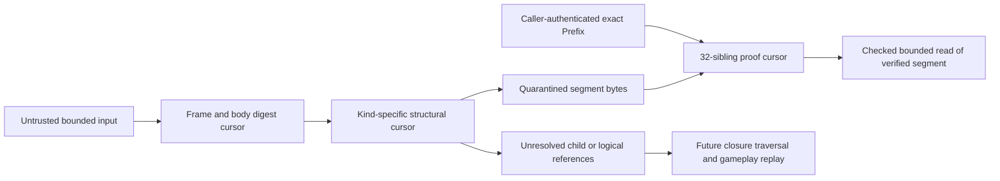

# Expanded history stream object codecs — implementation plan

<!-- BEGIN 2026-10-19 rewrite decision -->
> **Historical; Zig continuation canceled 2026-10-19.** Preserve this source contract and evidence. Active recovery targets Rust stable1.99.1; see the 2026-10-19 Rust designs/plans. Historical review labels do not approve new Rust behavior. Tests and CI gates remain paused.
<!-- END 2026-10-19 rewrite decision -->


- Author: Abbey; independent reviewer: pending
- Date: 2026-10-11
- Status: **Draft / Proposed. Plan review and controller approval required before implementation.**
- Compiler: exactly `0.18.0-dev.146+35accc06e` (`zig/.zigversion`).
- Deliverable: pure, bounded codecs for physical object kinds 1, 5 and 6, the existing Prefix wire, transport hashes and single-segment proof validation.
- Ownership: new files under `zig/src/expanded_session/` only; no shared registration in this slice.

## Purpose, evidence and scope

Build the next independently reviewable layer above the qualified pure catalog/ledger slice: encode and validate an immutable stream segment, its transport interiors and logical-tick descriptor, then authenticate one segment against an externally established exact Prefix. Later graph builders and providers can consume these primitives without introducing synchronous 1 MiB hashing/copying into the store update loop.

Current evidence is the [pure metadata qualification](../../qualification/2026-10-11-expanded-session-catalog-qualification.md): 33 tests per mode at its recorded eight-file hashes, with no host integration. `catalog.zig` uses synchronous owned metadata encoding/decoding, `types.zig` owns catalog types, and `limits.zig` contains only metadata limits. Those files remain unchanged. Their synchronous APIs are not a template for stream processing. `zig/build.zig` currently registers no expanded-session suite. `zig/tools/check.sh` is the scoped Rust-blocked migration gate; it does not currently execute the new focused suites proposed here. No codec/product tests were run while writing this plan.

This slice does not build the logical graph/radix index, manifests, inventory/pin codecs, kind-0 genesis objects, portable containers, an append tree, provider/broker, retention tokens, authority bridge, gameplay registry, native/IndexedDB storage, CAS, save, replay or Continue. It does not change authority's Prefix/Ticket definitions or implement a second authority transport frontier. Generic framing recognizes the seven existing kind tags but admits only explicitly supported kinds 1/5/6; recognized deferred kinds fail `UnsupportedObjectKind`, unknown tags fail `InvalidKind`. No opaque-body success is represented as validation of deferred object semantics.

This is a coherent transport-codec slice, not complete history authentication. A valid physical object has internally correct bytes and address. A valid proof authenticates one segment under a previously trusted root. Neither proves all leaves are contiguous, all graph nodes exist, history heads are correct, gameplay receipts replay, external source EOF occurred, or any object is durable.

## Frozen authority and dependency order

The [public stream review receipt](../../qualification/2026-10-11-expanded-durable-session-stream-review.md) approves the first two exact inputs below. Their document headers retain historical Draft wording; the exact-hash receipt establishes the approved design tuple, not implementation approval for this plan. Freeze and recheck this tuple before every implementation dispatch/review. A changed input pauses dependent work for focused reconciliation and review; do not silently adopt it.

| Input | SHA256 |
| --- | --- |
| [Durable session specification](../specs/2026-10-11-nyon-zig-expanded-durable-sessions-design.md) (D) | `c7acef06211205f59f123b4a565cc6dacc9321e2cfe2abf75007b8ec4889ffb5` |
| [Composed bridge annex](../specs/2026-10-11-nyon-zig-durable-authority-bridge-design.md) (B) | `dc73e20d6f6083db706b4803dafb32fd18edf1702ce58284b1ebbbf505e99d6a` |
| [Full-scale authority design](../specs/2026-10-11-nyon-zig-fullscale-authority-design.md) (A), compatibility reference | `a8bc0d41767722b3215e2e6c334d06d5cf5cacc3107f28f83b3b4219ba6ce2f5` |
| [Initial economy codec](../specs/2026-10-11-nyon-zig-fullscale-authority-codec.md) (C), deferred gameplay validation | `c116655859eae999ee1529180521254a575570ba471099fc0ca2e00c8778b6b9` |

Consumed requirements, rather than an implied adoption of every implementation dependency:

| Exact source section | Requirements consumed by this slice |
| --- | --- |
| D, **Logical ticks and portable bytes** | LE integers, exact ASCII hash domains without NUL, logical-node hash recurrence, separate E/G/node/address identities, 1..32 MiB logical payload |
| D, **Physical segment and transport tree schema** | 48-byte frame; kinds 1/5/6; exact 112-byte Prefix; 1 MiB segments; 32-level tree; ordinal `<2^32`; present-child framing; exact-prefix tail geometry; physical and transport digests distinct |
| D, **Exact-prefix acknowledgment and provider ownership** | 32 bottom-up sibling hashes; verify under locally authenticated Prefix; entire source segment before exposing target range; stale request checks belong to future provider; no durability from codec success |
| D, **Exact endurance and storage ceilings** | Checked u64 arithmetic, maximum ancestry 4,398,047,559,680 bytes, no whole-file usize conversion, preserved 131,072 nodes/5 TiB portable/32 TiB namespace ceilings |
| D, **Work, limits, observability and security** | Shared remaining 0..1,024 units; copy/encode <=256 bytes/unit; hash input <=64 bytes/unit; errors/cleanup charged; exact existing 128 MiB store partition |
| B, **Normative precedence and exact inputs**, **Candidate freeze and private extraction capability**, **Fixed memory and observable work** | B overrides historical standalone copy/publication assumptions; helpers must accept caller's remaining allowance, support metered repeated immutable passes, keep codec success separate from graph acceptance/pair publication |
| A, **Bounded provider and retention protocol (F2)** | Existing Prefix/tree domains and provider proof binding; no alternate tree/root/version |
| C | No gameplay receipt interpretation here; initial limits and history recurrence remain the registered validator's responsibility |

No wire ambiguity blocks this subset: domains, offsets, sizes, proof order and limits are specified. Zig API spelling, private state layout and error names below are proposed implementation choices. Graph-wide validation and authority trust are deliberately deferred obligations, not missing wire fields to invent.

| Order | Owner / new files | Depends on | Release condition |
| --- | --- | --- | --- |
| 1 | Codec implementer: `object_types.zig`, `codec_work.zig`, `prefix_codec.zig`, `prefix_codec_tests.zig`, `stream_fixtures.zig` | Approved plan/tuple | Prefix wire/hash and bounded work reviewed |
| 2 | Same sequential owner: `merkle.zig`, `merkle_tests.zig` | 1 | Domain/level/ordinal hashing reviewed |
| 3 | Same sequential owner: `object_frame.zig`, `object_frame_tests.zig` | 1 | Incremental exact framing reviewed |
| 4 | Same sequential owner: `segment_codec.zig`, `segment_codec_tests.zig` | 1–3 | Kind-5 encode/decode with quarantine reviewed |
| 5 | Same sequential owner: `interior_codec.zig`, `logical_tick_codec.zig`, `object_descriptor_tests.zig` | 1–4 | Kind-6 and kind-1 structural/binding checks reviewed |
| 6 | Same sequential owner: `segment_proof.zig`, `segment_proof_tests.zig`, `history_codec_tests.zig`, `history_codec_wasm.zig` | 1–5 | End-to-end proof/lifecycle/layout qualification and independent whole-slice review |
| Later, separate dispatch | Shared root/build owner: `zig/src/root.zig`, `zig/build.zig`, gate registration | This slice qualified and ownership coordinated | Fresh integrated gate; not authorized by this plan |

The implementer is not alone in the checkout. Preserve all existing work, all eight qualified expanded-session files and other agents' changes. Each task owns only its listed new files; it may adjust earlier files from this same slice for an independently reviewed fix, with their suites rerun. No dependencies, commits, pushes, other SDD directories or specification edits are authorized.

## Exact wire and validation contracts

All offsets below are byte offsets, not Zig layout. Explicit serializers write LE fields; do not serialize structs with `asBytes`.

| Value | Exact layout / limits |
| --- | --- |
| Object header | `0..8 NYONOBJ1`, kind at8, version LE16 at9, flags at11, body length LE32 at12, body SHA at16..48; version1, flags0 |
| Kind5 | Body `G[32]`, ordinal LE64, length LE32, payload; body size `44+length`, frame size `92+length`; payload1..1,048,576, ordinal0..4,294,967,295 |
| Kind6 | Body height1..32, left presence0/1 + optional address/hash64 bytes, right presence0/1 + optional64 bytes; one present child body67/frame115, two body131/frame179; both absent invalid |
| Prefix | `G[32]`, tick LE64, byte_count LE64, history_head[32], transport_root[32]; exactly112 bytes; identity `H("NYON-FS1-PREFIX" || wire)` |
| Kind1 | Body logical digest32, parent logical digest32, tick LE64, payload_length LE32, Prefix112, stream-root physical address32; exactly220 body/268 framed bytes |

Body SHA covers exactly the body; address SHA covers the complete actual header and body. Require both to match. A caller-provided expected address is required for decoding a named physical object; successful encode returns the computed address. No format has extra extension flags or a new profile/domain/version.

Prefix parsing establishes framing only. A separate explicit contextual check accepts a retained expected Prefix/parent and the registered bounds supplied by the future owner. For a logical tick: tick equals Prefix.tick, tick = parent.tick+1 with overflow rejection, G matches parent, payload_length is nonzero and <=32 MiB, byte_count equals checked parent.byte_count+payload_length, and the expected parent logical digest matches. Bound the session ancestry to D's maximum independently of the generic 2^32-leaf format. Tick/node count, branch membership, registered 4,057,265-byte initial-codec bound, history-head recurrence and receipt correctness cannot be inferred from object bytes; expose them as explicit future validation requirements. A structurally valid kind1 is not a replay-validated logical node. A separate incremental logical digest cursor can compare the stored digest against the exact caller-supplied payload stream; it does not claim that stream came from this object's authenticated range without the future graph/provider binding.

Transport definitions are exactly:

```text
leaf = H("NYON-FS1-SEG" || G || ordinal:LE64 || length:LE32 || H(payload))
empty[0] = H("NYON-FS1-EMPTY")
empty[h] = H("NYON-FS1-NODE" || h:u8 || empty[h-1] || empty[h-1])
node[h] = H("NYON-FS1-NODE" || h:u8 || left || right), h=1..32
logical = H("NYON-ES1-NODE" || parent || tick:LE64 || length:LE32 || payload)
```

An interior decode returns **unresolved child references**. Its stored child transport hashes are assertions until recomputed child results match them. A separate local link check accepts a validated child result, verifies address, height/kind and expected ordinal interval, and compares the recomputed hash. It then permits the local parent transport hash calculation. Absent children use the exact empty hash at height-1. This API validates supplied child relationships only: a complete rooted closure still requires the future depth-32 traversal. Never name a parsed interior `ValidatedTree` or certify a parent from the stored child hashes alone.



## Work, memory and lifetimes

Proposed interfaces use integers/fixed values and caller-owned bounded workspaces. Representative shapes, not claimed existing exports:

```zig
pub const Work = struct { remaining: u16 }; // admitted 0..1024, shared by pointer
pub const FeedResult = struct { consumed: u32, produced: u32, state: Progress };
pub const Progress = enum { pending, need_input, need_output, cleaning, ready, failed, cancelled };
// Each operation may use multiple units; one atomic copy/encode <=256 bytes,
// one hash-input step <=64 bytes. Zero units consume/produce/change nothing.
pub fn feed(self: *Decoder, input: []const u8, work: *Work) FeedResult;
pub fn finishObject(self: *Decoder, work: *Work) Progress;
pub fn cancel(self: *Decoder, work: *Work) Progress;
pub fn poll(self: *Decoder, work: *Work) Progress;
pub fn readVerified(self: *Decoder, offset: u32, out: []u8, work: *Work) ReadResult;
```

Each task's public types and exact signatures must compile before its behavioral RED is recorded; task1 establishes the common value/work types. Do not expose `[]u8` into unverified workspace, depend on callbacks, or retain `input`/`out` after a call. `feed` consumes only an explicitly reported prefix, so callers can discard consumed chunks immediately. It can process a larger supplied slice only through charged bounded iterations, returning at budget exhaustion. `readVerified` copies <=256 bytes/unit into caller output; after that call the caller owns the copy.

Contexts borrow stable, exclusive workspace addresses for their entire active lifetime. The caller reserves them before admission and keeps them alive through cancellation/cleanup. The codec owns the lease to used ranges, not the allocator allocation. Contexts are non-copyable by API convention and must not be moved while active; expose opaque handles through a later owner if needed, without inventing durable IDs here. Repeated finish/cancel/read after terminal state produces a charged typed state result and cannot re-release workspace. Terminal delivery and window release are explicit charged transitions. A cancelled/failed context is reusable only after used bytes are cleared in <=256-byte steps and cleanup completes. No bulk `deinit` wipes a megabyte, and no zero-budget call latches cancellation.

No codec function accepts an allocator or allocates a whole object/history. Caller-owned segment windows correspond to the existing two 1 MiB assembly windows, not additional allocations. Frame states retain a <=256-byte pending chunk and small headers; fixed proof scratch is exactly32×32 bytes plus bounded cursor state. All simultaneously active codec/hash/interior/proof control states must fit inside D's existing 2,097,152-byte Merkle/control scratch. Do not consume the authority's separate verification window as if it were store-owned. Show actual native and wasm32 layouts and peak simultaneous use; this is a suballocation witness only, not proof that the unimplemented full store fits. Keep total store assignment109,819,824 plus adapter margin24,397,904 =134,217,728 unchanged.

Lengths, counts, header/body total, offsets and range products are checked in u64 before any bounded usize conversion. Reject body length and kind-specific inconsistency before touching workspace payload bytes. Admission into an already held/undersized workspace returns Busy/TooLarge without changing caller state. Initializing/reseting a context must not zero the full backing arena or eagerly calculate33 empty hashes. Empty-hash construction is incremental or uses independently verified literal constants; copying a table into a context remains charged.

SHA operations are resumable. Account each feed of <=64 input bytes, any SHA compression/finalization work, domain-prefix assembly and digest copy explicitly. Audit pinned std SHA implementation before choosing wrappers; if finalization executes two compression blocks, reserve/charge both or split it. An empty-input finalization is not free CPU. Do not use whole-slice `Sha256.hash`, `@memcpy`, equality or a helper that secretly drains a cursor on public runtime paths. A unit may perform one small constant control/check operation; payload comparison/copy is capped256 and hash input64. Meter validation failures, state transitions, cleanup and terminal delivery. Counters expose copied/encoded/hashed bytes and units without logging data.

Encoding uses the same reserved immutable window, with an incremental preparation pass to compute body SHA and then an emission/address-hash pass. A segment source is staged via bounded calls before preparation and remains immutable until emission ends. There is no bulk source snapshot or extra object-sized allocation. If a future caller uses repeatable external streams, it needs a separately reviewed owner/immutability contract; this slice does not borrow such streams between calls. Output chunks are provisional until successful terminal completion. A caller must not publish/stage them as a completed object on cancellation. Kind1/interior encoding has only bounded fixed fields but still follows the shared meter.

`finishObject` asserts the supplied object boundary: it rejects incomplete header/body, unconsumed queued input and a byte count different from declared length. Any supplied extra byte rejects as trailing. The host must independently establish that this boundary was the complete requested file/record/response and that no extra source bytes were discarded. The codec cannot prove external EOF or a provider's immutable pin. Document this beside the public API, matching the existing catalog/ledger complete-input trust boundary.

Errors are typed and deterministic by parser order: `InvalidMagic`, `InvalidKind`, `UnsupportedObjectKind`, `UnsupportedVersion`, `InvalidFlags`, `TooLarge`, `LengthOverflow`, `Truncated`, `TrailingBytes`, `BodyDigestMismatch`, `ObjectAddressMismatch`, `InvalidOrdinal`, `InvalidLength`, `InvalidHeight`, `InvalidPresence`, `EmptyInterior`, `ChildMismatch`, `PrefixMismatch`, `ProofMismatch`, `Busy`, `InvalidState`, `Cancelled`. Keep first failure stable while charged cleanup runs. These are in-memory implementation errors, not additional persisted discriminants. Future store/authority error mapping is out of scope.

## Exact proof binding and trust preconditions

The verifier captures a copied **caller-authenticated** Prefix, its separately supplied expected Prefix identity from the retained capture/token binding, and the requested ordinal before accepting data. It incrementally recomputes the identity of the supplied112-byte Prefix and checks it against that retained expected identity before processing the response. These are API arguments, not new provider-wire fields. It cannot receive the expected root from the same untrusted proof response. The future provider must first check Ticket/owner generation, exact retention-token Prefix identity and live pin ownership; no codec return value substitutes for that check. This slice's fixtures inject those trusted values explicitly and make no token claims.

For byte_count B>0, compute `last=(B-1)/1,048,576`, require ordinal<=last and `<2^32`, and require length=`1,048,576` for ordinal<last, else `(B-1)%1,048,576+1`. Check B against the approved session ancestry ceiling. Bind decoded segment G, ordinal, length and exact payload bytes; recompute H(payload) and leaf. Consume exactly32 sibling digests, in bottom-up order height0..31. At level h use ordinal bit h to select left/right; hash parent height h+1. A sibling subtree wholly beyond `last` must equal canonical empty[h]. Finally compare the recomputed height32 root to the captured Prefix.transport_root. Copied Prefix identity binds all112 bytes, including tick/history head even though those two fields are not inputs to the transport tree itself.

This proves membership/content/range under that Prefix. It does not authenticate tick/history head semantics or the Prefix's origin. Occupied sibling subtrees remain opaque hashes, so contiguity and correctness of their contents are trusted from the locally committed Prefix or later full closure validation. A proof calculated from a self-consistent attacker-selected root must never be described as authenticated history.

The verifier ingests payload into one quarantine window and releases no bytes until full segment and proof validation, exact supplied input completion and charged success. A target ending midway through the source segment uses the complete longer source Prefix and verifies all source bytes, then exposes only the explicit requested subrange. It cannot substitute the shorter target Prefix, mint a shorter pin, or accept just the target payload prefix. Physical expected address is a separate optional upstream check: a provider response carries no physical address on its wire. Object-decoder proof tests use the trusted expected address; raw-response proof tests authenticate leaf bytes by the transport root alone, without adding any response field.

## Independent literal fixtures

These synthetic transport fixtures are derived from D's formulas with Python standard-library `hashlib` and `struct`, independently of any proposed Zig encoder. They are not valid gameplay genesis/receipts. Preserve that distinction in test names. Hex is lowercase for readability; wire is raw bytes.

F1: G is bytes00..1f, ordinal0, payload ASCII `abc`, length3. The full kind5 frame is95 bytes:

```text
4e594f4e4f424a31050100002f000000
ad3dfcad1503b256b8e7357e6f601e1c7082179c991fa289dd4c1975560f969e
000102030405060708090a0b0c0d0e0f101112131415161718191a1b1c1d1e1f
000000000000000003000000616263
```

| Fixture | Literal expected digest |
| --- | --- |
| Empty leaf | `ab8bc65698a7dc627da5c95d70baf4c89ea62a79d18015e36c0d3d33d13d0a7c` |
| Empty height1 | `a20f60ae817e338e79909f87ebf66128e9500f5cc8e51a3a275d1d8041e3566f` |
| Empty height32 | `762d5d6ebc249eddde35527c4b8d7f4817cfc859e76c5c532f9d4eab3566218f` |
| F1 frame address | `4ad8798001672854a9fe6287dec7e2b3a7c27558128b14bab300947cd96b8670` |
| F1 transport leaf | `b47b0333c64de04b356ee6174ed3b7f88d82b046dfac2050fefed214da1e3513` |
| F2 height1 object, left F1, absent right | `a729d4b9f961ff491716b23e007ffc436ca603a73e48c95dc5b3c1af33a0603c` |
| F2 height1 body SHA | `a0e8b942cd99f62cfc6da5fb50a088f99e31c3c02bf8bcdbf910698823a3f7a9` |
| F3 height32 root physical address, sole F1 leaf | `2462f47e449930d9845fd94dcb7aeab8e6b5b9c57b8dc8840621582fa9574ebb` |
| F3 transport root | `e3fb458e47f774dc4b1135144c479e94af8425924ef59cd090f2a9ffb8d2c439` |
| F3 Prefix identity, G above/tick0/bytes3/head 32×11/root above | `e54d511187e23d148adbd296488c3e450e0ddf30853fd854efa24b62d8bb69ce` |
| F4 logical hash: parent32×22, tick1, payload `def`, length3 | `9c624c0843851943a0efaae76a62bacf941cb45b9bf2627e59499791b57e86e7` |
| F4 stream-root address for sole payload `abcdef` | `df04673629fddb94476ce7691f2184683edb7db162a9fc6550cb6305fa356740` |
| F4 transport root for `abcdef` | `779eb1c8c58f3edc206ee830944c7abb5aa30c2ec5932457ce25e047d21c278a` |
| F4 kind1 body SHA, Prefix G/tick1/bytes6/head32×33/root above | `e1ec1c3378ce41e6f16afeb0660afa382024decc15ae118c8b6f8267305b3134` |
| F4 kind1 frame address | `2e6b56df184672f2bf2f71d4ec0abf1224cdc9596a682b7ce44d690c1349ae44` |

F2 body is `01 01 || F1_address || F1_leaf || 00`; F3 recursively creates one left-present interior for each height1..32. Its proof is empty[0]..empty[31], without reversal. F4 kind1 body is logical_hash, parent32×22, LE64(1), LE32(3), the specified Prefix, root-object address. These definitions determine literal wire independently; tests must encode the literal fields/offsets directly, not call the production encoder to establish expectations. For larger 255/256/257 and segment-edge fixtures use deterministic `payload[i]=i mod251`, derive and freeze additional SHA literals independently before implementing their production path. Independent fixture generation may be a one-off external reference calculation recorded in evidence; do not make a second production codec or add a dependency.

Every malformed semantic fixture must recompute all enclosing integrity fields needed to reach the intended guard: body SHA, object address, and when applicable parent transport/root expectations. Record which guard actually fires. Wrong-checksum tests remain separate. Unique-but-invalid order/side cases must not accidentally hit a duplicate/missing-child guard first. Expected values never come from the implementation being tested.

## Sequential tasks and required evidence

For **each** task: first add compiling signatures and a focused behavioral test that fails for the absent behavior, capture actual nonzero test exit and assertion, then implement to green. A missing import/type/symbol or unrun test is not RED. Test scripts must propagate the real Zig exit. Apply the common lifecycle/meter matrix below to every introduced state; do not postpone its safety tests to task6. Freeze exact owned source/test/fixture hashes, inputs and command/results after green, request fresh independent review, fix findings, rerun affected suites and obtain controller approval before the next task. No unchecked plan checkbox proves implementation.

### Task 1 — bounded work and Prefix wire

Create `object_types.zig` with local fixed-value Prefix/digest/error types, limits derived from D and distinct physical/transport/logical result wrappers. Reuse no mutable catalog structures. Create `codec_work.zig` for shared allowance validation/charging and instrumentation. `prefix_codec.zig` supplies incremental encode/decode/identity and checked prefix geometry/context checks; `stream_fixtures.zig` stores independent literals/helpers for tests only. Compile `prefix_codec_tests.zig` before implementing Prefix identity behavior.

RED: the F3 Prefix literal must encode to exactly112 bytes and hash to its literal identity; stub behavior returns a controlled failure. Assert LE offsets32/40, no struct padding. Mutate each field separately and require identity change; recompute identity on malformed framing to distinguish framing from identity checks. Cover length111/112/113, truncated fields, bytes0/max/max+1, checked parent additions and tick overflow, exact full segment versus partial geometry, and input chunks1/63/64/65/255/256/257. A 257-byte offered span consumes only admitted framed bytes and rejects an extra suffix on completion. No input/output borrowing after call; all-zero budget leaves state/output canaries unchanged. No allocation is permitted, so use allocation-denying harness and caller-workspace preservation instead of fictitious internal OOM cases. Run both focused modes and fmt; freeze/review.

### Task 2 — exact incremental transport and logical hashing

Create `merkle.zig` with resumable payload, leaf, interior, empty-subtree, Prefix-domain and logical-node hashing as needed; share low-level bounded SHA adapter instead of divergent algorithms. The Prefix helper from task1 may consume it after an owned-slice refactor and task1 rerun. No global mutable state, provider or graph builder. `merkle_tests.zig` starts with a compiled F1 leaf assertion that fails before implementation.

Use F1/F3/F4 and empty0/1/32 literals, independently generated additional right-child/asymmetric cases and 255/256/257 payload hashes. Reject height0/33, ordinal2^32, zero/oversize segment length and declared/consumed mismatch. Cover logical payload1,32 MiB,32 MiB+1 with the max case streamed from repeated bounded test windows; no 32 MiB allocation. Probe SHA input63/64/65 and finalization padding55/56/63/64/65. Compare all digests across budgets0/1/7/1,024/mixed, split domains/lengths and repeated cancellation cuts. Input chunks may be destroyed after feed. Rehashed framing is not applicable to this raw-hash layer; length/domain/tick/parent mutants and independent digests are its semantic guards. Prove every hash/compression step charged, cleanup bounded, and no allocator calls; run both modes/fmt/freeze/review.

### Task 3 — incremental physical frame

Create `object_frame.zig` and `object_frame_tests.zig`. Frame decoder accepts expected kind/address and exact admitted body bound; keeps bounded header/chunk state and incrementally checks both digests. A kind-specific consumer must finish before a public object result is ready; raw framing success is internal. Encoder receives an already prepared body digest/length and emits/hash-checks only bounded pieces. RED is decoding F1's exact frame/address through split input; bodies may be interpreted by a test consumer until task4.

Test F1 literal header, F2 known body/frame sizes, and independently generated frames for body255/256/257. Unknown kind7/255 versus recognized deferred0/2/3/4, wrong magic/version/flags, declared-length overflow/over-limit, header47/48/49, every field truncation, byte suffix, body hash mismatch and address-only mismatch have separate assertions. Rehash outer digests for semantic-kind/version/length tests. Validate caps before payload writes using canary windows and an allocation-denying harness; finish on partial input cannot release a validated result. Cancel after header/body-hash/address-hash/final checks; stale repeated feed/final/read cannot change terminal state or expose data. Hash/body copy charges are additive, not a shared free pass. Run both modes/fmt and tasks1–2 regressions on refactor; freeze/review.

### Task 4 — kind-5 segment encoder and decoder

Create `segment_codec.zig`, `segment_codec_tests.zig`. Decoder binds G/ordinal/length, uses frame and payload hashing, and stages only in caller-owned quarantine. Encoder stages immutable input incrementally, prepares body hash, emits header/body and computes final address without another payload copy. Final values include physical address, payload SHA and transport leaf as distinct fields. RED is F1 exact encode/decode with no read permitted before successful finish.

Cover independent payload1/255/256/257 and1 MiB-1/1 MiB literals, reject0/1 MiB+1 before copying. Test ordinal0/2^32-1 accepted by structural format and2^32 rejected, with contextual prefix range separately restricting the accepted high ordinal. Rehash objects with mismatched length/body length/G/ordinal to hit each binding guard. Two independent old/new partial-tail objects (`abc`/`abcdef`) retain different addresses and leaves; updating one context cannot mutate the old caller window. Split synthetic record/tick boundaries at segment offsets1 MiB-1/1 MiB/1 MiB+1 without interpreting gameplay or adding padding. Hash the complete32 MiB synthetic logical stream in bounded pieces; use <=1 MiB windows reused only after prior ownership release, no new whole-tick buffer.

Cancel/preserve at every copy/hash/emit/terminal cut; inspect failed/cancelled results before/after bounded clearing and exactly-once lease release. Overlapping second admission is Busy; insufficient workspace leaves old result/canaries unchanged. Production has no allocation; test owner reservation failure at each requested fixed workspace allocation, including failure of the second window, must release only prior test-owned allocation and preserve existing context/bytes. Those tests prove the documented owner harness, not a future real broker. Run both modes/fmt, all prior suites, freeze/review.

### Task 5 — kind-6 interiors and kind-1 logical boundaries

Create `interior_codec.zig`, `logical_tick_codec.zig`, `object_descriptor_tests.zig`. Implement strict presence/field-order encoders/decoders, unresolved-child results and explicit verified-child local-link check. Implement fixed kind1 encoding and contextual parent/Prefix/range validation with a separate payload digest cursor. No index membership, closure lookup, branch mutation or authority import. RED: F2/F4 exact frame/address assertions with compiled stubs.

Independent F2/F4 literals and asymmetric left/right fixtures must differ when swapped. Rehash both-absent, presence2, absent-with-extra-fields, illegal height, wrong child type/height/address/hash and trailing variants; test each targeted guard. One present child yields115 bytes, two179; no accepting a body3 both-empty object because its digest is valid. Local child ordinal intervals must match the supplied path position with checked u64 arithmetic; a right-only parsed interior may be structurally valid but cannot be accepted as a globally contiguous root without closure validation. Verify full inherited path interval separately from a stored child hash.

Kind1 fixed268 bytes must reject267/269, wrong tick/Prefix.tick, changed parent G/logical digest, parent tick overflow and parent byte-count overflow, payload0/32 MiB+1 and mismatched digest from a complete bounded payload pass. Use F4's parent byte_count3 and tick0; synthetic parent logical digest22 is a contextual fixture, not a derived genesis E. Payload255/256/257 literals exercise range/hash handoff despite fixed-size descriptors. Valid framing never certifies a supplied transport root or receipt history. Test cancellation/zero allowance at child-check/digest/public-result transitions and metered268-byte emission crossing256. Allocation-denying/canary harness covers all paths; no internal allocator failure is possible. Run both modes/fmt/regressions/freeze/review.

### Task 6 — exact-prefix segment proof and whole-slice qualification

Create `segment_proof.zig` and `segment_proof_tests.zig` for bounded proof ingestion/folding and verified subrange reads. Inputs use the exact approved response (`ordinal:LE64,length:LE32,32 sibling hashes,payload`) or already decoded segment values; do not add G/address/Ticket fields to that response wire. Copied expected Prefix/ordinal comes through a separate trusted argument. Implement `history_codec_tests.zig` importing all six suites and `history_codec_wasm.zig` as an exported compile-only layout/API witness. RED: F3's independent proof must authenticate F1 only under the fixed expected Prefix/root; initially it fails behaviorally.

Derive/freeze an independent two-leaf vector with a full first leaf and partial last leaf; use ordinal1 to expose orientation mistakes and distinct non-empty sibling order. Test proof31/32/33 hashes, swapped levels, changed sibling/G/ordinal/length/data/root, out-of-range ordinal, exact full tail and byte_count1 MiB±1, u64 exhaustion and session ceiling. Rehash all physical wrappers for semantic corruption; when attacking trusted bindings, leave the expected caller Prefix unchanged. A self-consistent forged response/root pair must fail against that captured Prefix. Changing the supplied Prefix tick/history head while retaining the original expected Prefix identity must fail that identity comparison, not be falsely described as detected by the Merkle path. Supplying both a different Prefix and its different identity is a different trusted caller input; the codec cannot detect a dishonest caller and must not claim to do so.

Copy1024 proof bytes with255/256/257 offered chunks; zero budget changes nothing; 257 offered bytes cannot be copied as one unit. Test data boundaries63/64/65 and255/256/257, source target ending before source segment end, no read before all full-segment bytes authenticate, proper subrange bounds, caller EOF attestation and no discarded trailing suffix. Check both physical-object and raw-response paths: raw responses need no nonexistent expected physical address.

Inject cancellation after each charged proof/hash/data/read/cleanup step; fail workspace reservation at each owner-harness allocation; retry matches every frozen digest; double finish/cancel/read/cleanup cannot double release; zero-budget terminal calls stay pending. Retain independent old tail window while validating new tail; decoder failure leaves old output and caller-owned data intact. Validate no allocator/OS/browser/clock/gameplay imports. Compile concrete simultaneous layouts natively and wasm32: two segment windows exactly2,097,152 bytes plus all codec controls within the existing2,097,152-byte scratch partition, with individual size/alignment and wasm32 truncation assertions. Do not count both decoder and verifier as owning separate copies of the same segment. Run complete focused commands below, freeze final sources and independent whole-slice review; controller decides readiness for later graph/provider planning.

## Common test matrix and exact commands

Every task's relevant states use budgets0/1/7/1,024 and a mixed schedule containing repeated0. Snapshot state/output/counters before zero calls. Assert consumed allowance <= supplied remaining allowance, all copy/encode/clear spans<=256, all hash input<=64, and no sibling receives a fresh1,024 units. Exercise nonempty work and error delivery as well as empty/control transitions. Test cancellation before/after each phase and retry; wrong lifecycle operations return a typed result. Check arithmetic exhaustion without huge allocation. If a task introduces no allocator/ID counter, document that fact and prove no allocation or wrap path rather than claiming irrelevant fault injection. No host ticket/generation lifecycle is implemented by these codec tests.

Focused commands are **proposed and unavailable until their new files exist**. Run from `zig/`, using a compiler guard before **each** invocation (prefix shown once here and included in command logs). Do not change `.zigversion` or install a different compiler to fit the source.

```sh
test "$(zig version)" = '0.18.0-dev.146+35accc06e' && test "$(cat .zigversion)" = '0.18.0-dev.146+35accc06e'
zig test src/expanded_session/prefix_codec_tests.zig
zig test src/expanded_session/prefix_codec_tests.zig -O ReleaseSafe
zig test src/expanded_session/merkle_tests.zig
zig test src/expanded_session/merkle_tests.zig -O ReleaseSafe
zig test src/expanded_session/object_frame_tests.zig
zig test src/expanded_session/object_frame_tests.zig -O ReleaseSafe
zig test src/expanded_session/segment_codec_tests.zig
zig test src/expanded_session/segment_codec_tests.zig -O ReleaseSafe
zig test src/expanded_session/object_descriptor_tests.zig
zig test src/expanded_session/object_descriptor_tests.zig -O ReleaseSafe
zig test src/expanded_session/segment_proof_tests.zig
zig test src/expanded_session/segment_proof_tests.zig -O ReleaseSafe
zig test src/expanded_session/history_codec_tests.zig
zig test src/expanded_session/history_codec_tests.zig -O ReleaseSafe
zig build-obj src/expanded_session/history_codec_wasm.zig -target wasm32-freestanding -O Debug -fno-emit-bin
zig build-obj src/expanded_session/history_codec_wasm.zig -target wasm32-freestanding -O ReleaseSafe -fno-emit-bin
```

Execute only the task's new tests plus affected prior suites until task6; final aggregate runs must include actual test counts, not just a cached build. The wasm witness exports functions that instantiate each codec entry point/state and compile-time layout assertions; an empty import-only probe does not defeat Zig lazy analysis. This is wasm compilation/layout evidence, not browser execution.

Before review run `zig fmt --check` with **all new files introduced so far listed explicitly**, including fixtures, probes and tests. Final file set is the ownership table's eighteen files. Record the actual exit code before displaying a bounded log; do not pipe a gate into `tail` and claim its status. Freeze source SHA256 before final tests and verify after them. Recheck the eight metadata hashes from their receipt; report any other owner's drift to the controller without reverting it. Review the entire new-file contents; ordinary `git diff` omits untracked files.

The existing `./tools/check.sh` from `zig/` remains a required separately coordinated integration gate before broader readiness claims. It compiles/runs currently registered modules and Rust-blocks subprocesses; it does not prove these standalone codecs are registered. The shared owner runs it after scheduling against concurrent work and records the result even if unrelated failures exist. No root/build/gate edits occur in this slice. A focused codec PASS must retain **Partial: shared integration pending** until the owner registers suites and reruns the gate; native/browser/provider/gameplay evidence remains separate even then.

Independent review checks source compliance, actual RED/GREEN logs, literal provenance, wrong-guard mutations, digest/EOF trust boundaries, std SHA work accounting, bounded cleanup and allocator/layout witnesses. Review exact frozen bytes, not a moving checkout or earlier plan revision. Use a disposable test-only mutant to remove the proof orientation or presence guard and prove the corresponding uniquely targeted regression fails; never weaken a production assertion to pass.

## Risks, alternatives and handoff

| Risk | Severity / mitigation |
| --- | --- |
| A large synchronous helper bypasses the outer meter | High: inspect all hash/copy/final/cleanup paths; instrument256/64 limits, repeated zero allowance and maximum segment |
| Correct object SHA is treated as full graph/replay authentication | Critical: separate unresolved references, local links and exact-root segment proof; public preconditions and negative self-selected-root fixtures |
| Same window is counted or released twice | High: exclusive stable workspace lease through cleanup; one quarantine owner; concrete peak layouts and terminal-repeat tests |
| Expected roots or physical addresses originate in untrusted response | Critical: separate caller-authenticated arguments; root/address-independent failure tests; later provider Ticket/token gate required |
| Source EOF or persistent retention is assumed from a byte slice | High: exact supplied-frame boundary only; host EOF/pin proof remains explicit prerequisite |
| Current unrelated work changes shared integration results | Medium: strict new-file ownership, before/after freezes, no registration edits; separately scheduled integrated gate |

Alternative1 is synchronous whole-object encode/decode using the catalog pattern. It is simpler but creates an uncharged1 MiB hash/copy path and is rejected for stream objects. Alternative2 is implementing the entire graph/provider/host layer now. It would entangle closure trust, paired publication, pins and transactions before codec fixtures exist; bounded sequential codecs are selected. Alternative3 is a generic opaque object decoder for every kind; it creates misleading validation results and broadens the slice. Explicit supported-kind admission is selected while preserving the complete existing kind namespace.

No rollout feature flag is needed for standalone pure modules. Initial integration is opt-in through a later owner-reviewed registry/build change. Rollback omits these modules from consumers and preserves all new/old profiles. Observability is local counters and typed phase/errors only; no transcript/log payload, network telemetry or secret paths. There is no schema migration or production dependency addition.

Handoff requires the exact plan approval hash, six sequential task reports, independent source/fixture hashes, compiled RED and both-mode GREEN evidence with exit codes, fresh review disposition and explicit residuals. Proposed codec APIs are not authority capabilities or storage receipts. Remaining work includes kind0 and all graph/manifest/pin/inventory codecs, complete closure/receipt validation, providers and retention, the actual composed bridge, host atomicity/recovery, Save/Continue and full game/endurance qualification in the [master plan](2026-10-11-finish-nyon-in-zig.md).

## Revision Summary

Initial bounded implementation plan. Consumes the approved stream/bridge tuple without changing wire identities, limits or budgets; preserves the eight qualified metadata files. Adds independently derived literal vectors and six sequential pure-codec tasks. Implementation, independent plan review, controller approval and runtime qualification remain pending.
