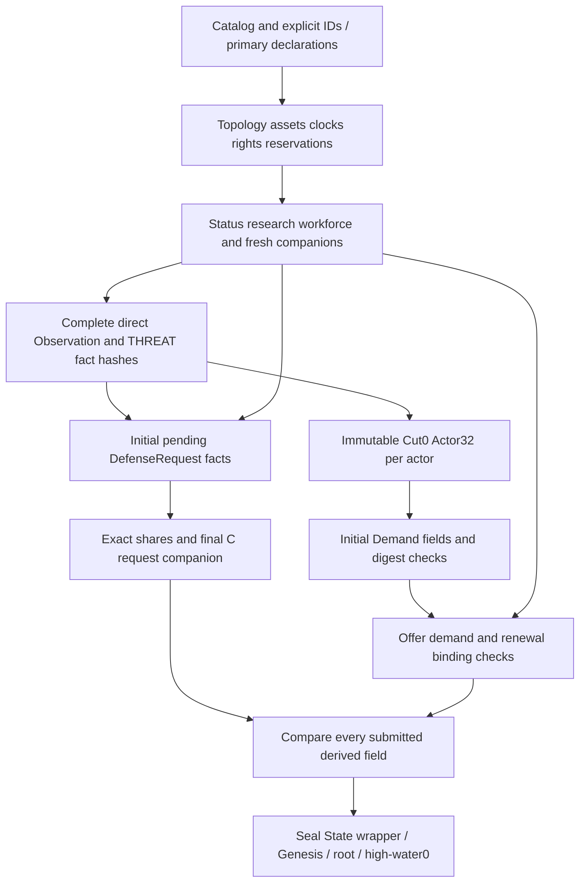

# Living V3 explicit initialization contract

Author: Abbey / reviewer and approving owner to be recorded on acceptance.  
Date: 2026-10-03. Status: **Draft — Proposed; independent review and Donald's written-spec approval pending.**  
Audience: V3 authority, schema, history, corpus and creator-interface engineers.  
Scope: a complete direct tick-zero constructor and its boundary with authenticated post-root history. This is a written specification, not V3 implementation authorization.

## 1. Overview and authority of this document

Living V3 needs to admit fully declared fresh galaxies with functioning infrastructure, research capabilities, people, political rights, conflict setups and observable conditions. The frozen complete schema currently specifies only the optional finite B0–B7 hub/deposit/docked-scout bootstrap profile. Its explicit initial-collection table leaves broader predicates open. That profile neither already admits this design nor prohibits every richer Genesis.

This design defines a pure, independently checked construction from complete serialized records. It admits acyclic initial truth without running an ordinary boundary. It does not turn authored capabilities into evidence of earlier payments, production, travel, combat, negotiation or success. Branch-bound or genuinely historical facts enter only through an already sealed root and authenticated creator/ordinary history. Every field remains required; a producer computes before encoding, and admission recomputes and compares rather than completing the document.

**Status convention:** every rule introduced or specialized here is **Proposed**, including all tables and algorithms in §§3–12. Statements labelled **Inherited** describe the pinned source contract, which is itself Proposed V3 unless explicitly identified as accepted V2. **Selected** denotes the user's chosen policy, not approval of this author's concrete table. No table below is Current product behavior.

### 1.1 Fixed source basis

The eight documents below are immutable inputs, pinned by `task-3-protected-baseline.json` in `.superpowers/sdd/2026-10-03-complete-nyon-v2-then-v3/`. They exactly match the eight source hashes in `.superpowers/sdd/2026-10-01-sandbox-completion-and-expansion/v3-ia2-completion-lane-freeze-2/manifest.json`. Their shared status is Proposed coordinated review submission2, not accepted complete V3 rules.

| Alias | Source in `docs/superpowers/specs/` | SHA-256 |
| --- | --- | --- |
| A | `2026-10-01-living-expansion-architecture.md` | `55905f9c45ff32bfe645d79ee450ab6330a1793ad3590588549c6d8a7b5b1087` |
| S | `2026-10-01-living-societies-rules.md` | `1b79c491dc38122c410bcb1a3157ffdcc3208a37478bdae1c1bb5182a60ce2bb` |
| E | `2026-10-01-living-ecology-rules.md` | `7219bbbf35b3ee50ce8b1f270584e0b05445ab20f944703d4e037d54059a9acf` |
| D | `2026-10-01-living-diplomacy-expansion.md` | `350badd8e5197df1f8d30991401dd950a5d2efbcd2aa8eb6f273d85063abb97a` |
| W | `2026-10-01-living-expansion-wire.md` | `1fba0ff89f795c3cdf4df970ec7e5728bc82b2ea250e9f803450d87eaa2f74e7` |
| X | `2026-10-01-living-expansion-experience.md` | `7e12c533085af8f67de9523902b547b307c0dd023134817e3553367704828980` |
| C | `2026-10-01-living-v3-complete-schema.md` | `bf77dc1237e4f8717143a3ca04c6d20db4632cf8cbe4645a00d21f3de023339a` |
| Q | `2026-10-02-living-v3-scoring.md` | `911410cee5f10229e4471c18154a2e7f821aff2d6645fba1222cc41091fa487f` |

C's copied inventories and mandatory overrides, rather than moving V2 code, own the V3 record shapes. Accepted V2 `2026-09-04-nyon-living-galaxy-rules.md` §§2–6 supplies explicitly inherited clocks, queues, repair and conservation where C/S/E/D retain them. `crates/nyon-workshop-core/src/living/genesis.rs::{build,check_genesis_boundary,check_clocks}` is an implementation-pattern reference: it validates explicit content and treats Generator as provenance. Its V2 envelope, types and weaker admission predicates are not a V3 constructor. `model.rs::check_colonies_and_industry` illustrates queue/reservation ownership; its six-slot V2 limit is superseded by S's eight-slot V3 rule.

### 1.2 Selected decisions and concrete proposals

| Selected user policy | Concrete Proposed realization |
| --- | --- |
| Both direct Genesis and authenticated creator/history entry | §§2,10; a sealed original Genesis is immutable |
| Every independently verifiable acyclic fresh record family | Exhaustive State tables §§3–7; history-bearing subfamilies explicitly excluded with producer path |
| Initial facilities/building jobs/hull jobs have zero credit | `paid_alloy=0`, no initial debit; completion carries zero, cancellation/scrap refunds zero |
| Research progress/unlocks and damaged assets allowed | §4 grant closure; full or positive damaged HP; repair deadline10 |
| Eligible fresh claims/occupations allowed | §7 arrival0/close50/progress0; no prior paid arrival or capture claim |
| Derived pre-insertion request/intelligence source | §9 one Actor32-style cut, no new serialized document or fake phase7 source |
| Complete explicit records compared, no silent defaults | §§8,11; every source and derived field has a check owner |

Goals are complete family admission, deterministic source construction, exact capacities and conservation, inspectable diagnostics and a reviewable acceptance matrix. Non-goals are new procedural content generation, V2 migration or changes, V3 product code, new payment/provenance registries, invented event phases, runtime speed claims, replacing historical corpora, or accepting the complete eight-document package by implication.

## 2. Two entry paths and the fresh-state boundary

**Direct Genesis:** the only direct tick is0. `State.branch_sequence=0`, `State.next_sequence=0`, and `counters={}`. There is no creator queue, ordinary Receipt, Event, Anchor, Decision, CandidateAudit, negotiation pass, growth, payment, allocation by an actor, or phase execution. The initial records are authored declarations. Initial Stock and population/passenger sums define the starting conservation account, not a transfer from an invisible source.

**Post-root:** first validate and seal a direct Genesis, then use actual paused creator revisions at tick0 or advancing ordinary history. Paused creation can author creator cargo with genuine `CreatorCapture`, set supported assets/conditions, and grant research through real intervention records. It cannot create actor-paid provenance. Supply payments, actual production/Needs, accepted defense action, negotiated acceptance/fulfillment, paid departures and objective outcomes require their actual ordinary producers. A creator can author a paid-shaped Supply component under C's explicit creator rule, but it remains creator evidence and cannot fulfill an actor obligation. The initializer never flattens these later records into Genesis or pretends an authored override happened before the root.

A field without a branch reference is not automatically fresh. `Fleet.location.travelling`, `return_credit=true`, nonnull passenger origin, nonnull Supply history, historical relation reasons, nonnull RecipeFacts/Needs, objective progress and Peace all assert a prior transition or outcome. Their absence rules below are semantic rules, not a claim that all their JSON shapes are cyclic. Shipment's existing ManifestProvenance additionally has a definite root cycle. A bare post-root State wrapper is a hashing payload, not a new import endpoint.

A direct record can later persist without adding an origin bit. Its source is the exact original Genesis record/typed key and uninterrupted replay lineage. A removed/replaced row, even with equal bytes/key, receives no original-source exemption. Later same-key claims, objectives, C instances, observations and request rows must validate at their actual producer. No terminal target absent from the original Genesis gets a historical reference waiver.

## 3. Schema, Catalog, identities and primary records

**Inherited:** C's scalar grammar, field order, tagged enums, Sorted keys, required nulls, byte caps, depth64 and18 entity kinds are unchanged. All tables enumerate fields in declared order, grouping a nested complete record only where its table follows. `0/10/100` in Tick/u64 columns means canonical strings `"0"/"10"/"100"`; u32 values remain JSON integers. `present` means explicitly authored and validated, never generated during admission. All ID references resolve to their declared kind, including nested Hulls.

### 3.1 Catalog and envelopes (Proposed application of inherited finite mechanics)

| Record/fields | Direct rule |
| --- | --- |
| Catalog `kind,format_version,rules_version,pack_id,pack_version` | `NYON_LIVING_PACK_V3`,3,3, valid Slug, positive u32; no self-hash field |
| `star_archetypes,world_archetypes` rows `id,name` | Exact C finite roster: main_sequence/red_dwarf and barren/temperate; valid Name may vary |
| `resources` rows `id,name,storage_limit` | Exactly alloy/energy/food/ore, sorted; limit10000 each; valid names |
| `industry_definitions` rows `id,name,alloy_cost,build_ticks,slot_cost,max_per_colony,effect,workforce_units,stress_per_operation` | Exact table below; every effect payload and resource list present with C canonical field order |
| `hull_definitions` rows `id,name,alloy_cost,build_ticks,hit_points,damage,role` | colony_ark=(60,200,20,0,ark), escort=(20,100,10,2,escort), scout=(10,50,10,0,scout) |
| `hazard_definitions` rows `id,name,effect` | ion_storm only; freight_batch_scale numerator1/denominator2 |
| `policy_definitions` rows `id,name,bonuses`; bonus `intent,bonus` | Exact expansionist/guardian/industrialist/neutral/trader roster and bonus lists in C §Frozen inherited initial catalog values; no additions from computed scoring utilities |
| `technology_definitions` rows `id,name,prerequisites,point_cost,effect` | agronomy/[]/100/farm_base_output units25; efficient_logistics/[]/100/departure_energy_scale3/4; resilient_habitation/[agronomy]/150/carrying_capacity_penalty_scale1/2 |
| Genesis `kind,format_version,rules_version,catalog_hash,seed,generator,allocations,state` | Existing kind and3/3; exact PACK digest; Seed32; complete explicit State. Generator `{generator_id,generator_version}` valid Slug/u32, including version0, provenance only |
| Allocation `kind,ordinal,id` | Positive u64 ordinal unique per kind; strictly sorted(kind,ordinal); gaps permitted; exact C GENESIS_ENTITY formula and installed correspondence |
| State `tick,branch_sequence,next_sequence`, collections, `counters` | Three zeros; every collection explicitly present in W's exact order; `counters={}` |

| Industry slug | Alloy / build / max per world | Effect | Workers / stress |
| --- | --- | --- | --- |
| defense_battery |40 /200 /1 | defense HP40, damage4 |0 /0 |
| extractor |30 /150 /6 | period10, deposit4, Energy2 → Ore4 |1 /1 |
| farm |30 /150 /8 | period10, deposit0, Energy2 → Food20 |1 /0 |
| foundry |40 /200 /6 | period20, deposit0, Energy4+Ore4 → Alloy2 |1 /2 |
| habitation |30 /150 /8 | habitation base_capacity1000 |0 /0 |
| research_lab |60 /300 /8 | research period20, inputs Energy2+Alloy1, points1 |1 /0 |
| shipyard |60 /300 /1 | hull_assembly concurrent_jobs1 |1 /0 |
| solar_array |20 /100 /6 | period10, deposit0, inputs[], output Energy8 |1 /0 |

Every slot_cost is1. Resource lists sort by resource slug, not the prose order above. Catalog maxima remain64 star/world archetypes, four resources,64 industries,32 Hull definitions,32 hazards,32 policies,64 technologies; finite roster equality is stricter than those caps. Only names, pack_id and positive pack_version may vary. General nonamplifying fraction syntax does not admit equivalent-but-different fixed ratios such as ion_storm2/4. Metadata changes alter PACK and all consumers' exact catalog binding.

### 3.1.1 Complete State collection roster (Inherited shapes; Proposed admission below)

The exact State field order is:

```text
tick, branch_sequence, next_sequence, systems, stars, worlds, lanes,
civilizations, deposits, colonies, facilities, construction_jobs, hull_jobs,
fleets, routes, shipments, relations, agreements, wars, observations, hazards,
settlement_claims, occupations, offers, demand_requests, commitments,
defense_requests, shared_intelligence, stellar_events, counters
```

| Collection | Maximum and strict key | Initial constructor |
| --- | --- | --- |
| systems |64, id | §3.3 System |
| stars |128, id | §3.3 Star |
| worlds |512, id | §3.3 World |
| lanes |256, id | §3.3 Lane |
| civilizations |16, id | §§3.3,4.1 Civilization |
| deposits |1024, id | §3.3 Deposit |
| colonies |512, world | §§3.3,4.2 Colony/Hub/Society |
| facilities |2048, id | §4.3 Facility, plus global promises |
| construction_jobs |4096, id | §4.3, stronger per-world/global promise predicates apply |
| hull_jobs |512, id | §4.3, distinct Hull/Fleet promises |
| fleets |256, id | §5.1, nested hulls id/16 per Fleet/2048 global |
| routes |2048, id | §5.3 |
| shipments |4096, id | [] direct; §5.3 authenticated history |
| relations |240, (from,to) | §6.1 |
| agreements |256 shared union, (participant_a,participant_b,kind) | §§6.1,6.3 |
| wars |120, (participant_a,participant_b) | §6.1, future Truce union |
| observations |8192, (civilization,world) | §8 exact complete roster |
| hazards |128, id | §6.4 |
| settlement_claims |8192, (world,civilization) | §7 authored eligible subset |
| occupations |512, world | §7 authored eligible subset |
| offers |64 globally/one outgoing per actor, id | §§6.1–6.2,9 |
| demand_requests |1024/one key, (actor,world,resource) | §9.2 authored eligible subset |
| commitments |256 shared union, id | §§6.1–6.3,9 companions |
| defense_requests |256/one per Commitment, id | §9.3 authored eligible subset |
| shared_intelligence |4096, (recipient,originating_actor,world) | §9.3 exact request-generated roster |
| stellar_events |128, id | §6.4 |
| counters | Required object with no members | {} |

Every empty permitted collection is an explicitly serialized empty array, except counters' required empty object. No top-level hulls, projection, SourceCut, temporary ledger, queue, Receipt or allocation registry is appended to State.

### 3.2 Allocation correspondence (Proposed)

Each installed issued row has exactly one matching allocation, and every allocation has exactly one installed row of its kind. Kinds are system1/star2/world3/lane4/civilization5/deposit6/facility7/construction_job8/hull_job9/fleet10/hull11/route12/shipment13/hazard14/offer15/commitment16/defense_request17/stellar_event18. No direct Shipment13 is admitted, hence no unused Shipment allocation. Hull11 correspondence is through the containing Fleet, never a top-level Hull collection. Colonies/relations/agreements/wars/claims/occupations/observations/demands/shares/research entries have no allocations. Future outputs reserved by jobs are not already-issued entities and have no Genesis allocation.

Use C §Identity's literal GENESIS_ENTITY frame including catalog hash, seed, provenance-only Generator, flag3, kind and positive ordinal, excluding Genesis/root/state digest. Compare all32 digest bytes when classifying collisions, ID first16 for references. A duplicate installed ID has stage7 ownership even across kinds or Fleets. Positive ordinal u64::MAX is legal when its frame/correspondence is valid; no ordinal+1 allocation runs here. Civilization ID zero is forbidden by C's lifecycle namespace separation.

### 3.3 Topology, inventories, colonies and actors (Proposed)

| Row and all fields | Exact initial rule |
| --- | --- |
| System `id,name` | Issued System and Name; no minimum system count |
| Star `id,system,archetype,name,next_activity_tick` | Typed live System, exact catalog archetype, Name, activity1000 |
| World `id,system,archetype,name,owner,inventory,environment` | Typed live System/archetype, Name; owner null or issued Civilization; no implicit Colony |
| Inventory `energy,ore,alloy,food` | Four independent integers0..10000, authored balances; never reduced for initial assets/jobs/passengers |
| Environment `base_habitability,stress,fertility,maximum_fertility,next_environment_tick` | Each scale0..10000, fertility<=maximum, next100; barren/temperate label does not fill these fields |
| Lane `id,system_a,system_b,distance_units` | Distinct live Systems, submitted direction retained; positive u64 distance; separate differently identified lanes may connect the same pair. No connected-galaxy requirement |
| Civilization `id,name,policy,research,status` | Exact catalog policy, Name; Research §4.1; status Active iff at least one matching owned Colony, otherwise Dormant, even with fleet/owned uncolonized world |
| Deposit `id,world,resource,remaining_units` | Live World, one of four resources, u64 including0; no renewable inference. Multiple deposits remain distinct. Observation aggregates only Ore, checked u64 |
| Colony `world,owner,hub,society` | Live World with exactly same nonnull owner; at most one Colony/world |
| Hub `energy_next_due,ore_next_due,fallback_next_due,blocked_reasons` |10,100,100,[]; no attempted fallback or free first payment |
| Society `population,specialization,next_needs_tick,last_needs,workforce_assignments` | Population0..10000; one of four S specializations;100,null, exact §4.2 assignments. Population may exceed effective capacity; no initialization growth/decline or truncation |

Caps and strict keys: Systems64/Stars128/Worlds512/Lanes256/Civilizations16/Deposits1024 by id; Colonies512 by world. Empty topology and Dormant-only galaxies are legal. Owned noncolonized Worlds and unowned infrastructure are legal. A new Colony never silently resets its declared world inventory to settlement's20/20/0; that award belongs to an actual later settlement producer.

## 4. Research, facilities, jobs and reservations

### 4.1 Explicit research capability grants (Proposed)

`Research.target` is null or one live incomplete technology whose every transitive prerequisite is completed. `progress` is strictly sorted by technology with at most64 entries, each points0..cost. A missing entry means no stored progress, with numerical lookup0 under C's existing lookup contract; it is not permission to omit the `progress` array or fill it on load. Explicit zero entries are permitted and retain distinct bytes.

For every progress entry, all prerequisites must be in `completed_technologies`, including when points0. Points equal cost iff that technology is in the completed set. Every completed technology has exactly one progress row equal to cost and recursively completed prerequisites. Thus cost100 without completed membership, completed without progress, target already completed, or Resilient without Agronomy rejects. Every remaining noncompleted entry has points<cost. Switching targets need not discard other valid progress. Target null with partial progress or completed grants is valid. Dormant status does not erase capability grants.

Completion grants apply immediately as capabilities: Agronomy base25, logistics3/4 per Hull, resilience Formula A. There is no research-completed Event, earlier lab debit or hypothetical point production. First actual lab payment occurs at its due clock and uses the then-current target and guards. An initial99/100 target can complete on its first genuinely funded/staffed lab attempt; a grant100/100 has already applied its capability and pays nothing merely for being granted.

### 4.2 Workforce and initial facility status (Proposed)

Compute available workers as floor(population/100). Enabled completed solar/extractor/foundry/farm/research_lab/shipyard require one each; disabled rows, batteries, habitation and all jobs consume zero. With no Colony, assign no workers. Build the S priority order then facility-ID order, select at most available workers, and serialize selected IDs in increasing ID order. Balanced: Food+power, extraction+processing, research, military; Agrarian: Food, power, extraction+processing, research+military; Industrial: power, extraction+processing, Food, research+military; Research: Food+power, research, extraction+processing, military. Food=farm, power=solar_array, extraction=extractor, processing=foundry, research=research_lab, military=shipyard. No resources or clocks are changed.

Initial `status` is a fresh activation descriptor: disabled means blocked with exactly `[disabled]`; otherwise operational with `blocked_reasons=[]`. This does **not** claim a funded or staffed successful attempt. Short stock, missing Ore, zero environment, absent target and insufficient workforce are evaluated only at an actual due attempt; no initial RecipeFacts are fabricated. This specializes the previously unwritten initial status semantics and requires the C/X amendment in §12, including inspector wording “enabled; no operation yet” rather than “produced successfully.” Operational battery means enabled, operational and positive HP; passive battery needs no worker.

### 4.3 Complete asset and job fields (Proposed)

| Row and fields | Initial values and predicates |
| --- | --- |
| Facility `id,world,definition,status,paid_alloy,hit_points,next_due,next_repair,blocked_reasons,disabled,recipe_facts` | Typed live World/catalog industry; authored disabled; status/reasons §4.2; paid_alloy0; battery HP1..40, otherwise HP0; damaged battery next_repair10, full battery/null and nonbattery/null; recipe/research next_due=its period10 or20, all passive/assembly effects null; recipe_facts=null regardless disabled/staff/stock |
| ConstructionJob `id,world,owner,definition,accepted_tick,completion_tick,paid_alloy` | Live matching OwnedColony; valid definition; Farm job also requires base_habitability>0; accepted0, completion=definition.build_ticks, paid0; reserve §4.4; no workforce or up-front resource requirement |
| HullJob `id,world,owner,definition,accepted_tick,completion_tick,paid_alloy,target_fleet` | Live matching OwnedColony and completed enabled shipyard; valid Hull definition;0, definition.build_ticks,0; target null or same-owner nonempty idle Fleet docked at world; reserve §4.4 |

Farm requires a Colony with base_habitability>0; stress/active event making effective habitability0 is legal and later produces environmental_limit. Other facilities may be on a World without Colony, as inherited creator-authored noncolonized industry permits; no workforce is invented there. Jobs need a Colony because their future completion/cancellation uses the recorded owner's local account. Initial jobs can be installed with zero alloy and an unstaffed enabled shipyard: they are authored commitments to future work, not a claim that autonomous acceptance guards once passed. Disabled/missing shipyard cannot host a fresh HullJob. Initial job completion is strictly future, with no partial elapsed construction.

The first damaged-asset repair deadline is always10, including unowned/noncolony/foreign-docked cases where no repair is currently eligible. Existing repair location/ownership/combat/funding guards determine the later attempt. Full HP requires null; HP0 Hull/battery is a removed combat intermediate and not a live initial row. Extra damage does not postpone a nonnull deadline. A first blocked repair consumes no energy and advances by10 under its ordinary due rule. Nonbattery HP0 is its noncombat sentinel, not a damaged building requiring repair.

### 4.4 Reservation equations (Proposed extension to endowed jobs)

Apply C capacities to endowed jobs exactly as to actual paid reservations; the adjective paid in existing reservation/forecast text becomes “retained job with authenticated paid or Genesis source.” This changes source qualification, not limits, costs or completion behavior.

| Account | Exact initial occupancy and limit |
| --- | --- |
| World industry | Number of completed Facilities plus ConstructionJobs on that World <=8, including noncolonized World; each definition actual+reserved <=its fixed max_per_colony |
| Building queue | At most one ConstructionJob per World |
| Facilities global | Completed Facilities + ConstructionJobs <=2048, besides collection ConstructionJobs<=4096 |
| Hull queue | At most one HullJob per World's unique shipyard; concurrent_jobs1; no industrial-slot charge |
| Hulls global | All nested Hulls + HullJobs <=2048; HullJobs collection<=512 |
| Existing target Fleet | Actual Hull count + its reserved HullJobs <=16; Fleet idle/docked/matching owner/world; no duplicate mutually exclusive reservation |
| Fleets global | Actual Fleets + count(HullJob with target_fleet=null) <=256; each null job promises one distinct new Fleet |
| Future output identities | No pre-issued Facility/Hull/Fleet rows or allocation entries; actual completion uses C's existing lifecycle AUTO formula only after root |

When an initial building job completes, its new Facility retains paid_alloy0, enabled/operational/full HP, first operation at completion+period and null facts/repair. Hull completion creates full HP, creditfalse, passengers0/originnull, no supplied readiness. Cancellation, capture and later scrap compute floor(0/2)=0; neither a hidden catalog-cost refund nor a second alloy debit is allowed. Authentic later jobs retain actual paid_alloy and inherited half-refund/discard rules. A job with zero credit still blocks incompatible departure/split/merge until completion/cancellation.

## 5. Fleets, passengers, future orders, routes and cargo

### 5.1 Fleet/Hull constructor (Proposed)

| Row/fields | Exact initial rule |
| --- | --- |
| Fleet `id,owner,location,order,hulls,supply,blockade` | Issued owner; location exactly Docked{world} at any live World; nonempty1..16 Hulls, global actual+reserved2048 and Fleet actual+reserved256; order below; Supply below; blockade below |
| Hull `id,definition,hit_points,return_credit,next_repair,passengers` | Issued nested Hull, catalog definition; HP1..max; creditfalse; damaged deadline10/full null |
| Passengers `count,voyage_origin` | Ark count0..u32::MAX, origin null always; Scout/Escort count0/originnull |
| Supply `last_success,last_attempt,readiness` | null,null,never_supplied only |
| FleetOrder `kind,target_world,not_before_tick,lane_path,objective,defense_request` | Null whole order or exact future-intent constructor §5.2; no hidden omitted binding |
| Blockade `world,war_a,war_b,accepted_tick` | Null or matching authored Blockade order, same target and active War pair containing fleet owner and target owner, accepted0; no actual restriction until ordinary due/position/Supply/strength guards succeed |

Initial passengers are endowed people, additional to explicitly declared Colony population. No Colony is debited, no boarding Event is generated, and no `voyage_origin` is manufactured from Docked placement. Count>10000 is allowed aboard an Ark under S's u32 capacity; such an Ark cannot found a Colony until its entire count fits the0..10000 Colony domain. No truncation or implicit unload permits settlement. Count0 always has origin null.

At first genuine nonReturn departure, a positive-count Hull with null origin acquires the actual paid departure World under S/D; credit becomes true. Return never creates an origin. A genuine subsequent Return unloads only matching original origin and current owner into available effective capacity, retaining remainder; arriving/docking without that history does not unload endowed passengers. Creator SetPassengers retains its explicit reset semantics. Total initial people `sum(Colony.population)+sum(Hull.passengers.count)` is checked u64 (maximum under caps <=8,796,098,140,160); it is a validation/accounting number, not a new serialized registry. World inventories, finite deposits and people have distinct conservation dimensions.

**Travelling is post-root only.** It asserts an earlier paid or authenticated creator motion with original path/roster/payment/credit/origin truth, even though location itself contains no branch. No direct departure0/arrival10 exception, arbitrary imported leg, fabricated Energy0 payment or retroactive assigned origin exists. Direct resources are World balances; in-flight cargo is only authentic Shipment history. This retains the supplied acyclic/fresh criterion rather than adding Genesis motion provenance.

### 5.1.1 Endowed-cohort transition closure (Proposed amendment I04/I06)

Positive passengers with null origin have a valid original source in this Genesis, just as S already gives an actual creator SetPassengers reset a null origin. This adds Genesis to the authentic initial-cohort sources; it does not weaken the genuine paid-departure rule. The following exact changes to later source verification must be adopted together with admission. Without them, admitting a nonempty endowment alone would be an incomplete vertical contract.

| Later operation | Required source and exact disposition of the initial cohort |
| --- | --- |
| First paid Move/Explore/Settle/nonReturn leg | Reproduce the original Genesis count/null origin plus actual intervening transfers; actual departure debits the existing per-Hull Energy cost, sets credittrue and sets origin to that real departure World iff count>0 and origin still null. This is the first origin-creating event, never evidence of earlier boarding. |
| Initial claimant founds without prior motion | Original Genesis claim membership plus current eligible Ark authenticates the founding source. Accept null voyage_origin for that specifically authentic Hull cohort. Remove exactly its whole count once and install equal Colony population; no origin/payment/boarding predicate is fabricated. Ordinary claim eligibility and count<=10000 still apply. The claim key alone does not waive any later producer. |
| Genuine later Settle arrival | Departure/arrival are ordinary authenticated sources. A direct endowed Ark that actually departed therefore has its actual departure origin. Count transfers once only on true winning close, not on arrival. |
| Return attempt before any paid departure | All initial credits are false, so a genuine different-target Return attempt fails the existing whole-credit guard with no unload, payment or origin write. A same-World order is not an arrival and unloads nothing. |
| Return after a genuine credited trip | Consume actual credits once; at genuine phase3 Return arrival unload only when each positive cohort's retained origin equals endpoint and live Colony/Fleet owners match, up to effective room in Hull-ID order. Preserve remaining count/origin; zero clears origin. No absent-origin fallback to current dock. |
| Board, split, merge or owner capture | Real Board debits its actual Colony; it does not relabel existing passengers as previously boarded. Split/merge/owner transfer preserves count and origin byte-exact, including null; the replayed Hull identity and original source remain authentic. No whole-Fleet reorganization invents a cohort origin. |
| Creator SetPassengers / explicit unload | Actual CreatorCapture owns the reset or explicit transfer, with existing preview/conservation semantics; it cannot claim Genesis source merely because count equals the original. A count reset ends the former cohort's origin claim. |
| Hull destruction / explicit Hull or Fleet removal | Real removal disposes exact remaining passenger count once under its actual cause; no Colony receives it by implication and no refund is paid for people. Positive loss is represented by the appropriate real passenger-loss/creator facts. |
| World deletion | If a real later voyage origin names that World, the actual reviewed deletion clears it while retaining people as S specifies. Initial null origins remain null; no surviving nearest World is substituted. |
| Save, fork, replay or replacement | Preserve unchanged original count/origin and authentic ancestry; no refresh, boarding, grant or unload occurs on read/fork. Same-byte replacement does not recover a removed Genesis cohort source. |

The availability cost is explicit: an endowed Ark placed at a foreign or unowned dock may have no legal departure because it has no return credits or owned launch account. It can participate in an eligible declared fresh claim; otherwise it needs actual later lawful changes or creator intervention. The constructor does not mint fuel/origin to avoid this consequence. Likewise an initial pending DefenseRequest cannot immediately grant a bound relief order; real acceptance must occur first. These are part of Donald's I04/I06 written-review packet.

### 5.2 Authored future orders (Proposed)

A direct nonnull order has a live nonnull target, `not_before_tick>=1` within u64, no DefenseActionBinding, and a complete public shortest simple path from current dock to target. Same World and distinct Worlds in one System use path[]; different Systems use minimum checked sum `max(10,ceil(distance_units/10))` per Lane, ties lexicographic Lane IDs, <=256 unique Lanes. Reject absent path or a nonminimal submitted path. Validate checked `not_before_tick+duration` for a different-target order; same-world duration0. Positive clock slack is authored future scheduling, not an earlier attempt. No resource hold/debit/credit is created.

| Kind | Initial purpose/permission predicate | Objective |
| --- | --- | --- |
| move | Target own/unowned or active usable bilateral Transit at0 | null or matching pending Secure-access objective endpoint |
| explore | PureScoutRoster permits any live target; mixed roster uses Move permission | null |
| settle | Target unowned, base_habitability>0; Fleet includes Ark with count<=10000; no armed presence at target; future actual eligibility rechecked | null |
| defend | Target owned by Fleet owner; a Colony is required if bound to Defend objective | null or matching pending Defend target |
| attack | Foreign target owner and active matching War/no Truce | null, matching pending Occupy target or Secure-access endpoint |
| blockade | Foreign target owner and active matching War/no Truce; at least one Escort | null; matching Blockade row required |
| return | Target matching OwnedColony; credits remain false initially | null |

ObjectiveKey is exact sorted War pair with actor=fleet.owner and that actor's pending objective; all C I5 kind/target constraints remain. An order with a HullJob reservation rejects even if scheduled after completion; the reservation owns the idle Fleet. A non-Blockade order requires blockade=null, and a nonnull Blockade requires its matching order. Initial unsupplied Attack/travelling Defend/Blockade and false-credit Return are legal **intent**, with no claim of immediate execution eligibility; ordinary dispatch may block, or a genuine later Supply/departure may enable it. No arbitrary initial military Supply grant is needed. Authoring checks purpose/path/binding now; subsequent owner/treaty/path changes remain ordinary guard failures, not retroactive edits. This explicit distinction is a new constructor rule, not an inference from “order has no branch.”

### 5.3 Routes, treaty binding and Shipments (Proposed)

FreightRoute fields are `id,kind,source_world,destination_world,resource,batch_size,cadence_ticks,source_reserve,source_owner,receiver_owner,next_due,suspended,commitment`. Require distinct live endpoints, four-resource kind, batch1..10, cadence10, reserve20..10000, due10. Endpoints are in same System or connected by at least one direct Lane; use inherited shortest direct duration/tie rule. Source and receiver owners are issued actual matching World owners. This fresh constructor admits authored `suspended=true` as an initial disabled route; it asserts no earlier capture or attempted dispatch. No stock minimum or promised cargo is required.

Internal requires same source/receiver owner and commitment=null. Aid requires distinct parties, commitment=null and no active same-pair War; no Trade permission. Unbound Trade requires distinct parties, commitment=null and active Trade Agreement/no active War. Bound Trade requires exactly one resource_supply Commitment, its parties/endpoints/resource/batch/cadence/reserve byte-exact, and both directions of Route.commitment/C.obligation.route. No unrelated C may point to it. Supply rights authorize only that Route. A future Agreement does not provide current unbound Trade permission. Valid suspended routes retain their clocks; at10 they take the ordinary checked due/suspension branch with no debit.

`shipments=[]`. Every Shipment field—id/dispatch_owner/intended_receiver/source_world/destination_world/resource/units/departure_tick/arrival_tick/original_travel_ticks/disposition/dispatch_kind/returning_to_source/dispatch_provenance/creator_disposition_override—remains required in real history. Existing paid and creator provenance both require an already existent branch source. No Genesis variant, zero digest, fabricated earlier SnapshotReference or settlement resource parcel is added. A paused post-root CreateShipment supplies creator provenance and exact positive duration; actual paid Route dispatch withdraws once and authenticates immutable manifest fields. Initial bound Route and C confer no shipment/fulfillment.

## 6. Relations, treaties, offers, war and environmental schedules

### 6.1 Political base records (Proposed)

| Row and all fields | Exact initial rule |
| --- | --- |
| Relation `from,to,base_disposition,reasons` | Distinct issued actors; base −100..100; every reason/accumulator zero |
| RelationReasons `delivered_aid,successful_trade,adjacent_rival_settlement,war_declared_against_it,colony_captured_from_it,aid_units_remainder,trade_units_remainder` | Seven explicit zeros; initial neighboring colonies or war do not fabricate penalties/tranches |
| Agreement `kind,participant_a,participant_b,start_tick,end_tick` | Sorted distinct pair; authored start>=0; end=start+1200 for Trade/Nonaggression, start+300 for Truce, checked; active iff start<=0<end; no retained War at same pair, even future |
| War `participant_a,participant_b,declarer,start_tick,end_tick,objectives,peace` | Sorted distinct pair, declarer one party; start>=0, end=start+1200 and checked end+300; two exact objectives sorted by actor; peace=null |
| WarObjective `actor,kind,target,secure_endpoints,consecutive_witness_count,status,last_evaluated_tick,witness` | Each party once;0,pending,null,null; typed live target below; no past sample or terminal waiver |
| Peace `proposer,created_tick,considered_tick,status,reason` | No direct nonnull Peace; its allowed reason requires actual terminal outcome/refusal history |
| Commitment `id,parties,kind,terms,created_tick,expires_tick,obligation_status` | Issued C, sorted distinct parties matching Terms; created0/expires1200; exact kind/Terms and companions below |
| Offer `id,proposer,recipient,kind,terms,created_tick,expires_tick,demand,renewal_of,last_consideration` | Distinct issued parties, exact kind/Terms;0/300; demand and renewal below; consideration=null |

Relations cap240 directed keys; Agreements/C share256 including retained War future-Truce keys; Wars cap120 pairs; Offers cap64 and one outgoing per proposer. Initial actors need not satisfy an autonomous proposal's policy, relation, score, force or surplus thresholds to author an Agreement/War/C/Offer. These rows describe rights or proposals, not negotiated agreement. Both parties may be Dormant. All current reference and incompatibility rules still apply. A future War reserves its Truce key immediately but has no active offense/suspension until start. No legacy Agreement of any kind coexists with a retained same-pair War. Authored initial Truce records peaceful rights without claiming a prior War end.

Defend objective targets a live own Colony World, `secure_endpoints=null`; no initial threat needed. Occupy targets the OTHER party's live Colony World, pair null. Secure-access targets a live Lane and distinct live Worlds in its declared system_a/system_b direction, with exact nonnull pair; it asserts neither ownership nor a successful access sample. No initial terminal or count1/2/3 is accepted. At first ordinary100 diplomacy sample a pending objective may count1 or become terminal only from that actual producer; initial favorable conditions do not precredit a sample. Initial Peace cannot invent objective_complete/objective_invalid/force_unachievable/war_expired or a prior refusal baseline.

### 6.2 Terms and obligation construction (Proposed)

Terms retains its exact enum payload. Transit_access and mutual_defense carry the exact sorted participant_a/participant_b and duration_ticks1200. Resource_supply carries source_world/destination_world/resource/batch/cadence_ticks/source_reserve/duration_ticks: distinct live endpoints owned by the two parties, batch1..10, cadence10, reserve20..10000, duration1200, same-System/direct-Lane connection. Offer proposer is its resource supplier/source owner and recipient owns destination. For C, direction follows endpoint owners; Pair order does not imply supplier direction. Transit/Defense require a public graph connection between at least one World owned by each party (same System counts); this constructor uses owned Worlds including noncolonized Worlds, explicitly a Proposed authored-right rule. No connection/no world rejects this direct right; future post-root interventions still use their separately specified source rules.

C requires current usable rights at0: no active same-pair War. Same-pair future War and active Truce can coexist with continuing C as in C §Continuing C rights. Distinct same-party/same-kind C with identical Terms rejects; conflicting same endpoint/resource Supply Terms also reject until explicit removal; distinct Supply endpoint/resource channels are legal. Transit/Defense admit only one C of their kind per pair because their Terms otherwise coincide. All C expiry clocks are1200, no initial renewal history.

`Obligation {status,last_attempt_tick,route,request,last_fulfillment,reasons}` uses last_attempt=null and last_fulfillment=null throughout initialization. Access has route/request null, ready, reasons[]. Defense has route null; absent request gives ready/[]; selected pending initial Request gives request=its ID, waiting/[] (§9). Supply requires its unique matching Route, request=null; unsuspended Route gives ready/[], authored suspended Route gives suspended/[endpoint_changed]. Here endpoint_changed identifies the existing suspension latch, not a claimed earlier ownership change; this is a Proposed initial encoding required by the existing closed reason enum. No state claims a prior attempt, actual contribution, fulfilled status, unavailable funding or accepted negotiation.

Fresh Offer terms pass the same type/endpoint/connection/current-war checks, but do not reserve treaty/Route/material capacity; a pending proposal may await256-account capacity. Access/Defense proposals additionally require no active same-pair Truce, as ordinary new acceptance does. Supply `demand` must name a selected initial Demand for its recipient, destination and exact resource (§9), units>0; non-Supply demand=null. `renewal_of` is null or an exact live C with same parties/kind/Terms; for Supply its current bound Route remains the exact one. The reference proposes a future renewal of an authored initial C, not a claim that it was negotiated earlier. One renewal Offer still consumes outgoing/global Offer capacity, with no expiry extension at0. Fresh proposals always have last_consideration=null, including capacity-unavailable cases.

### 6.3 Treaty reservation (Inherited equation, Proposed initial application)

`N = |AgreementKeys union {TruceKey(pair(W)): W retained}| + |CommitmentIDs| <=256`. Keys are typed; raw ID equality never conflates Agreement and C. A future War consumes its key, though it grants no current combat rights. The compatibility rules above prohibit an initial War/actual same-pair Truce coexistence even though the union could count it once. Initial Offers consume no treaty units. Natural expiry/real peace later atomically replaces one War reservation with Truce[E,E+300), using ordinary phases; no initial Truce insertion is performed.

### 6.4 Hazards and StellarEvents (Proposed)

| Row/fields | Exact constructor |
| --- | --- |
| Hazard `id,definition,lane,warning_tick,start_tick,end_tick` | Genesis allocation kind14; catalog hazard/live Lane;0<=warning<=start<end with end>0; authored active (start0) or future schedule |
| StellarEvent `id,star,warning_tick,start_tick,end_tick,habitability_impact,freight_factor,provenance` | Genesis allocation kind18, live Star; same interval, impact0..10000; factor numerator0..denominator with denominator1..u32::MAX, preserve unreduced literals; genesis provenance below |
| RecordProvenance.genesis `generator,kind,ordinal` | Exact Genesis Generator, kind18 and the event's allocation ordinal; independently recompute same ID; creator/autonomous variants invalid for direct event |

Each family caps128 pending/active, separately. No expired end0 record exists. Warning0/start>0 is visible warning if the scope is visible; warning>0 remains undisclosed. Active0 events affect capacity and initial observed environmental facts without fabricating warning/start/creation Events. Next ordinary lifecycle does not replay tick0 markers. Fixed automatic solar selection still first runs at1000; initial event is authored, even if its numbers equal an automatic flare. Schedule overflow and factors are checked before projection. Existing positive future warning/start/end markers and expiry use ordinary E phase2, not initialization callbacks.

## 7. Fresh claims and occupations (Proposed)

SettlementClaim fields `world,civilization,arrival_tick,close_tick` are world/issued actor/0/50. World must be unowned, base_habitability>0, no Colony, no live positive-damage Hull or enabled operational battery stationed there. The civilization has at least one live Ark docked there with count<=10000. A fresh claim need not prove a paid voyage: this specific initial `(world,actor)` declaration is its source. Multiple Arks count once per actor, all direct claims at one World share close50. A claim can be declared without an order; a separate allowed future order neither grants nor revokes physical presence. A submitted claim must meet eligibility; it is not installed simply because an Ark exists. Claim set is an authored subset of eligible participants, not automatic actor selection. Other initially present Arks without a claim may enter only under the ordinary new-participation producer and its real source.

Original initial claim membership is associated with its declared actor and live eligible docked Arks at0. Replay uses the original Genesis and actual arrival/departure/removal history; it never retroactively admits a later unqualified arrival using the same key. On50 the ordinary phase4 close uses current genuine membership, live eligibility and C's SHA256 CLAIM_RANK frame. It consumes only the winning actor's globally lowest eligible Hull ID, preserves full passenger conservation, and makes the actual founding20 Energy/20 Ore/0 Alloy award once, retaining Food/environment/deposits. No rank, Ark consumption, inventory award, Colony, relation penalty, winner/loser or Claim-lost Event is produced at0. Departure before50 can invalidate eligibility; hostile armed presence or ownership change clears the window under ordinary rules. A declaration is not a guaranteed settlement.

Occupation fields `world,claimant,progress_ticks` are live enemy Colony World, issued foreign claimant,0. Use C §Conflict's exact current geometry predicate: claimant has a live docked Escort; active claimant/owner War and no Truce; owner has no live Escort or enabled operational battery; there is exactly one eligible foreign claimant; no docked third-party Fleet hostile to claimant, including noncombatants. Disabled battery may remain targetable but does not block this eligibility. Hull supply is not an occupation prerequisite in the frozen predicate; do not invent it to forbid all fresh occupations. No future War grants current eligibility. Cap512 by world; claims cap8192 by(world,civilization).

The0 progress row is a Proposed initial-only value. It claims a fresh setup, not a completed tick of occupation. First ordinary phase4 at1 increments to1 only if still valid. Transfer requires100 subsequent qualifying ticks, preserving the ordinary reset/contest/combat-before-progress rules. At10 combat may invalidate the setup before progress; no initializer combat damages a defender to make an occupation eligible. Neither current owner nor claimant status changes at0. Claims and Occupation cannot overlap a World because their ownership predicates differ.

## 8. Pure direct observations and threat fact hashing (Proposed)

Before any request/Offer/sharing installation, compute the entire direct Observation roster from validated primary records. For every issued actor A and World w, DirectVisible(A,w) is exactly C Actor32/B5:

1. w.owner=A; or
2. an own Colony is in w.system; or
3. an own Docked Fleet is at w; or
4. an own Docked Fleet in w.system contains any scout-role Hull.

This also runs for Dormant actors, because observing current owned/docked facts is not autonomous planning. Travelling is absent from direct Genesis and cannot authorize sight in any case. Public Systems/Lanes/World id-system geometry grants no other dynamic sight. Submitted observations, initial requests, shares, treaties or grants of Transit do not authorize themselves or additional sight. Serialize **exactly one** Observation for each true predicate, no extra stale/partial/shared-origin rows and no missing visible rows. Cap8192 follows16*512, with ordinary byte cap still independently enforced.

| Observation fields, in order | Independent initial projection |
| --- | --- |
| `civilization,world,observed_tick,owner` | A,w,0, actual w.owner |
| `remaining_deposit` | Checked u64 sum of remaining units of all Ore deposits at w; not Food/Energy/Alloy deposits |
| `facilities` | Positive counts grouped by definition for every completed Facility at w, disabled included; sorted definition; no jobs |
| `stationed_hulls` | Positive counts grouped by definition across every Docked Fleet at w, all owners; no travelling Hulls/jobs |
| `operational_defense_batteries` | Count enabled operational positive-HP batteries at w, required u16; no staffing requirement |
| `environment` | Exact base_habitability/stress/fertility/maximum_fertility plus complete stellar_scope, without private next_environment_tick or star clock |
| `threats` | Exact §8.1 list with independently computed digests |
| `hazard_scopes` | One complete assertion for each public Lane incident to w.system, sorted Lane ID, including empty assertions |

EnvironmentObservation omits effective capacity because it depends on private research/population; no new field is added. Each StellarScope is system=w.system/observer=A/tick0 and all events with that actual system and warning<=0<end. Each HazardScope is incident Lane/observer=A/tick0 and all Hazards on it satisfying warning<=0<end, resolved catalog fraction. Children copy all declared ID/star/system or definition/lane, warning/start/end, impact/factor and observer/tick fields byte-exact. Pending hidden warnings are omitted; empty authorized scope is genuine negative coverage at0. Scope events cap128, hazard_scopes256. No seeded future schedule is predicted.

### 8.1 Exact initial threat predicate (Proposed source amendment)

Frozen C fixes threat fields/hash but does not fully specify which branch-free fresh hostile setups produce a threat. This constructor chooses a finite initial observation rule requiring review, rather than accepting arbitrary authored threats. For each DirectVisible(A,w) and E!=A, let `F` be all E-owned Docked Fleets at w with at least one live Escort; let `O` mean a valid initial Occupation at w with claimant E and w.owner=A. Threat exists iff `(F nonempty AND active War(A,E) with no Truce) OR O`. No relation threshold alone supplies hostility and no third-party War implies hostility to A. This restricts the initial no-war threat subcase: nullable war remains part of the record schema, but every valid fresh occupation/war threat here has the actual sorted A/E pair. Non-war threatening intent can be authored and observed through its genuine later producer; it is not inferred from foreign docking at0.

For an existing threat: enemy=E, target_world=w, war=Some(sorted A/E), observed_tick0, originating_observer=A; hostile_fleets is exactly F's sorted IDs; hostile_escort_count counts its live Escort Hulls (<=2048), occupation=O. No HP, Supply, inventory or private order bytes are disclosed. `F` cannot be empty for O under §7. One row/enemy/world, cap15; an enemy present in two Fleets is one threat with both IDs. Source read of authority Fleet/War/Occupation is only this pure directly visible projection; later forecasts cannot repeat an omniscient scan.

Compute `observation_snapshot_digest` with C's existing `NYON_LIVING_V3_THREAT_OBSERVATION` plus NUL and canonical payload in this exact order:

```text
{format_version:3,rules_version:3,catalog_hash,
 originating_observer,target_world,observed_tick,enemy,war,
 hostile_escort_count,occupation,hostile_fleets}
```

The hash excludes itself, outer Observation, all requests/shares, State/root/Receipt and Actor32. Domain/hash formula is inherited; the pure Genesis source substitution is Proposed. Copying through a request/share changes neither source observer/tick nor digest. Every submitted ObservationFacts/Threat/scope is compared, not trusted because a supplied digest happens to agree with altered input.

## 9. Immutable pre-insertion source and one request/intelligence wave

### 9.1 Definition of Cut0(A) (Proposed)

Construct a private, nonserialized Actor32 payload for each actor from the validated initial base and §8 observations. It uses the exact32 fields and OBSERVATION domain in C, with the following explicitly reviewed source exceptions. It is a projection, not a modified submitted State, not a new source-document kind, not a SnapshotReference, and not a phase7 execution.

| Actor32 fields | Cut0 selection |
| --- | --- |
| `actor,actor_policy,actor_status,research` | Exact actor ID/policy/recomputed status/validated research |
| `own_worlds,own_colonies,own_facilities,own_deposits,own_fleets,own_jobs,own_hull_jobs,own_routes` | C Actor32 original owner/source-owner predicates, complete records including initial orders/zero-credit jobs; Fleet DefenseActionBinding is null |
| `own_shipments,incoming_shipments` | [] because no direct Shipment source |
| `agreements,wars,relations` | C party-visible selection; full pending objective records with no Peace/witness |
| `offers` | **[] for all actors**, even when initial Offers are supplied; offers can refer to an initial Demand and are a wave output |
| `commitments` | Party-visible C base projections: full id/parties/kind/Terms/0/1200; Obligation as §6.2 before Request association, meaning Defense request=null/statusready/reasons[]. Supply Route/status preserved. No initial Request ID read |
| `observations` | Exact complete §8 direct rows for this A |
| `demands,defense_requests,shared_intelligence` | **[] for all actors**, irrespective of supplied final values |
| `known_systems,known_world_geometry,known_lanes` | Full public Systems; World{id,system}; full Lanes, exact C keys/caps |
| `own_settlement_claims,own_occupations` | Exact civilization/claimant=A initial rows |
| `known_hazard_scopes,known_stellar_scopes,known_hazards,known_stellar_events` | C I1 selection from ONLY the above direct observations; retain empty winning scopes; scope winner then newest child including expired then expiry filter then cap |

Hash `CutDigest0(A)=SHA256("NYON_LIVING_V3_OBSERVATION\0" || canonical32(Cut0(A)))`. Reusing the existing domain is deliberate: same payload means same permitted fact bytes. Source ownership is the original Genesis constructor, not a synthetic SnapshotReference. The final ordinary Actor32 after installation can differ and must never be substituted for Cut0's digest. No branch, state_digest, root, future receipt or another actor's capture digest enters Cut0. Do not run Q's200-boundary forecast or allocate candidates to build it. Even a Dormant cut can be derived for source comparison; that does not create a Dormant phase7 planning capture.

The Commitment/Route cross-reference is a graph of already-issued typed IDs with no recursive hashes. C's masked Defense request companion is an explicit source projection exception to the ordinary “copy full records” rule. Every other field is copied unchanged. Whole final Offers and all initial sharing are excluded, so Offer→Demand and C→Request cannot feed a Demand hash back into itself. No new wire mask flag is added.

### 9.2 Demand constructor (Proposed)

A submitted DemandRequest (`actor,world,resource,units,tick,expires_tick,snapshot_digest`) is an authored selected request, not an ordinary request_supply Decision. Require actor Active, matching own Colony world, positive independently derived shortage, tick0, expires200 and digest=CutDigest0(actor). Any eligible subset of keys may be authored, including empty; the presence of a shortage does not cause admission to fill a missing row.

For Food/Energy, `units=max(ceil(population/100 or200)-exact current local stock,0)`. For Ore, choose the earliest `(next_due,FacilityID)` enabled assigned own Foundry due<=100 with all other physical guards at the cut satisfied except Ore: enough Energy4 and room Alloy2; units=max(4-Ore,0). For Alloy, choose earliest enabled assigned own Lab due<=100, selected incomplete eligible target, Energy2 available, other non-Alloy guards true; units=max(1-Alloy,0). These initial queries evaluate present eligibility only, with no future production/needs/repair simulation, no payment and no recipe status mutation. Due-needs holds at0 are zero because next_needs100; the query does not advance time to synthesize them. If no such facility or deficit0, that key is ineligible. Every admitted unit count is1..10000. No speculative construction deficit or arbitrary purpose units are admitted by the direct contract; creator-authored other-purpose requests require their authentic post-root source where supported.

This closes C's ordinary Demand producer rules at a fresh source. Initial fields are still required: missing snapshot_digest is stage5 malformed, not permission to calculate and insert it.

### 9.3 DefenseRequest and share constructor (Proposed)

Submitted R fields `id,commitment,requester,defender,target_world,created_tick,expires_tick,disposition,originating_observer,observed_tick,observation,threat` have exact initial values: Genesis kind17 ID; live usable mutual_defense C; requester/defender are its distinct parties; target is requester's owned World (Colony not required), DirectVisible to requester; created0/expires200/dispositionpending; originating_observer=requester/observed_tick0. `observation` is exactly the target's §8 ObservationFacts, and `threat` is one exact nonempty member. This chooses one authored threat/target, not an actor-ranked winner. No existing accepted/refused R is direct, and no initial Fleet may bind R.

At most one R per C and cap256. A submitted reciprocal second request fails uniqueness, never auto-picks a winner. Set the **expected** final C request=R.id/statuswaiting/reasons[], preserving null attempts/fulfillment; compare submitted C, do not repair it. Active requester/defender War disallows the duty; active third-party requester/enemy War is the threat and does not dissolve C. Current C expiry/party/target references must hold. Initial request lifetime remains200 even if a future War will terminate it sooner.

For each admitted R require exactly one SharedIntelligence row keyed `(recipient=defender,originating_actor=requester,world=target)` with observed_tick0, received_tick0 and exactly the same ObservationFacts. Multiple R with identical share key and identical bytes coalesce to one row; inconsistent bytes reject. The final share set is exactly this deduplicated set: no extra allied world, independent share, transitive share, guessed observer or refreshed tick. This is mandatory complete transport alongside an authored request, not implicit decoder insertion. Direct observation at the recipient is neither required nor replaced. Cap4096 remains; the one-wave source limits new unique shares to<=256, a reachability bound rather than a changed capacity.

Initial Offers are then checked against installed Demand keys and C/Route terms (§6). They do not trigger acceptance or alter Cut0. Defense and sharing do not create another Demand, Offer or Defense wave. A requester cannot use newly received intelligence to choose another target, and a recipient cannot forward it to a third party at0. The ordinary final Actor32 can select authentic installed shares/requests/Demands under its registry at a later real capture; this never changes their original source.

### 9.4 Dependency graph and independently checked projection



No edge points from wave outputs back into Cut0. A typed cross-reference between R and C is resolved by declaration ID comparison after both exist; it is not recursive serialization or hashing. Cut0 construction ignores submitted derived wave values, even during validation. An adversary cannot alter its hash input by choosing a different submitted snapshot_digest, C request, share or Offer. Those changes must instead fail independent expected-value comparison.

## 10. Admission and root sealing interface (Proposed)

The conceptual pure operation below describes ownership, not a new public Rust API commitment:

```text
admit_direct_genesis(canonical_bytes, exact_validated_catalog, visit_budget)
  -> Pending(exact_cursor)
   | Rejected(existing_closed_error, path, bounded_detail)
   | Prepared(complete_original_bytes, validated_state, state_digest,
              genesis_digest, root_branch)
```

Stages: schema/catalog/allocation checks; base topology/assets/bindings/clocks/reservations; status/research/workforce; direct observations/environment/threat hashes; Cut0/Demand/Defense/share/Offer comparisons; complete-projection comparison; then sealing. These logical construction dependencies do not override the decoder diagnostic stage order in §11. A dependency-sensitive local check may be scheduled later to keep typed-link error ownership correct.

Use only complete explicitly submitted fields as primary input. For every derived leaf in §§3–9 derive an independent expected value from the approved source and compare field-by-field in schema order. For every authored leaf validate its exact domain, binding, cap and no-history predicate. Require complete array equality where the table says “exact roster”; allow authored eligible subsets only where expressly stated. Do not calculate canonical bytes from a repaired state. No formatter, sort, normalization, insertion, omission, alternate Generator run, RNG call or rehash mutation can convert a rejection to acceptance.

C's existing framed formulas then apply: wrapped STATE includes format3/rules3/catalog/state; GENESIS includes the complete explicit manifest including observations and requests, no root; ROOT_BRANCH includes catalog/seed/genesis_digest/Generator. Root Branch has parent/fork_revision/head null, fork_tick0/ordinal0/tip_tick0, fork_state_digest=wrapped initial STATE digest. Root HistoryView is branch/root, revision null, tick0. Document accepted_sequence_high_water and branch_sequence_high_water are0; no initial authored revision, fork or allocation by an actor is consumed. An optional genesis-only Archive has revisions[], anchors[], that exact root/selected view/final tick/digest and its ordinary outer integrity. A bookmark may name the root State; evidence requiring an actual Receipt cannot be supplied from initialization.

The owner installs a Prepared result only after complete success and resident/capture freshness checks. Failure leaves the previous resident and authored file unchanged. Apply the inherited1..1024 record/scalar/reference or<=4096-byte visit budget to parsing, indexes, all joins/scopes/hashes/comparisons and retirement. Nested arrays cost visits individually. Do not count a whole World/Actor32/Catalog pass as one visit. Output over8 MiB cannot be truncated to make a profile fit. No measured latency is asserted; future acceptance must measure on named devices against A/X targets.

## 11. Diagnostics and exact precedence (Proposed)

C §V3 decoder stages remains the closed error vocabulary and stage order. This design adds **predicate ownership**, not error tags. “outside_family” describes an old B0–B7 test harness's coverage; it is not invalid JSON, unsupported_rules_version, or a production wire tag. Once this contract is adopted, a correct richer direct document has an admission rule, not a profile-fallback guess. Until adoption/implementation, tooling must report its coverage limitation without claiming a codec verdict it did not compute.

| Stage | Initialization ownership and first-error rule |
| --- | --- |
|0 bytes | Selected entry cap before any parse: Catalog1 MiB, Genesis/State wrapper8 MiB; raw length includes whitespace/BOM. byte_capacity, root path, actual/limit |
|1 encoding | Strict UTF-8; first bad byte noncanonical_bytes at root+offset; valid literal U+FFFD remains eligible Name data |
|2 syntax/depth | First fault encountered by increasing byte offset; invalid/trailing/unpaired surrogate noncanonical_bytes; opening container65 depth_capacity before descend |
|3 duplicate member | Earliest repeated decoded object name offset, duplicate_key; never map-overwrite |
|4 routing | Existing ordered header presence/type/grammar/value checks; unsupported kind/format/rules retains existing tags; State wrapper has no kind or new transport path |
|5 schema | Unknown member first by UTF-8 name, then required declaration order and input index; missing/noncanonical spellings noncanonical_bytes; scalar/type/width/domain invalid_range, bad tag invalid_enum, unknown_field; collection cap before children record_capacity. Nonissued duplicate sorted key duplicate_key, descending key noncanonical_bytes. Issued equal IDs deferred7 |
|6 canonical | Exact re-encoding of submitted unmodified object; first differing byte+containing path noncanonical_bytes; no repair |
|7 installed/local | Global issued duplicate first, second occurrence duplicate_identity. Then independent local no-history values, clock equalities with already available valid definitions, cost/HP domains, population/fertility/research bounds, cap/reservation equations, subset uniqueness. invalid_range or declared slot/cap record_capacity; choose schema ordinal/numeric input-index path. No missing reference is disguised as a clock or eligibility failure |
|8 linkage | Ordered families catalog_mismatch, missing_reference/wrong_reference_kind, graph invalid_graph, view invalid_history_view, allocator_regression; within family canonical path order. Resolve all required typed inputs before dependent semantic assertions. Allocation correspondence missing/extra typed installed row is missing_reference at allocation/record path; false framed ID itself is9. Original-root source exemptions never apply to a never-issued ID |
|9 integrity | Check supplied allocation IDs, supplied catalog-linked/framed wrappers and enclosing archive integrity under existing domains; false framed field integrity_mismatch. Threat/Demand digests are source-derived facts, compared10 after source reproduction, not accepted as independent arbitrary frames |
|10 original source | Independently reproduce initial derived status/workforce/observation/threat/Cut0/Demand/share/C companion/Offer eligibility/claim and occupation predicates in §§3–9 order, with rows in schema order. False derived record/digest replay_mismatch; genuine source/reference absence missing_reference; unrepresentable checked arithmetic invalid_range; fabricated Anchor/witness forged_evidence at its genuine evidence check. Retained histories use C's integrated deterministic replay/collision encounter order and all-branch scan |

**Specific stage7 subpredicate order:** first global installed IDs; then in State declaration/array order check the local field values explicitly fixed here (headers, clocks, null/zero credit/history, interval arithmetic and record-only domains), then family-local counts, then cross-record reservations whose typed operands resolve. When a predicate needs an unresolved typed operand, do not assert false: stage8 owns that fault. After linkage, such a predicate's numerical derivation/comparison belongs to stage10; its error is replay_mismatch for a representable wrong assertion, invalid_range for impossible checked arithmetic, record_capacity for a violated declared capacity. This conditional scheduling is an explicit amendment to C's broad stage7 local-reference wording and prevents missing definition plus false due clock from choosing an invented clock error first.

For a source-valid but unsupported historical subfamily in direct Genesis, exact null/no-history constraints select stage7 invalid_range at the forbidden field (e.g. shipments, travelling location, supply.last_success, objective.witness). This is a deliberate fresh-state contract after adoption, not malformed wire or a false root-cycle diagnosis. In an actual Archive, missing retained creator/payment/source history uses stage8/10 missing_reference or invalid_history_view as appropriate; present but wrong replay uses replay_mismatch; forged outcome evidence uses forged_evidence. Genuine history is not repaired from matching current bytes.

Path is existing JSON Pointer: root `""`, escaped `~0/~1`, actual input indices, expected path for missing field, numeric index/schema-ordinal comparison rather than lexical `/10` before `/2`. Syntax/UTF-8 offsets are byte offsets; canonical mismatch points to first difference. Return only closed tag, path, bounded offset and typed reference/expected/actual limit; no original text dump. This spec adds no persisted or hashed diagnostic record. Stale/cancelled/more_work_required and platform output/store outcomes remain job results distinct from malformed input.

Required multi-fault controls: overcap+bad UTF8 selects0; early syntax versus container65 selects encountered2; duplicate decoded field beats missing envelope3; whitespace+semantic fraction failure selects6; duplicate issued ID beats zero credit7; missing definition+clock dependent on it selects8; bad framed allocation beats false observation9; correct final State hash plus forged source digest still fails10. Ordinary replay retains its batch/live collision-before-outer-scan and prerequisite-fault stop rule without a new initialization exception.

## 12. Amendment impact, alternatives, risks and integration

### 12.1 Required amendments after written approval (all Proposed)

| Amendment | Owning frozen clauses to update coherently | Impact and justification |
| --- | --- | --- |
| I01 general direct constructor, separate post-root route | A Core execution; C Optional bootstrap/Initial collection policy/History; W Canonical state; X Entry | Keep B0–B7 finite historical profile, add this complete contract and immutable source distinction; no new tag |
| I02 zero-credit authored jobs and all future reservation/completion paths | C Capacities/Production/Actor32; S State/Research; Q F1/F3/F4 and central ledger | Genesis jobs participate wherever “paid job” currently excludes them; carry0 without retroactive debit/refund |
| I03 research, status/workforce and damage clocks | S Needs/Research; E workforce; C Mandatory records/constructors/initial checks; X inspector | Explicit capability closure, no-attempt status descriptor, repair10; no fake completion/recipe facts |
| I04 docked passenger endowments, future orders/Blockade and travelling exclusion | S passengers; D Fleet logistics; C dispatch/initial source/order I5; Q F3 | Null origins/false credits; add authentic Genesis cohort to forward producer verification; direct-claim founding accepts that exact cohort without voyage/boarding proof. Future intent is not execution; no initial paid leg. Stranded endowments remain stranded; endowed jobs retain Fleet lock |
| I05 authored political rights and exact fresh companions | D Offers/Alliances/War; C lifecycles/constructors/capacity; Q source and holds; X | Initial0/300/1200 clocks, future schedules, null attempts/outcomes, C/Route/R bindings and suspended reason specialization |
| I06 initial claim membership/occupation0 original source | C Conflict/initial validation; S settlement; Q F3; E first boundary | Source is original Genesis, no prior arrival/combat; subsequent reset/replacement requires genuine source |
| I07 full pure observation/initial threat source | C Actor32/I1/THREAT; D intelligence; E warning visibility; X | Exact direct roster and new finite threat predicate; no stale/transitive knowledge or environmental seed read |
| I08 Cut0/Demand/Defense/share single wave | C Actor32/request lifecycle/initial validation; W source ownership; D request/sharing; Q captured evidence; A | Reuses32-field/domain bytes with Offers/Demand/Defense/share empty and exact C request/status mask; final installation is independently checked and is never ordinary phase7 input. No SnapshotReference or serialized source document; no same-wave relief or transitive sharing |
| I09 exact diagnostic subpredicate ownership | C Decoder stages/arithmetic; W Encoding | Local constants versus linkage-dependent derivation, no new error tag or misuse of old profile coverage |
| I10 corpus/experience/rollout boundaries | All eight, particularly W qualification and X workflows | New source freeze/new independent corpus; existing evidence retained; no implementation acceptance |

These changes keep field names/order/types, caps, keys, kind registry and framed hash formulas. New source predicates and permitted Cut0 bytes change which Genesis documents are admitted and their derived values; unchanged formulas do not imply unchanged roots. They require independent complete canonical vectors. No source hash in §1 is repinned by this task.

### 12.2 Alternatives considered

| Alternative | Trade-off | Decision |
| --- | --- | --- |
| Keep B0–B7 as the only direct family; author everything after root | Simple existing fixture but fails selected broad direct scope and forces unnecessary intervention history for independently verifiable initial truth | Rejected |
| Execute a hidden ordinary tick0 boundary | Reuses runtime code but charges resources, allocates IDs, samples objectives, negotiates and creates synthetic history/self-dependent sources | Rejected |
| Hash final Actor32/State for initial requests | Short implementation but Demand/C/Offer/share self-reference and recursive knowledge amplification; State also discloses unrelated private inputs | Rejected |
| Add a new serialized Genesis source document or provenance registry | Could label travel/cargo credit explicitly but changes wire/ID/provenance scope and selected source-cut policy, retains more historical authority | Rejected |
| Pure complete constructor plus genuine history | More specification and comparison work; preserves required fields, immutable roots and independently auditable initial facts | Selected proposal |

### 12.3 Security, observability and risks

Threat model: hostile canonical documents with false derived records, self-referential digests, wrong-kind IDs, unknown prior payments, duplicated people/capacity and fabricated observation sources. Admission is unpublished and bounded. No credential/network service is needed; Catalog is exact supplied content. Full creator truth is distinct from actor projection; Cut0 and direct observation disclose no rival inventory/research/HP or hidden schedule. Do not log unbounded authored names or document bytes. Existing actor privacy of later paid/audit evidence remains unchanged.

| Risk | Severity | Mitigation/acceptance |
| --- | --- | --- |
| Initial source exemption reused after same-key replacement | High | Authenticate original Genesis plus actual replay instance lineage; delete/recreate/fork controls |
| Cut includes request/C companion/Offer recursion | High | Fixed masks, independent literal Cut vectors, mutate each wave output and prove source cut unchanged |
| Endowed asset refunds or duplicate people | High | Credit0 through completion/scrap/capture; population+passenger ledgers and first real departure/Return controls |
| Initial clock produces at0 or skips first due boundary | High | All clock equality and0/1/period−1/period acceptance controls; no ordinary receipts0 |
| Threat/status/suspension constructor choices diverge from future ordinary meaning | Medium | Explicit I03/I05/I07 review, inspector attribution and first-boundary controls; no claim of an old attempt |
| Full8192 observations with complete incident scopes exceeds8 MiB | Medium | Byte cap wins; permitted collection caps are independent maxima, not a promise all maxima fit simultaneously |
| Source checks accidentally consult moving V2 implementation | High | Pinned copied C inventory and accepted inherited clauses; no live alias or amended V2 golden |

Future instrumentation is noncanonical: admitted/rejected count by existing tag and stage, bytes processed, scalar/reference visits, Pending polls, source comparison work and total duration. Diagnostic detail names the offending pointer and source class (direct original Genesis or authentic history); no new portable field is needed. Failed verification preserves resident/canonical bytes. A development alert on impossible partial publication is an invariant failure; normal invalid documents are structured rejections, not application crashes. Performance remains unmeasured; future target is bounded polling under A/X's authority p95<=5 ms on named hardware, not a claimed outcome of this design.

### 12.4 Review and rollout

1. Self-review this new document, pin exact bytes/hash with the protected-input audit and hand it to the independent combined design/quality reviewer. Resolve reviewed findings only through controller-assigned original-author fixes and scoped rereviews.
2. Present the complete written contract and amendment table to Donald. All concrete choices remain Proposed until written approval; no narrow fixture review substitutes for full contract approval.
3. Only after that approval, amend all eight source documents coherently for I01–I10 in a separately owned task; retain this reviewed version, old freeze2 manifest, source mirrors, historical corpora/helpers and acceptance receipts unchanged. Resolve changed package dependencies before generating a new immutable source freeze.
4. Independently derive a **new** full corpus against the new freeze. It must include §13's literals, source cuts, all-family positives/negatives and authentic history. Do not patch hashes on an old helper to obtain a green verifier. Existing B0–B7 and old wire/scoring subsets remain historical evidence with explicit applicability.
5. Complete independent integrated review, corpus audit and Donald's later complete-rules approval. Only a subsequent authorized implementation plan may add the separate V3 crate/API/product flows. V2 source/build owners continue separately. Rollback before adoption is withdrawing this proposal; after implementation a failed V3 admission preserves its previous resident and V2 readers. Never “roll back” by reinterpreting saved V3 bytes under older semantics.

No runtime feature flag is introduced by this documentation task. Future V3 creation remains explicitly versioned and unavailable as an accepted product until the package/implementation gates pass. Open approval decisions are acceptance or revision of I01–I10, especially threat-source, authored Order/status/suspension semantics and pre-insertion masking. They are concrete proposed choices, not missing implementation predicates.

## 13. Required acceptance matrix (Proposed tests, not existing evidence)

Every row below requires independently authored complete canonical Genesis and wrapper literals when direct-positive is named, plus exact expected source/canonical/hash or error outputs. A row labelled post-root-positive needs authentic creator/ordinary replay input, not a fabricated State. Tests must check full field equality and untouched unrelated inventory/people/headers, not only successful parsing. Cross-product variants combine feasible maxima subject to bytes and reservations; infeasible simultaneous maxima get precise rejection tests.

| Family/predicate | Admitted control and first ordinary behavior | Negative/boundary controls |
| --- | --- | --- |
| Catalog/envelope | Exact finite pack with changed valid metadata and distinct PACK/root; empty Genesis; Generator version0 and max | Every missing/extra definition, mechanics mutation/equivalent ratio, wrong version/domain, absent required field; exact1MiB/8MiB and +1 |
| Scalar/schema | Name Unicode scalar/byte endpoints, literal U+FFFD, explicit null/empty/false; max u64 allocation ordinal | Every enum/required leaf, wrong width/type, leading zero/-0/alternate escapes, unknown/duplicate members, depth64/65, unsorted/reference-key duplicates |
| Allocations | All17 directly reachable issued kinds (all18 only with post-root Shipment controls); noncontiguous ordinals; nested Hull correspondence | Missing/extra/wrong kind/duplicate allocation, cross-kind duplicate ID, full-frame collision classification, zero civilization ID, fake composite allocation |
| Topology | Nonempty Systems/Stars/Worlds/Lanes, both Lane directions, multiple IDs on a pair, disconnected and same-System configurations; clocks100/1000 | Missing/wrong-kind endpoints, self Lane, distance0/max and path overflow;64/128/512/256 caps and +1 |
| Inventory/environment/deposits | Each resource0 and10000, deposits0 and u64 max where aggregate fits, owned/unowned Worlds; renewal100 |10001, fertility>maximum, next99/101, checked aggregate Ore overflow; no depletion/renewal0; deposit1024/+1 |
| Actor/Colony/Hub | Active population0 Colony; Dormant with only Fleet or owned noncolony World; all three Hub clocks; first10/100 attempts | Wrong status/owner/duplicate Colony, fake Hub reasons, last_needs nonnull at0;16/512 caps; population0/1/99/100/199/200/10000 |
| Research | Partial0/99, granted100; Agronomy+Resilient exact150, logistics; null and valid targets; lab actual later completion | Missing progress for grant, cost without membership, overcost, unmet transitive prerequisite, completed target, unknown technology, duplicate row; no lab debit0 |
| Workforce | All four specializations, enabled job/full-slot shipyard, disabled/passive/no-colony facilities; deterministic ID ties | Wrong included/excluded/sort ID, exceeds floor(pop/100), job counted as worker, hidden funding-dependent initial assignment |
| Facility | Every industry with correct HP/period; disabled blocked/[disabled], enabled/no prior attempt; damaged battery39 first repair10 | Fake RecipeFacts, input-shortage reasons0, paid_alloy1, wrong/null due, battery0/41 or nonbattery positive HP, repaired-at0; facility+promise2048/+1 and per-kind caps |
| Construction | Each definition, paid0 at zero Alloy, completion=100/150/200/300, first recipe+period; cancel/scrap/capture0 refund | Earlier/later completion, accepted>0, paid catalog cost, second building queue, ninth slot, missing owner/Colony; no double capacity on completion |
| Hull jobs | Each Hull kind; target existing idle Fleet and null new-Fleet reservation; unstaffed enabled shipyard permitted | Missing/disabled shipyard, duplicate queue, Fleet wrong dock/owner/nonidle/full16, global2048 and Fleet256 reservation overflow; no extra industry slot; completion no supply/payment |
| Hull/Fleet | Mixed/all-role nonempty rosters, HP1/full/damaged, false credits; repairs due10 with physical shortage and later payment | Empty Fleet,17 Hulls, shared Hull ID, HP0/overmax, true credit, wrong repair; Fleet256/+1 and global Hull2048/+1 |
| Passengers | Ark0/1/10000/u32max, origin null, zero starting Colony withdrawal; genuine later departure/Return origin and partial unload | NonArk count, false claimed origin, automatic dock unload, truncation to Colony max, double count/debit; exact endowed-person total and loss/founding/capture conservation |
| Travelling/paid origins | Post-root genuine whole-final paid trip, later graph/owner/order edit and original arrival; creator provenance where permitted | Every direct travelling shape including departure0, fake credit/origin, replay using current path/technology instead of original source |
| Orders/Blockade | Each seven-kind order, future1/slack clocks, exact path and bindings; unsupplied military blocks; Blockade no restriction at0 | due0, null target, wrong path/objective/Request binding, HullJob reservation, inconsistent Blockade, future War used as active; first permitted real departure pays once |
| Supply | never_supplied direct; post-root first failure, paid success, failed renewal with previous unexpired success | Any direct attempt/success/readiness claim; no tick0 payment; global100 boundary deadline equality and genuine historical deleted-world component proof |
| Route | Internal/Aid/unbound Trade/bound Supply; due10; suspensiontrue; zero stock legal, zero modifier later no parcel | Endpoint/party/kind/binding/path mismatch, batch0/11, cadence9, reserve19/10001, clock0, future Trade as permission;2048/+1; no initial cargo/holds |
| Shipment | Post-root Creator paused cargo and actual paid outbound/one return/wait/delivery with exact source | Any direct Shipment/provenance; forged root capture, altered immutable duration, creator cargo masquerading as paid C fulfillment |
| Relations | Base−100/0/100 with all reasons0, missing direction lookup0; no initial neighbor/War penalty | Nonzero every counter/remainder, bounds, self/wrong-kind pair,240/+1; actual later tranche/decay uses real history |
| Agreements | Each kind active0 and future start; exact1200/300 duration and current interval rights | War coexistence including future, reversed/duplicate pair/kind, overflow; treaty union255/256/257, no fake negotiation0 |
| War/objectives/Peace | Both party objectives, every objective kind, active/future War; first100 samples; real later peace/expiry300 Truce | Count>0, terminal/evaluated/witness/Peace initial, missing live target, wrong directional endpoint, future occupation/offense,120 pairs bound, end+300 overflow |
| Commitments | Access/Defense/Supply authored0/1200, exact Route, pending R companion; future same-pair War not early suspension | Duplicate/conflicting Terms, active War, no graph, wrong parties/expiry, false attempt/fulfillment/status, dangling R/Route; no automatic acceptance credit |
| Offers | Every kind, Supply keyed initial Demand, renewal same Terms; first ordinary100 consideration, delay/expiry300 | Missing/wrong Demand, invented accepted/wait/refused consideration0, wrong renewal/terms, two outgoing,64/+1; capacity full waits at real consideration |
| Hazards/Stellar | Each active0, warned0/future-start and hidden future warning; literal0/7 and unreduced2/4 stellar factors; genesis provenance | End0/interval/order/denominator0/numerator>denominator, fake auto/capture/provenance ordinal; each128/+1 independent; no initial lifecycle marker or random flare |
| Claims | One/multiple actors and Arks at same unowned World, arrival0/close50; depart49, late real arrival50, genuine rank50 | Armed world, owned target, absent Ark, oversized passengers, claim forged paid arrival, wrong close, same-key replacement origin theft; no rank/award0 |
| Occupations | Eligible claimant/progress0, disabled battery, valid third-party geometry; progress1 at1, capture at100 if maintained | Progress1/99/100 initial, no War/future War, defending Escort/operational battery, hostile third-party noncombatant, multiple claimants; reset before capture |
| Direct observations | Each four visibility clauses separately, mixed scout, owned noncolony, Dormant dock, complete positive/empty scopes | Missing/extra row, remote submitted self-authorizing row, partial scope, hidden warning, private stock injection, wrong Ore aggregation/summary/defense count,8192 cap/8MiB conflict |
| Threat | Two enemies, multiple Fleet IDs, occupation and War-only threat, exact THREAT literal/hash | Wrong enemy/pair/timestamp/count/observer/Fleet IDs, nonwar docking called hostile, copied enclosing Actor32 digest, branch/self-hash,16th threat |
| Cut0 | Exact32-field literal and digest for rich direct state; all masks explicit; final Actor32 demonstrably differs | Whole-State substitute, fake phase7 SnapshotReference, Offer→Demand loop, C.request self-inclusion, altered final Demand/share affecting Cut hash, private rival changes affecting permitted cut |
| Demand | Food/Energy shortages, earliest qualifying Ore Foundry/Alloy Lab; authored eligible subset; source digest exact |0/arbitrary/wrong units, wrong world/resource, cost guards absent, hidden/future stock, stale tick/expiry, source hash uses final Demand,1024/+1; first actual refresh100 genuine |
| Defense/share | Authored exact target/threat, pending R, required byte-identical share, coalesced same share key; C companion exact | Accepted/refused at0, direct source absent, second R/C, false observer/received age, missing/extra share, reciprocal/transitive amplification, stale/copied threat; ordinary100 response authentic |
| Counters/root/history | Explicit{}, all initial headers/highwaters0, root/null view, no ordinary Receipt; save/reopen/fork preserves initial source | Extra counter, nonzero sequence/mark, fake root Receipt/Anchor, altered root/catalog, terminal never-issued ID waiver, delete/recreate source borrowing |
| Diagnostics/admission | All §11 multi-fault pairs with exact path/tag/offset; original bytes preserved | Sorting/default-fill, mixed path numeric order, malformed classified outside profile, stale/cancel publishes prefix, replay fault hidden by later collision |
| Budgets/first transitions | Poll1/2/1024 same results, internal0 continuation, valid no-op finish; advance1/9/10/19/20/49/50/99/100/149/150/199/200/299/300/999/1000 as applicable | Public0/1025 invalid; full scan in one visit, partial install, clock catch-up, duplicate first transition/event, original input mutation |

Each numerical row needs lower/equal/upper and cap−1/cap/cap+1 where independently reachable. Caps made unreachable by a stronger finite roster, per-world queue or byte bound require an explicit documented unreachable control at that earlier owner, not a claimed full positive. In particular512 one-per-world HullJobs can be limited by global Hull/Fleet reservations,4096 building jobs cannot coexist with512 one-per-world queues, and direct shares cannot exceed256 unique request-generated keys. Tests must not invent invalid positive states to exercise later caps.

Required independent evidence deliverables are: exact canonical PACK/State wrapper/Genesis/ROOT_BRANCH/allocation literal frames; every direct admitted family including rich combinations; full Cut0 and THREAT bytes/hashes; exact diagnostics; authentic initial-job completion/refund, passenger trip/Return/founding, request response, War/objective and cargo histories; immutable save/Continue/fork/transfer and first1000-boundary replay controls. Expected bytes/hashes derive from these spec formulas outside the Rust implementation and are reviewed separately. A Python/source audit alone does not prove runtime replay, interface operation, native/wasm parity or latency. None of these fixtures or executed results is claimed by this document.

## 14. References and handoff boundary

Primary references are the eight pinned sources in §1.1, accepted V2 Living rules §§2–6/10, the task's brief/supplement/protected baseline, and the old freeze2 manifest. Precise owning sections are listed in §12.1 so reviewers can trace each amendment without relying on live code behavior. Historical `fixtures/living-v3-complete-proposed`, `living-v3-wire-proposed` and older mechanics vectors retain their original provenance and scope; this specification does not update their bytes or applicability claims.

The author self-review and exact output/source/input hashes are in `.superpowers/sdd/2026-10-03-complete-nyon-v2-then-v3/task-3-report.md` and its named evidence. Submission is frozen by that report for independent review. This design ends at written-spec handoff; it does not silently begin source integration, vector generation, build execution or V3 implementation.
