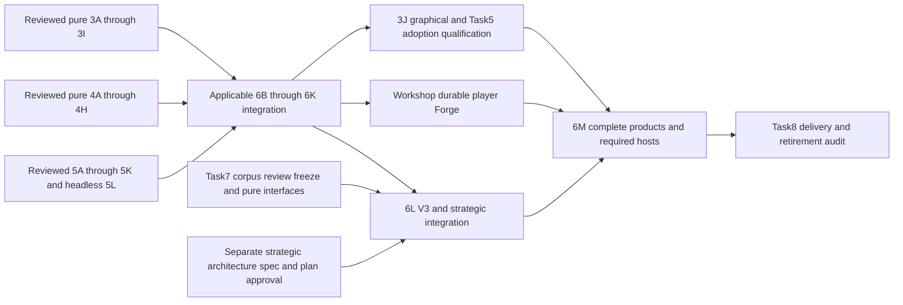
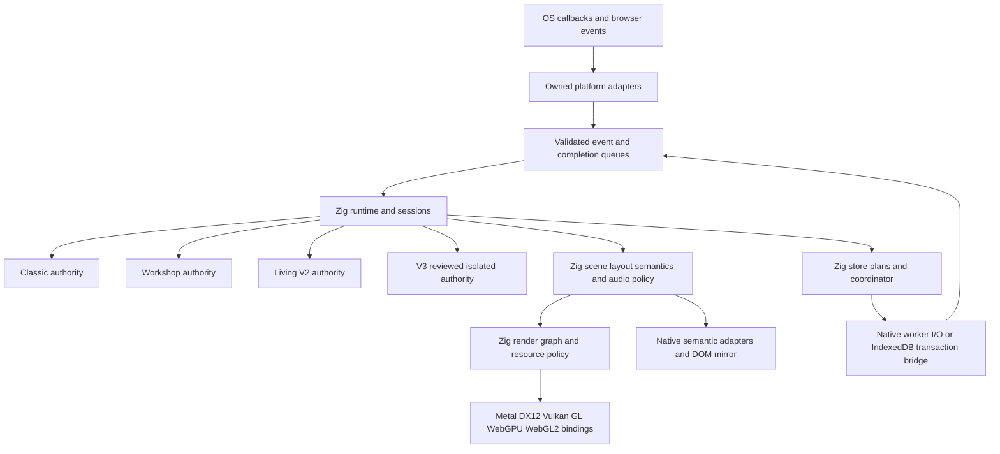
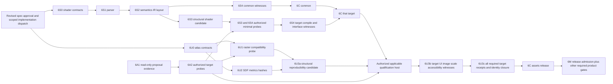
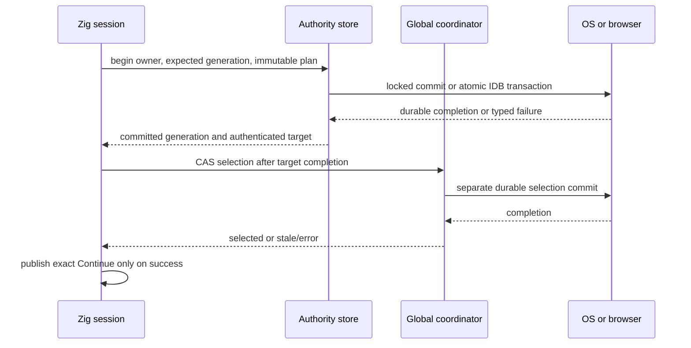

# NYON Task 6: platform bindings and complete game delivery

Date: 2026-10-09

Author: Abbey; host implementation ownership will be assigned in the reviewed plan.

Status: **Approved specification — implementation plan and its review pending**

Independent review: the [initial architecture review](../../qualification/2026-10-09-zig-platform-design-review.md) and [architecture fix1 review](../../qualification/2026-10-09-zig-platform-design-fix1-review.md) were followed by the [Zig-only tooling review](../../qualification/2026-10-09-zig-platform-tooling-review.md) and its [approved scoped fix1 review](../../qualification/2026-10-09-zig-platform-tooling-fix1-review.md). All blocking findings are resolved in this revision. Original raw findings are preserved. This does not authorize implementation, dependencies or asset replacement.

Reviewed draft identity: `50c5b1e6925f2fd4077d30dd2d2d283ea31ce2a4436a432139ea053130560add`; this durable copy changes only author/status metadata, the binding-inventory link and this review note.

User written-specification approval: Donald selected **Approve revised spec** on 2026-10-09 at 06:52 EDT for artifact `1d3257c31e7383118e46a78e6550e83752b4f6d2cf2fb74fc6d79b1af0c04d04`. This permits detailed implementation planning. Host/tool implementation, new dependency/tool acquisition, changed asset versions and source retirement retain their separate gates. Historical author revision notes below describe their preparation-time status.

Scope: Task 6 platform/runtime design; production-read-only preparation

Baseline: canonical NYON `main`, observed HEAD `bac2b6e313f8034309bd718d3b8cb4e0448ac20f`; concurrent dirty work remains owned by its existing agents.

## Overview

Recommend a project-owned Zig application/runtime and a deliberately small platform binding layer: AppKit/Metal on macOS, Win32/DX12 on Windows, X11/XWayland with Vulkan or explicitly selected GL on Ubuntu, and Zig WebAssembly with project-owned JavaScript adapters for WebGPU/WebGL2. Zig owns authority, sessions, command admission, layout, navigation, rendering policy, job scheduling, durable selection, recovery, cancellation, and audio policy. Foreign code performs framework calls, object/protocol adaptation, and browser transactions. No retained Rust production library qualifies through a C facade.

This choice has substantial costs: six graphics backends, three native accessibility adapters, Unicode text integration, cross-platform durable storage, and real qualification hardware. Linux requires a concrete, separately authorized set of distribution C libraries; Windows/Linux SDK availability and ABI behavior remain unverified. Donald's 2026-10-09 direction, **“Revise for Zig-only tooling,”** resolves the project tooling-language choice: recommend an owned Zig shader subset compiler and an owned Zig atlas generator, built with the repository's exact Zig 0.18 development pin. This adds compiler validation and raster compatibility work before 6C. No project Rust generator, Naga dependency, or Rust compatibility wrapper is selected for final tooling or runtime. The existing Rust game is a temporary migration comparison oracle only. System target shader compilers and platform raster APIs remain explicit proposed platform boundaries, with acquisition/linkage gates. This draft is neither specification approval nor authorization to implement hosts, acquire tools, add dependencies, or replace assets.

## Evidence, scope, and prerequisites

**Current:** focused source contracts were inspected and the supplied inventories were read; the supplied [binding inventory](../../qualification/2026-10-09-zig-platform-binding-inventory.md) records installed macOS headers, and the migration [requirement inventory](../../../docs/qualification/2026-10-09-zig-migration.md) retains the full product. Header presence is not a compiled binding or a working device. Current Rust behavior can expose a gap: sparse Classic semantics, unsupported non-macOS clipboard, and ASCII-only atlas drawing must not become a reduced acceptance standard.

**Proposed:** every new file, ABI, capacity allocation, dependency selection, delivery format, and implementation slice in this document. **Unknown/unverified:** native foreign ABI execution, Windows/Linux SDK and library versions, performance, driver correctness, real browser persistence, full Unicode coverage, accessibility, and offline delivery. No build, dependency installation, profile write, generated asset change, runtime qualification, commit, push, or PR was performed for this document. It closes no Task 6, Task 8, or LG acceptance row.

Authoritative references are [the migration plan](../../../docs/superpowers/plans/2026-10-09-nyon-zig-migration.md), [LG qualification](../../../docs/superpowers/specs/2026-09-04-nyon-living-galaxy-qualification.md), and [the acceptance ledger](../../../docs/qualification/2026-10-09-zig-acceptance-ledger.md). The October 8 [completion ledger](../../../docs/qualification/2026-10-08-living-completion-ledger.md) describes the strategic six-faced-world direction; its architecture/specification approval remains a separate prerequisite. Supplied inventories route focused investigation rather than prove host behavior.

| Reviewed prerequisite | Interface Task 6 consumes | Task 6 must not recreate |
| --- | --- | --- |
| Tasks 1/2 | Owned Classic scenario/preferences codecs, checked authority, exact store requests/outcomes, injected native paths | Canonical bytes, legacy fallback policy, atomic-save implementation owned by Task2B |
| Task 3A–3I | Fixed clock/session, command controller, detached drafts, typed settings, immutable scene/layout, input owner/router, pure durable-exit policy | Simulation commands from GPU/DOM callbacks; a second editor or advisory controller |
| Task 3F | Synchronous CPU scores and immutable GPU request/completion metadata | A new neural model, CPU worker, truncated fleet features, authority-affecting advice |
| Task 4A–4H | Workshop catalog/IDs, all 14 operations, six-phase tick, DAG/archives, bounded authenticated restoration and complete core Forge | Catalog substitution, headless Forge presented as durable player Continue |
| Task 5A–5K and headless 5L | Living V2 typed wire/catalog, all ten phases, history/notebook/facts, reviewed pure shared-update/retirement/private-presentation handoff and whole-island headless qualification | Synchronous hashing/replay/cleanup suffixes disguised as host work |
| Task 7 pure prerequisites | Independently reviewed/frozen V3 domain, pure authority/storage contracts, and separately approved strategic architecture/specification/implementation plan | V2-to-V3 conversion, invented V3 save keys or authority semantics |

### Dispatch dependency graph

The prerequisites are **reviewed pure interfaces**, not whole-task completion. Reviewed 3A–3I, 4A–4H, and 5A–5K plus headless 5L provide the inputs to the applicable 6B–K integration slices. The resulting graphical host then qualifies 3J, Workshop durable player Forge, and Task5's real runtime adoption. Task3, Task5 and Task6 remain Partial until those integrated journeys pass. The 5K handoff explicitly includes a runtime-owned retirement owner and private presentation preparation; headless success does not prove their host adoption ([Living inventory](../../../docs/qualification/2026-10-09-zig-living-inventory.md), slices 5K/5L).



Task7's corpus/review/freeze and approved strategic design prerequisites can proceed before final Task6 closure; 6L consumes their reviewed interfaces and supplies their player integration. Task7 remains Partial until its full integrated product qualifies. Do not make complete Task6 a prerequisite of the Task7 inputs that 6L needs. Likewise 6H must not wait for graphical 3J or final Task5 adoption before creating their host. Host-only conformance probes may precede pure-core completion after the relevant design/authorization subgates; they do not establish player acceptance. Slice 6M/Task8 waits for all integrated products and required hosts.

Goals: preserve every retained Classic/Workshop/Living/V3 journey; deliver the complete native/browser matrix; make ownership and commit races inspectable; keep work, memory, and callbacks bounded; qualify real user controls and actual artifacts. Non-goals: a general engine/plugin framework, a new storage schema, new gameplay rules, new catalog/font downloads, or a Rust production compatibility layer. Native Wayland protocol support is not selected for the first Ubuntu delivery: explicitly qualify X11 and XWayland on Ubuntu 24.04, including touch, IME, Orca, scaling and both graphics backends. This delivery choice does not remove Ubuntu or Firefox acceptance.

## Architecture and permitted foreign boundary



All native entrypoints and the Wasm exports are Zig. An OS calling a tiny Objective-C delegate/COM provider or a browser loading JavaScript is the explicit permitted host bootstrap boundary, not a foreign application runtime. Proposed files `zig/host/include/nyon_host.h`, `zig/host/macos/nyon_appkit.m`, and `zig/host/windows/nyon_com.cpp` provide mechanically typed framework calls where Zig cannot directly express Objective-C protocols, blocks, or COM callbacks safely. Prefer direct C imports for C APIs. Do not cast an untyped `objc_msgSend` across arbitrary struct-return signatures. C++ glue has exceptions disabled at the boundary; no STL-owned state crosses it. Objective-C exceptions never unwind through Zig. Framework-owned buffers are copied or retained under a documented release operation.

Allowed foreign responsibilities are window/surface creation, event encoding, native IME/text metrics, immutable semantic provider objects, audio-device transport, async dialog handles, and browser API calls/atomic transaction execution. Foreign code cannot validate game archives, select an authority, advance ticks, decide whether a stale result installs, author revisions, generate stories, implement autosave timing, select render quality, or retry destructive store operations. A source import graph and final binary dependency audit enforce this boundary. Project developer generators, shader parsing/lowering, atlas layout/SDF/serialization, and final asset verification are owned Zig programs. Tiny C/Objective-C/COM/JS adapters only bridge the specified system APIs; invoking a Rust generator through any adapter or subprocess is forbidden in the final tool graph. Temporary Rust game-oracle executables are separately named migration evidence artifacts and are removed from the final build/qualification dependency graph once their Zig replacements qualify.

### Project ABI and ownership

The following is a **proposed project ABI sketch**, not a claim about foreign SDK declarations or presently compilable Zig syntax. Review concrete ABI layouts with the pinned compiler before generating headers.

```c
typedef struct { uint32_t slot, generation; } NyonHandle;
typedef struct { uint64_t session, presentation, device, request; } NyonOwner;
typedef struct { const uint8_t *data; uint32_t length; } NyonBorrowedBytes;
typedef struct {
    uint32_t abi_version, struct_bytes, kind, flags;
    NyonOwner owner;
    NyonHandle payload; /* arena-owned payload, never an OS pointer */
} NyonCompletion;
/* Returns a status; borrows input only until return. */
uint32_t nyon_host_submit(NyonHandle host, const void *request,
                          uint32_t request_bytes);
/* Single consumer takes the payload once; release is explicit. */
uint32_t nyon_host_poll(NyonHandle host, NyonCompletion *out);
uint32_t nyon_host_release(NyonHandle host, NyonHandle payload);
```

Internally use typed Zig unions and separate domain interfaces, not a generic integer-opcode store exposed to application code. ABI version and struct byte count reject mismatches; use fixed-width integers, explicit padding, checked lengths and stable tags. No Zig error unions, native `bool`, slices, allocators, C++ containers, Rust layout, or native pointer addresses in the wire ABI. UTF-8 strings are length-delimited, not trusted NUL-terminated data. POSIX paths use owned opaque byte arrays and Windows paths use owned UTF-16 code units; do not round-trip filesystem paths through display strings. IDs and generations use checked increment; exhaustion is a typed error, never wraparound reuse.

Each completion carries a never-reused request identity and the relevant owner generations. Session replacement invalidates session and presentation ownership; draft replacement invalidates a distinct editor identity; GPU recreation invalidates device ownership. A mutable field value does not itself replace the draft identity (`src/ui/accessibility.rs:50`, `SemanticInputOwner::matches`). Acceptance rechecks ownership at **publication**, not only submission. A stale completion disposes its resources exactly once and never installs a session, edits a replacement draft, or overwrites a GPU context. Native callback userdata lives until callback detachment and in-flight callback acknowledgement; freeing its Zig owner earlier is forbidden.

Browser ABI: Wasm32 byte offsets/lengths, checked unsigned arithmetic against the current `memory.buffer.byteLength`, and opaque handle pairs. Pass 64-bit identities as two u32 words or BigInt at explicit exports; never use lossy JS Number conversion. JavaScript copies a borrowed span before returning or starting a Promise. It must reacquire typed-array views after any call that can grow memory and must never retain Wasm views across `await`. Large input/results use bounded transfer handles and 64 KiB copy steps; completion ownership changes only when Zig takes the result. Host callbacks enqueue events; they do not reenter ticking or publication. A synchronous user gesture may start a previously prepared clipboard/picker/audio request before returning; its completion still follows the queue.

### Threads, scheduling, and bounded retirement

Native window/event dispatch, semantic snapshot publication, surface configuration and renderer encoding remain on the designated UI thread. GPU initialization may use one worker only for API operations whose SDK contract permits that thread; the surface stays attached to the main-thread window. A generation-only wakeup tells the main thread to inspect the mailbox, matching `src/app.rs:471–565`. Worker-safe device acquisition is a per-backend proof obligation, not inherited from wgpu's `Send` behavior. GL context initialization/use remain on their bound thread. Windows provider RPC callbacks serve retained immutable snapshots and enqueue actions; they never block waiting for the main thread while holding a provider lock.

Proposed initial host limits, to be measured and adjusted by reviewed constants:

| Resource | Bound and saturation policy | Establishing test |
| --- | --- | --- |
| Shared update allowance | At entry to one outer resident runtime update, initialize `remaining_visits` once: default 1024, valid range 1..=1024, test allowances 1/64/1024/mixed. Every child consumes this same remainder; invalid 0/1025 allowances execute zero visits | Mixed boundary/history/restore/compare/cache/retirement work, including failed work, never exceeds the single initial allowance |
| Living pending requests | `pending_boundaries` ≤20, including the request held by the one prospective boundary until committed or cancelled; this is separate from accepted authority commands and host I/O tickets | Cap prospective debt without losing accepted commands; unrelated host I/O saturation does not change boundary-request admission |
| Publications per update | `publications_this_update` starts at zero only at outer update entry and permits at most twenty committed boundaries; every successful boundary publication increments it independently of request/ticket release | Twenty-one immediately-ready boundary attempts with recycled tickets/replenished pending requests still publish at most twenty in one update |
| Proposed physical host tickets | At most twenty outstanding physical host operations, counted separately from Living pending requests and per-update publication counters; this proposed admission/backpressure limit is not an accepted Living invariant | Saturating/recycling host tickets neither resets `remaining_visits` nor `publications_this_update`, and cannot consume Living's twenty request slots |
| Native I/O workers | Two fixed store/file workers; one GPU-init worker; no thread per request; one audio transport context | Abandon/retry storm cannot increase workers or in-flight tickets; UI poll never joins |
| Workshop public lanes | Exactly Commit and LoadOrImport; `abandon` frees the public lane/outcome only | Source contract at `src/workshop/store.rs:441`; real write may finish, next generation is reconciled |
| Physical operations | Ticket/byte permits remain held until actual native/JS completion, even after public abandonment; new admission returns Busy when permits are exhausted | Repeated abandon/start cannot spawn unlimited writes or leak outcomes |
| Async payload memory | Proposed 128 MiB host transient byte budget, maximum one 32 MiB import per transfer lane; reserve worst-case copies before admission | Legal maximum single archive succeeds; concurrent pressure reports Busy, never a false TooLarge or truncated archive |
| Input queue | 512 records plus bounded text payloads; coalesce pointer motion/resize only; reserve critical focus/cancel records | Saturation cannot drop commit text, release, or cancel silently; overflow resets held input and reports recoverable input loss |
| Completion queue | One reserved terminal cell per admitted ticket; terminal/error/commit results cannot be displaced by progress events | Out-of-order completion plus cancelled owners, no terminal result loss |
| GPU frames | At most three in flight; upload and retire bytes tracked against approved per-device budgets | Fence stalls do not cause unchecked allocation; backpressure reduces rendering, never skips authority ticks |
| Text cache | Proposed 16 MiB runtime glyph/run cache plus immutable 1 MiB R8 atlas; eviction excludes in-flight resources | Cache churn, mixed scripts, scale changes and eviction preserve text and caret |

The scheduler contract comes from `docs/superpowers/plans/2026-10-02-living-resident-runtime.md:15,33–47`. A single outer runtime update owns the reset boundary, even when the view is hidden or no Session is installed. It passes **the current remaining allowance**, never a fresh 1024, to boundary/history/restore/compare/private-cache/cue preparation and retirement children. After each child returns, subtract its actual visits exactly once, including failed work; terminal polls consume zero visits. Nested children use their parent's remaining value, and variable encoding emits at most 256 bytes per visit. A store completion or browser callback only enqueues work for this scheduler; it cannot obtain a fresh budget, commit a boundary, or reset the publication counter. The per-update cap applies even when very cheap prepared boundaries finish and physical tickets are recycled. Reaching either the visit limit or twenty publications defers subsequent eligible work to a later outer update.

A runtime-owned retirement owner outlives Session removal/replacement. Preserve at most one prospective boundary and one retirement task; drain required retirement before admitting the next prospective owner, retain rejected incoming owners for counted cleanup, and never accumulate a queue of fully allocated cancelled candidates. Private Chronicle/decision/guidance/cache rows, labels/evictions and audio cues consume the shared allowance before the capture fence; install them only with successful current authority publication. Stale/cancelled work emits no rows or cues. Hidden/no-session updates continue retirement with the same allowance. The current `src/sandbox_session.rs:3537–3568,3619–3650` is transitional source evidence, not proof that this complete contract already works.

Living pace remains integer 1/4/20 with prospective due requests capped at twenty and excess prospective timing debt dropped. Exactly-one Step requests one boundary even when it needs multiple updates. Pause/holds/suspension/history/replacement/leave clear prospective timing/request debt and cancel the candidate while preserving accepted authority-owned commands. Effective pace uses actual publications over rolling one-second elapsed time, omitting zero-duration denominator entries. Required scheduler tests combine immediately-ready/recycled publication attempts, mixed history plus retirement consuming the same remainder, failed-child visits, hidden/no-session cleanup, every presentation cut, and accepted-command retention. These are independent from tests of proposed host physical admission.

The 128 MiB host allowance excludes authority/history memory, GPU memory and browser implementation-internal copies; measure those separately. It is an admission limit, not a reduced archive cap. Maximum-size operations must account for transport copies and fail without mutation if allocation cannot be reserved. Moving a 32 MiB structured clone or a driver call off a core budget does not make its wall time bounded. Record synchronous copy, GPU acquire, OS flush and callback costs separately; adjust staging or worker placement if input/frame targets fail.

Retirement is a state machine: detach callback sources → invalidate generations → stop new work → await completed I/O/GPU fences → release each bounded batch. The single shared update allowance includes Task5 cleanup of core arenas and histories; do not call a recursive unbounded destructor after reporting Ready. Driver/object destruction that may block goes to the permitted owner context after fence completion, not a falsely “free” core step. At most one retiring device plus its bounded in-flight frames is retained; if teardown stalls, stop renderer reinitialization and offer recoverable diagnostics instead of allocating repeated devices. The window outlives its surfaces, and audio buffers outlive their callbacks.

## Selected platform services

Each row describes the recommendation, source basis, known cost, failure policy, ownership invariant and qualifying test. Foreign function signatures must be generated/imported from the selected target SDK or checked in a tiny C/ObjC/C++ probe on that host; none are inferred from a macOS header inventory for other systems.

| Surface | Recommendation and evidence | Cost, recovery, invariant and proof |
| --- | --- | --- |
| macOS window/input | AppKit window and view with `NSTextInputClient`, thin typed ObjC delegate; local headers in inventory and lifecycle/IME in `src/app.rs:2079–2394` | Main-thread AppKit, retained callbacks; composition and committed text distinct. Lost focus clears held keys/pointers; suspended/zero extent stops rendering. Test resize, occlusion, Retina move, non-Latin composition, close during save and stale callbacks. |
| Windows window/input | Win32 window/message dispatch with per-monitor DPI and TSF text service; native touch/pointer identifiers | New target SDK implementation, no local proof. Windows main-thread host owns HWND and TSF lifetime. Cancel composition on owner loss, not every redraw. Test surrogate/combining text, candidate UI, pointer cancellation and DPI changes on Windows 11. |
| Ubuntu window/input | Xlib/XInput2/XIM on X11 and XWayland; retain one window owned by UI event thread | X11 client runtime proposal below; XIM composition under the actual IBus/session must qualify. No raw keycode-to-text shortcut. X server loss gives explicit session-preserving failure. Test GNOME X11 and Wayland/XWayland, IME, touch/pinch, selection and scaling. [Xlib specification](https://www.x.org/releases/X11R7.6/doc/libX11/specs/libX11/libX11.pdf) documents input-method preedit; transport selection is Proposed. |
| Browser window/input | DOM canvas with CSS extent/DPR and pointer, wheel, key, composition and visibility events; project-owned JS | Based on `src/platform/web.rs`, `src/ui/platform_web.rs`. Avoid duplicate canvas and mirror input processing; one active input owner/action. Pointer capture loss cancels. Test actual Safari/Chrome/Edge/Firefox typing, touch, tab visibility and replaced canvas handlers. |
| Native accessibility | AppKit NSAccessibility; Windows UI Automation provider objects; Ubuntu AT-SPI D-Bus server for application/tree/component/action/selection/value/text/editable-text/cache/events | High implementation cost; direct adapters consume a common Zig semantic snapshot. Stable IDs, focused/disabled/selected/expanded/value/name/description and live notices are required. No direct authority mutation. Test VoiceOver, Narrator and Orca with all tools and editable text. UIA is a provider interface, and Linux libatspi is primarily a client, not an automatic custom-widget server. See [UIA providers](https://learn.microsoft.com/windows/win32/winauto/uiauto-providersoverview) and [AT-SPI action protocol](https://gnome.pages.gitlab.gnome.org/at-spi2-core/devel-docs/doc-org.a11y.atspi.Action.html). |
| Browser accessibility | DOM mirror with actual editable controls, roles/ARIA/live region and UTF-16 caret restoration | `src/ui/platform_web.rs:120–174`; snapshot is derived from the same logical layout. Avoid a hidden duplicate tab order. Test browser/screen-reader combinations, modal focus, long lists, rejected edit and stale event after session replacement. |
| Clipboard | NSPasteboard; Win32 clipboard; X11 CLIPBOARD selection including bounded INCR; browser Clipboard API and normal paste events | Complete current unsupported Windows/Linux gap (`src/ui/clipboard.rs:143`). One owned request with 1 MiB cap; denied permission, owner loss, invalid UTF-8 or oversize preserves field. Never clear clipboard on cancellation. Test normal/large/cancelled paste and busy lane, with user-gesture browser cases. |
| File dialogs | AppKit open/save panels; Windows common item dialogs; Ubuntu xdg-desktop-portal FileChooser over D-Bus; browser input/download | Async owner-bound selected-path/file handles, real cancel outcome, cap before reading and during stream. Portal availability and version probed on Ubuntu; absent portal yields actionable import/export failure, not fake success. [Portal contract](https://flatpak.github.io/xdg-desktop-portal/docs/doc-org.freedesktop.portal.FileChooser.html) supplies chooser requests, not content validation or durable write. |
| Audio | Zig synthesis/cue/rate/mute policy, AudioQueue output on macOS, WASAPI shared output on Windows, PulseAudio client transport on Ubuntu, WebAudio procedural playback | `src/living_audio.rs:15–371` is behavior witness. Native realtime callbacks only consume preallocated PCM; no locks, allocation, storage or authority. Device loss suspends output and preserves settings. Browser user gesture resumes; no-device and mute remain playable. Test one cue/category/rolling second and four total, stop on presentation replacement and persisted levels. Reconcile native/browser envelope differences explicitly before freezing waveform tests. |

Native semantics providers may retain retired snapshot nodes while clients hold references, but actions carry the original owner token and are rejected after replacement. Provider retention is bounded by a tombstone policy and snapshot generations; remote assistive clients cannot keep game authority alive. If OS objects must survive longer, they retain a minimal immutable tombstone, not the retired session. Virtualized lists must expose correct total position and a discoverable scroll/reveal action; offscreen items cannot intercept input. Full Classic semantics are required even where the Rust oracle has fewer nodes.

### Text, logical geometry, and asset identity

Retain the existing 1024×1024 R8 SDF atlas, metrics, icons, Inter/Lucide licenses and hashes for existing ASCII UI. `assets/ui/PROVENANCE.md` and `src/ui.rs:27–36,666` establish that atlas identity, not a Unicode rendering solution. The proposed Zig atlas tool below replaces project generation and verification; keeping the immutable committed atlas during migration is not proof that regeneration works. Changed raster pixels or metrics require a distinct reviewed asset-version proposal; the tooling-language direction grants no permission to rewrite the current assets. Do not reject otherwise valid names merely because this renderer cannot show them.

Recommendation: add a separate runtime text-run service for non-ASCII/editable text: CoreText/CoreGraphics, DirectWrite glyph runs, Pango/Cairo on Ubuntu, and local browser Canvas2D/DOM shaping. Use the committed Inter fonts where covered and platform fallback for missing scripts; no runtime font network fetch. Native text service returns measured runs, cluster/caret boundaries and raster tiles as owned presentation data; Zig owns text content, validation, selection intent and layout. Browser editable DOM controls supply real composition/caret behavior; equivalent visible text uses the same local font family, bounds and direction. DirectWrite is renderer-independent and supplies text layout/glyph handling ([Microsoft documentation](https://learn.microsoft.com/en-us/windows/win32/directwrite/introducing-directwrite)); [PangoCairo](https://docs.gtk.org/PangoCairo/) is the proposed Linux shaping/raster seam, not a currently installed NYON dependency.

Keep canonical stored UTF-8 bytes unchanged; no implicit normalization. Model caret/selection positions in validated UTF-8 boundaries with explicit UTF-16 conversion for AppKit/Windows/browser and code-point conversion where AT-SPI requires it. Grapheme/cluster movement comes from a reviewed text-run mapping; never slice a surrogate pair or combining cluster by byte index. A run containing shaping-sensitive characters is shaped as a whole, not mixed per-character with ASCII atlas glyphs. Malformed input stays in a detached invalid draft with a visible error. For valid code points without a platform glyph, render an explicit replacement/code-point description and preserve editable/copyable text; required international scripts and IME cases must receive actual glyph/font qualification before completion. Color emoji, RTL selection and font fallback are material costs, not assumed solved by installing a shaper.

All drawing, clipping, picking, semantic bounds and text caret bounds come from one immutable layout result. UI scale is applied once in logical coordinates; device pixel ratio only converts raster/surface extents and final pixel scissor. Validate finite/range inputs, round scissor edges outward and clamp to the physical target under the numeric-boundary contract below; do not round authoritative or hit-test geometry to device pixels. Retain 44 logical-pixel control targets. Resize/scale updates invalidate presentation/text cache generations while retaining draft/caret/focus. Test all required viewports and 100/115/130% cases, mixed-DPI movement, non-ASCII maximum-length valid names, RTL/combining text, surrogate pairs, long diagnostics and composition during resize. Font-specific raster pixels may differ across OSes; clip/hit/caret correctness and accessible text must not.

## Graphics, shaders, and advisory

Use a narrow Zig renderer interface with explicit resource descriptions, immutable frame commands, surface state, capabilities, and error outcomes. It is shaped by `src/engine/{resources,render_frame,scene_renderer,ui_renderer}.rs`, not a full wgpu API emulation. Represent backend objects as generational handles. Required commands cover bounded buffer/texture upload, indexed/instanced opaque and transparent draws, depth, blend, scissor, render targets/MSAA/resolve, postprocess, and optional compute/readback. Error scopes must distinguish malformed packaged shader/ABI from device resource failure. No backend supplies gameplay truth.

| Backend | Binding/shader selection | Ownership, failure and qualification |
| --- | --- | --- |
| macOS Metal | Objective-C Metal through typed bridge, CAMetalLayer; offline generated MSL and host-built metallib | UI owns layer; explicit queue/fence retirement. `nextDrawable` may block: measure and use bounded frame admission. Test zero extent, occlusion, drawable timeout, layer recreation and Low/High under real Metal. |
| Windows DX12 | D3D12/DXGI calls via SDK C/COM seam; HLSL translated offline and DXIL produced with pinned SDK DXC | Descriptor heaps, root signatures, barriers, queue fences and device removed handling are project work. Never reuse upload/descriptor ranges before fence. Require Windows SDK build and live adapter fault/resize tests. |
| Ubuntu Vulkan | Direct Vulkan loader C ABI and `VK_KHR_xlib_surface`; offline SPIR-V | Own surface/swapchain/render-pass or dynamic-rendering choice, memory and command pools, semaphores and fences. Check queue-family presentation and capabilities. No assumption that Vulkan handles are safe concurrently. Vulkan explicitly supports [Xlib WSI](https://docs.vulkan.org/spec/latest/chapters/VK_KHR_surface/wsi.html); actual Ubuntu extension/driver support is unverified. |
| Ubuntu forced GL | Direct GLX context plus reviewed desktop GLSL target; `--backend=gl` must force this path | Context owned by one thread; actual selected backend reported. Low is mandatory, no compute required. Test extension/limits, transparent sorting, context recreation and shader compile/link failures. This adds an explicit selector missing from current `Backends::PRIMARY`. |
| Browser WebGPU | JS calls `navigator.gpu`, canvas context and typed resources; validated WGSL | Promise error/loss completions are device/owner tagged, no retained Wasm views. Test startup failure after successful adapter preflight, device loss, async map failure and real compute parity. |
| Browser WebGL2 | Separate Wasm/JS backend package, actual WebGL2 context, offline GLSL ES 3.00 | Explicit attribute/uniform/sampler mapping and downlevel render limits, no compute advisory. Handle context lost/restored events. Qualify both forced and natural fallback, not merely import a GL artifact. |

### Shader eligibility and common/target gates

Before **6C-common**, complete the reviewed Zig tool prerequisites 6S0–6S2 and 6S4-common below. The project tooling-language decision is already Zig-only; architecture/specification approval, implementation dispatch, and any tool-provisioning authorization under 6A1/6A2 remain separate. The actual current pin is `zig/.zigversion`: `0.18.0-dev.120+9fe22a29b`; changing it needs a reviewed toolchain change, not an implicit move to another nightly. Task8 audits this prior decision and final dependency closure; it grants no Rust tooling exception.

Proposed pipeline: the owned Zig lexer/parser and semantic checker validate **all seven WGSL source families**, lower them to typed IR, then emit or retain only the backend-eligible entrypoints in the following table. Current `tests/shaders.rs`/`tests/ui_assets.rs` and the Naga reference in `Cargo.toml` are historical contract evidence, not a selected generator or validation dependency. `R` means rendering entrypoints required in that target's compilation gate and shipped shader manifest; `C` means advisory compute required for the selected compute-capable target, with actual supported-device parity later; `X` means intentionally excluded by the selected backend contract, not a failed or passed test.

| Shader family and exact source entrypoints | Metal / MSL | DX12 / HLSL→DXIL | Vulkan / SPIR-V | Native GL / desktop GLSL | WebGPU / WGSL | WebGL2 / GLSL ES 3.00 |
| --- | --- | --- | --- | --- | --- | --- |
| `primitives.wgsl`: `vs_main`, `fs_main` | R | R | R | R | R | R |
| `space.wgsl`: `vs_main`, `fs_main` | R | R | R | R | R | R |
| `worlds.wgsl`: `vs_main`, `fs_main` | R | R | R | R | R | R |
| `routes.wgsl`: `route_vs/route_fs`, `fleet_vs/fleet_fs`, `halo_vs/halo_fs`, `particle_vs/particle_fs` | R | R | R | R | R | R |
| `ui_sdf.wgsl`: `panel_vs/panel_fs`, `vs_main/fs_main` | R | R | R | R | R | R |
| `postprocess.wgsl`: `vs_main`, `fs_main` | R | R | R | R | R | R |
| `advisory.wgsl`: compute `score_world`, workgroup size 8, three storage buffers | C | C | C | X: CPU baseline | C | X: no compute |

The six rendering families comprise twenty vertex/fragment entrypoints; **none may be removed from the WebGL2 Low artifact to fix compute eligibility**. Low's rendering policy still draws its complete scene/UI, quarter decorative particles and no bloom; compiling/retaining the postprocess family does not enable High effects in Low. Native GL compute is optional and **not selected** in this baseline: any later opt-in needs its own capability/language/entrypoint gate and keeps CPU fallback. GLSL ES 3.00/WebGL2 never demands or packages `score_world`. Capability-unavailable compute devices retain the CPU controller; that fallback is not a successful GPU-parity result.

6C has separate gates:

- **6C-common:** reviewed 6S0–6S2 and 6S4-common Zig tools and witnesses; parse/validate all seven source families, enumerate every entrypoint, freeze reflection/packing/numeric contracts, eligibility table, source hashes and translation options. It neither runs a foreign backend nor waits for every target compiler. A syntax/semantic failure anywhere, including advisory, fails the common source gate even though GL does not emit compute.
- **6C-Metal / 6C-DX12 / 6C-Vulkan / 6C-GL / 6C-WebGPU / 6C-WebGL2:** after that target's 6A2 tooling/ABI prerequisites and reviewed 6S3-target/6S4-target, emit or retain the table's eligible entrypoints, then run the appropriate system SDK/compiler or minimal real browser/GL shader-compilation/link probe. WebGPU validates packaged WGSL in its real implementation; native GL and WebGL2 compile/link the packaged GLSL. Record the exact compiler/browser/device and artifact hash. Runtime pipeline/draw/advisory parity is additional host acceptance, not implied by shader compilation.
- **6C-assets:** final all-target release asset admission, also called **6C-assets-release**. It follows 6U3a structural/reproducibility candidate admission, 6U3b-target UI/image/layout/scale/accessibility witnesses and 6U3c all-target promotion. It is not a prerequisite for executing the qualification hosts that produce those witnesses. Exact compatibility or a separately approved asset-version proposal remains required; candidate admission alone closes no release or full-host acceptance row.
- An authorized individual platform qualification host can start after 6C-common, **its own applicable shader target gate**, other applicable pure/ABI/service prerequisites, and a **6U3a qualification-only candidate asset receipt**. It executes the complete target UI journeys needed for 6U3b-target before final 6C-assets-release. Missing Windows/Linux hosts do not block macOS candidate qualification; they keep their own witnesses and all-target release promotion pending. A browser pair remains Partial until both WebGPU and WebGL2 applicable gates and integration pass; full Task6 remains Partial until every required target gate and runtime row passes.

Manifest entries distinguish `required-passed`, `required-failed`, `required-unexecuted`, and `excluded-capability` with explicit reason, source entrypoint, target/version and evidence. An unsupported required translation is `required-failed`, never silently reclassified as excluded; absent hardware is unexecuted, never a pass. Freeze coordinate-space conversions, binding remaps and tool hashes in `zig/tools/shader-manifest.json`. Failed/unexecuted gate reports are not loadable release manifests. Explicit qualification-only candidate manifests may admit the exact authorized probe/host stage while later witnesses remain pending, under the candidate protocol below; a failure in an admission prerequisite rejects loading. Publication of a release manifest is atomic and requires its common/target gates, final 6C-assets-release and required runtime witnesses; the complete delivery manifest requires all six targets. Ordinary release packaging rejects qualification-only candidates. New DXC or other tool acquisition requires its separately recorded authorization before acquisition/use. No project source parser, IR interpreter, or source-to-source compiler ships in the game; platform shader compilation by WebGPU/GL and native GPU drivers remains the declared system boundary.

Before porting draws, produce shader reflection contracts for each entrypoint and host layout: 36-byte primitive Vertex, logical globals, matrices/column order, signedness, vertex locations, offsets/strides/alignment, storage/uniform sizes, sampler/texture types, bind slots, instancing and advisory buffers. `src/engine/resources.rs:31–135` uses column vectors and explicit attributes; `tests/renderer_contracts.rs`, `tests/shaders.rs`, `tools/validate-vertex-layout.py` and `assets/shaders/*` are witnesses. Translate depth range/front-face/Y conventions once in the backend's pipeline contract. Validate blend mode/premultiplication, linear/sRGB target behavior, depth attachment formats, stable back-to-front tie sorting, R8 sampling and clipping. Generated source diffs are tooling outputs; change generator/configuration then regenerate, never hand-edit generated shaders or atlas.

### Owned Zig shader compiler: exact corpus and supported language

**Recommendation, not an implementation claim:** retain the seven authored WGSL files as the single shader source and build a deliberately closed WGSL subset compiler in `zig/tools/shaders/` using Zig/std. It has a real tokenizer, grammar parser, name/type resolver, semantic validation, typed structured IR, independent IR verifier, resource-layout planner and target emitters. No regex rewriting, handwritten per-shader replacement, Naga subprocess/library, vendored Rust compiler, or runtime parser is permitted. The current seven files total 17,131 bytes; small source size bounds the initial language, not compiler correctness or implementation effort. The supported profile is provisionally named `nyon-wgsl-1`, pinned to the [2026-09-21 WGSL specification](https://www.w3.org/TR/2026/CRD-WGSL-20260921/); its exact grammar and conformance vectors must be reviewed in 6S0 before code is dispatched.

Source evidence is the full `assets/shaders/{primitives,space,worlds,routes,ui_sdf,postprocess,advisory}.wgsl` corpus. The following is the required profile, not a claim that every WGSL construct is supported. 6S0 must associate each construct with its source span and positive/negative cases; omission of an existing construct fails that slice instead of being worked around by changing a shader.

| Language / semantic surface | Required owned implementation and concrete source use |
| --- | --- |
| Lexical and declarations | Whitespace, `//` comments, identifiers with underscores, decimal integer/float literals and unsigned `u` suffix, hexadecimal unsigned literals, punctuation and operator precedence; `struct` with member attributes and optional trailing semicolon, global `const`, resource `var`, local `let`/`var`, typed/untyped initializers, typed zero-initialized variables, `fn` with attributed parameters/return. Parse tokens and nested type arguments, never textual substitutions. Negative values are unary operations; preserve contextual abstract-number materialization and f32 rounding. |
| Value types and constructors | `f32`, `u32`, inferred `bool`; `vec2/vec3/vec4<f32>`, `vec3/vec4<u32>`, inferred `vec2<u32>` texture dimensions; `mat4x4<f32>`; named structs; fixed `array<T,N>` with literal extents 3/4/6/7/57/84. Support scalar conversions, vector splats/mixed vector-scalar construction, matrix column construction, typed array constructors, member/index accesses and xyzw/rgba swizzles. Constructor arity, index type, writable single-component lvalues and implicit/explicit conversion rules are checked. |
| Expressions and statements | Arithmetic `+ - * /`, unsigned remainder `%`, `&`, `>>`, comparisons `== != < <= > >=`, unary minus, parentheses, calls; `=`, `+=`, `*=` including field/array/component assignments; blocks, `if`/`else if`/`else`, value/void return, fragment `discard`, and structured `for` with fixed bounds and u32 induction. Advisory's loops are 4 × 12 plus 4; it has no recursion, barrier, atomic or workgroup memory. Preserve evaluation/assignment order and zero initialization. |
| Builtins | Exact used overloads of `max`, `clamp`, `length`, `fwidth`, `smoothstep`, `dot`, `normalize`, `pow`, `sin`, `fract`, `floor`, `mix`, `select`, `atan2`, `textureSample`, `textureDimensions`. Validate scalar/vector overloads, stage and uniform-control-flow restrictions, result types and conversion rules. Builtin semantics are explicit IR operations, not unverified target-name aliases. |
| Stages and interfaces | `@vertex`, `@fragment`, `@compute @workgroup_size(8)`; `@location`, `@builtin(position/vertex_index/global_invocation_id)`, `@interpolate(flat)`, `@group(0) @binding(n)`. Validate unique locations/bindings, matched vertex/fragment types and flat u32 varyings, legal builtins/stages, return paths and workgroup limits. Struct members and direct parameters/returns both occur. |
| Memory and resources | Uniform structs, `texture_2d<f32>`, sampler; fixed-array storage buffers `var<storage, read>` and `var<storage, read_write>`. Validate address-space/access restrictions and entrypoint-reachable resource use. No implicit host struct memcpy assumption: every uniform/storage/vertex/instance mapping has a verified layout. |

Anything outside this profile fails with path, source span, stable error code and the unsupported construct before any loadable manifest publication: including unrecognized directives/attributes/builtins, pointers, runtime-sized arrays, overrides, f16, recursion, atomics, barriers, general loops, new resource kinds or unproved dynamic accesses. Future shader/assets that need an extension require a distinct reviewed profile/version/target-eligibility change and authorized implementation; a source hash change never silently widens the compiler. An accepted grammar construct must also pass semantic and target checks. Initial proposed limits are 64 KiB/source, 256 KiB/corpus, 32,768 tokens/nodes per module, nesting depth 64 and a 32 MiB compiler arena; measured existing-corpus headroom and exhaustion tests are 6S0/6S1 gates. Limit failure is explicit and leaves previous outputs intact. These limits are proposed engineering choices, not measured memory/performance claims.

The typed IR preserves f32/u32/bool/vector/matrix/array/struct types; symbol IDs and lexical scopes; source spans; resource bindings and access modes; structured blocks/branches/loops; stage/builtin/interpolation annotations; literal bit patterns; and explicit load/store/call/conversion/builtin operations. It contains no foreign pointers or allocator ownership. One invocation owns a bounded arena, released on every success/error; emitters consume a read-only verified module. The internal interfaces are source bytes + profile → spanned AST → checked module/layouts → verified IR → target artifacts + reflection → gate receipt; only the final manifest publisher can install output. Each stage returns a typed diagnostic or an owned result, never a partial module marked valid. An IR schema/version change invalidates caches. Independent verification rechecks every use/type, control-flow return, resource access and stage restriction after lowering; malformed IR cannot reach an emitter. Emit target identifiers from symbol IDs with deterministic escaping, never concatenate user-controlled source text as target syntax. No optimizer is needed initially: do not reassociate expressions, enable fast-math, introduce fused multiply-add, hoist derivatives through branches, or unroll/reorder compute reductions. Preserve eager builtin argument evaluation, including `select`; it is not an unchecked substitution with a lazy conditional. System compilers' effective numeric flags and actual behavior are separately qualified.

Bounds and numeric semantics need explicit proofs. Vertex-indexed constant arrays of size 3 or 6 require the matching host draw-count/range contract. The advisory invocation guard precedes all reads/writes and rejects invocation 7; loop induction proves every feature/weight/hidden/score index. Reject an unproved new access until guarded lowering and tests are reviewed. Preserve the primitive derivative calculations before shape-dependent flow, flat integer metadata, packed ring endpoints, and the source-specific straight/premultiplied blend conventions. `space.wgsl` and the fleet/halo/particle fragments use descending `smoothstep` edges. WGSL defines descending interpolation through its clamped polynomial; a target builtin must not be assumed equivalent. Lower it explicitly with the same typed operations and test both edge orders, equality-domain handling, and endpoints against independent vectors. This follows the pinned [WGSL smoothstep contract](https://www.w3.org/TR/2026/CRD-WGSL-20260921/#smoothstep-builtin). Keep shader math tolerances distinct from the exact CPU ring quantization contract below.

### Owned emitters, manifests, and independent witnesses

| Target profile proposed for 6S0/6A2 confirmation | Owned Zig output and mandatory target checks |
| --- | --- |
| Metal, MSL 2.4 | Emit typed MSL with explicit stage structs, vertex attributes, buffer/texture/sampler slots and verified host padding. The installed Apple SDK shader compiler produces metallib. Pin SDK/compiler build, deployment target and options; actual supported SDK/device compilation is unverified. |
| DX12, HLSL shader model 6.0 | Emit typed HLSL with explicit semantics/register/root-signature crosswalk and constant/storage-buffer layouts. Authorized SDK DXC produces stage-specific DXIL. Pin DXC identity, shader model and numeric options; no DXC installation or functioning Windows toolchain is assumed. |
| Vulkan 1.1, SPIR-V 1.3 | Emit SPIR-V binary directly from verified IR in Zig: explicit entrypoints, capabilities, types/constants, descriptor/location/interpolation/offset/stride decorations and structured control flow. A separately owned binary reader verifies word counts, IDs, types, decorations, merge/branch structure and the expected interface; Vulkan pipeline creation/validation is still required. An SDK SPIR-V validator is additional independent evidence only if already available or separately authorized, never a hidden generator dependency. |
| Native GL, GLSL 3.30 core | Emit vertex/fragment GLSL with uint flat varyings, explicit attribute bindings, column-major matrices and reviewed uniform/sampler mapping. Compile/link every required pair in the real GL context; no compute emitter selected. Establish actual version/extensions/limits under 6A2 before freezing this floor. |
| WebGPU, pinned WGSL profile | Package the validated original WGSL bytes for the eligible source families; do not regenerate WGSL merely to exercise the new emitter. Validate the owned frontend against independently parsed real browser shader modules and actual pipelines. The browser's implementation language is a platform boundary, not permission to add a project Rust tool. |
| WebGL2, GLSL ES 3.00 | Emit vertex/fragment source with explicit highp float/int precision, uint flat varyings, uniform/sampler and attribute mapping. Compile/link in each required real browser; no advisory module/compute declaration in this output. Texture/sampler pairing, texture dimensions, derivative behavior and clip-depth/Y conversion are explicit lowering tests. |

These are proposed baseline profiles, not verified outputs or support promises. If a target rejects a required feature, that target remains failed/unexecuted as appropriate. A reviewed lowering/profile revision can fix it; dropping a shader family or substituting a different host cannot. Split emitter reviews by target and by rendering/compute within compute-capable targets. Global common validation does not require GL compute. Coordinate conversion belongs to the backend entrypoint epilogue/pipeline convention exactly once; test winding/cull, depth and render-to-texture orientation together. Texture/sampler bindings remain stable across original and translated entrypoints. Target uniforms cannot use an incompatible automatic struct layout: require explicit packing/padding/remapping and independent readback confirmation.

Required byte contracts include primitive vertex stride 36 with offsets 0/8/24/32; primitive Globals 16; SceneGlobals 112 (matrix at 0, camera at 64, visual at 80, effects at 96); UiGlobals 16 (viewport 0, SDF width 8, padding 12); advisory feature/weight/score arrays of 84/57/7 f32, stride 4 and logical lengths 336/228/28 bytes. Buffer allocation may round up for a device requirement without changing logical length or exposing padding as data. Every other vertex/instance layout remains source-derived from `src/engine/resources.rs`/`src/engine/ui_renderer.rs`, with independently hand-reviewed descriptors frozen in 6S0. Vertex attributes use their explicit packed offsets, not WGSL uniform-layout alignment. Literal materialization uses correctly rounded f32/u32 values and target spellings/bit constructions that reproduce the intended bits. Bounds, alignment, signedness, matrix order, base instance and location maps are separately tested; a successful textual translation proves none of them.

Manifest identity is a tuple of corpus source hashes; `nyon-wgsl-1` grammar/spec revision; compiler source revision and scoped dirty hash; exact Zig binary version/hash; typed-IR/layout schema revisions; emitter revision; target language/profile; binding/coordinate/numeric options; system compiler/browser identity and flags; output hashes; and independent witness identities/results. Include all entrypoints and the existing four gate states. Stable ordering and content-derived cache keys make stale source, tool, options or layout invalidate output. Build into an isolated owned qualification output directory. After the applicable structural/source/IR checks, freeze a qualification-only shader candidate for authorized 6S3/6S4 compiler, sentinel, pipeline, image or compute probes; record which later checks remain pending. These minimal probes do not require a release manifest, 6C-assets-release or a complete game host. A target's passed compile/interface gate can then feed an authorized integrated qualification host while its remaining runtime witnesses are gathered. Only after the corresponding release prerequisites pass may the publisher atomically emit a separate release manifest for the exact tested payloads. A previous valid artifact may remain available but is never relabelled as matching changed inputs. Both paths consume prebuilt resources and checked host descriptors; no project runtime parsing is added. Tool diagnostics/source maps are build artifacts, not game logic.

Independent evidence is essential because a compiler can agree with its own incorrect reflection. The proposed gates use these distinct witnesses:

1. **Syntax/semantic witnesses:** reviewed handwritten positive/negative snippets and the exact seven source hashes; reject duplicate bindings/locations, wrong stages/types/access, nonuniform derivative calls, malformed literals/constructors, out-of-bounds accesses and unsupported grammar. Compare accepted source behavior with platform WebGPU compilation; the current Rust tests are migration evidence only and are replaced by owned Zig tests. Round-tripping through the same parser is supplementary, not independent proof.
2. **Packing witnesses:** hand-authored byte/offset vectors from current host declarations and the numeric contract, not generated by the new layout calculator. Separate Zig reader tests inspect emitted SPIR-V and textual target declarations; actual target probes upload sentinel values and read back attribute/uniform/storage results. Vary every lane, matrix column, flat u32 bit and ring endpoint. Include intentionally corrupted strides/bindings so the witness demonstrably detects mismatch. Target compiler reflection, where available, is another independent check, not the source of expected fixtures.
3. **Render witnesses:** frozen scenes cover all ten vertex/fragment pairs (twenty entrypoints), each world's metadata pattern/hazard, routes/dashes, fleets/halos/particles, all atlas glyphs/icons/panels, primitive ring endpoints/alpha/discard, postprocess taps, sRGB/blend/depth, clipping and scale. Freeze temporary Rust-game comparison captures before retirement and compare original-WGSL WebGPU against translated backends. Supplement with independently calculated vertex positions/color/sample probes and known source images. Require per-region pixel/coverage tolerances justified and reviewed from actual devices before gate closure; no invented global similarity threshold, identical-GPU-float claim, or missing pass hidden by a scene average. Driver derivative/raster variation is recorded separately from exact byte failures. High and Low both keep their required family coverage.
4. **Compute witnesses:** use Task3F's independently frozen CPU vectors/tolerance and complete immutable requests; execute actual Metal/DX12/Vulkan/WebGPU `score_world` pipelines, including seventh output, guarded eighth invocation, all weights/features and finite/bounds failures. Preserve operation order and metadata publication checks. WebGL2/native-GL CPU fallback tests remain separate from GPU parity. Compiler-produced expected outputs and mock GPU success cannot close this gate.

### Owned Zig atlas generator and compatibility gate

The supplied `tools/font-atlas.rs` name has no current file. The actual generator is `tools/build-ui-atlas.rs`, included by `tools/ui-atlas/src/main.rs`; `tools/ui-atlas/Cargo.toml` currently names fontdue/resvg/serde/sha2. Read these as behavior evidence only. None is selected for the final generation graph. Recommend `zig/tools/ui_atlas/` for the input manifest, SVG parsing, placement, SDF conversion, metrics/hash serialization and verification, with a narrow platform raster adapter. First generation host: the existing macOS host, using installed CoreText/CoreGraphics APIs with an owned Zig driver and only necessary typed Objective-C/C calls. The platform performs font mapping/metrics/rasterization and path rasterization; it does not choose atlas cells, output identities, SDF policy or file publication. Windows DirectWrite/Direct2D or approved Linux C raster libraries are future separately qualified generation hosts, not required to unblock a macOS atlas compatibility probe or assumed byte-identical alternatives.

Inputs are the **committed** Inter Regular/SemiBold TTFs, fifteen Lucide SVGs, retained licenses and `assets/ui/hashes.json`/`PROVENANCE.md`. Validate those source hashes locally before generation; archive URLs/hashes remain provenance records and are never fetch instructions. Open fonts from those byte streams, forbid system font substitution for the fixed ASCII atlas, and fail if a required glyph is absent. Resolve font weight from the selected file, not an installed family name. The runtime international text service remains separate. No network fonts, new raster library or downloaded tool is assumed. If a C library is later preferred to platform APIs, the concrete closure/license/version proposal and explicit dependency authorization precede acquisition/linkage; that is not a Rust tooling exception.

| Retained atlas contract | Proposed Zig implementation / compatibility witness |
| --- | --- |
| Layout and ordering | 1024×1024 row-major R8, 64×64 cells, 16 cells/row; 95 ASCII U+0020..U+007E Regular, then 95 SemiBold, then the fifteen semantic icons in the exact `ICONS`/provenance order: 205 entries. Check counts and all offset arithmetic. Keep unused cells zero. Fonts use 40 px, origin x=8, baseline y=48; icons are scaled from 24×24 to 40×40 then translated by inset 12. |
| Raster boundary | Return owned bounded alpha8 masks, integer bearing/bounds and finite f32 advances; no color channels influence SDF. Pin API/OS build, font bytes, scaling, transform, grayscale AA and effective hinting/smoothing settings. Map top/bottom origins once: existing glyph placement is x=8+xmin, y=48−ymin−height. Empty glyph bitmap is allowed; incorrect length or any cell overflow fails, never clips silently. Platform metrics need measured equivalence, not assumed correspondence to fontdue metrics. |
| SVG subset | Implement an owned bounded XML tokenizer/parser and typed path IR for the exact `svg`, `path`, `circle`, `line`, `rect` sources. Root has viewBox 0 0 24 24, fill none, currentColor stroke width 2 with round caps/joins; rect includes rx=1. Support path M/m, L/l, H/h, V/v, C/c, S/s, A/a, Z/z, implicit repeated coordinates, relative coordinates, signed fractional numbers, arc flags and smooth-control reflection. Resolve currentColor to opaque alpha; implement elliptical arc/rounded-rect conversion and preserve path closure/stroke semantics. Reject unknown elements/attributes/commands, invalid/nonfinite geometry, DTD/entities, CSS, external resources, scripts and unsupported transforms before output. No SVG library/subprocess is silently assumed. Arc approximation and raster AA tolerances require reviewed vectors; no claim of resvg pixel identity. |
| SDF | Threshold alpha≥96; all-empty cell yields zeros. For every cell pixel search offsets −8..8 in each dimension for opposite inside status, outside-cell samples are outside, minimum squared distance starts at 64 and only smaller distances replace it. Preserve source f32 sqrt/min, then `n=min(distance+0.5,8)/8`; inside value `128+n*127`, outside `128−n*128`, nearest half-away-from-zero rounding to checked u8. Exact empty/full/edge/corner/distance/threshold vectors come from independently reviewed masks and arithmetic; no unreviewed faster transform. |
| Metrics and identity | Keep format_version 1, descriptor/entry fields, optional-field omission, full-cell bounds, exact key/order/advances, and frozen icon semantics. Preserve pretty JSON field order, finite f32 decimal encoding and trailing newline when checking existing bytes; Zig std serialization defaults alone are not a compatibility proof. Hash source files/licenses/icons in lexical path order, then generated metrics and atlas, and retain the two archive provenance records as in the current generator. `hashes.json` is an output to validate, never an authority to rewrite on mismatch. |

A small SVG subset is feasible from the inspected fifteen icons, but raster compatibility is **unverified and a material gate**. CoreText/CoreGraphics need not produce the same coverage or advances as fontdue/resvg. 6U1 first measures every mask/advance/bearing and identifies whether platform rasterization can reproduce the existing atlas exactly; a few matching characters cannot establish that. 6U3a's compatibility mode admits a qualification candidate only if complete generated `atlas.r8`, `atlas-metrics.json` and `hashes.json` bytes match their current frozen identities, with deterministic repeated output under the pinned generation host. Copying the committed atlas as the supposed generator result is forbidden. Keeping it as an immutable migration input is allowed but leaves regeneration/tooling retirement incomplete. A mismatch rejects compatibility admission and reports affected cells/metrics; no silent pixel threshold, metrics rewrite or new hash baseline makes compatibility pass. If exact reproduction cannot be established, a distinct asset-version proposal must obtain approval before admitting its changed bytes as a qualification candidate. That proposal preserves source/fonts/licenses/semantic ordering and requires documentation of every changed metric/pixel. After 6U3a structural/reproducibility admission, authorized target hosts load that isolated candidate to produce the full 6U3b-target UI/image/layout/scale/accessibility witnesses. Those witnesses precede 6U3c final all-target promotion and 6C-assets-release; they do not require release admission in advance. No asset-version approval or asset replacement is authorized here.

Atlas witnesses include independently fixed SDF masks/bytes (alpha 95/96/97, empty/full/border), all 205 bounds and advances against frozen metrics, SVG path/arc/round-cap geometry vectors independent of raster output, input-tamper and unsupported-XML rejection, exact full-output bytes, and rendered text/icon sheets at the complete DPI/UI-scale matrix. Inspect missing glyphs, adjacent-cell bleed, stroke loss, whitespace advance, round caps and caret/layout alignment. Repeated regeneration on the pinned host plus output hashes is a reproducibility witness; it is not cross-OS raster identity. The tool receipt records generator/grammar/SDF/serializer versions, exact Zig identity, input hashes and platform raster settings/build. Candidate output and qualification are isolated and offline, preserving current generated assets; final release-manifest promotion does not itself authorize replacing committed assets. That write remains separately authorized.

### Qualification candidates, target witnesses, and release promotion

Use distinct versioned manifest kinds, `qualification-candidate` and `release`, and immutable receipts. A candidate is executable only by an explicitly dispatched qualification binary/probe, never an ordinary release loader. Proposed outputs live under an owned ignored `zig/zig-out/qualification/<candidate-id>/<target>/` directory with disposable profiles and a distinct native bundle/browser local-site identity; no replacement of committed `assets/ui`, ordinary release output, or a real profile occurs. The candidate ID hashes the frozen payload/identity manifest, not mutable test status. Later witness receipts reference that exact candidate ID and the host/shader/asset identities used; they never mutate candidate bytes in place. Changing bytes, source/profile/tool/raster options or approved version-proposal scope creates a new candidate identity and invalidates affected witnesses. No hot swap or fallback to unrelated committed assets may turn a failed candidate run into a pass.

| Candidate receipt field / gate | Required behavior |
| --- | --- |
| Payload and source identity | Pin every shader/atlas/metrics/hash payload path, length and content hash; source/corpus/font/icon/license hashes; WGSL/SVG profile, IR/layout/SDF/serializer/schema revisions; exact Zig/tool/emitter source/binary identities; target shader profile/options and raster API/OS/settings. Record absent/not-applicable fields explicitly. Verify payload hashes before any loading and again when promoting. |
| Approval and scope references | Pin reviewed specification and dispatched qualification scope; asset mode is exact-compatible with the existing frozen identity, or changed-version with the separately approved asset-version proposal identity and its allowed scope. Preserve the old baseline hashes and the complete diff for a changed version. These references record existing authorization; issuing a receipt grants no approval, dependency acquisition, implementation authority or asset replacement. A mismatch beyond approved scope requires a new proposal/approval, not a relabelled candidate. |
| Admission and evidence state | Enumerate structural/reproducibility/source/IR/layout checks that must already pass for the selected execution stage, and target compiler/pipeline/sentinel/UI/image/compute/accessibility checks that remain unexecuted or failed. An admission-prerequisite failure rejects execution; pending downstream checks are permitted only for the explicit qualification stage that will measure them. Negative-test malformed payloads are separate rejection fixtures, never valid candidates. |
| Loading and packaging | A qualification-only build uses an explicit candidate path plus expected candidate/target IDs, validates the receipt and payloads, and labels every log/capture as qualification-only. Browser probes serve only the pinned candidate artifact set locally. No auto-discovery or normal-release fallback. Ordinary release loaders and packagers reject the candidate manifest kind, missing/failed/pending required release witnesses, mismatched hashes and unapproved version scope. Flipping a tag is not promotion: an owned Zig promoter verifies the receipt closure and emits a new release manifest. |
| Witness binding and promotion | Each immutable witness pins candidate ID, asset/shader payload IDs, host executable/JS/Wasm hashes, test-spec/fixture IDs, exact OS/browser/GPU/driver and requested/effective backend/scale, results and actual exit/evidence path. Target promotion covers only those artifact/environment/journey rows; it grants no other-target pass. Final asset promotion verifies every required target/host/browser asset witness for the same selected asset identity and qualified target shader identities. It does not rebuild payloads or waive final exact-delivery-artifact gates at 6M; changed release executable/JS/Wasm or packaged bytes require their applicable checks. A different asset version cannot borrow another version's receipts. |

**Asset stages:** 6U3a verifies independent structural/SDF/metrics/hash expectations, all payload/source identities, compatibility or approved-version scope and repeatable generation, then admits a qualification-only candidate. It requires no complete UI host. 6U3b-target loads that candidate in the applicable authorized host after its own ABI/common/shader/service prerequisites and runs all applicable actual UI/image/layout/scale/accessibility journeys, including the complete target browser/backend combinations. A passing receipt yields `target-qualified` for exactly those asset/runtime witnesses, while missing other targets remain pending. Simply booting the candidate does not establish complete host acceptance. 6U3c checks all required 6U3b-target receipts and source/artifact identity closure, then emits the release asset manifest and closes 6C-assets-release. Ordinary release packaging still waits for the other required shader/runtime/product gates. Missing Windows/Linux therefore blocks all-target release promotion, not macOS candidate execution or its completed target witnesses.

**Shader stages:** 6S3 freezes a structurally valid candidate from the reviewed owned frontend/IR and applicable target lowering; 6S3/6S4's authorized system-compiler and minimal sentinel/pipeline probes consume that candidate before any release manifest exists. Required compile/interface checks must pass before that shader candidate is eligible for a full target qualification host. Image/compute witnesses may run in a sufficient minimal probe or that later host, as already specified; no mandatory whole-host prerequisite is added for a witness a minimal probe can establish. Such probes can use their own pinned, labelled test textures/buffers and need no atlas release gate. Integrated UI witnesses bind the shader and 6U3a asset candidate together. Pending runtime witnesses prevent release promotion, not the authorized probe that produces them. All twenty rendering entries/six targets and the existing four-target compute eligibility remain unchanged; neither candidate admission nor unavailable hardware converts a required entry to excluded or passed.

The staging protocol changes the path to evidence, not permission boundaries: revised written-spec approval, scoped implementation/qualification dispatch, 6A1/6A2 acquisition/linkage gates and changed-asset version approval still apply. It authorizes no action in this document-only revision. Keep original assets and all existing migration checks until qualified replacements and later authorized publication/retirement.

### Tool prerequisites and review-sized subdivisions before 6C

The **first next prerequisite is written-specification review/approval of this changed compiler/atlas architecture**, not a host implementation or a dependency install. The tooling language is already decided. Then 6S0/6U0 freeze exact sources and independent expectations, and 6A1 gathers read-only system-tool/raster evidence. Authorized implementation dispatch is still needed for pure Zig tool code and for each 6A2 platform probe. These can be reviewed in small sequential changes; no giant shader/tooling port is implied. No slice changes the approved scheduler, pure-interface graph, twenty rendering entrypoints or six-backend matrix.

| Proposed subdivision / bounded ownership | Prerequisite | Independent exit evidence before dependent work |
| --- | --- | --- |
| 6S0 shader specification/corpus | Approved revised tooling architecture; read-only source/layout inventory | Exact seven hashes, complete grammar/semantic/target profiles and entrypoint matrix; handwritten layout/numeric/control-flow vectors and target witnesses reviewed. Record all tool availability under 6A1, absent remains unverified. |
| 6S1 lexer/parser/diagnostics | Reviewed 6S0, exact Zig pin, authorized tool implementation | `zig/tools/shaders/{lex,parse,ast,diagnostic}.zig`; full corpus AST/span coverage and independent malformed/unsupported/limit cases. No emitters yet. |
| 6S2 semantic IR/layout | Reviewed 6S1 and 6S0 contracts | `zig/tools/shaders/{sema,ir,verify,layout}.zig`; types/access/stages/uniformity/bounds/zero-init/literal rules, independently fixed layout and numeric cases; all seven sources preserved. |
| 6S3 per-target emitters | Reviewed 6S2 plus applicable 6A2 system-tool/probe authority | `zig/tools/shaders/emit/{msl,hlsl,spirv,glsl}.zig` plus original-WGSL packaging; one target per review, compute as a follow-on for the four eligible targets. Freeze structurally checked qualification-only shader candidates before authorized compiler/driver/browser probes; pin source/profile/tool/output identities and pending witnesses. No release manifest or atlas release gate required for these probes; GL render paths never wait for a GL compute emitter. |
| 6S4-common witnesses/manifest admission | Reviewed 6S2; separately authored 6S0 expected data | `zig/tools/shaders/{manifest,check}.zig` and bounded Zig test fixtures; source/IR/layout/schema/options identity, no stale cache or publication on failure, exact 20-render/1-compute enumeration. Opens only 6C-common. |
| 6S4-target witnesses | Applicable reviewed 6S3-target candidate and authorized target probe | Independent byte/sentinel/compiler-interface checks consume the candidate and open only that 6C shader target gate. Render-image/compute fixtures run in a sufficient minimal probe or later 6D/F/I/J/K qualification host; no mandatory whole-host cycle. Receipts pin exact candidate/target/host inputs; unrun runtime witnesses remain pending and prevent release/host acceptance claims. |
| 6U0 atlas specification/inputs | Approved revised architecture; exact committed sources/generator/metrics | Freeze 205-entry order, source/output identities, SDF/JSON vectors, SVG grammar and platform-raster ABI/settings proposal. No regeneration/write. |
| 6U1 raster compatibility probe | Reviewed 6U0, applicable authorized 6A2 platform ABI/probe | Owned Zig font/path driver plus minimal platform calls and bounded SVG parser; measure every glyph/icon mask/advance/bearing, reject unsupported inputs, decide exact compatibility feasibility. No asset publication or asset-version approval inferred. |
| 6U2 owned SDF/metrics/hash tool | Reviewed 6U0 and authorized Zig implementation; may proceed alongside 6U1 using independent masks | `zig/tools/ui_atlas/{inputs,layout,sdf,metrics,manifest,check}.zig`; exact arithmetic, ordering, checked sizes, JSON/identity and rejection tests. The `svg.zig` parser/path IR belongs to 6U1; 6U2 consumes its masks and does not edit that slice. This cannot declare raster compatibility without 6U1. |
| 6U3a structural/reproducibility candidate admission | Reviewed 6U1 + 6U2; exact-compatible generated result or separately approved asset-version proposal and scoped qualification dispatch | Independent structural/SDF/metrics/hash and repeated-generation checks; preserve current assets. Freeze qualification-only payload/identity manifest and candidate receipt with pending target UI witnesses. Enables authorized target-host qualification, not release packaging; no complete host prerequisite. |
| 6U3b-target integrated asset witnesses | 6U3a admitted candidate plus applicable authorized target host, ABI/common/shader/service interfaces | Run that target's actual UI/image/layout/scale/accessibility and browser/backend rows against the pinned candidate. Record immutable target-qualified receipts tied to exact asset/shader/host identities; other targets may remain pending without blocking this target. |
| 6U3c all-target release asset promotion | All required 6U3b-target receipts for the selected asset identity, retained approvals and verified source/artifact closure | Owned Zig promoter emits a separate release asset manifest only after every required target/host/browser witness passes. Closes 6C-assets-release (6C-assets); ordinary release packaging also requires all other shader/runtime/product gates. Does not authorize overwriting committed assets. |



The shader-probe and host/6U3b branch is instantiated per applicable target; it does not wait for other targets' ABI/tools or witnesses. The 6U3c node is the explicit all-target join. There is no edge from 6C-assets-release back to a qualification host. A shader minimal probe may also supply its sufficient image/compute witnesses without waiting for the host branch; its compile/interface gate does not require those later whole-product journeys. Atlas mismatch blocks exact-compatible candidate admission, but a separately approved changed-version candidate can enter through 6U3a, qualify each available host and only then seek all-target release admission. No mismatch can be relabelled an exact match. The existing pure 3/4/5 and Task7 prerequisite graph remains independent: shader/tool work neither invents those domain interfaces nor makes their full integrated completion a prerequisite for the host that they need.

### Numeric-boundary contract

Packing and numeric conversion are separate proof obligations of 6A2/6C-common. Keep canonical integer authority values out of float presentation conversions; backend geometry never writes rounded values back to authority. Preserve the existing operation-specific rejection/sanitization order, rather than replacing all behavior with unchecked casts or one blanket clamp.

| Boundary | Required behavior and source witness | Required source-parity / host-input tests |
| --- | --- | --- |
| Logical viewport | Primitive globals map finite values to `max(value,0)` and nonfinite values to zero (`src/engine/render.rs:233–247`); UI rendering emits no draw for any nonfinite or nonpositive extent (`src/engine/ui_renderer.rs:240–245`) | Positive, zero, negative, NaN and ±infinity retain their distinct primitive/UI behavior |
| Primitive geometry/color | Preserve each source operation's finite checks and clamping order: disc/ring reject nonfinite radius (ring also thickness), finite negative radius becomes zero; line rejects nonfinite endpoints/width/color and nonfinite delta/length/direction; emitted corners/color must be finite. Quad half-size clamping precedes emitted-geometry checks; do not infer a new raw-input rule from the final check (`src/engine/primitives.rs:49–99,144–164`) | Finite extremes causing derived overflow, negative sizes/widths, degenerate lines, NaN/infinity in every field; do not silently clamp finite colors merely because they lie outside [0,1] |
| Host extent/DPR conversion | Reject nonfinite/nonpositive DPR and negative/nonfinite/unrepresentable physical extents before integer conversion. Zero physical extent suspends the surface. For a valid finite logical extent × DPR, check multiplication/range before explicit rounding to nearest physical pixel (positive half ties upward) when a host supplies no authoritative integer pixel extent; check the rounded result against u32 and actual device limits. Invalid events do not replace the last valid extent/configuration | Zero/negative/NaN/infinite/oversize values, fractional DPR, limits and rounding ties; OS-supplied integer physical sizes remain authoritative; this explicit host conversion is Proposed, not claimed Rust behavior |
| Scissor | Reject nonfinite bounds/DPR or inverted rectangles before conversion. Check finite scaled endpoints; outward rounding uses floor(min) / ceil(max), then clamp those finite values to [0,target extent], then checked integer narrowing and width/height subtraction. Empty clipped rectangles emit no draw. Never cast NaN/infinity or a negative unclamped endpoint to an unsigned integer | Partly/fully offscreen rectangles, fractional/negative finite origins, inverted/zero bounds, NaN/infinity, huge finite endpoints, scale overflow and target edges; shared hit-test geometry remains logical |
| Upload/count arithmetic | Checked underlay+overlay count addition; checked u32 count narrowing, count×36 byte size and capacity arithmetic. Enforce actual device buffer limits. Grow to checked next power of two only if it fits the limit, otherwise exact required bytes; an error preserves prior valid resources and authority (`src/engine/render.rs:233–240,354–378`) | Overflow at each arithmetic step, count u32 boundary, byte/device-limit boundary, power-of-two overflow and allocation failure; apply equivalent checked arithmetic for each reflected instance stride |
| Ring quantization and primitive ABI | Finite admitted ring inputs: radius is clamped nonnegative; ratio is zero for radius≤0, otherwise `clamp(max(thickness,0)/radius,0,1)` with source f32 operations. Width is source f32 `round(ratio * 16777215)` (nearest, half away from zero), checked within 0..16777215, packed as `(width << 8) \| 2`. Preserve 36-byte size/stride and offsets 0/8/24/32 for position/color/local/shape (`src/engine/primitives.rs:182–189,327–333`) | Zero/full/negative thickness, thickness above radius, radius zero, adjacent representable ratios and rounding boundaries; compare exact packed u32/bytes. Do not change the 24-bit quantizer to truncation or fuse/reassociate f32 arithmetic |

Host-specific numeric rules above are Proposed guards where the platform surface is new; source-equivalence tests establish retained primitive/upload behavior in Debug and ReleaseSafe. Shader/host reflection checks must include the numeric vectors as well as field sizes, offsets, alignment and signedness.

Initialize the required Low resources transactionally before optional High. Low = 1 sample/no bloom/quarter decorative particles; High = 4× MSAA/bloom/full particles (`src/engine/quality.rs:16–71`). A High allocation or capability failure disables High for that device epoch; requested preference remains visible. Zero extent suspends presentation. Timeout skips a presentation, not an authority tick. Outdated/suboptimal triggers reconfiguration at the next safe boundary; surface loss replaces surface resources; device loss starts a new generation and invalidates all advice/readbacks. OOM first retires optional resources; failure of required Low yields an actionable renderer error with the session and durable recovery path retained. Do not retry forever or recreate the game session to recover a GPU.

GPU advisory uses Task3F's immutable metadata and exactly one in-flight/one replaceable queued request, 30-tick cadence and CPU reference. It does not acquire a second authority snapshot by reading mutable renderer arrays. Preserve exact features including all fleets; GPU metadata comparison and parity check precede publication; matching fault disables that device epoch before latest-request staleness handling. WebGL2 and unsupported native compute use CPU. Exact tolerance and bit-level CPU goldens come from the reviewed controller, not new backend guesses. A skipped GPU test cannot establish parity. Test loss, late success/error, stale session, wrong model/fingerprint, nonfinite result, map failure and each required compute backend.

## Durable stores, Continue, and transfer

### Identities and compatibility

Task 6 changes platform adapters, not on-disk or browser schema. Read/write existing formats exactly; no migration runs implicitly because the language changed.

| Domain | Existing identity and limits | Required invariant |
| --- | --- | --- |
| Classic | Native `scenario-v1.json` / `preferences-v1.json`; web `nyon.scenario.v1` / `nyon.preferences.v1`; 65,536 bytes / 16 KiB | Integrate reviewed Task2 adapter; present/invalid/errored primary wins over read-only legacy. No copy-on-read or legacy writes. |
| Workshop | Native `workshop-v1`; IDB `nyon.workshop.v1`, version 1, `slots/archives/packs`; 16 slots, 16 MiB archives, 1 MiB packs | Exact catalog, CAS, retained predecessor, two lanes and abandon contract; preserve 64 branches/10,000 revisions and all pure-core caps. |
| Living V2 | Native `living-v2`; IDB `nyon.living.v2`, version 1, `living`; 64 slots/256 packs, 32 MiB archives, 2 MiB packs, 1 MiB notebooks | Authenticate kind/length/hash/replay/notebook; two recoverable generations/head, staging/reclamation and every request's owner/cancel contract. |
| Global Continue | Native `library-selection-v1.*`; IDB `nyon.library.v1`, `selection`, generation-a/b/head; record cap 4096 bytes | Separate coordinator alone selects exact authority/slot/branch. Update after authority commit; preserve recovery and first-launch V1 migration semantics. |
| V3 | Identities exclusively from reviewed Task7 schema/freeze | Distinct typed adapter and hash domains; no guessed `v3` strings, cross-authority conversion or V2 overwrite. Register only after schema acceptance. |

Sources: `src/scenario/store.rs`, `src/preferences/store.rs`, `src/workshop/store/{native,web}.rs`, `src/living_store.rs:8–11,158–187`, `src/living_store/{native,web}.rs`, `src/library_selection.rs:6,204–226`, `src/library_selection/{native,web}.rs`, and `crates/nyon-workshop-core/src/living/notebook.rs:21`. Native default roots retain Application Support/NYON, APPDATA/NYON and absolute XDG_DATA_HOME or HOME/.local/share/nyon. Resolve profile injection once (`src/platform/native.rs:40`), require an absolute nonempty owned path and use disposable qualification roots. Preserve native non-UTF8 paths. No tests touch real profiles.

### Store adapter protocol

Zig owns a typed operation plan, immutable expected generation/snapshot, canonical encoded records and authenticated payload references. The adapter owns physical I/O and only acknowledges the actual durability boundary. `begin` reserves work and payload bytes; `poll` drains progress/completion without blocking; `cancel` distinguishes precommit cancellation, commit pending and commit already won; `release` disposes outcomes without claiming rollback. Retain exact public source semantics rather than folding Workshop `abandon` into Living `cancel`.

Native commits retain OS lock → reread current manifests → generation CAS → bounded staging writes → file flush/sync → same-filesystem placement → directory/metadata durability and recovery protocol. Workshop and Living multi-file protocols remain distinct. Replacing these with one JSON save would discard recovery, authenticated payload and reclamation guarantees. Linux/macOS directory-sync behavior and Windows replacement/flush/locking equivalence require target tests. Windows does not inherit POSIX rename semantics by naming a function `atomic_write`; establish the failure/replace/share-mode contract with actual Win32 calls and crash-cut tests. Lock scope covers CAS and placement. Uncertain post-placement I/O failure reports an error requiring re-list/recovery, never “Cancelled” or definite no-mutation.

Native workers receive immutable byte plans and owned path handles, never a live Session pointer. Small store metadata operations and heavy payload copy/hash/replay are separately scheduled; cooperative Zig processing uses Task5's shared budget. Blocking filesystem work occupies bounded workers. Saturated I/O never blocks input; progress accurately distinguishes waiting for I/O from counted validation/replay work.

Browser JS ports the real current transaction protocols, not the host-only `IndexedDbTransactionModel`. Preserve stored value types and key names. Prepare canonical bytes and validation outside a live transaction. For Workshop, read the complete reference state used for the mutation, prepare a plan, then open one readwrite transaction over the original required stores, recheck all expected references and apply atomically. CAS mismatch retries only by returning typed stale state to Zig. For Living/coordinator, read generation-a/b/head and compare their exact stored values within the same write transaction before applying payload puts, manifest/head writes and garbage deletes (`src/living_store/web.rs:14–51`, `src/library_selection/web.rs:18–52`). No network await, asynchronous Wasm validation, or event-loop yield occurs inside transaction request callbacks. Zig freezes a bounded transaction plan before the transaction starts.

Success is emitted only from transaction `complete`, never an individual request's `success`. Abort/error/blocked-upgrade/versionchange/quota/security denial/eviction have explicit outcomes. Close stale connections on versionchange, expose a retryable blocked status and do not delete a database to resolve it. A cancelled transaction remains pending until abort or commit determines the durable result. Unexpected termination after a commit but before delivery is recovered by rereading generations. The W3C [IndexedDB transaction contract](https://www.w3.org/TR/IndexedDB/) supports atomic transaction completion, not an application guarantee against all browser eviction or hardware failure. Request strict durability where supported and record effective support; tests must separate committed transaction, restart readback, and true interruption recovery. Large structured clone time and engine copies are measured costs.



The authority DB and coordinator DB do not form one atomic transaction. If target save wins and selection fails, retain the saved slot, report the selection failure and keep the prior coordinator authoritative. Re-list and offer deterministic retry/recovery; never silently choose the most recent slot across authorities. On startup, recover the coordinator's independently valid generation, authenticate exact catalog/branch/authority, run incremental restore, and install only after owner/freshness checks. If both generations fail, enter Library recovery. First-launch V1 migration is a separate existing coordinator operation and must not become Classic copy-on-read migration.

Cancellation/release after durable commit cannot report Cancelled. Workshop abandonment requires re-list before trusting old generations. Selected-slot deletion first clears durable coordinator selection under its CAS; if clearing fails, do not delete. If deletion later fails, retain the slot and surface an unselected-but-present state. Archive does not free capacity. Test all 64-slot and 256-pack reference/archival/deletion races, exact one-slot reclamation, predecessor recovery and stale promotions. Autosave preserves Workshop's 250 ms debounce, every 600 ticks, clean pause/menu exit, checkpoints every 600 ticks/128 revisions, two native generations and exclusion of checkpoints from canonical exports. Port existing policy in its owning Zig runtime; do not add Classic battle autosave as an undocumented host behavior.

Application-controlled close waits for required authority and coordinator jobs, offering the existing recovery/cancel policy through normal controls. Browser tab close, process kill and OS termination cannot be made to await arbitrary async saves. Persist at the established boundaries while active, show pending/saved truthfully, and qualify crash/interrupted-transaction recovery. A `beforeunload` handler is not a durability mechanism.

### Portable file handoff

Choose/read returns an owned file handle or capped bytes; cancelled/oversized/invalid imports preserve source, active session, draft and selected catalog. Parse/authenticate in Zig incrementally before installing a new slot. Native export reports DurableSaved only after durable placement; browser export reports DownloadStarted for Blob/object-URL handoff. Keep URL/blob ownership through the permitted handoff interval and clean it on completion/teardown without promising the browser wrote a disk file. Actual portable qualification reselects the exported artifact in a fresh owned profile, registers its exact missing catalog, rejects mismatched catalog, imports a separate slot and compares the next 1000 authoritative ticks. Include notebook authentication and domain routing; file extensions and picker filters do not establish identity.

## Offline delivery, dependencies, and packaging

No new production dependency is authorized by this draft. macOS framework linkage and Windows SDK system APIs are the preferred native path. Linux lacks one equivalent OS framework for all selected services, so the following is the concrete **future approval proposal**; do not treat likely Ubuntu installation as permission or current evidence.

| Proposed dependency group | Exact responsibility and bounded alternative | Required review before adding |
| --- | --- | --- |
| Ubuntu libX11 + libXi | Window/XIM/clipboard/XInput2 touch; XWayland service on Wayland sessions | Pin Ubuntu 24.04 distribution package/header versions on actual host, ABI/license/SBOM, supported X11/XWayland configuration. Alternative: own X11/Wayland/input-method protocols, substantially larger correctness burden. |
| Ubuntu Vulkan loader + GL/GLX dispatch | Loader and window-system GPU entrypoints; hardware driver remains platform component | Pin header/loader ABI and extension/GL version floor; inspect delivered dynamic dependencies. Alternative: no acceptable replacement that removes Vulkan/GL matrix. |
| Ubuntu libdbus-1 and desktop services | Typed D-Bus transport for AT-SPI server and xdg portal; no GTK game runtime | Pin library plus required service/protocol capabilities; no external network. Alternative: project-owned D-Bus transport and marshalling, high complexity. |
| Ubuntu Pango/Cairo and their closure | Complex text layout/rasterization only, capped returned runs/tiles | Pin package/license closure, fallback font coverage and offline install metadata. Alternative: HarfBuzz/FreeType direct bindings or a project-owned shaper, neither approved and both require additional work. |
| Ubuntu libpulse | PCM output to the desktop's PulseAudio-compatible service | Verify service on actual Ubuntu host; pin client ABI/license. Alternative: ALSA direct, with extra device/mixing integration and own proposal. No-device graceful behavior still mandatory. |
| Owned offline shader/atlas tools | Zig/std at the exact repository pin; owned subset compiler/emitters and SVG/SDF/metrics/hash pipeline; installed CoreText/CoreGraphics generation adapter proposed | No project Rust generator or Naga/fontdue/resvg library/subprocess. Written architecture approval and scoped implementation dispatch precede 6S/6U; exact compatibility and independent target witnesses precede publication. |
| System shader compilers/validators | Installed Apple SDK shader compiler; Windows SDK DXC; actual Vulkan/GL drivers and WebGPU/WebGL2 engines; optional SDK SPIR-V validator only if separately proposed | Declared platform-tool boundary, exact version/content/options pins and reproducibility receipts. 6A1 records availability without acquisition; 6A2 requires explicit authorization for a new tool or dependency. No newly downloaded tool assumed available. |

The exact Linux package versions, full transitive closure and distributable license notices cannot be finalized from this macOS host; collect the read-only existing-package/header/protocol evidence and missing-package proposals in **6A1**, before any new dependency authorization. An absent package remains explicitly unverified; 6A1 must not install it to complete its proposal. Only **6A2 for that target**, after explicit scoped user authorization for the proposed new dependency/tool and implementation dispatch, may acquire or link it and execute the ABI probes. Link against declared distro ABIs and deliver a `.deb` with explicit runtime dependencies rather than resolving `/opt/homebrew` or developer caches. An offline installation bundle must contain approved runtime packages or document its preinstalled Ubuntu baseline and qualify that baseline with networking disabled; online apt resolution is not an offline game dependency strategy. Native Mac `.app` embeds catalogs/fonts/shaders/licenses; Windows package embeds DXIL/assets and declares its system DLL floor. Proposed initial qualification architectures are current-host macOS arm64 plus Windows 11 x86_64 and Ubuntu 24.04 x86_64; macOS Intel support remains a separate explicit distribution choice, not implied by arm64 headers. Recommend macOS 14 as the initial deployment floor, subject to a per-symbol SDK availability audit and execution on that minimum OS before release; this is a proposed floor, not verified compatibility. If the selected bindings require newer APIs, keep a reviewed older-API path or explicitly revise the floor before implementation rather than silently raising it.

Browser delivery preserves separate WebGPU and WebGL2 artifacts. Proposed paths: `dist/zig/webgpu/{nyon.wasm,host.js,assets.json}` and `dist/zig/webgl2/{nyon.wasm,host.js,assets.json}`, generated into ignored build output. Stable loader imports a manifest-pinned pair. Retain `?backend=webgl2`, adapter preflight and the existing 20-second graphics-ready/failed handshake (`web/loader.js:208–263`). Readiness follows successful required resources and a rendered frame, not Wasm instantiation. Failed WebGPU startup completely detaches callbacks, audio, DOM mirror, canvas and GPU resources before WebGL2 starts; old completion tokens cannot affect the new instance. No active session or store write is created before startup readiness. Runtime backend loss after gameplay uses session-preserving recovery, not bootstrap fallback that would discard unsaved state.

Cold offline browser acceptance uses a packaged static site and local loopback server while external networking is disabled, with empty browser caches. The complete Wasm/JS/WGSL/GLSL/atlas/fonts/catalog/templates/guide set is local; no CDN, telemetry or font fetch. A deployed PWA service worker is not required or claimed by this recommendation; if selected later it needs a separate versioned cache/update design. Assets are manifest-hashed with build/source/tool identities; mismatched backend assets stop loading with an actionable message. No `file:` loading assumption. Browser support/version numbers are recorded from the actual acceptance browsers, not guessed from API presence.

### Final project tooling inventory and language closure

The selected Zig-only boundary applies to **all retained project-owned generator, build, validation, corpus/formula, test-driver and packaging logic**, not just shaders and atlas. Minimal Objective-C/C/COM/JavaScript code is confined to the declared OS/browser adapter responsibilities; it cannot become an alternate generator, verification engine or build driver. Installed OS/SDK compiler binaries, platform libraries, GPU drivers and browser engines have external implementations and remain explicitly inventoried platform dependencies, not project code whose language is being rewritten. They do not authorize arbitrary foreign project tooling. Operator shell commands may invoke approved tools; existing owned shell/Python/Rust logic is not grandfathered into the final tool graph.

| Current source or proposed tool class | Migration status and final requirement |
| --- | --- |
| `zig/tools/check-classic-parity.py` and `examples/zig_classic_oracle.rs` | Current migration comparison against the Rust game. Preserve while replacements are qualified; final owned differential/fixture runner is Zig and independent frozen witnesses replace dependence on a Rust executable. Temporary comparisons do not generate new authority goldens. |
| `zig/tools/check-classic-store-cli.py` | Current Python CLI/store qualification in owned temporary profiles; not an accepted final language exception. A scoped Zig driver must retain the actual byte/path/error/no-real-profile assertions before this checker is retired. |
| `tools/living-v2-vectors.py` and `tools/living-v2-additions-vectors.py` | Current independent specification/formula witnesses. Preserve their independent derivation and frozen expected corpus during migration. Later owned Zig formula checks must be independently authored from the reviewed specification, not call production serialization/hash routines to derive their own expected values; review equivalence and mutation detection before retiring Python. |
| `tools/validate-vertex-layout.py`, related tests/Rust helper, `tools/cross-build-fingerprint.py` and existing build/check shell drivers | Current verification/orchestration context, not proof of target behavior or final Zig-only tooling. Inventory actual subprocess/import/input/output dependencies, then scope Zig replacements for retained behavior. The current `zig/tools/check.sh` invokes both Python Classic scripts; its current green result is migration evidence only. |
| Shader/atlas tools selected here, future owned build/package/qualification drivers | Zig at the exact approved pin; own parser/IR/emitter/SDF/identity/check logic. C/Objective-C/COM/JS adapters only perform the specified platform calls. System Metal/DXC/driver/browser compilation and platform rasterization remain declared, pinned and authorized target boundaries. |

This is a focused starting inventory, not a claim that every repository tool has already been audited. 6A1/6S0 records it read-only; each retained tool's replacement gets its own bounded dispatch and independent expected data. Before 6M closure, enumerate every executable entrypoint, source-language/import edge, subprocess, library, generated-data input, build/test/package invocation and delivered artifact, including cache-only or optional/fallback paths. Classify each as retained Zig-owned logic, minimal reviewed platform adapter, declared external system tool/library, or historical migration evidence excluded from final execution. Verify the final generation/build/qualification/package graph from approved local inputs without project Rust or Python processes/libraries and without an old shell script executing replacement business logic. Audit source as well as linked artifacts so a dormant fallback cannot hide a non-Zig tool dependency. Historical evidence may remain readable, but its execution cannot be required for final gates; any source retention/removal policy is recorded explicitly at Task8.

No current script, oracle, corpus, source or gate is authorized for retirement by this design. Keep running the established migration checks while their replacements remain unqualified. Task8 audits completed, independently reviewed replacements and final closure; it does not retroactively excuse a missing tool rewrite or authorize deletion. Current tool language does not invalidate its bounded migration evidence, and that evidence does not approve its retention in the final Zig-only graph.

Final retirement audit also enumerates native dynamic linkage, static archive objects, Wasm imports, JS imports, delivered files, runtime process launches, generator subprocesses and the complete asset build/validation graph. A native Rust-built `wgpu-native`, `AccessKit` C facade, static Rust object, project Naga wrapper or Rust atlas/shader generator fails the final rule. Prove shader generation, atlas regeneration/verification and release packaging from approved local inputs without cargo/rustc, a Rust library, cached Rust-generated target shader outputs masquerading as a new compilation, or a Rust process. Immutable current atlas bytes may remain the compatibility baseline, but copying them does not pass the owned regeneration gate. The unchanged Rust game oracle remains only temporary migration comparison evidence; its retirement depends on independent replacement witnesses, not continued Rust tooling in the final graph. Deleting historical sources is outside Task6 and requires Task8's acceptance decision and ordinary authorization for consequential delivery actions.

## Alternatives and decisions requiring review

| Alternative | Tradeoff and disposition |
| --- | --- |
| SDL3 native host + SDL GPU | Installed C ABI offers broad window/input/audio/clipboard/dialog support and Metal/Vulkan/DX12 GPU drivers, lowering host effort. Adds production dependency, still needs native accessibility, Linux GL and both browser paths, plus shader tooling. Keep as fallback if direct-host cost is unacceptable; no automatic adoption from Homebrew installation. |
| Portable C++ graphics runtime (for example Dawn) | Can reduce three graphics implementations, but availability/build/package/license/dependency closure are unverified and native forced GL still needs a qualified path. Requires a separately reviewed dependency proposal; not selected while OS APIs suffice and graphics scope is finite. |
| Retain Rust renderer/accessibility behind C ABI | Lowest initial port cost but directly violates final no-Rust-production requirement. Rejected as final architecture. Existing Rust remains a comparison oracle only. |
| GTK4 native Linux host | Attractive IME/accessibility/text integration, but its exposed VulkanContext does not provide the needed Vulkan internals and is deprecated as accidentally exposed ([upstream](https://docs.gtk.org/gdk4/class.VulkanContext.html)). GPU texture/DMABUF interop would add a distinct unproven rendering path. Not selected as a supposed simple Vulkan host. |
| Owned Zig WGSL subset → typed IR → target emitters (**selected**) | Preserves the seven authored source files and gives explicit unsupported-syntax failure. Owns parsing, typing, semantic/language limits, resource layout and backend lowering, with substantial validation cost. Scope is every feature actually used by the corpus, not all WGSL; 6S0 must prove coverage before implementation. New language features are separate profile upgrades. |
| Owned typed shader descriptions in Zig → shared IR → WGSL/MSL/HLSL/GLSL/SPIR-V | Avoids a WGSL parser but replaces the authoring source and duplicates every algorithm during migration. Still needs IR semantics/layout/target emitters and independent original-WGSL equivalence witnesses. A plausible fallback after explicit architecture revision if frontend cost dominates; not permission to silently hand-convert or remove shader features. |
| Full general WGSL compiler in Zig | Broader future compatibility but includes a much larger semantic, extension and conformance surface than these seven files. Not selected for initial delivery; the exact-corpus profile remains explicit and fail-closed. No claim that a small subset compiler can accept arbitrary WGSL. |
| Hand-translate every shader / regex translator | Multiplies divergence and packing/coordinate risks across six targets; token substitutions cannot enforce types, stage rules, uniformity or layout. Rejected as the compiler architecture. |
| Retain project Rust offline generators | Conflicts with Donald's explicit Zig-only tooling direction. Rejected for both final generation and final validation; wrapping the old tools does not qualify. |
| Atlas with a new C raster dependency | May improve controllability/portability over system raster APIs but adds unapproved dependency/license/acquisition work and still does not establish old fontdue/resvg pixel identity. First probe uses installed macOS APIs; alternative acquisition needs its own concrete proposal and authorization. |
| Pure Zig implementations of Linux protocols and Unicode stack | Avoids proposed distro dependencies but adds X11/Wayland/IME/D-Bus/audio/font machinery to owned code. Not a bounded shortcut. Recommend explicit distro-runtime proposal; if rejected, re-estimate this alternative without reducing required features. |

The tooling-language choice is settled: project-owned Zig generation/validation, with the existing Rust game serving only as a temporary comparison oracle. Concrete architecture review remains for the closed shader profile/IR/emitters, atlas compatibility approach, thin ObjC/COM/JS and system shader/raster boundaries, Linux dependency closure, deployment floors/architectures, and non-ASCII fallback coverage. Root records the user's direction and routes 6A1 proposals for explicit dependency/tool authorization before 6A2; spec approval is still pending. If raster outputs differ, a later asset-version change needs its own approval after concrete evidence. Independent design approval supplies no external user authorization. These are future gates, not permission requests in this revision. Target-specific dependency gates do not block unrelated targets or continued pure-core work.

## Security, privacy, and failure observability

Threat model: untrusted scenario/archive/catalog/notebook/clipboard/file bytes, malformed host callbacks, stale async results, cross-process/cross-tab saves, loss of device/storage, hostile or malformed accessibility requests, and filesystem path surprises. Validate length before allocation/read and again while streaming; authenticate full domain/catalog/archive identities before installation. Do not forward arbitrary pointers, deserialize OS handles from saves, or use user text as HTML, shell commands, shader code, filenames or D-Bus object paths. DOM uses text/value assignments. Native staging paths stay within the owned profile and use source-prescribed collision/lock rules; exported path comes from an explicit picker. Avoid symlink/path traversal and non-atomic cross-filesystem replacement. Authorization means the user's actual edit/save/export action, not a fabricated action from an obsolete semantic owner.

No network service, credentials, analytics upload or external messaging is needed. Logs omit save content, names, clipboard text, precise personal paths and notebook text. Structured local diagnostics include domain, operation class, anonymous request ID, owner/device epoch, selected backend, phase, elapsed time, bytes, typed error, generation conflict and committed/unknown/aborted disposition. Artifact/fixture IDs belong in owned qualification receipts. Debug dumps are opt-in and bounded.

Metrics: queue/ticket/byte high-water marks, shared units consumed, work waiting vs executing, frame/input p50/p95, authority p95, callback duration, GPU acquire/present and fence age, stale drops, High demotions, compute fallbacks, store commit/abort/CAS counts, recovery choice, pending durable-close age, text-cache memory and live object counts. No background telemetry. Show actionable user status for renderer unavailable, storage denied/full, corrupt recovery, missing catalog, clipboard permission failure and portal absence. Treat repeated CPU/GPU mismatch, double extraction, impossible owner transition and result-after-release as invariant failures retaining the last valid authority. Alert in the local diagnostic UI; do not retry mutations without rereading generations.

| Risk | Severity | Mitigation / release barrier |
| --- | --- | --- |
| Cross-platform native host/accessibility work underestimated | High | Separate host slices and SDK probes; complete VoiceOver/Narrator/Orca journeys before feature claims |
| Linux dependencies or system-tool acquisition not approved | High | Concrete 6A1 proposals then authorized 6A2; Zig-only project tooling is already selected, but implementation/host/dependency approval is separate; do not reduce matrix |
| Store cancellation reports false non-mutation | Critical | Commit arbitration, transaction-complete acknowledgements, late-result recovery and per-request crash-cut tests |
| FFI use-after-free or stale ownership | Critical | Fixed ABI, copied payloads, retained callbacks, generational handles, owner/fence tests, sanitizer probes on C seams |
| Shader translation/packing silently changes output | High | Reflection/offset fixtures, actual target compilers, color/depth/instancing regressions, backend image and advisory parity |
| Owned shader subset/IR/emitter effort underestimated | High | Freeze exact corpus/grammar in 6S0, review frontend/semantics and each target separately, independent verifier and source/packing/image/compute witnesses; no compiler output/support/performance claimed before implementation |
| Platform atlas raster differs from frozen assets | High | Early all-glyph/icon 6U1 compatibility probe; 6U3a rejects exact-compatibility mismatch. A distinct approved version may enter qualification-only admission, then 6U3b-target witnesses and 6U3c/6C-assets-release; no automatic baseline rewrite, candidate release or copied-atlas generator claim |
| Unicode/IME/accessibility mismatches | High | Separate shaping service, shared geometry/caret mapping, long/RTL/combining cases and real screen readers |
| Large copies/retirement evade work bound | High | Account bytes and callback wall time, chunk processing, explicit driver/IDB cost measurements, admission backpressure |
| Browser termination or eviction loses newest selection | High | Durable boundary autosaves, truthful completion, two-generation recovery, real restart/interruption/quota tests |
| Missing Windows/Linux/touch hardware | High | Keep rows unverified; reserve real qualification hosts, do not treat cross-compilation as acceptance |

## Sequential implementation plan and rollout

All paths below are **future proposed ownership**, not files created by this design. Each slice receives independent specification/quality review and its own focused evidence before the next dependent slice. Split a row further by platform; do not dispatch the entire host in one change.

| Slice | Future owned files / responsibility | Prerequisite and exit evidence |
| --- | --- | --- |
| 6A1 read-only proposal collection | Future per-target dependency/tooling/protocol inventory and proposal receipts; existing target headers/package metadata only, no product linkage or acquisition | May collect before dependency approval. Record installed exact versions/closure/notices, authoritative candidate metadata and missing prerequisites separately; record settled Zig-only project tooling and proposed system shader/raster boundaries. No install/download/new linking/build probe; design review alone supplies no external authorization |
| 6A2 authorized target ABI/probes | `zig/host/include/nyon_host.h`, `zig/src/platform/{abi,handles,events,capabilities}.zig`, `zig/tests/host_abi.zig`, `zig/tools/check-host-abi.*` | Reviewed target design/proposal plus authorized implementation scope; explicit user authorization before adding/linking a new production library or acquiring a new tool. Existing macOS system-framework probes require no Linux approval. Acquire only authorized missing prerequisites, then check header layouts/protocol/numeric/lifetime/owner ABI; unsupported target stays unverified |
| 6B scheduler/lifecycle | `zig/src/platform/{jobs,completion,retirement}.zig`, `zig/src/runtime/{host,durable_exit}.zig` | Reviewed pure 3I and 5K shared-update/retirement/private-presentation interfaces plus applicable 6A2 ABI; independently test remaining visits, pending≤20, publications/update≤20, proposed host tickets, hidden/no-session retirement, exactly-once extraction and commit races |
| 6S0–6S4 / 6U0–6U3 tool prerequisites | Owned Zig shader frontend/IR/emitters/witnesses and atlas parser/raster adapter/SDF/metrics/hash tools; bounded ownership specified above | Revised written-spec approval and authorized implementation dispatch, then staged source contracts, independent expected data and applicable authorized 6A2 platform probes. No project Rust tooling exception; source coverage and atlas compatibility are real gates before dependent 6C claims |
| 6C-common, per-target shaders and assets | `zig/tools/{build_shaders,build_ui_atlas}.zig`, proposed shader/asset manifests, `zig/src/render/{formats,layout,commands}.zig`, `zig/tests/shader_abi.zig` | Reviewed 6S0–6S2/6S4-common opens common validation of all seven sources, entrypoints/reflection/numeric vectors. Per-target 6S3/6S4 qualification candidates plus 6A2 probes establish only that shader target's eligible entrypoints. 6U3a admits asset candidates for actual host qualification; 6U3b-target records witnesses; 6U3c opens final 6C-assets-release. Candidate admission is never release/full-host acceptance |
| 6D macOS Low host | `zig/host/macos/nyon_appkit.m`, `zig/src/platform/macos/{entry,window,input,metal}.zig`, `zig/src/render/{scene,ui,resources}.zig` | Authorized qualification dispatch, macOS 6A2 ABI, 6B, 6C-common + 6C-Metal + 6U3a candidate receipt and reviewed pure 3G/H scene; load isolated candidate before 6C-assets-release to produce macOS 6U3b-target and real Low resize/suspend/loss/digest witnesses. Other host gaps do not block execution; all-target release remains pending |
| 6E text/semantics/service contract | `zig/src/ui/{semantics,text_runs,layout_snapshot}.zig`, `zig/host/macos/{nyon_accessibility,nyon_text}.m`, `zig/src/platform/macos/{clipboard,dialogs,audio}.zig` | Task3H/I; shared geometry, VoiceOver/IME/clipboard/audio cases; all Classic controls discoverable |
| 6F browser pair | `zig/src/platform/web/{entry,imports}.zig`, `web/zig/{host,events,semantics,text,webgpu,webgl2,audio,transfer}.js`, `web/zig/loader.js`, `zig/tools/build_web.zig` | Authorized qualification dispatch, applicable browser 6A2 ABI, 6B/6E, 6C-common + each applicable browser shader target gate + 6U3a candidate receipt; isolated locally served candidates run before 6C-assets-release to produce host/browser/backend-specific 6U3b-target, memory-growth/stale-handler/fallback/semantic/IME witnesses. Both browser backends remain required |
| 6G storage implementations | `zig/src/storage/{workshop,living_v2,coordinator}/...`, `zig/src/platform/{native_store,web_store}.zig`, `web/zig/{indexeddb,classic_store}.js` | Reviewed Task2 adapter; pure 4B/4G catalog/archive/restore and 5B/5I/5J codec/restore/notebook interfaces plus 5K ownership contract; real native/IDB each-request CAS/cancel/abort/recovery/quota evidence |
| 6H Sessions/transfers/content | `zig/src/runtime/{library,sessions,continue,transfer,content,chronicle}.zig`, `zig/src/ui/{library,creator,history,inspectors,navigation}.zig` | Reviewed pure 3A–3I, 4A–4H, 5A–5K + headless 5L interfaces and applicable 6D–G hosts/services; produces graphical 3J and Task5 adoption evidence, does not require them in advance; real complete Classic, 18-step Forge, 46 tools, seven experiments, release journey and durable Continue |
| 6I Windows | `zig/host/windows/nyon_com.cpp`, `zig/src/platform/windows/{entry,window,input,dx12,accessibility,text,clipboard,dialogs,audio,filesystem}.zig` | Authorized qualification dispatch, Windows 6A2 SDK/COM/store probes, 6C-common + 6C-DX12 + 6U3a candidate receipt and reviewed common pure interfaces; isolated candidates run before 6C-assets-release to produce Windows 6U3b-target/full DX12/Edge/Chrome witnesses. No macOS substitutions; missing Windows keeps its rows and all-target promotion pending |
| 6J Ubuntu | `zig/src/platform/linux/{entry,x11,xim,xi2,vulkan,glx,atspi,dbus,text,clipboard,portal,audio,filesystem}.zig` | Ubuntu 6A1 proposal then authorized 6A2 dependencies/probes and qualification dispatch, 6C-common + applicable 6C-Vulkan/6C-GL + 6U3a candidate receipt and reviewed common pure interfaces; isolated candidates run before 6C-assets-release to produce Ubuntu 6U3b-target/X11/XWayland/Vulkan/forced GL/Firefox/Orca/IME/touch/storage witnesses. Both native backends and the full browser matrix remain required |
| 6K High/compute/fault/endurance | `zig/src/render/{quality,postprocess,advisory}.zig`, target backend additions and `zig/tests/platform/...` | All required Low paths; per-backend High failure, device loss, actual compute parity, frame/input/memory/endurance targets |
| 6L V3/strategic integration | `zig/src/runtime/v3/...`, `zig/src/ui/strategic/...`, domain adapter registry | Task7 independently reviewed corpus/freeze and pure V3 authority/storage interfaces, separately approved strategic architecture/specification/implementation plan, plus qualified applicable 6B–K services; no final Task7 player-completion prerequisite; six-faced navigation, presets/templates/demos and separate V3 Sessions/storage/creator/content journeys |
| 6M delivery qualification | `zig/tools/{check_platform,package}.zig`, future exact-artifact receipts and manual updates | Final 6U3c/6C-assets-release plus required shader/runtime release receipts; integrated 3J, Workshop player Forge, Task5 adoption, 6L V3/strategic products, owned tooling regeneration/independent witnesses, qualified replacements for retained Python/shell/Rust migration tools and every required target/host row below. Reject qualification-only candidates in ordinary packaging; then propose Task8 closure audit. No source retirement/asset overwrite/publish/commit implied |

Rollout uses an explicit opt-in Zig artifact alongside the unchanged Rust oracle, separate executable/bundle identity and disposable profiles. Backend selectors are diagnostic runtime flags; production defaults select the approved native backend and browser natural fallback. Feature flags do not hide required final functionality. Each new service first qualifies its API contract, then an actual game journey. Switch the delivered entrypoint only after all domains and hosts have qualified. Rollback before final switch uses the prior executable with the same preserved schema; never roll back by overwriting user data or deleting a newer unknown domain. After V3 exists, old V2 binaries reject it without mutation. Retain artifact manifests and evidence for both versions.

### Verification on this host versus external hosts

This macOS host can later run the pinned Zig CPU/oracle gate, build macOS SDK ABI probes, Metal integration, owned native-store crash-cut tests, and installed Safari/Chrome browser tests once authorized implementation/tooling exists. It can prepare headers/fixtures and source/static artifact checks for other targets. It cannot establish DX12/Windows filesystem/UIA/Narrator or Ubuntu Vulkan/GL/XIM/Orca/PulseAudio behavior by reading headers or cross-compiling. Touch/pinch and screen-reader acceptance require actual interaction and suitable hardware. Browser IDB evidence requires the real engine, not native model tests.

The current documented migration gate is `./zig/tools/check.sh` (exact `0.18.0-dev.120+9fe22a29b`, Debug leak tests, ReleaseSafe, fresh Rust-game-oracle differentials). Preserve it during migration and extend with owned Zig tool/target gates; do not relabel its current Classic-only success as a host pass. Temporary legacy source comparisons remain historical/migration evidence, not a requirement to retain Rust project tools at delivery. Before retirement, independent Zig shader/asset/authority witnesses replace the legacy-dependent gates and the final tool graph must run without cargo/rustc. Record real command exit codes from the originating process. For this design-only dispatch, builds/tests were intentionally not run; file/link/coverage inspection is the only document validation.

## Complete acceptance mapping

Every row below is **Pending for final Zig artifacts**. The binding design is not a waiver of authority/content work in Tasks4/5/7. Record source revision plus scoped dirty identity, final native/Wasm/JS/shader/asset hashes, fixture version, OS/browser/GPU/driver, requested/effective backend/quality, requested/effective speed, screenshots, run outcome, actual command exit, and evidence path. A skipped backend or unavailable device remains unverified.

| Acceptance | Required final evidence and responsible slice |
| --- | --- |
| LG-01 diorama/compositing | 6C/D/F/I/J/K: populated worlds/routes, high contrast, no nonmodal panel obscuring whole scene; world counts 0/1/7/8/cap, depth/transparency regression |
| LG-02 responsive UI | 6E/H/L: all viewport/scale cases, no lost controls/overlap; shared draw/clip/hit/focus/semantic geometry |
| LG-03 inspectors | 6H/L + Tasks5/7: live complete world/industry/civilization/route/fleet/hazard information, values agree with authority |
| LG-04 hierarchy/history | 6H/L: searchable first/last/deepest/filtered reveal, >4 branches, bounded virtualization with accessible reachability |
| LG-05 conventional editing | 6E/F/I/J: caret/selection/paste/validation/cancel/IME; resize in edit/import/removal/history preserves focus; typing suppresses shortcuts and offscreen controls cannot capture |
| LG-06 navigation | 6H/L: galaxy/system/world and strategic six faces, fit/focus/pan/zoom, no random reframing, removal recovery and camera preferences |
| LG-07 deterministic V2 | Task5 pure interface + 6B/H adoption: full state/three receipts/journals/queue/fault identity at budgets 1/64/1024/mixed, one shared update remainder, pending≤20 and independently publications/update≤20, no-session retirement, insert-order/render-cadence/pacing independence and actual native/web parity |
| LG-08 economy | Tasks4/5 + 6H: real recipes/costs/queues/storage/freight/scarcity and recovery, displayed evidence matches actual receipts |
| LG-09 autonomy | Task5 + 6H: authentic construction/scouting/settlement without creator-issued civilization orders; First Expansion witnesses to tick 361 and release journey to 411 |
| LG-10 diplomacy | Task5 + 6H: bilateral reasons/agreements/expiry/trade/war-truce boundaries, real Commerce deliveries |
| LG-11 conflict | Task5 + 6H: simultaneous combat/retreat/occupation/claims/dormancy, Frontier Friction and preserved assets/resources |
| LG-12 continuous sandbox | Task5 + 6H: zero/one/many civilizations continue; remove/restore final civilization without terminal victory |
| LG-13 honest explanations | Task5 + 6H: narrative/chronicle refers to actual receipts and creator vs actor provenance; no fabricated experiments |
| LG-14 history/what-if | Tasks4/5 + 6H: same-tick Undo/Redo identity, siblings retained, matching-tick comparison, bounded fork/replay/retirement, checkpoint cadence and canonical exclusion |
| LG-15 durability | 6G/H: quit/reopen exact slot/branch/tick/digest; native and actual IDB CAS/recovery/interruption/device-full; every request Begin/Poll/Cancel and won-commit race; save at 18000 then replay to 36000 vs uninterrupted |
| LG-16 portable transfer | 6G/H: actual export handoff states, independent exported-copy readback, exact missing pack registration, mismatch rejection, new slot/source unchanged and next 1000 ticks equal |
| LG-17 legacy | Tasks1/2/4 + 6G/H: frozen seven worlds/60 Hz/seed `4947573120260902`/speed 23/digest `67D96E983D6C9330`, original bytes/replay/goldens, exact caps/namespace/legacy precedence |
| LG-18 accessible operation | 6E/F/I/J/H/L: pointer-only and keyboard-only full journeys, native/browser screen reader, all 46 tools via semantics, contrast/reduced-motion/mute equivalents, Retina and touch |
| LG-19 graphics resilience | 6C/D/F/I/J/K: every matrix row, native GL selector, forced/natural WebGL2, both-failed actionable startup, required Low and optional High failure, device/surface recovery preserves valid session |
| LG-20 performance/offline | 6K/M: named-device capacity authority p95 ≤5 ms; native/WebGPU frame p95 ≤16.7 ms at 1920×1080; WebGL2 Low ≤33.3 ms; input p95 ≤100 ms; 36000 mixed/replay + 100000 endurance ticks, bounded memory; cold offline complete journey |
| LG-21 content/experiments | Task5 + 6H: all production templates, Vale Confluence, seven authentic experiments and notebook evidence; no demo-only substitution |
| LG-22 audio/isolation | 6E/F/I/J/K: all levels/mute/rate limits/no-device/gesture resume, stop on owner change; camera/audio/quality/settings never change authority digest |
| LG-23 docs/delivery | 6M/Task8: manual matches observed behavior, exact artifact/dependency audit, independent review and stated remaining limitations; committed delivery only with later explicit authorization |
| LG-24 all creator capabilities | Task5 + 6H: all 46 tools, each pointer/keyboard/semantics discoverable, free despite ordinary actor lacking resources; preview/apply/cancel/stale/cascade, structural/atomic failure, provenance, undo/redo/save/reopen |
| LG-25 global Continue/lifecycle | 6G/H: independent coordinator recovery, first-launch V1 migration, target-win/selection-CAS-fail, missing/corrupt branch; 64 slots archive≠free, selected-clear/delete failure, reference-safe pack capacity/races and exactly-one replacement |
| LG-26 canonical wire | Task5 + 6G/M: independent full-byte native/Wasm pack/archive/notebook corpus, domain tags/orders/endian/kinds/length/hash/ID, mutation rejection including deferred nested lengths 255/256/257/513 |
| LG-27 running queue | Task5 + 6B/H: successive tails, duplicate/old tick rejection, projection conflict preserves earlier command, invalid-empty then valid, same-boundary parent chain, replay fault publishes neither tick nor revision, individual Undo/Redo and never-reused sequence IDs |
| Full Classic experience | Task3J + 6D–J: preview/confirmation/editor/guide/onboarding/settings/pause/speed/camera/touch and persistence/recovery; terminal interaction is insufficient |
| Workshop core and player Forge | Task4 + 6G/H: all 14 operations, limits/economy/history, all 18 Forge steps through real alloy and active/expired storm capacity; real process quit/durable selected-branch Continue and portable transfer |
| V3 complete product | Reviewed Task7 pure prerequisites → 6L integration → 6M acceptance (Task7 remains Partial until integrated qualification): independent full corpus/review/freeze, separate authority/storage, direct Genesis/authenticated post-root history, complete societies/research/ecology/diplomacy/conflict/Sessions/UI/content and qualification |
| Strategic-world experience | Separately approved Task7 architecture/spec/plan → 6L integrated experience → 6M acceptance: approved architecture/spec/plan, searchable galaxy/system/six-faced planets, Continue/Templates/Demos, presets to 64 systems/512 worlds, authentic demos and persistent graphics/camera/accessibility/audio |
| Final Zig-only production and project tooling | Task8 after 6M: source/artifact/entrypoint/runtime/build/generation/corpus/validation/delivery graph audit and all replacements independently qualified; owned Zig shader/atlas and retained tool logic, no project Rust/Python generator/library/subprocess/cache or owned foreign-script exception; declared OS/SDK tools and minimal platform adapters separately audited; temporary game oracle excluded from final gates |

V3 acceptance retains the full Task7 corpus named in the acceptance ledger: direct Genesis with acyclic truth, zero refund credits, tick-zero repairs, claim windows and zero occupation progress, fixed pre-insertion observation source cut; F2 nested `needs_reserved`, F5 validators, R1 original references; Actor32/scopes/200-boundary forecast; allocator/fork/creator/archive/notebook/anchor/retention/transport and registry/rejection variants. A generic version switch in the platform cannot satisfy those requirements.

### Runtime and manual matrix

| Required host | Required native cases | Required browser cases | Native assistive technology |
| --- | --- | --- | --- |
| macOS | Metal Low/High/recovery | Safari natural + forced WebGL2; Chrome natural + forced WebGL2 | VoiceOver |
| Windows 11 | DX12 Low/High/recovery | Edge natural + forced WebGL2; Chrome natural + forced WebGL2 | Narrator (additional NVDA useful, not a substitute for recorded matrix) |
| Ubuntu 24.04 | Vulkan and forced GL, on X11 and XWayland sessions | Firefox natural + forced WebGL2 | Orca |

Natural browser selection must record what actually ran; if it selects GL, it does not prove WebGPU. Add explicit available-WebGPU runs where natural fallback would otherwise leave that backend unmeasured. Each browser also exercises failed preflight, failed initialization after preflight, and both-failed status, with generation teardown evidence. Browser screen-reader journeys use the host's named assistive technology and record exact versions.

Every host/backend is qualified at 723×802 with 100/115/130%, and 1280×720, 1440×900, 1920×1080 with 100/130%; include Retina/high-DPI changes and resize during modal/draft/import/history. Pointer-only and keyboard-only runs complete all 18 Living release steps and all 18 Workshop Forge steps; screen-reader runs cover creation/inspection/events/history/save/recovery/import/export. Exercise all 46 creator tools and seven experiments with cancel/stale/save/reopen, plus touch/pinch and muted/reduced-motion variants. Capacity includes 64 systems/512 worlds/16 civilizations/2048 industries and routes/4096 shipments/256 fleets/2048 hulls, within valid per-entity bounds. No decorative aggregation hides inspection of authoritative objects. Restore owned test settings after manual runs; do not repurpose real profiles.

Offline tests run cold new/open/play/edit/branch/save/export/import with networking disabled, local artifacts and fresh caches, not a previously warmed online session. Performance receipts distinguish authority time, wait time, rendering, copying, actual input response, requested/effective speed and memory growth; no tick skipping. Unavailable Windows/Linux/hardware/manual evidence stays pending. Qualification closes only the exact row and artifact exercised.

## Document validation and remaining work

This design was prepared from the supplied inventories, focused current source reads and the linked primary platform documentation. No production code or fixture was changed. Read attempts/results and document checks are recorded in the revision reports; the failed PulseAudio documentation fetch and missing supplied `tools/font-atlas.rs` path are not treated as validation. The actual atlas source `tools/build-ui-atlas.rs`, all seven shaders and fifteen icons were inspected for this tooling revision. Local Markdown links, all 27 LG identifiers, fence balance and whitespace checks establish document structure only. No exact foreign signatures, working compiler output or PulseAudio ABI version are asserted. The Linux audio transport and all new shader/raster adapters remain proposals requiring target proof.

Independent review should first challenge (1) exact-corpus compiler grammar/semantics, target lowering and independent witness sufficiency under the settled Zig-only tooling requirement, (2) atlas raster compatibility and the explicit asset-version gate, (3) Linux dependency/AT-SPI/IME/text cost, (4) native durable replacement/cancellation on Windows and GPU retirement budgets, and (5) the practical qualification schedule for the complete matrix. The recommendation remains the direct native/bounded browser design with owned Zig tools; accepting only an early macOS window, Classic terminal slice, copied-atlas generator or model-only browser store would not implement it.

Document-only validation: the Python local-link/LG-row/fence/whitespace/matrix checks returned **exit 0**. `git diff --no-index --check /dev/null <this-file>` returned **exit 1 with no diagnostics** for the new-file comparison; this is not reported as a passing repository gate. The Python whitespace check independently found no trailing whitespace. No game/build/runtime gate was run.

## Revision Summary — fix 1

Prepared for independent scoped re-review on 2026-10-09. Important issues 1–3 are addressed in the proposed design: independent update/pending/publication counters and durable retirement ownership; explicit shader-entrypoint eligibility with common/per-target gates; and read-only 6A1 proposals separated from authorized 6A2 acquisition/linkage, with the first tooling-language decision before 6C. Related Minor issues 4–5 add operation-specific numeric/packing rules and an acyclic pure-interface-to-host/adoption graph. The design remains Draft/Proposed. Existing review notes and root's before-snapshot remain unchanged; detailed responses, exact document-check commands/results and frozen artifact identity are recorded in `task-6-binding-design-fix1-report.md`. No product source, build, runtime, dependency, installation, fixture, profile, commit, push or PR claim follows from this revision.

## Revision Summary — Zig-only tooling

Prepared on 2026-10-09 after Donald selected “Revise for Zig-only tooling.” The original fix1 scheduler/numeric/dependency graph and shader eligibility corrections remain requirements. This revision replaces the former offline Rust generator recommendation with an owned Zig exact-corpus WGSL compiler/typed IR/target emitters and an owned Zig atlas pipeline over proposed platform raster APIs. It adds fail-closed grammar/semantic/layout/manifest contracts; six target profiles; independent packing/image/compute/atlas witnesses; review-sized 6S/6U prerequisites before 6C; exact atlas compatibility versus a separately approved version change; and final Zig-only source/tool/artifact closure, explicitly including current Python Classic/corpus checks and shell/Rust migration tooling as temporary context awaiting scoped qualified replacements. No current source retirement, specification approval, compiler implementation, successful generated output, runtime/backend qualification, acquisition or asset replacement is claimed. The full frozen revision, validation commands/results, preserved fix1 evidence and remaining costs are recorded in `task-6-binding-design-zig-tooling-report.md`; the root-owned durable Proposed specification is unchanged by this writer.

## Revision Summary — Zig-only tooling fix 1

Prepared on 2026-10-09 for scoped re-review of tooling review Issue 1. Split candidate structural/reproducibility admission (6U3a), authorized per-target UI/image/layout/scale/accessibility qualification (6U3b-target), and final all-target release asset promotion (6U3c/6C-assets-release). Isolated immutable candidate manifests/receipts pin payload, source/profile/tool/raster/version-proposal and witness identities; ordinary release loaders/packagers reject candidates. Updated the dependency graph and 6D/6F/6I/6J prerequisites so available hosts gather candidate evidence before release admission while every final target remains required. Clarified the same candidate path for existing 6S3/6S4 minimal compiler/sentinel/pipeline/image/compute probes without adding a whole-host shader prerequisite. Retained original assets, Zig-only ownership, source-authoritative WGSL, eligibility and all prior protected contracts. The design remains Draft/Proposed; no approval, implementation or runtime result is asserted. Exact checks and frozen identities are recorded in `task-6-binding-design-zig-tooling-fix1-report.md`; prior review statuses and reports remain unchanged.
