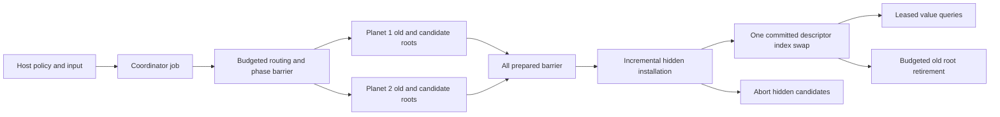

# NYON Zig: coordinated multi-planet transactional authority

- Author: Abbey; reviewer: Donald J. Filimon
- Date: 2026-10-11
- Status: **Approved specification — Donald approved written rules 2026-10-11 at 07:05 EDT; detailed implementation plan and its review pending**
- Independent review: `docs/qualification/2026-10-11-zig-coordinated-galaxy-design-fix1-review.md`; reviewed rules revision SHA256 `7dce7fad01c04da0b1b7e3de005883169238d5711a254efc2985fda176f7a6a2` (this status note changes metadata only).
- Rules identity: `nyon.coordinated-galaxy.v0`
- Compiler: exactly `0.18.0-dev.146+35accc06e`
- Decision input: Donald selected separate planet authorities, staged preparation,
  coordinator-owned committed snapshots and atomic global publication at 06:49 EDT.

## Overview

Introduce a pure Zig coordinator that advances independently allocated planet
states through one transaction at one explicit target tick. Each planet prepares
its local economy without publishing. The coordinator retains every previous
root while it installs prepared replacements invisibly, and publishes the entire
transaction by switching one descriptor index. Routing, economics, history,
validation, installation, abort and retirement consume the same caller budget.

This is the next coherent subsystem of the expanded rewrite. It establishes
multiple civilizations and worlds with local city economies, a common clock,
qualified references and complete coordinated replay. It does not substitute for
the final game's interplanetary logistics, research, ecology, diplomacy, fleets,
tactical ground battles, durable sessions or graphical hosts. Those remain
required subsequent reviewed contracts. No implementation or new performance
result is claimed by this specification.

## Background and source evidence

The approved island specification is
`docs/superpowers/specs/2026-10-11-nyon-zig-planet-economy-design.md`.
Current `zig/src/planet_economy/ids.zig` fixes planet 1 and civilization 7;
`state.Storage.routeCell` reconstructs planet 1. `job.Authority.beginOwned`
derives the next tick locally; `Authority.advanceTick` transitions directly from
invariants to `Candidate.publish`. `state.Candidate.advanceDiscard` selects the
obsolete root once published. `history.Finalizer` writes an invisible history
tail before root publication. `replay.Cursor` authenticates one island genesis,
extracts policies/envelopes and compares receipts and logical records.

These mechanisms are useful but sequential calls to the existing public poll
API cannot produce atomic galaxy publication. The integration audit at
`docs/qualification/2026-10-11-zig-galaxy-integration-audit.md` identifies the
specific barriers. This proposal preserves `nyon.planet-economy.v0`, its fixed
identities, public lifecycle and vectors. It introduces a separate integrated
planet adapter under the new galaxy identity. Shared algorithms may be extracted
only with unchanged island behavior and its complete regression gate; neither
an integrated world nor a replay is represented as an island v0 instance.

## Goals and continuing scope

Required here: all-planet fixed ticks, planet-qualified IDs, multi-civilization
local ownership, deterministic routed commands, explicit creator/ruler policy,
prepared barrier, hidden incremental installation, retained roots, constant-time
global publication, bounded abort/retirement, complete canonical replay, and a
public-API CLI journey involving at least two planets.

Deferred but mandatory in the full rewrite: generated strategic positions and
travel metrics; autonomous civilization decisions; interplanetary colonization
and cargo conservation; research/prerequisites; ecology/power/services; bilateral
diplomacy; strategic fleets/combat; tactical terrain-aware ground units and clock
substeps; save/archive branches and Continue; every approved platform and
accessibility qualification. This version admits no commands for these systems.
Adding one requires a reviewed rules identity/phase extension, not an arbitrary
new phase inside v0. No old profile is read, converted, overwritten or deleted.

## Limits, identities and memory

All values below are normative Proposed admission limits. They are deliberately
qualification-sized, not the final galaxy scale. Increasing a bound requires
review and fresh memory/work evidence. The final scale remains a later design
requirement; four worlds do not satisfy a large-galaxy delivery claim.

| Dimension | Contract |
| --- | --- |
| Systems | 1..4, IDs contiguous 1..N; immutable membership, at least one planet each |
| Planets | 1..4 total, IDs contiguous 1..P; default/demo two in one system |
| Civilizations | 1..4 present, IDs contiguous 1..C; default/demo two; no deletion/creation after genesis |
| Planet side | 4..32, default 8, demo 4; at most 6,144 cells each |
| Per-planet entities | 1..64 settlement capacity, 1..256 buildings/projects, 1..64 freight |
| Per-planet history | 1..4,096 receipts, slots ≤1,024 bytes, staging ≤1,024 receipts |
| Global history | 1..4,096 receipts, slots ≤2,048 bytes, staging ≤512 receipts |
| Public commands | 0..256 per tick, ≤64 routed to each planet; planet body ≤1,024 bytes |
| Clock | One hour/tick; completed tick 0 initially; target ≤1,000,000 |
| Public read leases | 64 concurrent tokens; zero interior pointers; query page ≤64 values |
| Jobs | One galaxy lane including all cleanup; no queue; job IDs never reused |
| Work allowance | 0..4,096 units per poll, host default 256 |

System/planet/civilization IDs are distinct `enum(u32)` wrappers. Entity IDs are
`{ planet: PlanetId, local: enum(u64) }`, cells `{ planet, local:u64 }`.
Local IDs start at 1 independently per planet and never reuse an allocated ID.
Local numbers alone are not public entity references. System membership is
immutable routing metadata, not orbital position. Tick, revision, sequence,
job ID and descriptor generation are distinct `enum(u64)` wrappers. Every
published planet tick and revision equals the global tick and revision; there
is no autonomous local advancement or local public sequence watermark.

Global genesis occupies exactly one global receipt slot; each local genesis
occupies one local slot. A capacity of one is valid creation but cannot advance
a tick. Before preparing a tick, reserve/check its exact global demand
`2 + planet_count + command_count` against the committed global count and
configured capacity, using checked widened arithmetic. One-planet empty tick
therefore needs three additional slots: capacity4 is exact fit after genesis,
capacity3 is one short. Insufficient space returns whole-tick `HistoryFull`
without policy/sequence/state changes. Replay construction uses the exact
serialized capacity, not the default or the fixed allocation size.

Creation config contains global seed:u64, system count:u8, civilization count:u8,
planet count:u8, global_history_capacity:u16 (default 4,096, admitted 1..4,096)
and PlanetId-ordered descriptors containing system:u32, side:u16,
settlement/building/freight/history capacities:u16 each. No startup grant occurs
in genesis. For PlanetId p, local terrain seed is
`seed XOR ((p-1) * 0x9E3779B97F4A7C15 mod 2^64)` using explicit wrapping multiply.
Terrain is rocky iff `(planet_seed % 4 + local_cell % 4) % 4 == 0`, fertile
otherwise. Planet 1 therefore retains the approved island terrain witness;
other worlds have independently reproducible variation. This is a transparent
placeholder terrain generator, not complete galaxy/ecology generation.

| Requested reservation | Bytes |
| --- | ---: |
| Four independent planet reservations, 4 × 8,642,560 | 34,570,240 |
| Global retained receipts, 4,096 × 2,048 | 8,388,608 |
| Global staging, 512 × 2,048 | 1,048,576 |
| Coordinator routing/replay/hash/validation scratch | 2,097,152 |
| Coordinator commands, metadata, two descriptors, leases, controls and padding | 1,048,576 |
| **Maximum aggregate requested bytes** | **47,153,152** |
| Aggregate ceiling, 64 MiB | 67,108,864 |
| Remaining requested-byte margin | 19,955,712 |

The coordinator reservation is exactly 12,582,912 bytes regardless of lower
configured limits; each enrolled planet retains its existing 8,642,560-byte
layout envelope. No extra allocator-owned query cache, transcript copy, third
root or per-command allocation is permitted. Two full receipt arrays are already
part of each planet's reservation. Actual controls and alignment must fit the
listed blocks with compile-time assertions; no arena overflow allocation.
Requested accounting includes all owned allocations but cannot promise allocator
resident overhead, OS memory protection or timing. Maximum construction, two
maximally dirty roots and zero poll allocations are required evidence.

## Architecture, ownership and interfaces

Proposed modules: `zig/src/coordinated_galaxy/{root,ids,types,planet,job,state,
command,history,replay,view}.zig`. They depend only on Zig standard library,
`surface.zig`, `play_role.zig` and explicitly shared pure economy algorithms.
No dependency points to Rust, Classic state, rendering, OS, browser or storage.
Each `PlanetAuthority` owns its allocation; coordinator exclusively owns the
planet objects and their mutation capabilities. Enrollment occurs only during
new galaxy creation. No public API attaches an existing island or detaches a
world. Hosts receive only a coordinator facade.



Single owner/thread execution is mandatory. Calls may not interleave through
callbacks or reentrancy. The publication is logical atomicity on that owner,
not a lock-free or hardware-thread atomicity guarantee. A future threaded host
must marshal calls or introduce a separately reviewed synchronization layer.

```zig
// Proposed signatures; lifecycle types are intentionally not existing APIs.
beginCreate(allocator, config) Failure!Builder;
pollCreate(builder, *WorkBudget) CreateProgress;
beginTick(*Galaxy, expected: Revision, target: Tick,
          policy: SessionPolicy, batch: []const RoutedEnvelope) Failure!JobId;
poll(*Galaxy, JobId, *WorkBudget) Progress;
cancel(*Galaxy, JobId) CancelResult;
acquireView(*Galaxy) Failure!ViewToken;
releaseView(*Galaxy, ViewToken) Failure!void;
settlement(*const Galaxy, ViewToken, SettlementRef) Failure!SettlementValue;
receipts(*const Galaxy, ViewToken, cursor, out) Failure!ReceiptPage;
```

`beginTick` requires target exactly completed tick+1, expected current revision,
no live lane/retirement, and no unreleased obsolete descriptor. It validates
small counts/lengths and copies at most 256×(1,024+4) = 263,168 bytes synchronously,
including routing IDs, as the only request-copy exception. The serialized
outer u16 length is derived metadata, not an additional copied payload; its
storage fits the coordinator metadata block. Borrowed input expires
on return. Sorting, policy validation, routing and world inspection are metered.
`beginCreate` allocates only; initialization and validation are incremental.
Creation cannot expose partially initialized worlds. Failure/cancellation drains
all acquired allocations before a builder can be destroyed.

A descriptor contains tick, revision, global history count/head, global sequence
watermark, optional trusted policy, and one fixed entry per planet containing opaque root
handle, local visible history count/head. Genesis descriptor policy and every local root policy are null; tick/revision
and global sequence watermark are zero. First local/global tick_input records
encode absent previous_policy (one zero byte). Each later previous_policy must
match the committed optional policy. Only publication changes all local/global
policies to the requested current policy; failed/canceled first ticks preserve
null genesis policy.

Descriptors and roots are immutable
while any lease resolves them. `ViewToken` is descriptor slot+generation+lease
slot+lease generation; token forgery, double release or reuse returns `StaleView`.
Acquisition/release are bounded constant operations and return/fill value copies,
never memory borrowed from pages. Lease capacity returns `ViewCapacity`.

A view acquired before publication continues reading the complete old galaxy
after publication, including old history counts. New acquisitions use the new
descriptor. Old leases prevent retirement of old roots, not publication of the
already prepared replacement. With only two roots/descriptors, another tick
cannot begin until every obsolete lease releases and cleanup drains. Polling
while blocked returns `waiting_for_views`, without spinning or consuming budget.
Leases on the new descriptor do not block old-root retirement. `deinit` requires
no jobs and no leases; violation returns `Busy`, not silent invalidation.

## Routing, roles and local economics

One trusted policy governs each global tick, using existing `play_role` tags and
admission semantics. Ruler/combined selected civilization must be present;
creator may have null or a present selected civilization. Every world can contain
settlements belonging to every present civilization. There is no civilization
simulation controller or autonomous command generator in this version. Local
economic events have autonomous provenance, generated only by the authority.

RoutedEnvelope is `planet:u32 || body_length:u16 || body`, with body exactly the
logical field codec in `planet_economy.command.encodeEnvelope`: sequence:u64,
provenance:u8, optional actor, command tag and typed payload. Tags 0..6 and enum
values retain the approved economy definition; this byte grammar reuse does not
make the integrated identity v0 island-compatible. All cells must name the outer
planet; local settlement/building/shipment numbers are implicitly qualified by
that outer planet and are converted to qualified public references. Cross-world
paths/endpoints are never accepted as local freight.

Sequence is one global positive u64, strictly above the last published maximum;
gaps are permitted. Sort the entire batch ascending sequence, using incremental
insertion sort with ≤32,640 pair comparisons. Duplicate/old sequence, invalid
encoding, unknown route planet or >64 commands to any planet is whole-tick
structural failure before gameplay. Commands route in that sorted order. Each
planet receives its subsequence in the same order; earlier accepted commands
on that planet are visible to later commands and its later phases. Worlds never
read another world's candidate economy. Commands on separate worlds commute
in state, but global input and receipt ordering remains fully specified.

Apply role → tag/provenance → explicit creator bypass → target existence →
ownership → ranges → topology/path → capacity → resources rejection precedence
from the approved economy rules. Integrated owner validation accepts any present
civilization, not fixed 7. Creator authoring can target any present owner;
ordinary ruler commands require all affected owned settlements and freight
endpoints to match the selected actor. Creator freight endpoints must share one
owner; intermediate claimed cells must have that owner. Creator grants/waivers
remain explicit receipts. Gameplay rejection consumes its global sequence on
publication and continues; resource/history/invariant failures abort all worlds.

All other local economy semantics are exactly the approved island rules:
frontier founding moves two population/four food and consumes twenty material
on the same planet; farm/quarry/house cost 6/4/8 material; projects start at two,
decrement in their admission tick and complete next tick; farm uses two workers
for six food, quarry two for two material; house adds four housing up to 32;
production checks workers then whole-output capacity including reservations;
food follows production; third hunger tick loses one population; eighth fed tick
grows one or records housing blocking. Freight takes its local path edge count,
never arrives at departure, and conserves stock/reservations except explicitly
minted creator cargo. No interplanetary founding or movement is inferred.

## Global phases and prepared barrier

Every enrolled planet advances on every target tick, including command-free,
zero-population and apparently inactive worlds. No lazy catch-up or inactivity
heuristic exists; hunger, growth, project completion and arrivals cannot diverge.
All planet snapshots start at the same committed tick/revision.

1. Prepare root directories and owned command descriptors; structural validation
   and sorted routing finish before any gameplay command executes.
2. Commands: visit planets ascending PlanetId, apply each sorted subsequence.
3. Arrivals: visit every planet ascending ID; shipments ascending local ID.
4. Construction: every planet ascending ID, buildings ascending local ID.
5. Production: every planet ascending ID, settlements then buildings ascending ID.
6. Population/supply: every planet ascending ID, settlements ascending ID.
7. Finalize each local transcript and candidate metadata; local invariants.
8. Finalize coordinator input/commit history and descriptor; global invariants.
9. Prepared barrier; install planet active markers incrementally, then publish.
10. Retire obsolete roots/descriptors or await obsolete leases.

The private staged planet API is `beginPrepared(expected, target, policy,
owned_lengths, global_watermark)`, `advancePhase(phase, *WorkBudget)`,
`freezePrepared(*WorkBudget)`, `installHidden(*WorkBudget)`,
`restoreHidden(*WorkBudget)` and `retire(root, *WorkBudget)`. A phase call accepts
only the next expected phase; `NotReady` cannot skip a barrier. It never publishes
or creates a fresh allowance. `freezePrepared` finishes local history/invariants
and returns an opaque immutable root/history handle. The coordinator invokes
these operations only from its lane; no public host export exists. This requires
refactoring the integrated adapter's cursors, not calling the current island
`Authority.poll` and trying to intercept its publication.

A phase finishes across all planets before the next starts. Planet cursors must
support stopping at these boundaries; calling existing full-tick `poll` is not
sufficient. Future strategic phases cannot slip into this ordering unreviewed.
The coordinator's candidate strategic state here consists solely of policy,
global tick/revision/sequence and immutable registry references; no invented
research, diplomacy or fleet state.

The prepared barrier certifies every local candidate, all receipt tails, global
input and commit records, root/history handles and descriptor are ready, capacity
checked and immutable. No root is reclaimed yet. After it, installation costs
one unit per planet and switches that planet's internal active marker to its
candidate; the old root remains explicitly retained and fully readable through
the old descriptor. Installation order is ascending PlanetId. No public query
uses a planet's active marker, and no facade exposes an installed local summary.

Once all installed flags are set, one work unit switches the coordinator's
committed descriptor slot index. That is the sole publication point, allocation-
free and failure-free. All O(P) checks, flags, head/count copying, aggregation,
receipt hashing and descriptor construction have already completed in separate
metered steps. This must not become a synchronous loop disguised as commit.
`published` is reported once after that switch, even if cleanup remains live.

## Abort, cancellation and reclamation

Before descriptor publication, any failure/cancel latches a terminal outcome,
then restores hidden active markers one planet/unit in ascending ID and discards
all candidate directories/page references/history staging incrementally. Even
fully installed worlds remain unpublished and rollback retains their old roots.
Rollback changes internal markers only; committed descriptor/state/history/policy/
sequence never changed. Candidate history-tail bytes are unreachable and may be
overwritten later; committed history bytes never change. Releasing a preexisting
view does not make an old committed root reclaimable during a live precommit job.

Track explicit `{old_root,new_root,installed,cleanup_cursor}` per planet. Do not
reuse current `Candidate.published` to mean global publication: its existing
obsolete-root cleanup branch would discard the old committed root too early.
Pending COW page refs and partial-directory retains must have separately owned
cleanup state, including the interval between clone allocation and reference
swap. Terminal canceled/failed notification is once only; ownership and `Busy`
persist until every planet and coordinator cursor drains. New tick IDs are
monotonic; stale poll/cancel cannot affect replacement work.

After publication, cancel returns `already_published`; there is no rollback of
published authority. Cleanup releases only old roots after old leases expire,
never current roots. A cleanup invariant defect reports `CleanupFault`, preserves
the published descriptor, closes mutation admission and allows value queries;
caller can release views and destroy all owned allocations through the explicit
fault lifecycle below. Such a defect is not a gameplay rejection or a successful
idle state. No recoverable operation after the swap is required to make
publication valid.

A cleanup invariant failure enters permanent `faulted` state, storing the faulted
JobId and cause; it never transitions to idle or reopens mutation admission.
`poll(faulted_id, budget)` returns `faulted:{job,cause}` on every call without
cleanup traversal or work consumption, including zero budget. Other JobIds return
`invalid_request:StaleJob`. `cancel(faulted_id)` returns `faulted`; other IDs return
`stale_job`. Queries through valid tokens remain available, and `acquireView`
remains available in faulted state until shutdown is requested. These repeatable
fault results are distinct from once-only ordinary failed/canceled notification.

`beginFaultShutdown(*Galaxy)` is valid only in faulted state, is idempotent, costs
no traversal and transitions to `fault_shutdown`. It closes new lease acquisition
(`Shutdown`), tick admission (`Shutdown`) and replay source acquisition, while
existing value queries and `releaseView` remain legal. Poll/cancel retain the
faulted outputs above. `destroyFaulted(*Galaxy)` requires fault_shutdown and zero
live leases; otherwise returns `Busy` without freeing anything. On success it
frees each successfully allocated planet reservation and coordinator reservation
exactly once using the allocation-ownership ledger established during creation.
It does not traverse pages/directories, decrement damaged page reference counts,
or require lane cleanup to drain. Each allocation is independent and contains no
separately allocated interior records. The ledger's ownership bits are outside
candidate page/refcount state and are cleared on free; no subsequent API call on
the destroyed object is legal. Allocator deallocation is an explicit destruction
operation outside poll latency/budget targets. Ordinary `deinit` remains for
healthy idle/no-lease galaxies; it returns `Busy` on a faulted galaxy. This escape
hatch addresses diagnosed invariant faults, not arbitrary native memory corruption
of the ownership ledger or allocator itself.

## Canonical history and replay

All integers below are unsigned little-endian, enums explicit numeric tags,
booleans 0/1, optional values `presence:u8` then value only when 1. Lengths are u16;
fixed hashes are 32 raw bytes. Encode logical fields only, never padding/pointers.
ASCII domains exclude NUL. Let `S(x)=u16(len(x))||x`, `H=SHA256`, and
`chain(h,r)=H(h||u32(len(r))||r)`. Hash primitive processes ≤64 bytes/unit;
encoding/copying ≤256 bytes/unit. A chain establishes deterministic integrity,
not network authenticity or authorization.

Global receipt bytes are
`"NYON-CG0-RECEIPT" || tag:u8 || tick:u64 || ordinal:u16 || payload`.
Global head starts `H("NYON-CG0-HISTORY")`. Ordinals start 0 each tick; genesis
has tick=0/ordinal=0. Exact tag payloads:

| Tag | Payload fields in order |
| --- | --- |
| 0 genesis | S(`nyon.coordinated-galaxy.v0`), seed:u64, system_count:u8, civilization_count:u8, planet_count:u8, global_history_capacity:u16; ascending planet entries: planet:u32, system:u32, derived_seed:u64, side:u16, settlements:u16, buildings:u16, freight:u16, history:u16, local_genesis_head:32 |
| 1 tick_input | target:u64, expected_revision:u64, previous_policy optional, current_policy, count:u16 |
| 2 routed_input | planet:u32, S(body) |
| 3 planet_prepared | planet:u32, local_history_count:u16, local_head:32, accepted:u16, rejected:u16 |
| 4 tick_commit | revision:u64, last_sequence:u64, accepted:u16, rejected:u16, planet_count:u8; ascending entries planet:u32, tick:u64, revision:u64, local_history_count:u16, local_head:32 |

Policy encoding is role:u8, optional civilization:u32. Emit tick_input first,
routed_input in global sequence order (including gameplay-rejected commands),
planet_prepared in ascending planet ID, then tick_commit. Maximum records/tick
is 1+256+4+1=262, within staging 512. Empty ticks emit boundaries and every planet
summary. Neither canceled transactions nor malformed structural batches appear
in published history. Per-planet accepted/rejected details remain in their local
transcripts; global inputs bind them via prepared/commit heads.

Integrated local receipts use ASCII `"NYON-CG0-PLANET-RECEIPT"`, then planet:u32,
then the exact header/event field order defined by `planet_economy.history.Encoder`
for tags 1..10. Replace island genesis payload/tag0 with planet:u32, system:u32,
seed:u64, side:u16, four capacities:u16, civilization_count:u8 and ascending
civilization IDs:u32. For clarity the full local formula is
`"NYON-CG0-PLANET-RECEIPT" || planet:u32 || event_tag:u8 || tick:u64 ||
ordinal:u16 || provenance:u8 || optional(sequence:u64) || payload`.
Genesis header is tick0/ordinal0/autonomous/null sequence. This retains the
actual island Encoder ordering (tag before tick), rather than putting its tag
inside the payload. Local
head starts `H("NYON-CG0-PLANET-HISTORY"||planet:u32)`. Tag1 input retains the
approved target/expected/previous/current policy fields and local envelope count;
tag10 last_sequence is the global batch watermark even on empty-route planets.
All event IDs inside local payloads are local u64 except CellId's planet:u32 and
local:u64; domain/planet qualifies other IDs. No v0 receipt bytes or heads are
advertised as integrated heads. The existing ≤1,024 local receipt envelope still
fits legal command shapes; any encoder overflow is a whole-tick failure, and
maximum-path accepted/rejected receipts require independent boundary tests.

Replay source is a leased committed descriptor, config/genesis, and every
published global input/body/boundary. Target is a fresh integrated galaxy;
extract/verify/copy, setup, driving ticks, cleanup, history comparison and logical
queries use one actual budget. Do not reconstruct policy from command actor or
accept a supplied head as evidence of replay. Recompute derived seeds, genesis
and all local/global receipt bytes. Verify tick/revision continuity, exact routed
counts/order, every local/global head/count, all logical records and terrain
across every planet, qualified counters, policy and sequence. Compare fields
incrementally; no whole-world memcmp/hash. Missing commits, altered role, unknown
world, duplicate sequence, reordered records or mismatched local head fail replay.
Published rejections and empty ticks are required input. Execution scheduling
stats and view leases are excluded from canonical input and comparison.

A replay allocates a second galaxy only as an explicitly separate owner, and
reports combined source+target requested bytes (maximum 94,306,304); the 64 MiB
limit applies to one galaxy, not an undisclosed process-wide replay guarantee.
No archive, save path, authentication, branch schema or old-data migration is
implied by this in-memory replay contract.

## Work, failures and performance proof

Reuse the approved work primitives: ≤256-byte copy/zero, ≤64-byte hash input,
one topology edge, bounded record evaluation/mutation, index compare/swap,
free-list allocation or reference increment/decrement per unit. Multi-record
loops require cursors; never mint per-planet sub-budgets. Zero allowance changes
no state, flags, hash cursors or terminal delivery. Poll allocations are forbidden.
A target aborts on HistoryFull, invalid trusted policy,
structural failure or invariant defect, preserving the committed snapshot.
Per-planet entity capacity rejection is a normal gameplay rejection. Advertised
pool exhaustion is an invariant defect. Arithmetic is checked except the stated
seed derivation's explicit wrapping arithmetic. Exhaustion is frozen as follows:

| Counter | Exhaustion behavior |
| --- | --- |
| Local settlement/building/shipment next ID | If allocating would exhaust the checked next-ID increment, command emits normal `IdExhausted` gameplay rejection; no ID/resources consumed, later commands and all worlds continue |
| Coordinator JobId | Admission returns `IdExhausted` before creating a lane when next-ID increment cannot succeed; max value is never wrapped/reused |
| Global command sequence | Incoming zero/old/duplicate is structural failure; sequence max is valid once if above watermark, publishes as watermark without increment; subsequent nonempty batch cannot supply a higher u64 and fails `SequenceAlreadyPublished`; empty ticks remain legal |
| Tick | target must equal checked completed+1 and ≤1,000,000; otherwise `TickHorizon` before lane admission |
| Revision | checked committed+1 must succeed before lane admission, otherwise `IdExhausted`; no partial candidate |
| Descriptor generation | both slot generations start1; checked increment of the destination slot generation is reserved before lane admission, overflow returns `IdExhausted`; aborted attempts may consume a generation but never reuse it |
| Lease generation | slot generations start0; acquisition increments checked, using generations1..max; a max-generation released slot is permanently exhausted and skipped, never wraps; if no free nonexhausted slot, `ViewCapacity` |

Checked setup/builder generation counters follow the same never-wrap/reuse rule;
creation failure returns `IdExhausted` and releases owned reservations. No entity
exhaustion is promoted into global abort. Unexpected arithmetic failure during
candidate simulation is an invariant failure and aborts precommit. Generation
reservation is scheduling metadata excluded from canonical receipts/replay; zero
budget poll cannot consume a generation. No stale job/view can resurrect through
wrap or generation reuse.

Performance targets, not current measurements: 256-unit native ReleaseFast poll
p95 ≤2 ms and maximum ≤8 ms on qualification host; record host/CPU/compiler,
config, sample count ≥10,000 polls and worst phase. Measure request-copy separately.
No target for total tick duration is implied: costs include dirty pages/history
and four full local economies. At maximum side, root-directory preparation costs
at most four×4,096 ref/entry steps before economics; reclamation is similarly
metered. Descriptor commit itself costs one unit; global sequencing sorting costs
up to 32,640 comparisons plus swaps. Slow measurements must trigger algorithm/
primitive review, not claims that a budget is a wall-clock guarantee.

## CLI acceptance and mandatory tests

Proposed command:
`nyon-zig coordinated-galaxy-demo --seed 2 --side 4 --budget 256`.
It creates two worlds in system1 and civilization IDs1/2 with default entity
capacities; all authoring uses ordinary public command admission. Print new
identity, derived seeds, qualified IDs, complete published receipt summaries,
world snapshots, requested bytes and replay result. No profile or storage access.

Use creator policy at tick1 with sequences1..4: planet1 author settlement owner1
at70, population4/food12/material20; author farm at71/east; planet2 author
settlement owner2 at70, population2/food8/material20; author farm at71/east.
Both use explicit bypass. Seed2 world1 has fertile71; derived world2 seed is
0x9E3779B97F4A7C17 with low bits3, so71 is fertile because (3+3)%4=2.
On both worlds side4 anchor71 east neighbor is4 across the +Z/+X seam;
anchor71 is east-adjacent to hall70. These identities are independently fixed
topology witnesses in the approved island specification. Both settlements allocate local ID1, producing distinct
qualified IDs. Tick1 ends world1 population4/food14/material20 and world2
population2/food12/material20, since authored farms immediately produce six.

Tick2 ruler civilization1: sequence5 paid house on planet1 cell69 costs8;
sequence6 paid house targeting planet2 settlement1 rejects WrongOwner. Both
worlds still produce/consume. Expected food16/16, material12/20; world1 project
remaining1; world2 no project. Tick3 ruler civilization2: sequence7 paid house
on planet2 cell74 (connected to hall70) costs8. World1 house completes; food18/20,
material12/12, world1 housing8, world2 project remaining1. Tick4 empty creator
batch/null actor advances both worlds; world2 house completes, food20/24,
housing8/8. No growth before eighth supplied tick. Replay all four ticks into a
fresh galaxy and compare every local/global byte and logical record.

Additionally, the real CLI must request tick5 candidate with a creator grant on
each world, poll budget1 until hidden planet1 installation, cancel, drain, and
assert tick4 reads/history/policy/sequence remain identical on both planets.
Retry same tick5 input, allow publication, cancel afterwards and assert
already_published; drain cleanup. Replay includes only the successful tick5.
Keep a tick4 view across tick5 publication: it must resolve both old worlds,
new view both new worlds; release old view to unblock retirement. This is a
transaction witness, not a full game acceptance journey.

Required automated independent proof:

- Budgets 1,7,256,4096 and alternating0/nonzero produce byte-identical transcripts
  and states; instrument actual units and zero allocation attempts.
- Cross-world ID collisions, cells/paths, all four owners, creator/ruler/combined
  provenance, multi-owner same-world freight, routing overflow and global ordering.
- All-world phase barriers and no-command hunger/construction/arrival/growth;
  rejected ownership cannot suppress that world's autonomous economic phase.
- Cancellation at each cursor boundary, between page-ref operations, each hidden
  install and immediately before descriptor swap; compare prior complete snapshots.
- Old/new view lifetime, 64-lease cap, stale tokens, double release, next-tick Busy,
  no old-root reclamation before lease release, and postcommit cleanup fault.
- Global history capacities1,3,4 with one planet and no commands: genesis-only
  valid at1, first empty tick fails at3, exact fit succeeds at4 then next fails;
  replay preserves exact configured capacity and genesis bytes.
- Null genesis policy and first empty creator tick produce absent previous-policy
  bytes locally/globally; canceled/failed first ticks retain null. Subsequent
  creator→ruler policy transitions compare exact previous/current fields.
- Inject undrainable old-page refcount failure after publication: repeated faulted
  poll/cancel, readable published snapshot, shutdown closes acquisition, existing
  lease queries remain valid, destruction returns Busy until release, then every
  reservation frees exactly once without damaged-ref traversal or idle claim.
- Inject exhaustion separately for every listed counter: entity command rejection
  versus pre-lane global admission failure; maximum sequence plus later empty tick;
  exhausted descriptor/lease slots cannot revive stale tokens.
- Exhaust global and any local history before commit, maximum dirty roots on four
  worlds, advertised capacities, allocator setup failures and exact byte accounting.
- Independent handwritten logical/hex fixtures for seed derivation, genesis,
  routed/rejected inputs, local receipt domains and global chain/commit heads;
  oracle code must encode formulas independently from implementation modules.
- Replay adversarial missing/altered/reordered records, policy-sensitive acceptance,
  structurally invalid batch, gameplay rejection and empty tick preservation.
- Existing island vectors and behavior remain unchanged; exact compiler and scoped
  Rust-blocked `zig/tools/check.sh` gate pass with actual exit status recorded.

These are future proof obligations. This document adds no tests or test results.

## Security, observability, rollout and alternatives

Trusted host policy is the local authority boundary, not multiplayer identity
proof. Untrusted envelopes cannot supply replacement policy, autonomous commands,
root pointers or internal mutable handles. Inputs are bounded before decoding;
receipts contain IDs/enums/quantities only. Native Zig module privacy and owner
conventions are API boundaries, not arbitrary memory access protection. A hostile
native process can corrupt memory; isolation/network authentication require a
separate threat model. No secret, user profile or path enters canonical history.

Expose phase/planet/cursor, consumed units, requested bytes, peak pages, copied
pages, global/local history occupancy, live obsolete leases, accepted/rejected
counts, abort cause and cleanup state. Host timing/logging is outside authority
and canonical receipts; alert host on CleanupFault and capacity-near-full. No
background logging or network telemetry is added.

| Risk | Severity and mitigation |
| --- | --- |
| Mixed world reads during physical installation | Critical: queries only through retained committed descriptor; partial-install cancellation and lease tests |
| Premature old-root retirement | Critical: per-descriptor leases and explicit root ownership; no second lane before drain |
| Budget multiplication across planets | High: one counter, instrumented total work, no child allowance creation |
| Silent island semantics/vector change | High: separate new identity; old gate and independent fixtures |
| History exhaustion stops clock | Medium: explicit HistoryFull; occupancy visible; later durable design must address retention |
| Four-world capacity mistaken for final game scale | High: delivery ledger retains later scale and all mandatory mechanics/hosts |

Alternatives considered: a monolithic galaxy allocation/root could simplify
publication but abandons the approved separate ownership and forces a larger
state redesign. Sequential island polls reuse APIs but expose partial ticks and
cannot preserve atomic abort; rejected. A global preparation barrier with direct
per-planet public roots still exposes mixed installation; rejected. A third root
per planet permits longer overlapping read/transaction lifetimes but raises memory
and reclamation complexity; two roots with explicit lease backpressure are chosen.

Rollout: review this written specification; obtain Donald's approval; write and
review a detailed plan with exact wire fixtures and ownership tasks; implement
staged planet adapter and coordinator; independently review/correct each task;
qualify capacities, cancellation, replay and real CLI; then review the next
required strategic mechanics contract. The integrated command/export remains
separate from island/Classic paths. Rollback disables only the new integrated
entry point; no old-data migration or production deploy is involved. No Rust
execution is needed for design or this scope's required implementation gate.

## Open questions and self-review

There are no intentionally unresolved normative rules in this slice. Approval
must accept the proposed qualification capacity, seed formula, all-world ticking,
global sequence space, two-root lease backpressure and new wire domains before
implementation. Later full-game scale and strategic gameplay are separate required
review decisions, not implementation latitude within this identity.

Self-review: every world advances; economics/ownership are explicit; local
freight never silently becomes interplanetary transport; one trusted policy and
global watermark are recorded on empty ticks; all-world phase order is frozen;
prepared does not mean public; hidden installation retains old roots; abort after
installation restores markers and discards only candidates; descriptor swap has
no planet loop; postcommit cancellation cannot undo authority; old view lifetime
fits two roots via backpressure; histories/replay bind complete inputs and all
world heads; memory includes coordinator buffers; replay process memory is
separately disclosed; work counters are shared and measurement targets unverified;
the CLI exercises two civilizations, two worlds, wrong-owner rejection, phased
construction, empty tick, partial-install abort, retry, leases and complete replay.
Final game mechanics and platform delivery remain Partial.

## References

- `docs/superpowers/plans/2026-10-11-expanded-zig-rewrite.md`
- `docs/superpowers/specs/2026-10-11-nyon-zig-planet-economy-design.md`
- `docs/qualification/2026-10-11-zig-galaxy-integration-audit.md`
- `docs/qualification/2026-10-11-expanded-rewrite-acceptance.md`
- `zig/src/planet_economy/{ids,types,state,job,command,history,replay}.zig`
- `zig/src/play_role.zig`, `zig/src/surface.zig`, `zig/.zigversion`
- `zig/tools/check.sh`, `zig/build.zig`

## Revision Summary — 2026-10-11, independent review fix 1

Addressed all four findings from
`docs/qualification/2026-10-11-zig-coordinated-galaxy-design-review.md`:

1. Fault shutdown now has permanent faulted outputs, explicit acquisition closure,
   lease-drain preconditions and allocation-ledger destruction independent of
   damaged page references. Added an undrainable-retirement/free-once witness.
2. Creation config now includes default/range for canonical global history
   capacity, genesis occupancy, exact whole-tick reservation and replay binding.
   Added lower-bound/exact-fit/one-short fixtures.
3. All genesis policies are explicitly null; first/local/global input bytes,
   transitions and canceled/failed first ticks are defined and tested prospectively.
4. Enumerated checked exhaustion behavior for entities/jobs/sequences/ticks/
   revisions/descriptor and lease generations; entity exhaustion remains a normal
   command rejection, generations never wrap/reuse, and focused witnesses cover
   each case.

Self-review of revisions: faulted lanes need not drain for owned destruction;
shutdown cannot acquire fresh leases indefinitely; exact history capacity is
canonical and replay-visible; null policy cannot become an inferred creator
default; counter exhaustion has one documented outcome per counter. This revision
changes only the Proposed specification, leaves the raw review unchanged, and
claims no runtime verification or approval.
