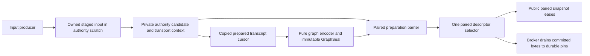
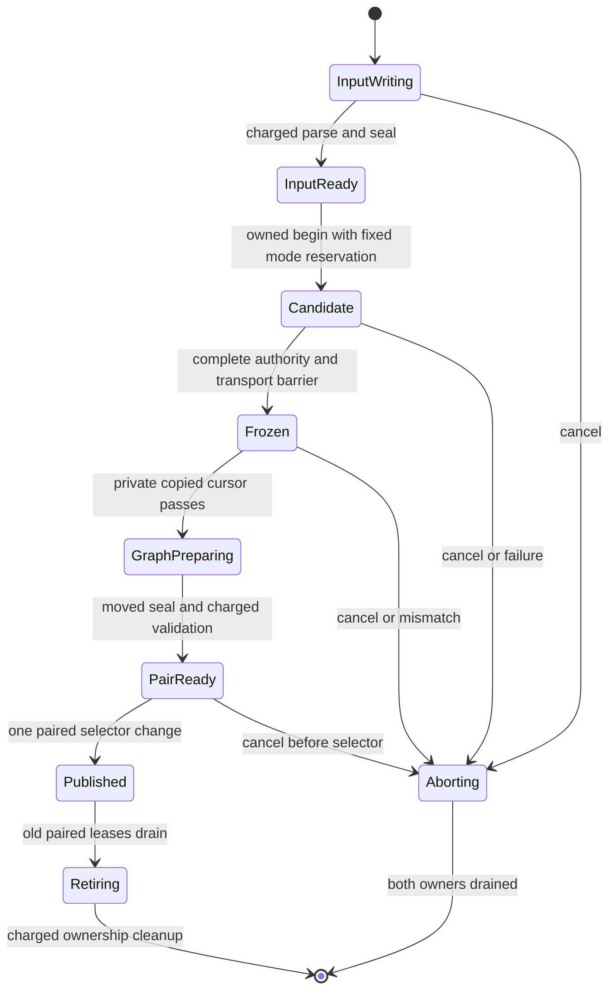

# NYON full-scale durable authority: composed publication and input bridge

<!-- BEGIN 2026-10-19 rewrite decision -->
> **Historical; Zig continuation canceled 2026-10-19.** Preserve this source contract and evidence. Active recovery targets Rust stable1.99.1; see the 2026-10-19 Rust designs/plans. Historical review labels do not approve new Rust behavior. Tests and CI gates remain paused.
<!-- END 2026-10-19 rewrite decision -->


- Date: 2026-10-11
- Author: Abbey; reviewer: independent reviewer pending
- Status: **Draft / Proposed normative amendment; technical review and controller approval pending**
- Composed adapter profile: `nyon.fullscale-durable-adapter.v1`
- Compiler: `0.18.0-dev.146+35accc06e`
- Scope: pure authority/session composition, owned command admission and joint publication

## Normative precedence and exact inputs

This annex defines the authority-side amendment for a session-backed full-scale
runtime. It is normative for `nyon.fullscale-durable-adapter.v1`, including calls
inside the authority engine. Merely implementing a host wrapper around the old
standalone `begin`/publication API does not implement this profile. The public
standalone authority design remains unchanged under its separate owner; no claim
is made that its text or source already adopted this amendment.

The adapter profile is an execution/interface identity, not a new gameplay or
archive wire identity. Rules remain `nyon.fullscale-galaxy.v1`, authority storage
profile `nyon.fullscale-storage.v1`, session container `nyon.expanded-session.v1`.
The same admitted commands and complete receipts produce the same canonical state,
history heads and portable bytes. Admission scheduling and paired handles never
enter gameplay digests. No old identity or user profile is converted.

| Exact input | SHA256 |
| --- | --- |
| [Base authority design](2026-10-11-nyon-zig-fullscale-authority-design.md) | `a8bc0d41767722b3215e2e6c334d06d5cf5cacc3107f28f83b3b4219ba6ce2f5` |
| [Initial economy codec](2026-10-11-nyon-zig-fullscale-authority-codec.md) | `c116655859eae999ee1529180521254a575570ba471099fc0ca2e00c8778b6b9` |
| [Durable design before this amendment](2026-10-11-nyon-zig-expanded-durable-sessions-design.md) | `ce8f58f9a4427a741b1fa72586975cee534ce18977669370af35edc78970b4f5` |
| Durable input reviewed for fix 2 | `a3d5b5e04204ecf16fe729a12306bfe868723af6195be48f4692e2ab7b147637` |
| Bridge input reviewed for fix 2 | `acf3592befd3c3f28febcf18a5ce4ed78427e0fef181f335c1622c22ec032959` |
| [Reviewed catalog plan](../plans/2026-10-11-nyon-expanded-session-catalog.md) | `b404476de83de41ba577d895a88153d1522145a51ac237f4b71b21c2cc3afc5a` |

Precedence for the composed profile is this annex, then the reconciled durable
design, then the exact base authority design. The initial economy codec governs
all gameplay byte/semantic definitions; this annex does not override that codec.
The specific superseded clauses are:

1. Base **One global transaction** synchronous command-snapshot exception: replaced
   by owned, metered input staging before candidate begin, below.
2. Base **One global transaction** and **Descriptor-owned transport transaction
   state** standalone committed-descriptor switch: replaced by the sole paired
   selector and mandatory prepared-graph acceptance below.
3. Base committed-only read rule: retained for every public query; only the private,
   copied prepared-transcript protocol below can read a frozen candidate.
4. Base **Moving durable-session dependency (M1)** and E10: historical observations
   of an older draft, not current normative limits in this profile. The current
   representation admits 32 MiB logical ticks, 1 MiB physical stream segments,
   131,072 nodes, 5 TiB portable and 32 TiB aggregate namespace ceilings. These are
   format/accounting ceilings, not host quota claims or smaller gameplay profiles.
   Actual required 100,000-tick workload retention on named hosts remains a gate.

All other authority invariants, transport contexts, Prefix/Ticket domains, provider
verification, exact-prefix pin ownership, page bounds, phase order and canonical
codec remain in force. This amendment gives concrete behavior; implementation
still requires independent merged review and an integration receipt freezing this
annex's final hash, the durable successor's final hash and the exact authority/codec
hashes together. The writer report at `.superpowers/sdd/2026-10-11-finish-nyon-in-zig/
durable-fullscale-report.md` records the final revision tuple outside these files;
independent review must attest that exact tuple before dispatch. This avoids
circular hash references between mutually referring specifications. Source dispatch
must reject an absent/mismatching tuple or a changed base until focused review
resolves it. The authority owner's eventual textual integration is separately
tracked; neither M1 nor a source function is presumed updated by this annex.

## Goals, non-goals and architecture

Prevent a durable runtime from exposing a gameplay root without its matching
resident graph boundary, and account for every command-copy byte before candidate
mutation. Preserve old snapshot leases, deterministic retry, fixed memory and
committed-only public views. Authority remains the sole gameplay truth; session
failure can pause publication but cannot edit outcomes or replay semantics.

No gameplay phase, city/combat rule, persistence transaction, archive format,
provider token, checkpoint, pruning policy or durable acknowledgment is introduced
here. The durable design continues to own those schemas and pin lifetimes.



The composition layer and graph encoder are pure Zig owners. Shared bridge types
contain integers, fixed byte arrays and generational values only. Authority may
import those pure types and hash functions, never the filesystem, browser,
IndexedDB, worker, clock or store adapter. Store completion mailboxes continue to
carry values, never candidate or authority pointers. All engine/composition calls
execute on one owner thread without foreign callbacks or reentrancy.

## Stable paired descriptors and public views

The composed resident runtime owns one stable `PairController`, two
`PairedDescriptor` slots, and one optional `selected_pair_slot` (absent before
initial publication, otherwise 0/1). The controller lives until
the whole resident session is drained, including across replacing one authority
owner with another. The one allowed detached replay/restore target has one private
PairController with two slots and its own selector; it never serves resident/public
queries. There is still one selector per paired publication domain, and no separate
authority-versus-graph selectors inside either domain.
Both controllers are charged inside the existing store's 1 MiB broker/control
reservation. No third controller or detached authority is admitted. A paired
descriptor includes these value fields:

```text
PairKey = { session_namespace:u64, session_generation:u64,
            pair_slot:u8, pair_generation:u64 }
AuthorityRef = { owner_namespace:u64, owner_generation:u64,
                 root_slot:u8, root_generation:u64 }
GraphRef = { session_namespace:u64, slot:u32, generation:u64 }
PairedDescriptor = { pair_generation:u64, authority:AuthorityRef,
                     graph:GraphRef, logical_boundary_digest:[32]u8,
                     prefix:Prefix, state:preparing|ready|committed|retiring }
```

These are value-level interfaces, not serialized host structs. Pair slot and root
slot are exactly 0/1; generations and namespaces are checked, nonzero and never
reused. `AuthorityRef` identifies the root and its same-generation transport context
already specified by the base authority. `GraphRef` resolves only in the owner’s
bounded graph-slot registry; it cannot be a pointer, arbitrary byte offset or
unvalidated caller-provided storage handle. Every descriptor owns its graph
reference and root/context ownership explicitly. No public API exposes a mutable
descriptor or permits choosing an arbitrary root slot.

In the composed profile the authority backend has **no independently writable
committed-root selector**. Authority reads, current-prefix queries, next-tick
admission, history capture and session graph reads resolve the same selected paired
descriptor through the composition layer. Backend calls receive the validated
`AuthorityRef` from that pair. The standalone `begin`, auto-publication and direct
public query entry points are inaccessible in this profile; a creation-time affine
composition capability binds the backend to this PairController. Calling the old
standalone API and then copying its result into a session is forbidden.

`acquirePair(*budget)` consumes one unit and returns a value lease carrying PairKey
plus checked lease slot/generation. At most 64 paired leases across these controllers
share the existing global lease capacity; private replay does not expose an additional
public lease pool. Its authority query and graph/cursor query always resolve the
lease's immutable pair, even after a new pair becomes selected. Thus an old view
sees old gameplay + old graph + old Prefix, and a new view sees the complete new
triple. Leasing a preparing/ready candidate is forbidden. Release is a charged
reference transition; a reused/stale/wrong-owner lease changes nothing.

Current and old descriptors use the two existing authority roots/transport contexts;
there is no third root. Old pair leases block its retirement and admission of the
next candidate. Independent save/export captures must acquire their own graph and
history ownership before releasing their pair lease. They do not silently extend
root lifetime through a borrowed GraphRef. Resident base/inventory pins and exact-
prefix tokens retain their separately reviewed lifetime rules unchanged.

## Owned input handoff before candidate begin

Select complete metered staging. There is **no synchronous bulk snapshot exception**
in this composed profile, including UI, replay/import, automation or test callers.
Every copying/encoding helper takes the same outer remaining `WorkBudget`.
An outer update admits 0..1,024 units; giving several consumers fresh allowances is
forbidden. Budget zero copies nothing, consumes no ID, advances no cursor, changes
no ownership/readiness/publication flag and delivers no terminal result.

The owned input staging stream is execution metadata, not an archive wire format:
for each of 0..1,024 input envelopes it is `planet:u32, body_length:u16, body_bytes`
in caller order. Body length is 1..1,024. Thus at most
`1,024*(4+2+1,024)=1,054,720` staged bytes exist. Policy, expected pair and counts
are fixed-size copied control fields. The extra two length bytes per envelope are
explicit; this supersedes the base's 1,052,672-byte synchronous-copy description
rather than hiding a larger snapshot. Canonical routed-input receipts still use
the unchanged codec. Structural checks/sorting still precede gameplay evaluation.

The owner APIs and their consumers are exact in behavior (Zig spelling awaits the
pinned compiler witness):

| API | Authorized consumer / effect |
| --- | --- |
| `openInput(expected:PairKey, policy:Policy, envelope_count:u16, staged_length:u32, *budget) -> InputTicket` | Gameplay producer or source-replay decoder through composition; checks current pair/count/length and idle lane, consumes one unit, reserves the single owned input arena and checked Ticket, copies only fixed controls. No candidate, bulk copy or allocation. |
| `writeInput(ticket, offset:u32, bytes:[]const u8, *budget) -> consumed:u16` | Producer; bytes length 1..256 and offset equals current written length. One unit copies that bounded span into authority-owned staging and advances the offset atomically. Zero returns WouldBlock without reading bytes. No caller pointer is retained after return. |
| `sealInput(ticket, *budget) -> validating|ready|failure` | Producer then composition poll; requires exactly staged_length received. Polled parse verifies count, complete records, length/routing/policy structure and initializes envelope offsets, with all decode/copy/hash work charged. No trailing bytes. Once ready, staging is immutable and writer operations reject. |
| `reserveAppend(input_ticket, expected:PairKey, *budget) -> SessionAppendReservation` | Gameplay composition only; reserves one prospective unique node, conservative graph/store growth peaks, a pending descriptor and authority history capacity without entering candidate phases. This admission does not yet choose append_new versus reuse_existing. Failure leaves input ready and current pair unchanged. |
| `reserveReplay(input_ticket, target:PairKey, source:ReplaySourceBinding, next_node:Digest, *budget) -> SourceReplayReservation` | Detached replay composition only; retains and checks the exact source-backed step and bounded resident resources below. Reserves no logical insertion, durable stream/index/manifest objects or append-space quota. |
| `beginFromOwnedInput(input_ticket, reservation:TickReservation, *budget) -> candidate_ticket` | Composition only; checks sealed input, selected PairKey and the matching immutable gameplay_append/source_replay reservation, then consumes one unit to move input ownership into that mode's candidate lane. It performs no command payload copy. All root preparation/retains, command ordering and phase work follow through charged polls. |
| `cancelInputOrCandidate(ticket, *budget)` | Composition; one charged transition latches cancellation/invalidation, then polled cleanup drains exactly owned ranges and references. Before begin, only input and the selected mode's reservation exist. |

The producer retains responsibility for its own original values until their chunks
are copied. Caller stack spans need remain stable only during the bounded
`writeInput` call. Nothing borrows them between updates. Producers with an existing
immutable owned message read it incrementally; producers encoding commands encode
at most 256 bytes/unit and use an already reserved ≤256-byte output window. There
is no preliminary uncharged copy into a 1 MiB temporary, no allocating `toOwnedSlice`
and no unmetered pre-serialization escape. Host-origin message storage is separately
accounted host ownership; any copy into or for this bridge is charged.

The staging arena is 2 MiB inside the authority's existing 8 MiB scratch. It contains
the maximum 1,054,720-byte stream and 1,024 fixed 16-byte envelope-index slots
(16,384 bytes), totaling 1,071,104 bytes; the rest is bounded parsing scratch.
Envelope indexes refer only to this arena. Sort/route metadata moves and scans
are charged; no command body is recopied to a second arena. The existing provider
verification window retains 1 MiB of the scratch; the remaining 5 MiB serves other
already declared codec/replay/algorithm scratch. A layout witness must prove every
simultaneously live cursor fits these partitions; overflow rejects implementation
approval, not an extra allocation. Empty input still passes the charged seal/begin
transitions. At the byte maximum, copying alone requires 4,120 units, hence at least
five outer 1,024-unit updates before adding parse/encode/control work.

Replays feed authenticated source routed-input bodies through the same owned
input handoff; their reservation is `reserveReplay`, never `reserveAppend`. No
alternate large-slice begin is permitted. Source provider verification precedes
staging those bytes, and the sealed count/policy/body sequence must equal that
exact source tick; caller-authored replacements are not admissible replay input. Cancellation, stale expected pair or owner replacement
before begin drains/zeros only used staging ranges in ≤256-byte units, returns
reserved controls once and leaves clock/sequence/state/history/selection unchanged.
After begin, input belongs to that candidate until its last routing/history use and
charged cleanup; producer cannot append, reuse or release it. No new input writer
is admitted until the previous arena and old pair retirement have drained.

## Mode-specific admission and source ownership

`TickReservation` is exactly `gameplay_append:SessionAppendReservation` or
`source_replay:SourceReplayReservation`. Admission mode is fixed before candidate
begin and recorded in the candidate ticket, cursor, seal and cleanup owner. It
cannot switch after a quota failure, after canonical output is known, or during
acceptance. `source_replay` is available only to the one detached replay target;
new UI/automation/gameplay commands always require `gameplay_append`.

Gameplay append conservatively reserves the full prospective insertion before
begin: current unique-node count must be <131,072, branch creation must fit 64,
and the unchanged physical/metadata peak and authority cache reservation must be
available. A later identical-node result may release that unused growth, but it
does not authorize speculative gameplay when the initial reserve is unavailable.
Thus a full graph or exhausted append-space quota can pause a gameplay fork even
if its unexecuted commands would have reproduced an existing node. This deliberate
admission limitation is not claimed solved at the full cap; it is a storage pause,
not a gameplay rejection. No branch salt, canonical hash change, dropped receipt
or gameplay-to-replay fallback is permitted.

A `ReplaySourceBinding` owns checked references to an immutable source graph
capture, its exact manifest/index identity and generation, and its complete source
Prefix retention token. It also binds rules/G/E, source branch/tip, intended replay
path and final target boundary. Retaining it is a charged owner-reference operation,
never an unretained alias. The source capture/pin must already exist and cover every
node/byte in that path. Capture acquisition may have its normal small persistent
pin/ledger cost; that cost must be admitted and reported honestly before replay.
This profile does not promise that a fresh capture can be created on a host with
zero metadata space. Once captured, no replay step allocates another durable pin,
ledger record, object or catalog generation merely to read the next source node.

Read-only restore begins with `reserveReplayOrigin(source,*budget)`, before any
source tick. It returns an `InitializationReservation` tagged source_replay_origin
and retains the same source binding and bounded target/view resources; no genesis
object, manifest, index or stream is newly persisted. The target initializes its
own registered genesis authority, regenerates and byte-compares genesis and initial
receipts against that capture through charged private cursors, and computes E/G
and its own initial Prefix. A replay_origin seal references the unchanged complete
source graph/count/branch records with private cursor E. The first paired selection
therefore already owns the source graph even at full capacity. This is not a new
session: it cannot invent branch IDs or fall back to new-session initialization.
The later source_replay steps follow that view's exact bound ancestry.

`SourceReplayReservation` contains the owned input Ticket, target parent PairKey,
source binding slot/generation, retained next-node identity, exact source parent,
tick/revision, payload length, source stream byte range, expected node Prefix,
reserved target candidate root/context generation, registered maximum payload
length and prospective GraphRef/control generations. `reserveReplay` checks the
source node is the next node on the bound path, its parent equals the target's
published logical boundary, and its tick is exactly target.tick+1. It retains the
binding/node under that reservation and checks all exact lengths before beginning.
The source graph may already contain 131,072 unique nodes. Its index/root and count
stay unchanged. GraphRef is a bounded view over the retained immutable graph plus
prospective cursor metadata; it is not a new radix insertion or durable manifest.
No uniqueness slot, 297-page insertion arena, changed stream leaves/interiors,
manifest staging, inventory batch or physical append quota is reserved for replay.

Replay still reserves real resources: the existing target authority candidate/cache
capacity for the registered exact next-tick bound; its 2 MiB input arena and 1 MiB
authentication window; one unselected paired slot and bounded GraphSeal/control
entry; the existing 24 MiB target graph-index view and metered traversal scratch;
and one permitted source request/window lane and independently retained pin refs.
These are partitions of the existing two-authority/store totals, never a third
owner or a copied graph. Local cache/lease/lane/scratch exhaustion returns Busy
with the concrete blocker; missing/corrupt source and unavailable provider retain
their typed failures. Source occupancy or absent append quota alone cannot return
ArchiveFull/StoreFull for this read-only step. Budgets, exact source authentication,
partial-tail verification, cleanup and physical-request disposal remain mandatory.

The authority regenerates and compares every source byte before publishing the
step. Verified target cache uses its owned reference to the source pin and the
base verified-prefix rule; it does not request an exact shorter output pin or
manufacture completePin for the target. For a target ending inside a source segment,
the full source segment authenticates against the retained source Prefix while
only the target range is compared/exposed; target Prefix is derived independently.
Successful take transfers that source binding and verified history backing with
the target. Cancel releases only that reservation's references after local cleanup;
any physical request retains its independent reference through broker disposal.
Source captures held by other owners remain unchanged.

Import is still a write: its input graph must first be staged and protected under
its admitted import reservation. Replay validation of those staged nodes may use
source_replay, but that does not waive import quota, durability, complete validation
or final catalog CAS. Read-only export/comparison uses existing captures and bounded
read/transfer resources, not append reservations. Export destination capacity and
ordinary metadata/pin costs remain real failures. Forking fresh simulation from a
replayed boundary requires its own exact-prefix pin and a new gameplay reservation;
source_replay never grants permission to create that pin or append under a later
source prefix without the normal storage admission.

## Candidate freeze and private extraction capability

`SessionAppendReservation` binds the input Ticket, exact parent PairKey, parent
logical digest, expected next tick and candidate root/context generation, maximum
payload length, graph slot/generation and reserved graph/physical-space ownership.
Ticket is the base pure `{owner_namespace,owner_generation,job_id,request_id}`
checked u64 tuple. It is session/authority owner-bound, never a durable store ID.
Candidate generation is allocated checked before preparation and never reused after
cancel. A reservation cannot be rebound to another input, parent, world root or
branch. Reserve all required storage/history/index capacity before candidate begin.
Quota denial pauses admission; it does not alter a valid command's gameplay outcome.

After phases, validation, complete receipt encoding, cache staging and transport
fold finish, the candidate enters `transcript_frozen`. It has exact payload length
≤the admitted bound, prepared Prefix, its root/context generation and complete
canonical tick bytes. Freeze forbids any further input, rule mutation, append or
transport change. The authority incrementally computes the expected session node
hash itself from its parent pair's logical digest and its own bytes:
`H("NYON-ES1-NODE" || parent_digest || tick:u64 || payload_length:u32 || payload)`.
This is pure container-envelope hashing, not a filesystem dependency or a second
gameplay history chain. Hash reads/compression consume shared units. The authority
stores this expected hash in its bounded bridge controls before exposing readiness.

`PreparedReservation` is a tagged value: tick carries the mode-tagged TickReservation;
genesis carries `InitializationReservation={kind:new_session|source_replay_origin, ticket:Ticket,
authority:AuthorityRef, graph:GraphRef, genesis_length:u32, initial_stream_length:u32,
source_binding:optional retained ReplaySourceBinding}`. The source binding is
absent exactly for new_session and mandatory for source_replay_origin. Initialization
reserves checked owner/graph generations before exposing any root and binds the
registered exact source lengths. `PreparedSource` is exactly genesis_authority,
initial_stream or tick. Both tick reservation modes admit only tick and preserve their admission tag; initialization admits
only the other two. Wrong combinations reject before reading.

`openPreparedCursor(reservation, source:PreparedSource, *budget)` is private to the pure composition and
graph encoder or the private source-replay comparator; it is absent from public views/UI/store workers. It consumes one
unit only after frozen readiness and validates Ticket, parent PairKey, candidate
root/context generation and graph generation. It returns a value capability with
those identities, checked cursor epoch, exact u32 length, Prefix and offset zero.
At most one such cursor exists; no slice, pointer or mutable candidate reference
escapes. Candidate bytes remain owned by the authority cache/candidate reservation.

`readPrepared(cursor, output_window, maximum:u16, *budget)` checks identities before
reading and copies at most min(maximum,256,remaining) bytes per unit into a separate
owned graph-encoder window. Maximum is 1..256. Output is valid caller-owned copied
data, never a view of candidate memory; its capacity is charged to existing store
scratch. Offset and consumed length advance with the copy. Hashing/encoding that
output uses further remaining units. Wrong/stale generation or epoch copies zero.
Terminal delivery consumes a unit. A complete pass can be closed in one charged
transition and reopened with a fresh checked epoch for the same frozen candidate;
repeat passes support exact logical and physical hash framing without buffering a
whole tick. The current resident partial tail is read via an owned committed window
lease, separately checked and charged; the tick candidate cursor exposes only its tick; genesis sources have their separately
bound exact lengths and cannot reinterpret one another.

While the candidate is frozen the store may prepare physical object bytes/hashes
and graph metadata in memory, but cannot publish/stage its candidate payload as a
committed durable node or acknowledge its Prefix. Gameplay graph construction uses its already reserved index/path buffers; replay
uses its bounded existing-graph view and source comparison windows without insertion. Source reads of previously durable tree
paths use the broker's existing pinned lane; cancellation can detach those reads
without waiting for external I/O. No private cursor is held by a worker/callback.

A cancellation/owner replacement invalidates the cursor epoch in the first charged
cancel transition. Subsequent reads, reopen or graph offers using it fail before
copying. The graph encoder owns and drains copied windows/metadata; the authority
owns and drains candidate/cache/transport controls. Cancel never requires rebuilding
the committed frontier or fetching evicted bytes. Public reads continue to resolve
the selected old pair throughout freeze/graph preparation/cleanup.

## Graph acknowledgment and the sole publication step

The pure graph encoder finishes a sealed immutable graph slot before offering it.
Its `GraphSeal` records admission mode `genesis`, `gameplay_append` or
`source_replay`; result disposition `genesis`, `replay_origin`, `append_new`,
`reuse_existing` or `replay_existing`; the initialization kind for genesis admission; exact Ticket, parent PairKey/digest, candidate root/context
generation, tick, revision, payload length, logical node digest, Prefix, physical
logical-node digest, graph radix root, manifest/capture identity and unique-node
count. Only gameplay_append may produce append_new/reuse_existing; only
source_replay may produce replay_existing. Genesis admission with new_session
produces genesis; with source_replay_origin it produces replay_origin. The tag is checked against the original
reservation, not selected by a caller's acknowledgment. Seals are immutable and
bound to one job. Graph codec invariants and all comparisons below complete before
sealing or publication.

### Gameplay result: new node or exact existing node

After authority independently computes the candidate logical digest, the graph
encoder performs a charged lookup in the retained parent graph's unique-key radix.
An absent key produces append_new: insert exactly once and require
new_unique_count=parent_unique_count+1. A present key is never inserted again.
It can produce reuse_existing only after the following complete equality proof:

1. The retained index membership and physical logical-node object bind the exact
   logical digest, parent logical and physical boundary, tick, payload length,
   ancestry offset/range, rules/G/E, complete Prefix/history head/transport root
   and stream-root object. Compare those values against authority-owned expected
   values and the captured parent; digest equality alone is insufficient.
2. Traverse the complete existing node's canonical ancestry and stream/tree closure
   under an independently owned source/capture reference. Validate every reached
   canonical frame, address hash, parent link, ordinal, segment length, tree level,
   child binding and exact final byte count, including partial-tail objects and
   radix membership. Compare canonical ancestry bytes with the captured parent's
   validated ancestry followed by the frozen candidate's exact complete transcript.
   Compare candidate bytes byte-for-byte, not just their node or transport hashes.
   The candidate does not include branch labels/manifest metadata, which are
   separately prepared below. Reject extra, missing or conflicting closure bytes.
3. The equality cursor uses bounded authenticated windows and resumable repeated
   traversal; copy/compare spans ≤256 bytes and hash input ≤64 bytes each consume
   shared work. There is no full-history/transcript copy or all-digest RAM set.
   An already completed equality witness may substitute only for the exact bytes
   it compared under the same retained immutable object/owner generations; a SHA
   match, current catalog entry or another owner's pin alone is not such a witness.

A present key with any mismatching metadata or canonical byte fails closed as
GraphConflict before publication; no duplicate key, overwrite, salted hash or
fallback insertion is allowed. Missing closure/provider data is a typed source
failure and cannot be repaired by silently treating the key as absent. Existing
unsaved closure may be compared through independently retained immutable resident
windows; it is not falsely acknowledged durable. If the bounded resources needed
for proof are unavailable, preparation waits/fails while the old pair stays selected.

For reuse_existing, require new_unique_count=parent_unique_count and the same radix
root/membership, physical node and stream-root closure. Move a retained reference
to that exact closure into the prepared graph. Do not allocate a duplicate logical
node, payload/transport object, index page or duplicate-only inventory batch. A
charged release cursor returns the unused node-slot/growth, insertion-page and
stream/transport reservations exactly once after equality completes; all needed
existing-closure references and prospective metadata reservations remain owned.
No transferred reference is released by both the encoder and pair. Pair readiness
requires unused-growth release finished; cancel before/after it drains only the
still-owned reservation bits and cannot release the source owner's protection.

Both dispositions apply the same explicit BranchMutation: bind the prior active
branch/cursor/tip; if submitting before tip or explicitly forking, retain the old
branch and use the normally reserved fresh branch ID; then set only the target
active branch's tip and cursor to the candidate digest. All unrelated branches
remain unchanged. Reuse changes no unique-node/index counter, but ordinary fresh
branch IDs, request IDs and catalog generations still advance when that operation
requires them. The prospective branch/manifest metadata is installed in the ready
pair and marked dirty at paired publication. Save later publishes the complete
manifest/catalog with normal CAS and quota; reuse is not a metadata-write bypass.
If the existing target equals the old branch tip, the new branch may simply share
that tip. Portable export emits each unique node once and both branch records.

### Replay result: unchanged source graph

For source_replay, replay_existing refers only to the node already bound by
SourceReplayReservation. Verify its parent/metadata/complete canonical output and
node hash against the regenerated candidate and retained authenticated source.
Unique count, radix root, immutable source manifest, branch records and durable
catalog are unchanged. The prepared GraphRef adds only bounded target-cursor/view
metadata; it does not serialize a replacement manifest. Source branch identity and
the final requested target boundary are explicit in the retained binding. The
paired step advances that private view once after the same closed-cursor and
acceptance barrier. No logical node, stream, transport tree or output archive is
created again. Pure restore/comparison does not mark the source graph dirty;
a later user branch selection/save is its own admitted metadata mutation.

Genesis uses a checked initialization Ticket and no parent/input reservation.
The initial root/context must be completely initialized and immutable; the private
cursor can stream registered genesis authority bytes and the initial receipt bytes
as two explicitly tagged sources, both with exact lengths and charged copies.
Authority independently computes E with the durable genesis domain/length framing
from its own registered encoder, as well as G and the initial Prefix. A new_session genesis seal requires node_count=0, absent logical index root,
tick/revision=0, matching E/G/genesis/initial-stream lengths and bytes, and exact
initial branch/cursor metadata from the pure session initializer. A replay_origin
seal instead requires the retained source count/index/manifest/branch records,
private cursor E, tick/revision=0 and those same exact genesis/initial-byte checks;
it requires source_replay_origin reservation and unchanged source binding. It
creates no branch/manifest/catalog object and holds source history backing. No public pair exists before validation completes.
Its ready barrier requires `initialization_ready` instead of `input_owned_ready`;
all hash/cursor/graph acceptance and sole-selector requirements still apply. Only initial new-session or bound source-replay origin construction may use
genesis admission; neither can bypass ordinary tick admission.

A `GraphReadyToken` contains only Ticket, candidate generation,
GraphRef and seal generation (fixed bounded values); no arbitrary external caller
can mint a valid registry entry by supplying a hash next to bytes.

`offerGraphPrepared(token,*budget)` is composition-only. In one charged transition
it checks Ticket/current job and the immutable registry handle, then **moves** the
GraphRef from encoder ownership to the candidate's pending acknowledgment owner.
Wrong Ticket/owner/handle rejects with no ownership transfer and leaves the caller's
object intact. Duplicate offers of a moved token return AlreadyOffered; they never
add a retain or a second cleanup obligation. The matching caller cannot modify or
free the moved seal. This is an ownership handoff, not publication.

`pollGraphAcceptance(*budget)` validates the seal incrementally, one bounded field
comparison/copy per unit. It independently checks against authority-owned values:
mode-appropriate expected parent PairKey/digest (absent only at genesis);
candidate slot/generation; unchanged admission mode and permitted result disposition;
mode-correct tick and revision; exact transcript length; complete Prefix including G,
history head, byte_count and transport_root; and the authority's computed logical
node hash. For ticks, Prefix.byte_count equals parent.byte_count+length with checked
arithmetic; genesis byte_count equals the registered initial-stream length.
The composition layer additionally validates the graph registry owner/generation,
sealed physical node/index/manifest or retained-capture bindings, disposition-specific
unique count/index conservation or insertion, complete equality witness for reuse,
finished unused-growth release where applicable and mode-correct branch/cursor/view changes. Authority does not trust a provider's
root or let storage change any gameplay field. Physical graph validity belongs to the pure graph codec;
gameplay/state/history validity remains the authority's independent barrier.

The validator also verifies the mode-specific genesis or tick header/length rules,
candidate root/context ready flags and no active prepared-transcript cursor/pass/hash operation. The closed-cursor state is required,
not inferred from an end offset. For this profile, the base prepared barrier is
extended with `input_owned_ready` (or genesis-only `initialization_ready`),
`transcript_frozen`, `node_hash_ready`, `graph_ack_valid` and the exact immutable candidate GraphRef. Missing any condition
keeps publication impossible. After the last comparison, one charged transition
moves the graph reference into the unselected PairedDescriptor and marks that pair
ready. No new durability is required at publication: gameplay candidate bytes remain
reserved in authority RAM; source-replay bytes are verified under its retained source
binding. Source reads needed for reuse/replay proof must have completed beforehand. An accepted immutable seal remains owned by that pair.
Matching-job metadata mismatch aborts the candidate and drains its moved graph;
foreign stale messages cannot abort another job. Repeat acceptance returns its
existing status through charged delivery, without another retain/transfer.

`publishPair(*budget)` consumes one unit only after all ready checks above, unchanged
selected parent (or absence for first genesis), no latched cancellation, no active
copying/validation and a fully initialized candidate pair. Its single bounded commit operation changes
`selected_pair_slot` to the prepared slot and records published/retiring ownership
flags with that selector transition. It copies no payload/Prefix/graph structures,
performs no hashing, allocation, IO, callback, graph install or fallible validation.
All graph ownership and immutable metadata were installed in the unselected pair
before this point. This is the **only** committed selector in that paired
publication domain; the private detached domain cannot select resident state.
There is no authority switch followed by a session switch, even without a yield.
Queries and new leases therefore cannot observe an authority/graph mismatch.



Prepublication cancel closes input/cursor/offer admission, invalidates candidate
capabilities, and drains pending/unselected graph, candidate pages, input, cache
tails and candidate transport context through their recorded ownership cursors.
Gameplay cleanup also releases remaining prospective growth/metadata reservations;
source replay releases only its retained source/view/resources and never an append
reservation. Reuse cleanup follows the recorded returned-versus-owned growth bits.
Each release, ≤256-byte zero/copy, hash and terminal delivery consumes shared work.
The old selected pair, frontier, graph and pins remain unchanged. No rollback copies
are needed. A graph ref in pending acknowledgment is owned exactly once; after its
transfer to the ready pair only that pair cleanup may release it. Zero budget does
not latch or advance cancellation; the host may enqueue one bounded cancel request
for later charged consumption without changing authority.

After the selector change, cancel returns already_published via charged delivery;
it cannot remove the new graph or restore old authority. Old paired leases retain
the entire old root/context/graph. Retirement releases each owner once when its
leases drain, then clears the old descriptor through charged cleanup. A separate
captured GraphRef or durable token remains owned by that capture. Existing two
pending-node descriptor and two physical-request caps still apply. A new tick/input
cannot reuse a slot until its obsolete ownership drains. Broker disposal after
cancel/shutdown remains independent of authority cleanup and cannot callback into
freed memory; the unchanged four-disposition handoff remains the authority/broker
boundary for outstanding durable tokens/source requests.

Genesis and every detached replay step prepare a root/context + graph pair and
publish within their own PairController by one selector change after owner
validation. The detached controller uses source_replay reservations and replay_existing seals
backed by the source capture and the authority's authenticated-source/verified-prefix protocol; its own
shorter Prefix and logical boundary are checked even when its retained source pin
covers later bytes. It does not create an output archive. To fork new gameplay,
obtain the exact-prefix pin and a normal append reservation first, as required by
the durable design. Successful restore/replacement prepares the resident unselected
pair by moving the detached controller's final authority/graph ownership into it
only after that target's old pair has retired and its admission is closed.
The target is a separate existing full authority reservation, not a third root in
the source. Source and target owner IDs differ. The resident old slot must be free
before preparing installation; otherwise return Busy without moving target ownership.
Installation atomically selects the paired target refs; old source leases continue
to see their old pair. The detached selector is invalidated when its final pair
ownership moves; it cannot publish or free the transferred target afterward. The
target authority remains resident-owned. The obsolete **source** authority owner
is freed only after its old paired references and local cleanup drain, with delayed
broker work disposed independently. The stable PairController is never freed as a
side effect of replacing one authority. A failed/stale replacement leaves the entire
old pair selected and only destroys the target's owned candidate/graph references.

## Fixed memory and observable work

No allocation total changes. The authority keeps its seven allocations totaling
188,809,216 bytes; source plus one target remain 377,618,432. The 2 MiB input arena
and 1 MiB authenticated provider window are partitions of the existing 8 MiB
scratch, leaving 5 MiB for remaining simultaneous scratch. Reserve 4,096 bytes of
the existing 2 MiB authority controls for input/candidate tickets, private cursor,
node hasher and bridge flags. Together with the base's two 4,096-byte transport
contexts this consumes 12,288 control bytes and leaves 2,084,864 for other controls.

Reserve 32,768 bytes within the existing store broker/control 1 MiB for the
resident and one private detached PairController, four ≤256-byte paired slots,
64 shared ≤64-byte lease entries, pending graph acceptance and cleanup cursors.
The remainder of that control block is 1,015,808 bytes. The complete store budget stays 109,819,824 assigned bytes plus 24,397,904
adapter margin under 134,217,728. No command/graph/history payload is duplicated in
those controls. The compiler witness must instantiate concrete field layouts,
including every simultaneous pending/error state, inside these exact partitions.
Claiming a fit from these envelopes alone is forbidden; a failed witness blocks
implementation approval instead of allocating extra memory.

Replay binding/equality cursors use the existing authority bridge 4,096-byte and
store paired-control 32,768-byte partitions. Source equality uses the already
reserved two 1 MiB store windows, one authority authentication window and existing
index/traversal scratch; replay does not claim a free second copy of any arena.
Only one candidate mode operates per controller; unavailable overlapping windows
return Busy. No additional paired slot, pin class or physical lane is introduced.

Record copied/encoded/hash bytes and units by input, prepared extraction, graph
acceptance, publication and cleanup; expose input written/validated lengths,
frozen cursor epoch/offset, paired generations, acknowledgment state and old-pair
lease blockers. Do not log commands or transcript bytes. Input-copy total and
end-to-end tick latency remain separately measured; small polls do not establish
full-step p95. The base full-step and host qualification targets remain required.
No compiler, allocator, runtime, host or performance result is asserted here.

## Alternatives and risks

A synchronous copy exception would preserve the standalone API but leave up to
1 MiB of input work outside the durable runtime's shared allowance. Rejected for
this composed profile; it remains only in the unchanged standalone base document.
A host-owned immutable message transferred wholesale would avoid an immediate copy
but import allocator/lifetime conventions and hide allocation in a caller. Rejected;
bounded charged ingestion gives an explicit ownership boundary with the existing
reserved arena. Two separate publication calls would require every read path to
honor an extra exclusion mechanism; rejected in favor of one paired selector.

| Risk | Severity / mitigation |
| --- | --- |
| Source keeps calling standalone begin/publish | Critical: creation-time composition capability, inaccessible standalone paths, negative integration tests and exact source gate |
| Forged/stale graph acknowledgment | Critical: private immutable registry, checked ticket/generations, independent node hash, moved ownership and paired barrier |
| Old query observes a new graph | Critical: one PairLease selects root/context/graph; interrupt immediately around selector and replacement |
| Copy or cleanup work escapes meter | High: owned bounded ingestion, no bulk begin, all cursor/terminal transitions charged; counter witnesses |
| Fixed partition does not fit real Zig layouts | High: pinned-compiler layout witness before implementation approval; no extra allocation |
| Actual host cannot retain required history | High: unchanged complete real-workload/host quota gate; ceilings do not establish practicality |

## Acceptance and integration gate

Independent merged review must verify this annex and its durable successor together
with the exact base authority/codec inputs before any session-backed engine, graph,
provider or host adapter dispatch. The pure catalog codec can continue within its
separately reviewed plan; its persisted anchor is specified in the durable revision.
Then a source integration gate must prove:

1. The composed profile has one selector; public authority/session reads and leases
   all resolve it, and direct standalone begin/publication cannot be called through
   the composed capability. No store/OS/browser import enters authority truth.
2. Pinned-compiler layout witnesses fit the 2 MiB input partition, authority bridge
   controls, paired slots/leases and existing total allocations on native and Wasm.
3. At 0/1/7/1,024 and mixed budgets, 1,024 maximum 1,024-byte bodies ingest over
   at least 4,120 copy units; producer spans can disappear after each call. Observe
   zero allowance at open/write/seal/begin/cancel/terminal delivery. Cancel input
   before begin and replace owners at every ingest/parse cut point.
4. Independently expected canonical outputs agree across schedules and the base
   codec; no record/body/order is changed by the staging stream's length metadata.
5. Interrupt every candidate cursor pass, hash, offer, field comparison, ownership
   transfer and selector transition. Cover stale Ticket/parent/pair/candidate/graph
   generation, wrong exact length/Prefix/node hash, unclosed cursor, duplicate offer
   and acceptance, matching-job rejection, source provider unavailability and cancel
   immediately before/after publication. No double release or mixed public pair.
6. Split records and ticks across physical segments, preserve old partial tails,
   retain old pair leases across publication/replacement, and prove retry produces
   identical logical/history/transport digests. Existing save-N/N+1 and resident
   base/inventory trim/GC witnesses remain mandatory and unchanged.
7. Prove empty input, rejection-only ticks and failed admission never bypass paired
   preparation. A malformed/unavailable graph delays/fails the candidate without
   manufacturing a gameplay rejection or deleting acknowledged history.
8. Fork a retained ancestor and submit identical policy/input on two branches.
   Require append_new then reuse_existing, exact equality proof, unchanged unique
   count/index on reuse, no duplicate upload and both branch records retained.
   Diverge one branch and require exactly one new unique node. Export/import,
   undo/redo and independent pin ownership must agree. Corrupt an existing closure
   with a matching lookup key and require fail-closed comparison, including provider
   failure, partial-tail differences and cancellation at unused-reservation release.
9. At exactly 131,072 source nodes and with no append-space allowance, restore and
   compare every requested retained boundary and stream an export using bounded
   resources. Assert source_replay never reserves a node/insertion/physical peak,
   read-only replay_origin at initialization, source count/catalog unchanged,
   target inside a partial source segment verifies
   correctly, and canceled source requests retain pins through disposal. Contrast
   new gameplay at the same capacity: pre-begin ArchiveFull/StoreFull is the explicit
   conservative pause even if it might reproduce a node; no replay fallback.
10. Run the documented Rust-free gates plus focused integration/lifecycle tests and
   real required workload/host quota/performance qualification. Record actual exit
   codes and distinguish source gates from native/browser/provider acceptance.

Until that gate succeeds, source integration and product qualification are pending.
This annex fixes DSR-1/2's specification boundary; it does not turn an unimplemented
interface or historical review PASS into execution evidence.

## References and Revision Summary

- [Durable session design](2026-10-11-nyon-zig-expanded-durable-sessions-design.md)
- [Base full-scale authority](2026-10-11-nyon-zig-fullscale-authority-design.md)
- [Initial economy codec](2026-10-11-nyon-zig-fullscale-authority-codec.md)
- [Catalog implementation plan](../plans/2026-10-11-nyon-expanded-session-catalog.md)

Initial annex addresses DSR-1 with an authority-side private extraction/acknowledgment
amendment and one jointly selected descriptor, DSR-2 with owned charged input before
candidate begin, and DSR-3 with exact input identities and explicit precedence over
historical M1 limits. All new behavior remains Proposed pending independent review;
no source, runtime, build, profile data or other owner's document changed.

Revision fix 2 addresses DSR-4 with explicit append_new/reuse_existing outcomes,
complete canonical closure equality, branch-only reuse updates and charged unused-
growth release. DSR-5 receives a separate source_replay admission/reservation with
retained source backing and no append-space allocation. Read-only replay at the
source graph cap is supported by this proposed contract; speculative gameplay
reuse at the cap remains conservatively paused. Independent review is pending.
