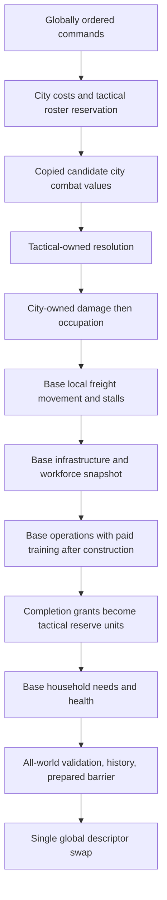

# NYON Zig: city combat and paid recruitment integration annex

<!-- BEGIN 2026-10-19 rewrite decision -->
> **Historical; Zig continuation canceled 2026-10-19.** Preserve this source contract and evidence. Active recovery targets Rust stable1.99.1; see the 2026-10-19 Rust designs/plans. Historical review labels do not approve new Rust behavior. Tests and CI gates remain paused.
<!-- END 2026-10-19 rewrite decision -->


- Author: Abbey; independent written reviewer: pending.
- Date: 2026-10-11.
- Status: **Draft / Proposed integration annex; no implementation dispatch.**
- Selected city base: `nyon.rich-city.v1` in the [rich-city specification](2026-10-11-nyon-zig-rich-city-design.md).
- Proposed composed identity: `nyon.city-combat-galaxy.v1`.
- Compiler: exactly `0.18.0-dev.146+35accc06e`.

## Overview and scope

Integrate the selected rich-city rules with tactical damage, occupation and paid
ground-unit training in one globally staged galaxy tick. This annex supplies the
city-owned resource/population costs, custody transitions and incoming effect
application. The tactical specification owns class statistics, unit admission,
movement, targeting, simultaneous combat and occupation resolution. There is
one city authority, one commodity table and one globally published descriptor.

The [finishing plan](../plans/2026-10-11-finish-nyon-in-zig.md) and
[expanded roadmap](../plans/2026-10-11-expanded-zig-rewrite.md) require independent
written mechanics review and a detailed implementation plan before product work.
The controller selected the concurrent rich-city draft as the base during this
assignment. Its author's file is not modified here. The amendments below are normative
within the new composition and require independent review before dispatch.
This annex neither claims Donald reviewed these exact numbers nor requests a
new approval-only pause; controller-reported design delegation remains distinct
from independent technical acceptance.

## Current evidence and selected base

Current source observations, inspected2026-10-11:

| Source | Verified behavior / boundary |
| --- | --- |
| [rules.zig](../../../zig/src/planet_economy/rules.zig), `validateConfig`, `footprintContext`, `terrain` | Island side4..32, one/two-cell footprints, rocky iff `(seed%4+cell.local%4)%4==0`. |
| [types.zig](../../../zig/src/planet_economy/types.zig), `Resource`, `BuildingKind`, `Command` | Existing v0 has food/material, farm/quarry/house and population cap32. New rich-city schemas are Proposed. |
| [phases.zig](../../../zig/src/planet_economy/phases.zig), `scanProduction`, `scanPopulation` | Current v0 workers/food/growth phases differ from rich-city; do not change their rules or vectors. |
| [command.zig](../../../zig/src/planet_economy/command.zig), `admission`, `Cursor.advanceContext` | Role checks and bounded candidate mutation provide reuse seams, not new city/combat behavior. |
| [play_role.zig](../../../zig/src/play_role.zig), `SessionPolicy.admit` | Creator null actor, ruler selected actor, combined explicit provenance, external autonomous rejected. |
| [surface.zig](../../../zig/src/surface.zig), `Topology.neighbor`, `cellId` | Qualified connected cube adjacency; no duplicated face-seam entities. |

The selected base defines commodity tags food0,water1,timber2,stone3,ore4,alloy5,
tools6,medicine7; ephemeral power; population0..512; hall housing16; base storage
512/resource plus512/warehouse up to4096. Roads are building records, coststone2,
and require construction. Its tiered workforce uses
`floor(floor(population/2)*(100-health_debt)/100)`. Its capital scenario gives
pure ruler play a productive starting capital; creator and combined retain
explicit authoring. All these are Proposed base decisions, not source facts.

Use the base's footprints, road connectivity, recipes, health, construction,
paid cancellation/dismantling, capital genesis, household demand and priority
rules unchanged. Completed projects become operational next hour. Freight advances
one validated edge per subsequent hour,can stall,and supports the base's explicit
current-source-owner cancellation; nominal departure+edges is not guaranteed. Do not substitute grain/metal resources, sparse free-standing
roads, a256-population cap, or a second city ledger from earlier alternatives.

Goals are paid ruler acquisition, exact city/training/unit crew custody,
conservative structural damage, whole-city occupation, deterministic effects,
bounded shared work, canonical replay and full-scale acceptance. Research,
ecology, diplomacy, fleets and interplanetary logistics remain required later
interfaces. This annex adds no research unlock, ecological depletion, treaty,
ship speed or battle algorithm. Later adapters consume copied city values and
must use separately reviewed typed mutations/receipts to change them.

## Proposed merged phases and ownership



One tick is one hour, completed tick0 at genesis, horizon1,000,000. Proposed
phase order is prepare/route; validated hostility frame; commands; copied tactical values and tactical
resolution; city effects; local arrivals; infrastructure/workforce snapshots;
city operations including training; needs; validation/history; prepared barrier;
publication; retirement. Every phase visits all worlds before advancing. Inside
city operations retain base tiers waterworks,farms,clinics,construction, then
retain training before industry and spaceports,as the selected base already defines. No separately advancing tactical or city clock is introduced.

Commands execute ascending planet then global sequence, matching the full-scale
storage proposal. Accepted creator authoring and ruler orders influence the
candidate tactical copy this tick. Incomplete/newly completed city projects retain
the base next-hour activation rule. Tactical resolution occurs before training
completion, so new units cannot participate in that tick. A candidate reserves
all owners' state, quota and history; no subsystem publishes independently.

The coordinator owns policy, sequence, clocks and global quotas. City owns
population, stocks, buildings, training jobs and damage/occupation application.
Tactical owns roster/reservations/unit IDs and resolution. All calls are on the
shared authority owner; no live mutable pointer escapes through projections.
Proposed modules `zig/src/city_economy/{training,effects,combat_view}.zig` are
integration responsibilities, not declarations that these files exist.

## Paid training rules and admission

Tactical class tags are infantry0,armor1,artillery2. Prices use the selected
base's alloy commodity. These fixed prices need joint review with tactical
statistics; they are neither inferred existing rules nor configurable scripts.

| Class | Goods consumed once on admission | Crew transferred from city | Successful training hours |
| --- | --- | ---: | ---: |
| infantry/0 | food8,tools2 | 1 | 2 |
| armor/1 | food8,alloy8,tools4 | 2 | 4 |
| artillery/2 | food8,alloy6,tools6 | 2 | 3 |

`recruit(city,class)` is a ruler-provenance command, admitted by the existing role
rules and ownership checks. Combined ruler commands pay all costs. Creator uses
the tactical design's explicit authored-unit path; no creator tag is smuggled
through paid recruitment. Autonomous producers, if later introduced, must use
the same costs/quotas and reviewed internal provenance.

Admission requires an intact active hall, known class, at least one city resident
remaining after crew removal, and all goods. Reserve atomically: one qualified
TrainingId, one city job slot and one tactical roster slot plus never-reused
reserved global UnitId. Limits are2,048 training jobs/global,32/world,4/city;
tactical live+reserved roster<=4,096/global and256/world. No faction roster cap.
Reserve unit identity and capacity before debit; quota/ID rejection consumes no
stock, population, IDs or reservation. Inputs and IDs use checked arithmetic.
Earliest completion tick is target+duration-1; require completion+1<=horizon.

Training record fields: qualified TrainingId, qualified city, class, crew:u8,
remaining:u8,initial_duration:u8,paid_goods:[8]u32,reserved_unit_id:u64,
created_tick:u64. Owner is the current city owner; no stale duplicated owner field.
Population removed from city remains explicit training crew custody. Upfront food
is consumed as training rations, with no separate household demand for trainees.
This abstract rule creates no additional workers while training is pending.

Training runs after construction, before industry. Visit city then TrainingId
ascending. Each progressing job requires two available workers, an intact active
hall and no successful occupation this tick. Reserve those workers until hour end,
then decrement remaining by1. Newly admitted jobs may progress this hour. An
idle job reserves no workers and consumes no additional goods. Base worker debt,
life-support priorities and construction competition remain in force; training
cannot obtain labor from future growth or from its removed crew.

When remaining becomes0, produce one internal grant:

The exact grant type is defined once in “One private projection/effect/result/
grant contract” below; all field widths and correlation checks there are normative.

In the same candidate, tactical consumes the matching reservation into a reserve
unit without a cell, and city retires the job. The grant is not a public mint API,
queue for next tick or persistence write. Tactical `deploy_reserve` owns later
hall/placement admission. A unit cannot deploy/fight before eligible tick.
Completion cannot run at horizon (eligibility would overflow the admitted clock):
that job idles with `horizon` reason and remains cancelable at the last tick.
If the reservation is absent, duplicated or inconsistent, abort the entire
unpublished tick as an invariant defect. Normal quota cannot fail at completion
because it was reserved; never debit twice or turn failure into lost crew.

`cancel_training(training)` is admitted for the current city owner. Return all
crew and floor(each originally paid goods/2), regardless of progress; release
job and tactical reservation atomically. This fixed training refund is deliberately
separate from the base's remaining-work building refund. Require resulting city
population<=512 and for every commodity
`stock+incoming+refund<=current functional capacity`. Returned crew may exceed
housing, producing existing base needs consequences. Reject an unaffordable
capacity return without changing either owner's state. Never mint a substitute
unit or discard crew to make cancellation fit. Reserved UnitId is permanently
consumed by accepted cancellation, and cannot be reassigned.

Occupation transfers pending jobs with their city; they pause that tick and
resume for the new owner later. A damaged hall pauses jobs; cancellation remains
possible. No automatic timeout, desertion, refund or training restart. Crew
conservation across the composed state is city population + training crew +
live/reserve unit crew = scenario/creator people + growth - city mortality -
tactical casualty sinks. Tactical classes retain crew1/2/2 respectively; killing
a unit consumes its remaining crew in an explicit tactical casualty receipt.
No city population is debited again when a trained unit deploys.

## Structural values, incoming effects and occupation

Completed operational halls/buildings have integrity:u16 in0..1000, initially1000.
Incomplete projects are not tactical structural targets. A base project completed
this tick enters tactical projections next tick, as it becomes operational.
Damaged1..1000 structures retain full base service; integrity0 disables their
operation. Completed roads have fixed integrity1000,are nondamageable and
non-targetable,and remain base building/quota records. Hall identity remains its CityId and never consumes a
second building slot.

The exact projection/effect/result types and emission ownership are defined
once in the composition contract below.

Projection is a copied candidate value qualified by committed source revision and
target tick. All structure cells are passable; cover is true iff integrity>0 and
kind is neither farm nor solar array;roads are absent from this projection. Hall cover follows integrity;
capturable is true only for an intact hall. Tactical owns interpretation of cover,
all attacks and occupation eligibility. No battle formula is introduced here.

Effect batch binds source revision,target tick,tactical rules identity. Effects
are bounded by4,096 distinct damage targets plus2,048 occupations/global/tick,
6,144 total. IDs are unique ordinals1..N scoped by batch revision/tick, not a
new global counter. Aggregate raw tactical damage with checked widened arithmetic;
tactical keeps raw shot receipts and sends `min(1000,sum_damage):u16` once/target.
No single damage effect can overflow city integrity arithmetic.

Validate the complete batch before writes: matching bound revision/tick/rules,
contiguous unique effect IDs, known projected targets, amount1..1000, at most
one damage/target and one occupation/city, present distinct new owner and matching
expected owner. Sort by damage before occupation, then qualified target/city;
assign effect IDs in that order. Any malformed internal batch aborts the global
candidate as `InvalidEffectBatch`, not a gameplay rejection or partial apply.
Apply damage as `max(0,integrity-amount)`. Then occupation of a now-zero-integrity
hall emits `OccupationBlocked(destroyed_hall)` and retains owner. Otherwise
change the entire city owner, retaining all IDs, stocks, people, buildings,
roads and pending training. Set `occupation_tick=target`. Disable worker
operations including training and construction for that tick;intact connected
passive solar,storage and residences continue. Household needs still consume
stocks and report deficits;growth streak resets. Next tick normal operation resumes.
This flags an outcome; it does not change tactical occupation criteria.

`repair_structure(target)` is a ruler command on an owned completed hall/building.
Cost2timber+2stone restores min(250,1000-integrity). Require integrity<1000.
It operates in commands before combat and does not promise survival that tick.
Creator `author_repair_structure(target,bypass=true)` restores1000 with explicit
waived vector `ceil(restored/250)*(2timber+2stone)`. Neither can repair a road or unfinished
project; no health is restored without a command or admitted authored endowment.

## Capacity loss, passive services and stalled freight

The selected base already defines hard stock+incoming<=4096 per commodity and
visible over_capacity relative to functional capacity. Destroyed warehouses may
reduce functional capacity without losing goods,reservations or people. Each
positive producer output tests its post-input sum against functional capacity;
consumption of an over-capacity commodity remains legal. New cargo,mint,refund,
training/shipment cancellation returns must fit functional capacity and hard cap.
A valid previously reserved arrival keeps stock+incoming constant and is honored
even above functional capacity. No overflow stash,spill or implicit destruction.

The hall cell anchors same-city completed-road connectivity even if ruined.
Completed roads cannot be attacked or damaged. Ruined hall supplies zero of its
own16 housing but retains base512 storage;connected intact residences,warehouses
and enabled solar retain passive functions. Worker operations require intact
hall and no occupation at this tick. Occupation also resets growth and assigns
zero workers,while connected intact solar continues producing/domestic allocation.
Needs and health use actual resulting power,stock and housing;no automatic death
arises merely from a capacity recomputation. Capacity queries after accepted
commands recompute against the candidate,including repairs,not stale caches.

Exact service table after effects,starting with ordinary capital24people,debt0,
food192,water256 and otherwise intact/connected starting assets:

| Condition | Housing | Storage/resource | Solar/domestic/unused | End food/water | Debt | Assigned workers/growth |
| --- | ---: | ---: | --- | --- | ---: | --- |
| Ruined hall | 16 from surviving Residence | 512 | 24/3/21 | 168/232 | 2 from overcrowding | 0/0 |
| Intact hall,captured this tick | 32 | 512 | 24/3/21 | 168/232 | 0 after clamp | 0/0 |

Other stocks unchanged,population24,full food/water supply,shortage streaks0,no
care. Current health reduction rule applies once:captured capital's fully met
needs/power/housing would subtract1 but clamps debt0. Ruined hall's housing
shortage prevents that reduction and adds2. Neither table is a runtime test.

Shipment immutable fields are source,destination,launch_owner,commodity,amount,
departure and original unique adjacent path. Mutable position,stalled_ticks:u32
and last_stall are canonical base fields. No move at departure. Every later
freight phase tests in this exact order:source owner==launch_owner;
destination owner==launch_owner;source hall intact;destination hall intact;
next path cell completed hall/road owned by launch_owner. Failure keeps cargo,
position and destination reservation;increment stalled_ticks1 and record first
reason1..5. Success advances exactly one edge;at final cell convert reservation
to stock and retire shipment exactly once. Endpoint ownership is tested every
hour,not merely when reached. There is no guarantee,automatic timeout,reroute,
teleport or delivery to a conquered destination. Reclaim/repair can permit
resumption. All static path/claim references remain valid while legitimately
stalled;current ownership/access is a movement predicate,not an invariant that
rejects the stored shipment. Deliberate removal of any active-route cell remains
forbidden. Next-edge ownership checks catch captured intermediate-road cities.

Family0/tag17 cancel_shipment is authorized only by **current source-city owner**.
Require the full returned amount fits source functional capacity and hard4096
including its incoming reservations. Then return cargo,release destination
reservation and retire shipment atomically;otherwise preserve all fields. Source
capture permits its new owner to recover outbound cargo;destination capture alone
cannot seize or cancel it. Shipment IDs never reuse. Creator minted cargo obeys
identical custody/reservation/stall/cancel rules after explicit initial mint.

## Composition authority and immutable selected revisions — fix3

The sole city base is the byte-exact [fix3 base snapshot](../../../.superpowers/sdd/2026-10-11-finish-nyon-in-zig/city-fix3-base.md),
SHA256 `32c9e391e9f8936b8124a984b8c83f588aa51017ea8e987a0e551bff362c6668`,
copied unchanged from the public rich-city document at fix3 admission. All its
city rules,command tags0..17,family0,52-entry profile,city canonical record payloads,
phase tags0..21,event headers/tags and hash domains are incorporated by reference
as normative bytes. The tactical additions below fill only that base's explicitly
reserved family1,kinds7..9 and events64..66 plus the bounded hostility input67.
There is no competing annex city codec or alternative commodity/road/freight rule.
The root controller's fix3 selection retains fix2's single city authority and
adopts its canonical defaults and exact city-command custody mappings. It
supersedes fix1's guaranteed freight and conflicting annex choices. Review binds
this frozen artifact,not a subsequently changed public file. Later public drift
is a separate integration prerequisite: reconcile consumers and rereview before
implementation; a passing frozen review never approves newer base bytes.

Rules identity `nyon.city-combat-galaxy.v1`,storage `nyon.city-combat-storage.v1`,
city `nyon.rich-city.v1`,tactical `nyon.tactical-ground.v1`; wire,mechanics and
annex versions1. Selected full-scale storage hash
`a8bc0d41767722b3215e2e6c334d06d5cf5cacc3107f28f83b3b4219ba6ce2f5` and initial
codec W hash `c116655859eae999ee1529180521254a575570ba471099fc0ca2e00c8778b6b9`
remain unchanged. W's initial economy schemas/domains are not this composition's
city codec. Fixed source+target memory and segmented-history lifecycle remain
shared-owner obligations. No product dispatch follows from this document alone.

### Canonical city defaults and receipt semantics

The snapshot's “Trusted capital genesis” default mappings and “Accepted
city-command effect mapping (tags0..17)” are normative in their entirety. They
fix every capital building's enabled/priority bytes,initial_work/paid_cost and
activation,all city creation fields,and which resettlement fields reset or remain.
Behaviorally passive bytes still participate in genesis/replay equality. No host
zero initialization,author-building default or source-city state substitutes for
those mappings. This annex does not duplicate a second city-command effect table.

Base event5 debit/credit are actual **city stock changes at command admission**;
incoming reservation or cargo is not a city credit. Full command input and family/
tag identify mint,transfer,sink and return. Family1 below preserves that meaning:
it never changes city stock and always emits zero debit/credit/waiver vectors.
Creator unit crew is an explicit people mint,while deployment merely changes
existing unit location and has population_moved0. City recruitment/cancellation
and shipment/founding/resettlement mappings remain solely the frozen base's table.
Every coupled witness compares those exact outcome fields as well as final state.

### One identical profile and phase registry

The profile is exactly the base's52 u32 values. Positions0..33 are W's frozen
profile facts; they confer no authority to decode W's city records. This complete
vector is repeated for mechanical equality checking,not a second version:

```text
0:64 1:512 2:16 3:4 4:32 5:4096 6:64 7:16384 8:256 9:36864
10:576 11:4096 12:64 13:65 14:2048 15:256 16:2048 17:256
18:4096 19:4096 20:256 21:2048 22:2048 23:1024 24:1024 25:64
26:64 27:131071 28:131072 29:67108864 30:33554432 31:1000000
32:4096 33:1 34:256 35:512 36:4096 37:512 38:16 39:2048
40:32 41:4 42:4096 43:256 44:2048 45:16 46:6144 47:4096
48:2048 49:8388608 50:4 51:64
```

| Phase | Exact shared work/barrier |
| --- | --- |
| 0 | Structural admission,root/history reservation,globally sorted public input; validate hostility producer input before gameplay |
| 1 | Public commands by planet then global sequence |
| 2 | Copy city values and the already validated hostility frame |
| 3 | Round start counters,all worlds |
| 4 | Intents,all worlds |
| 5 | Movement proposals,all worlds |
| 6 | Movement arbitration,all worlds |
| 7 | Position installation,all worlds |
| 8 | Shots,all worlds |
| 9 | Damage accumulation,all worlds |
| 10 | Damage application/deaths,all worlds |
| 11 | Withdrawal,all worlds |
| 12 | Objectives,all worlds; after this barrier repeat3..12 for next round,exactly four rounds |
| 13 | Validate city effects,damage then occupation,consume correlated results |
| 14 | Local freight movement,stalls and arrivals |
| 15 | Infrastructure,power and worker snapshots |
| 16 | Operations waterworks,farms,clinics,construction,training,industry,spaceports |
| 17 | Household needs,health,mortality,growth |
| 18 | Invariants,state/history hashes,prepared commit bytes |
| 19 | Prepared barrier |
| 20 | One descriptor publication,one unit,no new hashes/events |
| 21 | Retirement |

This is the base's registry,not fix1's phase0..14 proposal. No extra strategy phase
is inserted. Numeric round0..3 is an event field,not a clock. Setup/genesis events
use phase0,tick0 outside command ticks. Every world participates at each barrier.
Hostility is validated as immutable input during existing phase0 so public
commands1 and later copied combat frame2 use identical relationships.

### Required hostility producer without invented diplomacy

`HostilityFrame={source_revision:u64,target_tick:u64,producer_version:u16=1,
source_kind:u8(fixture0/qualified_strategy1),pair_count:u8,pairs}`. Each pair is
`a:u32,b:u32,hostile:bool`; require exactly N*(N-1)/2 pairs,1<=a<b<=N,sorted(a,b),
no self/missing/extra pair. Producer reads committed strategic relation state R
and computes due relationship values for T; it cannot depend on later public
commands or candidate capture. Frame context must equal current committed R and
target T. Validate it in phase0 before command admission; phase2 copies these
same frozen values for all four rounds. Stale/malformed frame aborts candidate;
missing producer gives HostilityProducerUnavailable,not assumed war/peace.
No public envelope grants hostility. Replay uses the recorded frame and verifies
qualified producer output when source_kind1; fixture0 is explicit test evidence.
No diplomacy rule or production provider is delivered by these city/combat docs.
Release qualification requires the separately reviewed strategy producer and
cannot count fixture-only histories as diplomacy completion. The interface and
phase are exact even while that producer remains an unmet readiness dependency.

Hostility is canonical tick input,event67,not a new persistent city row or another
52-entry quota. Its bounded scratch is retained in control/input allocation.
No new mutable strategy record kind is admitted. The previous full transcript
records every frame; state digest hashes only the frozen base plus tactical
records. This is a deterministic externally produced input,not hidden state.

### One private city/tactical seam and sole emitters

Use base scalar conventions `Q=planet:u32,local:u64`,
`Structure=planet:u32,kind:u8(hall0/building1),id:u64`. Direction wire tags are
**east0,west1,north2,south3**; capital placement tie order remains north,east,south,
west. Crew is **u8 everywhere**,fixed infantry1,armor2,artillery2. Scope binds
`Context={source_revision:u64,target_tick:u64}`; include it once per batch where
base event grammar uses enclosing batch/header fields.

- `CityCombatValue={context,target:Structure,city:Q,owner:u32,count:u8,
  footprint:[count]Q,integrity:u16,max_integrity:u16=1000,passable:bool,
  cover:bool,capturable:bool}`. Only activated completed **nonroad** structures.
- `CityEffect={context,id:u64,kind:u8,payload}`; damage0:
  target:Structure,amount:u16; occupy1:target:Structure,objective:u64,
  expected_owner:u32,new_owner:u32. Occupy target must be hall.
- `CityEffectResult={context,effect_id:u64,type:u8,target:Structure,
  objective:O(u64),previous_owner:u32,new_owner:u32,integrity_before:u16,
  integrity_after:u16,outcome:u8(applied0/blocked_destroyed_hall1)}`.
- `DeploymentGrant={context,producer:Q,reserved_unit:u64,owner:u32,world:u32,
  hall:Structure,class:u8,crew:u8,eligible_tick:u64}`. Hall is **Structure(kind0,
  city ID)**,not CellId. Resolve its city hall cell separately. This agrees with
  base event33 exactly; Context comes from active candidate and receipt header.

Effect ordinals1..N are batch-scoped; damage-target order then occupation
(planet,hall,ObjectiveId). Tactical emits inputs34 and batch36 exactly once.
City validates complete batch before writing and emits sole result35. Tactical
consumes its matching ObjectiveId result exactly once; no duplicate result event.
Lost final-round control is tactical ObjectiveRound outcome only and produces
no city effect/result. City blocked result is destroyed_hall only.

Occupy-hall admission requires hall presence,kind0,same world,exact
objective.cell==stored hall cell,and at most one unfinished objective for that
qualified hall. Hold requires absent hall. Unfinished objective cells remain
unique. These are decoder invariants too. Projection may include ruined targets
but they are not capturable. Roads never enter this projection: a road-target
internal effect aborts the entire batch before any neighboring valid write.

Before grant conversion compare live current training ID,city,reserved UnitId,
world,current city owner,class,crew,remaining0 and eligibility T+1. Require grant
hall structure resolves to that same city. Reserved UnitId must not already be a
unit; reservation/counter must match. City retires training and tactical creates
reserve atomically in one candidate and city emits event33 once. Missing,duplicate,
wrong-context/objective/owner/class/crew/hall/eligibility inputs or results abort
and drain the unpublished global candidate; no silent stale-success path. Retry
recreates each debit/grant/result once. Outputs are derived during replay,never
unchecked commands. The sole reservation record is the city training record.

### Complete composed command and rejection additions

Use exact base frame `planet:u32,body_length:u16,body`, body
`sequence:u64,provenance:u8,O(actor:u32),family:u8,tag:u16,payload`.
Family0 city tags0..17 and payloads are exactly the frozen base table,including
17 cancel_shipment. No annex tags32..36 remain. Family1 tactical is:

| Tag | Exact payload in order |
| --- | --- |
| 0 set_order | unit:u64,Order |
| 1 deploy_reserve | unit:u64,hall:Structure |
| 2 designate_objective | issuer:u32,kind:u8(hold0/occupy1),cell:Q,hall:O(Structure) |
| 3 remove_objective | objective:u64 |
| 4 author_unit | owner:u32,class:u8,cell:Q,hp:u16,bypass:bool |

`Order=tag:u8,payload`:auto0/hold1(no payload),move2(Q),attack_unit3(u64),
attack_structure4(Structure),retreat5(Structure). Family1 tags0..3 admit creator
or ruler under policy/ownership; tag4 creator only with explicit bypass. Both
families share count/body/sequence caps,canonical enum/optional/length validation.
Unknown family,tag,provenance,class/order bytes are whole-batch structural errors;
known autonomous2 denied by SessionPolicy is ordinary InternalCommandOnly6.
Mixed legal recruit and well-encoded forbidden autonomous command publishes the
recruit and rejection6; unknown provenance3 aborts both. Rejections consume
sequence only if the tick publishes; role errors retain base codes1..6,including
InvalidActor2,not fix1's old numbering.

Base city rejection1..39 and ordering are incorporated unchanged: role;tag/
provenance;bypass;target and present civilization;ownership;ranges;topology/
connection;global then world then city then roster quotas;IDs/eligibility horizon;
return population/storage;resources by commodity tag;crew cost. Global-before-
world is a new composed rule,not initial W's old precedence. Tactical additions:
40 WrongKind,41 WrongWorld,42 NotHostile,43 HallCellMismatch,
44 UnexpectedHall,45 ObjectiveHallExists,46 ObjectiveCellExists.
Existing9 UnknownTarget,10 UnknownCivilization,11 WrongOwner,12 InvalidScalar,
13 InvalidCell,16 OccupiedCell,22 GlobalCapacity,23 PlanetCapacity,25 IdExhausted,
32 InvalidTargetState and36 RosterCapacity apply to tactical predicates.
Tactical lookup order actor unit/source,then referenced target,then required hall;
hold-present hall uses44 without resolving an unnecessary target. After existence/
ownership,same-world41 precedes scalar/state ranges; then cell equality43,hall
uniqueness45,cell uniqueness46,occupancy16; then quotas/IDs. Hostility42 is checked
with ownership,after source-owner checks. Range,LOS,cooldown,credit/conflict are
round outcomes,not command rejections. Invalid known scalar priority/HP remains
12; unknown enum encoding never gets37 InvalidClass. First array-error index wins.

Tactical accepted event5 uses the following exact mapping; all debit,credit,
waived_goods vectors and waived_work are zero. `0` means scalar zero. Original
command input identifies its existing target; created_local always identifies
only a newly created object. Family1/tag distinguishes the global ID namespace.

| Family1 tag | created_local | counterpart_id | population_moved / custody |
| --- | --- | --- | --- |
| 0 set_order | 0 | 0 | 0; no people transfer |
| 1 deploy_reserve | 0 | Hall CityId | 0; same full-crew unit leaves reserve |
| 2 designate_objective | New global ObjectiveId | 0 | 0 |
| 3 remove_objective | 0 | 0 | 0; retired ID remains burned |
| 4 author_unit | New global UnitId | 0 | Class crew1/2/2; explicit creator people mint into deployed unit |

No row credits city goods or debits population. Training completion emits city
event33 and no synthetic tactical accepted command. These meanings stay within
the existing256-byte outcome envelope. Replay uses authenticated input+outcome
once; unit state is an assertion of custody,not a second crew mint.

### Canonical state, domains and event additions

Adopt base `NYRC` genesis,exact52-value profile,initial policy/scenario/records,
kind0 global keyrealm0/local1,kind1 world local1 and exact city record kinds2..6
unchanged. No annex row-change event or extra city-hour summary record. Its
`record_length:u16,key14,payload` sorted grammar and
NYON-RC1-GENESIS/STATE/HISTORY domains are the single composed grammar. State
hash includes manifest/identity and sorted global/entity records as base states;
no former NYON-CC1 digest remains. Preserve distinct transport NYON-FS1 and session
NYON-ES1 domains. Initial theater records count in base genesis envelope.
The following fill all reserved tactical record kinds:

| Kind/key | Exact payload |
| --- | --- |
| 7 unit /realm0,local=UnitId | world:u32,owner:u32,class:u8,crew:u8,hp:u16,state:u8(deployed0/reserve1),cell:O(Q),Order,credit:u8,cooldown:u8,withdrawal:u8,eligible_tick:u64,origin:u8(creator0/training1),producer:O(Q) |
| 8 objective /realm0,local=ObjectiveId | world:u32,issuer:u32,kind:u8,cell:Q,hall:O(Structure),controller:O(u32),streak:u8,completed:bool,completion_tick:O(u64) |
| 9 theater /realm=world,local1 | victory_count[16]:u32; absent civilization slots zero |

#### Canonical unit creation fields — fix4

This is the sole tactical creation-default table, applied after the existing
creator admission or city grant validation. `T` is the active target tick; `G`
is the validated DeploymentGrant above. Class crew and maximum HP come only from
the tactical class table (infantry1/100,armor2/200,artillery2/80). The creator
column makes its existing defaults explicit beside training; it is not a second
city/grant default source. Every kind7 key/payload field is specified:

| Field | Accepted author_unit at phase1 | Consumed training grant at phase16 |
| --- | --- | --- |
| key realm / local | 0 / newly allocated UnitId | 0 / G.reserved_unit; already allocated at recruitment |
| world | Admitted cell.planet | G.world, equal to G.producer.planet and G.hall.planet |
| owner | Admitted command owner | G.owner, current city owner |
| class / crew | Input class / class crew | G.class / G.crew, checked against class crew |
| hp | Input HP in1..class maximum | Class maximum HP |
| state / cell | deployed0 / present admitted Q | reserve1 / absent |
| Order | auto0, no payload | auto0, no payload |
| credit / cooldown / withdrawal | 0 / 0 / 0 | 0 / 0 / 0 |
| eligible_tick | T | G.eligible_tick, exactly T+1 within horizon |
| origin / producer | creator0 / absent | training1 / present G.producer (qualified historical TrainingId) |

Grant hall identifies the validated city, not a unit location or stored unit
field. Conversion consumes its existing full crew/reservation exactly once;
there is no new ID allocation, goods debit, population debit or crew mint.
The producer remains historical after the job retires. Creation does not depend
on host zero-fill. Subsequent reserve deployment/extraction preserves id,world,
owner,class,crew,origin and producer; the existing admitted location/counter/HP
and eligibility rules govern that transition. This table does not reset them by
reapplying creation defaults. A phase16-created reserve has no UnitRound this
tick because all four round-entry sets were already fixed and processed.

Theater payload64 plus key/length16=80 bytes,ratifying base's genesis bound.
Each unit has crew equal to class;reserve has absent cell and zero credit/
cooldown/withdrawal after extraction;completed training grants preserve origin
producer historically,not as a live training reference. No unit ID aliases a
pending training.reserved_unit. Count7 entries in base global/world metadata
remain city/building/claim/shipment/training/unit/objective,with unit including
live+reserve but **excluding** training. Roster quota separately adds training.
Never-reused next counters include allocated then canceled/dead/removed IDs;
replay validates their history. No tombstones,retired training,arrived shipment
or dead unit row remains. Physical claims biject every existing building/hall;
service failure does not delete claims. Objective hall/cell uniqueness and target
binding,shipment path/position/stall ranges,hard4096 storage/incoming sum and
crew conservation are decoded cross-record invariants.

Base event header is exactly19bytes `tick:u64,phase:u8,planet:u32,ordinal:u32,
tag:u16` plus length:u32; no extra domains/provenance/round in the header.
Use base event tags0..12 and32..36,payloads and sole owners unchanged. Tactical
fills reserved events64..66 and adds explicit bounded producer input67:

| Tag / sole owner | Exact payload |
| --- | --- |
| 64 UnitRound / tactical | round:u8,unit:u64,Order,reason:u8,move_from:O(Q),move_to:O(Q),move_result:u8,shot_unit:O(u64),shot_structure:O(Structure),damage:u16,hp_after:u16,credit:u8,cooldown:u8,withdrawal:u8,reserve_after:bool,crew_sink:u8 |
| 65 ObjectiveRound / tactical | round:u8,objective:u64,controller:O(u32),streak:u8,outcome:u8 |
| 66 Theater / tactical | victory_count[16]:u32; header planet identifies world |
| 67 HostilityFrame / strategic producer via coordinator | exact HostilityFrame defined above |

Tactical reason/outcome tags are success0,hold1,reserve2,dead3,range4,occluded5,
nonhostile6,cell_occupied7,arbitration8,credit9,lost_control10,
blocked_destroyed_hall11,completed12,retreat_unavailable13,none14. City building/
training/population status tags remain base's distinct enums. UnitRound permits
at most one shot target option;absent shot has damage0. Per-unit state after that round's
barriers is recorded once at phase12 before that world's objective records;
ObjectiveRound also phase12. Immediate intermediate barriers emit no extra copy.
Theater summaries emit once per world at phase18,not each round. Effect batch36
then inputs34 sorted then matched city outcomes35 emit phase13. City grant33
has crew:u8 and Structure hall exactly as base specifies. No duplicate city
result/grant is emitted tactically. Outcome35's enclosing batch36 and header tick
restore Context for private validation;no asynchronous result can outlive batch.

#### Canonical tactical event field selection — fix4

The following is the **single normative selection table** for events64/65.
Tags retain the existing numeric enum; a known tag not allowed for that field
is noncanonical. `none14` deliberately represents both no target and cooldown
suppression; it is not an unspecified implementation choice. No cooldown tag,
event, phase or second emitter is added. Each numbered predicate is evaluated
in order and the first matching predicate wins. Decisions are retained in the
already reserved round intent/shot/objective slots until phase12 emission.

Round entry means phase3 of this round. Emit one UnitRound for every unit
present at round entry, ascending UnitId within each world, including reserves
and units killed this round. A removed unit has no event in later rounds.
Emit one ObjectiveRound per existing objective, ascending ObjectiveId, after
that world's UnitRounds. Completed objectives still emit but never score again.
All of these headers use phase12; payload round identifies0..3. Phase13 does
not amend or re-emit those records.

At phase4, resolve `auto` by the tactical document's ordered HP/target/objective
rules against the phase4 snapshot. Store the generated concrete intent, without
changing standing auto. An auto fallback with no retreat hall/objective/target
resolves to hold. A standing move already at its goal changes to hold and uses
hold behavior this round. A terminated attack/retreat instead changes to hold
but performs **no replacement targeting or movement that round**: missing,
withdrawn unit, or structure absent from phase2/with frozen integrity0, gives
invalidation none14; a remaining nonhostile target gives nonhostile6; invalid
retreat hall gives retreat_unavailable13. Target invalidation checks these
existence/deployed/integrity predicates before hostility; retreat checks its
present friendly intact projected hall as one availability predicate. Invalid
cross-world/kind references remain admission/decoder errors under the existing
rules, not a new silent invalidation path. Clear withdrawal when
leaving retreat. This termination is observed at4, not retroactively after8.
At next round's phase4 the new standing hold behaves normally. Reserve-at-entry
resolves to hold with no action, retaining its persistent standing order.

For targeting, "nearest visible" means the shortest **clear transported-ray
step count**, then UnitId; choose that unit's tied ray by source direction tag.
Auto selects its attack_unit at4; hold selects at8 from the post-move snapshot.
An explicit/resolved attack retains its target through8 and revalidates it there.
For structure fire, select among clear footprint endpoints by(step count,
original CellId), then source direction for a tied endpoint. A geometric range
test traces the same four transported rays through at most class range steps
while ignoring blockers (still stopping at revisits). No reached target cell
means range4, including diagonal/off-ray targets. If a cell is geometrically
reachable but all such rays are blocked, use occluded5. A unit occupying a
structure endpoint counts as a blocker. This diagnostic test changes no firing
envelope: only a clear ray can produce a shot.

| Event field | Allowed tags, ordered predicates and exact defaults | Observation |
| --- | --- | --- |
| UnitRound.round / unit / Order | Round index / round-entry UnitId / concrete phase4 intent. Order auto0 never appears here; reserves and terminated orders encode hold1. Later death, extraction or target loss never rewrites the recorded intent. The canonical unit record still stores its standing order. | 3/4, retained to12 |
| UnitRound.move_from / move_to / move_result | 1. No move/retreat neighbor selected (reserve, terminated/nonmoving intent, or goal equality): both options absent, none14. 2. Otherwise both options present: pre-move source Q and selected **attempted** destination Q, even on failure. First test destination occupied in pre-move snapshot: cell_occupied7; then credit after phase3 less than destination cost: credit9; then another affordable proposal with lower UnitId wins: arbitration8; otherwise install at7 and spend cost: success0. No alternative neighbor is tried. Legal result set is {0,7,8,9,14}. | Proposal5, arbitration6, install7; never recomputed after deaths/withdrawal |
| UnitRound.reason | 1. Killed at10: dead3. 2. Reserve at entry or extracted at11: reserve2. 3. Phase4 termination: its exact invalidation tag above. 4. Effective move/retreat suppresses fire even if movement failed: copy move_result when a neighbor was selected, otherwise hold1. 5. For fire-capable intent, no selected target or target missing/withdrawn at8: none14; surviving selected target nonhostile: nonhostile6; successful movement: none14; cooldown after3 greater than0: none14; outside geometric range: range4; all eligible rays blocked: occluded5; otherwise shot: success0. Legal set is {0,1,2,3,4,5,6,7,8,9,13,14}. A hold with no visible hostile target uses none14. Cooldown precedes range and occlusion. | Actions4..8, with terminal overrides10/11; selected once for12 |
| UnitRound.shot_unit / shot_structure / damage | Set exactly one target option only when a shot actually fired at8, and record its uncapped class/armor/cover damage. Otherwise both absent and damage0, including every cooldown, suppressed, range, occluded or invalidated case. Hold/auto never falls back to another target after a selected attack fails at8. Death at10 retains a shot already fired and its damage. | 8, retained to12 |
| UnitRound.hp_after / credit / cooldown / withdrawal / reserve_after / crew_sink | Surviving deployed: post11 HP/counters, false,0. Reserve-at-entry or newly extracted: preserved HP,0,0,0,true,0. Death at10: 0,0,0,0,false,full class crew; terminal zeros are receipt values, not a retained dead row. Earlier move/shot options and amounts remain intact under either terminal override. Reserve HP is never repaired implicitly. | 10/11 before objectives12 |
| ObjectiveRound.round / objective | Round index / existing ObjectiveId, including previously completed objectives. | 12 |
| ObjectiveRound.controller / streak / outcome | 1. Completed on entry to12: keep controller/streak, completed12. 2. An occupation attempt already staged this tick: before round3 keep staged controller/streak4,success0 without rechecking intermediate control; at round3 require that same civilization's living deployed unit on the hall and no other civilization in its five cells, else reset absent/0,lost_control10. Eligible round3 remains staged controller/4,success0. 3. An unstaged occupy objective whose frozen projected hall is not capturable: reset absent/0,none14. 4. No unique qualified five-cell controller: reset absent/0,lost_control10. 5. Occupy controller not hostile to frozen hall owner: reset absent/0,nonhostile6. 6. Otherwise set the qualified controller, adding1 to streak for the same previous controller or starting at1 for a different/previously absent controller. Hold reaching12 sets completed=true and completion_tick=T, increments victory once, and emits completed12; every other progressing hold/occupy emits success0. Occupy reaching4 stages exactly one attempt and freezes controller/streak4; if this happens in round3 the just-tested controller also satisfies the final check. Legal set is {0,6,10,12,14}. | 12 after deaths/withdrawal, using frozen city/hostility projections; no phase13 city result is read |

Thus success0 with occupy streak4 means **capture staged**, never capture
completed. If still eligible at end round3 it creates one correlated phase13
input34. City alone emits result35: applied0 completes the objective, retains
staged controller/streak4 and sets completion_tick=T; blocked_destroyed_hall1
resets controller absent/streak0,completed=false,completion_tick absent.
The final canonical objective record reflects that phase13 transition. There
is no second ObjectiveRound or capture-completion event this tick. A completed
objective emits completed12 on later ticks; a blocked one can retry after a
later repair. Shared tag blocked_destroyed_hall11 is **not allowed in any of
the three tactical fields**; city result35 uses its separate outcome1 enum.
An already ruined phase2 hall therefore yields none14 at12, whereas destruction
by this tick's accumulated damage is observed solely by result35 at13. Hold
completion at12 continues to use completed12 and never creates a city effect.

Phase0 emits tick_input4,HostilityFrame67,sorted command_input12 preserving
original input index. Phase1 emits command outcomes5/6 in execution order.
Other events follow base phase/entity/tier order,then one commit11 prepared in18.
All records participate in one base history recurrence. Replay regenerates every
input-derived phase event and compares bytes,records,counts,policy and complete
history;outcome bytes cannot directly mutate a replay target.

The base's shared bounds are adopted:genesis cap262144,initial stream65536,
composed tick reservation12746752 within33554432. Subtotals6258688 base,
1703936 training/effects integration,4784128 raw tactics. HostilityFrame maximum
1123 framed bytes fits the already included65536-byte header/slack allowance;
no new allocation/event family subtotal is added. Exact record maximum proofs:
UnitRound<256,ObjectiveRound<64,Theater87 framed bytes<128;largest effect/grant
payload plus23byte framing<96/128 as reserved in base. Recheck independent packed
maxima before implementation approval. No fix1 final-row-diff transcript or
30124288 bound survives. No initial W transcript is added to this replacement.

## Shared capacity, work, failure and replay contract

Keep full strategic1..64systems,1..512worlds,1..16civilizations and side4..32.
Reuse selected base quotas4096cities,16384buildings/projects (roads included),
4096local shipments and36864claims globally. Do not add a second road family.
Training adds2048 one-page records, with counterpart tactical reservations charged
to tactical's live+reserved roster capacity. Training records must fit256bytes;
city/building integrity and occupation fields require fresh base record witnesses.

The separate full-scale draft estimates86800 pages/root before these extensions.
Training+2048 and tactical's proposed6656 record pages would total95504, below
its131071-page/root ceiling. This is arithmetic only. It does not prove compiled
records,refcounts,combined scratch,transcript,archive or maximum-live memory fit.
The full-scale owner must review a versioned capacity/layout amendment with both
systems, maximum dirty roots,leased old root,one replay target and segmented
history. Never instantiate512 old8,642,560-byte island reservations as scale proof.

The single composed event grammar above replaces the earlier independent
subsystem transcript estimates. It assigns no duplicate tactical effect result
or city grant. Its12,746,752-byte conservative sum is an arithmetic envelope;
maximum codec and actual emit-site witnesses remain required.

Every comparison,route edge,lookup,record copy,hash block,quota reservation,COW,
cleanup and receipt uses the same actual allowance0..4096 (default256). Variable
loops are cursor-based. Primitive limits remain256-byte copy/zero,64-byte hash
input,one topology edge,one bounded record operation,index move or reference
operation. No nested per-city budget or allocation during poll. Zero allowance
cannot mutate flags,counters,references or terminal delivery.

Prepublication cancellation discards city/tactical candidates,reservations and
receipts together, leaving all published worlds,policy,watermark and old leases
unchanged. After descriptor swap cancel reports already_published. Late producer
or stale effect cannot act on another generation. Missing reservation,arithmetic
fault,history overflow or malformed internal effect aborts the whole candidate;
normal player shortage rejects only its command. Postcommit cleanup fault stays
faulted until ownership-ledger shutdown; no false idle. Exact claimed capacity
must construct and dirty successfully; unexpected pool exhaustion is a defect.

Replay binds complete base scenario,initial policy,commands,rejections,empty ticks,
tactical inputs,training and effect results. Independently regenerate canonical
records and compare every logical city/roster/reservation field. Missing or reordered
grants,altered class/crew,duplicate producer,wrong owner and modified eligibility
must fail. Durable/session owner supplies complete segmented history and a fresh
new-identity replay target. No old profile access,migration or fallback is permitted.

## Independent witnesses and acceptance

1. Preserve base independent six-face witnesses and immutable terrain. Side4
   cell71 east neighbor4 is one directed seam anchor; all directed seams/corners
   and road/structure topology remain the selected base's required test matrix.
2. Rich capital population24 supplies12workers at debt0. Base essentials and
   industry use10; training inserted after construction can take2, idling a
   later2-worker industry as dictated by priority. New training deducts crew
   before worker snapshot: infantry leaves23people ->11workers, so do not claim
   unchanged12-worker staffing. Expected whole-hour commodity tables must be
   independently calculated for each chosen recruitment fixture.
3. Isolated training-phase fixture, sufficient available workers: infantry
   admission consumes8food/2tools and moves1 person; two staffed ticks create
   exactly one reserve unit, eligible the following tick. Cancel after first
   tick returns4food/1tool and1 person, releases quota, never reuses UnitId.
   Distinguish isolated fixture from the capital's whole-hour production table.
4. Full roster/global/world/city job cap,ID exhaustion,short goods or population
   rejects before debit. Cancellation full storage/population rejects before
   releasing job/reservation; damage/occupation never creates duplicate crew.
5. Damage1000 followed by hall occupation yields blocked capture; damage999
   allows capture, keeps IDs/population/stocks, skips operations but consumes
   household needs. Zero-hall training idles; later repair resumes without debit.
6. Warehouse damage: stock600,incoming64,old capacity1024,new512 yields visible
   over-capacity664. An otherwise valid arrival converts to stock664/incoming0
   without loss;new additions reject. Capture or hall ruin instead stalls the
   shipment under the exact endpoint/next-edge predicates above.
7. Independent command/event/genesis hex vectors include creator/ruler/combined,
   authored capital paid-cost=false,repair waiver,crew,reservation and grant
   eligibility. Replay across budgets1,7,256,4096 and alternating0/nonzero must
   match all bytes/fields. Inject failures at each reserve,COW,effect,grant,
   cleanup boundary and immediately around single global publication.
8. Full64/512/16 loaded fixture exercises global city caps,2048 training jobs,
   tactical4096 live+reserved units,6144 incoming effects,maximum dirty roots,
   retained old leases and full transcript. Pinned-compiler layout/counting
   allocator witnesses prove actual peak requested bytes and zero poll allocation.
   Small CLI stories or512 metadata records are not full-scale acceptance.
9. Run the applicable Rust-blocked [Zig gate](../../../zig/tools/check.sh) with
   actual exit code, independent native/Wasm replay,36,000 mixed and100,000
   endurance ticks with complete durable history. Measure named-hardware256-unit
   poll p95<=2ms/max<=8ms and full authority tick p95<=5ms separately at declared
   capacity. Tests,layout,measurement and runtime journeys are not run by this
   document-only assignment; none is claimed passing here.

## Security, observability, risks and rollout

Trusted local policy controls player admission; hashes are integrity evidence,
not network authentication. No host may forge internal effects or grants. Bound
all arrays before decode; no raw pool handle,live pointer,arbitrary script or
secret appears in commands/receipts. Old user profiles remain untouched.

Expose city integrity/occupation/access,over-capacity state,training crew/cost/
remaining/idle reason,reserved UnitId and eligible tick as copied views. Show
actual refund capacity failure and fixed-price repair consequences. Progress
reports shared consumed units,phase/cursor,requested bytes,history occupancy and
cleanup fault. Host timing/logging is outside canonical state.

Critical risk: independently authored documents disagree on phase/schema/quotas;
mitigate by one merged reviewed identity and one shared-authority writer. High
risks: duplicated crew at reserve completion,damage deleting inventory,and hidden
capacity growth; mitigate paired candidate reservations,conservation witnesses,
explicit over-capacity state and maximum-layout proof. Medium risk: captured endpoints/intermediate roads stall cargo;expose current
position,first blocking predicate and the current-source-owner cancellation cost. No alternative invisible
transfer or cancellation behavior may appear in implementation.

Alternatives: immediate paid unit mint is simpler but removes training/labor
choices; rejected. Charging only on completion avoids escrow but creates ambiguous
resource races; rejected in favor of admission debit plus reserved roster.
Separately committed city debit and tactical creation is rejected because failure
can destroy goods/crew or duplicate units. Per-building inventory/individual
haulers remain a later base evolution, not a requirement of this integration.

Rollout: independently review the exact annex/tactical composition and frozen
base revisions; validate shared codecs/layout/oracles; write the implementation plan; dispatch
one shared-authority writer; review and qualify; then integrate durable sessions
and native/browser journeys. New composed identity gates new-session creation.
Rollback disables that entry point while preserving its new saves; no conversion
to v0 and no old-profile access. No new dependency,commit,push or deployment.

## Integration gates and amendment precedence

This composed identity adopts the annex's exact training,integrity,repair,
occupation,service,over-capacity,stalled-freight,crew,phase and codec rules.
They take precedence over conflicting standalone rich-city statements only here;
its own identity remains unchanged. Tactical consumes these exact schemas and
emission ownership. No further owner may choose a different interpretation under
this identity. The final hash receipt pins both revised documents for review.

Still required before implementation approval: independent merged rereview;
compiled native/Wasm layout and largest-encoding proof; mathematically equivalent
movement-index proof; named-hardware full-tick feasibility; and qualified
production hostility provider for release-kind sessions. These are validation/
producer readiness gates, not undefined phase or codec choices. Their absence
must be reported, not replaced with a production claim or weaker capacity.

## References

- [Selected rich-city rules](2026-10-11-nyon-zig-rich-city-design.md).
- [Planet economy v0](2026-10-11-nyon-zig-planet-economy-design.md).
- [Coordinated galaxy v0](2026-10-11-nyon-zig-coordinated-galaxy-design.md).
- [Seeded galaxy](2026-10-11-nyon-zig-seeded-galaxy-design.md).
- [Full-scale storage draft](2026-10-11-nyon-zig-fullscale-authority-design.md).
- [Delivery prerequisites](../../qualification/2026-10-11-expanded-delivery-prerequisites.md).

## Fixed scratch lifetimes and feasibility gate — fix2

One authority keeps the existing8MiB core scratch and8MiB tactical scratch;
no third city allocation is permitted. Source+replay requested envelope stays
394,395,648 bytes before allocator overhead, leaving8,257,536 of384MiB.
Page accounting95,504/root remains inside the already reserved pool; do not add
another allocation for those logical pages. Offsets below are byte offsets within
each block, end-exclusive, all starts256-byte aligned. Fixed subrecords use their
explicit codecs, not padding-dependent native structs.

| Block range | Owner, bounded arrays, lifetime |
| --- | --- |
| Core[0,2097152) | Input snapshots up to1,052,672 bytes; input offsets/order/header arrays262,144; remainder782,336 structural/sort cursors. Retained until commit/abort. |
| Core[2097152,4194304) | Combat copied city targets20,480*64=1,310,720, sorted key indexes20,480*8=163,840, remaining622,592 copying/validation. Lifetime combat_copy through final city-effect result consumption. Thereafter reuse for city road BFS/queue/visited,worker/tier cursors and training transition buffers; those never coexist with city combat copies. |
| Core[4194304,5242880) | One codec/hash/frame stream workspace: largest record2048, SHA state/block256, source/target comparison windows2*65536, remainder915,200 cursor/broker scratch. Kept separate from input and projection. |
| Core[5242880,7340032) | Two1MiB authenticated history-provider windows; no unbounded stream concatenation or third read buffer. Durable provider ownership/leases remain as F, charged within this partition. |
| Core[7340032,8388608) | Setup/replay/validation traversal1MiB; phase-specific union. Distance-table construction queue6144*u16 and distances6144*u16 reuse here at setup; city and state-diff scans use it after setup. Never two consumers concurrently. |
| Tactical[0,6291456) | Immutable all-side4..32 orbit-distance bytes proposed6,061,056; remaining230,400 transform/orbit offsets and validation metadata. Construct once during setup, retain through lifetime. No per-unit field or poll allocation. |
| Tactical[6291456,7340032) | Effects6144*64=393,216; pending results6144*64=393,216; remaining262,144 target aggregation/sort/correlation. Lifetime first shot accumulation through all city results consumed. Training grants later reuse it only after effects drain. |
| Tactical[7340032,8388608) | Global round snapshot4096*32=131,072; intents4096*64=262,144; shot staging4096*64=262,144; damage4096*8=32,768; objectives2048*16=32,768; remaining327,680 occupancy/rays/world cursors and canonical tie sorting. Arrays remain through each all-world round barrier then reset under budget. |

Packed64-byte effect/result slots omit Context (one immutable batch header in
control space) and store only scoped fields; their public copy-out restores
Context. Copied city64-byte records encode local target8,city8,owner4,kind1,count1,
footprint locals4*8,integrity2,flags1 and zero padding7 (64total). World comes
from the sorted world index and Context/max_integrity from the batch; typed
copy-out restores all qualifiers. No four-element qualified array is stored
inline in that64-byte slot. A128-byte temporary typed copy-out belongs to codec/cursor
workspace, never a hidden per-record allocation. Long-lived canonical counters,
hostility frame,leases,descriptor references and cursor offsets occupy the existing
2MiB control reservation, not heap objects; the pinned-compiler witness must
prove that complete control layout too. Simultaneous query copies are caller-owned
and explicitly excluded from authority allocation, with bounded output64records.

Selected movement acceleration is exact unweighted cube-graph distance,ignoring
units/terrain cost. Enumerate48 signed-axis permutation automorphisms,including
reflections. Map goal to positive-Z with x<=y<ceil(side/2);ties choose the first
transform in the pinned matrix order. Canonical field index is y*(y+1)/2+x.
Transform source for lookup,but select movement neighbors by(distance,**original**
CellId),never transformed-ID ties. Reflection affects distance only,not firing
rays. This is the controller's independently investigated candidate,not a proved
all-side implementation. Candidate documentation is
[distance investigation](../../qualification/2026-10-11-tactical-distance-candidate.md).
It reports572388 distance and movement matches and190464 edge checks with all
pairs4/5/8 and64 sampled goals32;it does not cover every goal32/all admitted sides.
No Python experiment time establishes Zig full-tick performance.

All side4..32 distance bytes total6,061,056 under the orbit formula. Goal mapping
stores two u8 values(transform_index,canonical_goal_index) per68,556 cells,
137,112 bytes;side offsets29*8=232,field offsets1627*4=6,508,and48*9i8 matrices432.
Metadata totals144,284 within230,400;remaining86,116 reserved zero/control bytes.
The whole cache stays **inside** Tactical[0,6291456),per authority;do not add an
extra6,198,168-byte allocation to the session. Each source/replay owner holds its
own already-counted scratch. The geometry candidate's alternative external shared
cache accounting is not adopted here. Independence/lifecycle proof must include
both retained copies and exact setup/cancel/free behavior.

Setup builds maps/fields with charged work before ready. Independent Zig/native/
Wasm validation must cover all48 transforms,all sides4..32,all source/goal pairs32,
original-ID ties,maximum distance<=254 and exact layout/peak bytes. Failure blocks
implementation approval;no hidden per-unit BFS fallback or extra scratch. One
lookup plus four neighbor lookups replaces full BFS. Maximum autonomous hall
comparisons4096*4*64=1048576,objective comparisons262144,movement neighbor reads65536.
These are count bounds,not latency evidence, and include no claim that hashing,
flat-index work,history,city operations or cleanup fit5ms. Full maximum-load
native/Wasm ticks remain CCM-07's open measured feasibility gate. No benchmark
has been run by this document worker. The separate
[distance feasibility plan](../plans/2026-10-11-tactical-distance-feasibility.md),
SHA256 `214c6903c2c987971f276362caf2f69e54fa0ccb19a3315f01e468fceeae145e`,
is Proposed pending its own review/dispatch; it supplies no compiled proof yet.

## Coupled ownership and custody witnesses — fix2

Use the frozen base's full capital recruitment fixture:tick1 infantry leaves
population23,workers11,end stocks[193,265,102,96,24,24,14,8],training remaining1;
tick2 end[202,274,108,96,24,24,14,8],reserve UnitId1/crew1/eligible3;city+crew24.
Cancel branch at tick2 instead ends[205,273,108,102,26,24,15,8],population24,
no unit/job,next UnitId2. Deploy completing branch at3 debits no further goods/
people. These are selected hand-arithmetic expectations,not executed gameplay.

Additional coupled invariants/witnesses:

- Recruit armor before same-tick capture:city24->22,trainingcrew2,reserved1;
  goods -8food/-8alloy/-4tools. Capture reattributes job/city A->B without release/
  reacquire;remaining4,no work. Passive solar still works;households use22 needs.
- Capture job remaining1 on would-be completion:keep crew2/reserved1/remaining1;
  next unsuppressed staffed tick converts crew to one full-crew reserve,eligibleT+1.
  Household water death that capture hour reduces city22->21 only,crew remains2.
- Old-owner cancel before capture returns2crew and4food/4alloy/2tools and releases
  one reservation;capture transfers resulting city only. After capture old-owner
  cancel rejects WrongOwner11,new-owner cancel next tick may succeed identically.
- Population512 or insufficient functional capacity blocks cancellation with base
  PopulationCapacity26 or ReturnCapacity39 in stated order;goods/job/crew/reserved
  UnitId unchanged. Armor death removes unit/crew2 and frees one quota,never ID.
- Horizon-completing training idles with crew/reservation intact. Abort after each
  city/roster mutation restores published state/counters exactly;retry records once.
- Cargo4 over3edges departsT,moves index1 atT+1;destination capture beforeT+2
  gives stall reason2,index1,stalled_ticks1. Reclaim beforeT+3 moves index2;arrival
  T+4. Ruined destination instead reason4 until repaired. Intermediate city capture
  stalls only when its cell is next and endpoint predicates still pass. Both
  endpoints captured by different owners fail source_owner first,never deliver.
- Source capture enables its current owner to cancel only if stock+incoming+4 fits
  capacity;510+4 at512 rejects with all cargo/reservation intact. Destination owner
  alone cannot cancel. Successful source cancellation returns4/releases4 once.
- Internal damage targeting a road aborts the whole batch,even alongside another
  valid target. Ruined/captured passive service tables above apply exactly.
- Hold with hall rejects UnexpectedHall44;off-hall occupation43;duplicate unfinished
  hall45,cell46. Cross-world hall41. Valid first H plus invalid adjacent-X objective
  cannot generate duplicate capture. Lost control creates tactical event65 only;
  stale/mismatched ObjectiveId result aborts global candidate.

## Exact tactical selection witnesses — fix4

These are independently packed scalar design witnesses using only Python's
standard `struct.pack` with little-endian widths from the frozen base and this
annex. They are not output from a game encoder, an executed tactical tick or a
complete transcript. All optional absences encode the single byte00. UnitRound
payloads below exclude the common23-byte frame overhead; byte lengths are exact.

1. **Occupied before credit.** World1,side4,seed2; artillery Unit7 at cell5,
   standing move(1,6). The selected neighbor6 is rocky and occupied in the
   pre-move snapshot. Phase3 leaves credit1 and cooldown2; HP80 is unchanged.
   Both occupancy and credit fail. Record Order move(1,6),reason7,
   move_from present(1,5),move_to present(1,6),move_result7; both shot options
   absent,damage0,hp80,credit1,cooldown2,withdrawal0,reserve false,crew_sink0.
   Neither credit9 nor cooldown-derived none14 replaces the movement result.
2. **Cooldown before occlusion.** Same topology; armor Unit7 at4 attacks hostile
   Unit9 at7; a friendly unit at6 blocks the only in-range ray. Phase3 gives
   credit2,cooldown1; HP200 is unchanged. Reason none14,move_result none14,
   all movement/shot options absent,damage0. A ready cooldown0 version emits
   occluded5 with the same absent options. No intended-but-unfired target leaks
   into shot_unit. All examples use round0 and withdrawal/reserve/sink zero.
3. **Death after successful fire.** Infantry Unit7 and hostile infantry9 are
   adjacent on fertile uncovered cells,HP23,cooldown0 and attack each other.
   Unit7 fires23 at9 before both die: Order attack_unit9,reason dead3,
   move options absent/move_result14,shot_unit present9,shot_structure absent,
   damage23;hp/counters0,reserve false,crew_sink1. Death cannot erase the shot.

```text
move_occupied_credit payload[61] = 00070000000000000002010000000600000000000000070101000000050000000000000001010000000600000000000000070000000050000102000000
cooldown_occluded payload[33] = 0007000000000000000309000000000000000e00000e00000000c8000201000000
occluded_ready payload[33] = 0007000000000000000309000000000000000500000e00000000c8000200000000
dead_after_shot payload[41] = 0007000000000000000309000000000000000300000e01090000000000000000170000000000000001
```

**Threshold capture followed by hall destruction.** Target tick7,source revision6,
world1,side4,seed2,hostility(1,2)=true. Hall1 at cell4 belongs to1 with integrity25.
Objective3 occupy_hall1 has issuer2,controller2,streak3,not completed on entry.
For a legal round schedule, use these units (all manual orders, no other units
in the hall's five-cell control area; all unlisted counters zero):

| Unit | Owner/class/HP | Cell / standing order / initial cooldown |
| --- | --- | --- |
| 2 | 2 / infantry /1 | 4 / hold /0 |
| 7 | 2 / artillery /80 | 7 / move(1,4) /0 |
| 8 | 1 / artillery /80 | 12 / attack_unit2 /2 |
| 9 | 1 / artillery /80 | 70 / attack_structure(1,hall,1) /0 |

At round0 Unit7 cannot afford rocky6 (credit1); Unit2 holds and gives Objective3
its fourth round. Record success0/controller2/streak4 and stage the attempt.
Unit8 cooldown becomes1, so it does not shoot. At round1 Unit7 enters6; Unit8
fires at2 from distance2 and kills it. Unit2's simultaneous second24-damage shot
leaves8 alive atHP32. Objective3 remains staged despite the temporary vacancy.
At round2 Unit7 enters5. The hall is empty at the shot barrier, so Unit9's ray
70→71→4 hits it for `32-2=30`; frozen hall cover remains2. This accumulates
damage without changing city integrity yet. Unit8's terminated attack has no
replacement shot. At round3 Unit7 enters4 atHP80. Unit8's hold shot is suppressed
by cooldown1 and Unit9 is on cooldown2;8 and9 are both distance2 from4, outside its
five-cell control area. Final control is again2. ObjectiveRound still reports
success0/controller2/streak4,not completed12 or blocked_destroyed_hall11.

Phase13 sends batch36(count2),damage input34(id1,amount30),occupation input34
(id2,Objective3,expected1,new2),then the two city-owned outcomes35. Damage
reduces25→0. Occupation therefore returns blocked_destroyed_hall1 with previous
and new owner both1,integrity before/after0. Only its correlated consumption
resets Objective3 to controller absent,streak0,completed=false,completion absent.
No phase13 ObjectiveRound is emitted. In the otherwise identical integrity100
branch, damage leaves70 and result35 applied0 changes owner1→2 and completes
Objective3 at tick7; its earlier phase12 bytes remain identical.

The following exact framed suffix selects ordinal100 for the shown final-round
ObjectiveRound and consecutive101..105 for phase13; omitted preceding events
must supply their own proper ordinals. This framing witness does not claim a
complete100-event input fixture. Length counts the19-byte header plus payload,
excluding the length field itself; header tick7,planet1 is explicit.

```text
capture_round3 frame[39] = 2300000007000000000000000c0100000064000000410003030000000000000001020000000400
effect_batch frame[41] = 2500000007000000000000000d01000000650000002400060000000000000007000000000000000200
damage_input frame[55] = 3300000007000000000000000d010000006600000022000001000000000000000600000000000000010000000001000000000000001e00
occupy_input frame[69] = 4100000007000000000000000d0100000067000000220001020000000000000006000000000000000100000000010000000000000003000000000000000100000002000000
damage_outcome frame[59] = 3700000007000000000000000d01000000680000002300000100000000000000010000000001000000000000000001000000010000001900000000
occupy_outcome frame[67] = 3f00000007000000000000000d010000006900000023000102000000000000000100000000010000000000000001030000000000000001000000010000000000000001
```

**Trained reserve defaults.** At phase16 of tick7, validated armor grant from
TrainingId(1,4),reserved Unit7,current owner2,world1,hall(1,hall,1),crew2,
eligible8 creates exactly the following kind7 record: HP200,reserve,cell absent,
Order auto,credit/cooldown/withdrawal0,origin training,producer present(1,4).
No UnitRound is added this tick; event33 is the sole grant receipt. The56-byte
record includes `length54:u16`,realm0,kind7,local7 and40-byte payload:

```text
training_reserve record[56] = 3600000000000700070000000000000001000000020000000102c80001000000000008000000000000000101010000000400000000000000
```

## Revision Summary — joint fix3

Controller selected frozen rich-city32c9e391 as sole base;copied byte-exact
snapshot;adopted its exact canonical defaults and per-command city custody table.
Retained its52-entry profile,phase0..21,city family0/tags0..17,
record kinds0..6 and event0..12/32..36 grammar. Added only its reserved tactical
family1,kinds7..9,event64..66 and explicit bounded hostility input67. Removed
fix1's competing codec/row-diff events,direction numbering,guaranteed freight and
damageable roads. Crew is uniformlyu8;grant hall is Structure;passive solar and
road connectivity survive occupation/ruined hall as the base specifies.

CCM01–05/08–09 author fixes are retained under this reconciled base,pending fresh
merged rereview. CCM06 remains partial:fixed16MiB scratch lifetimes and count
arithmetic exist;compiled native/Wasm layout/peak proof outstanding. CCM07 remains
open:controller Python geometry experiment is partial evidence,not full equivalent
Zig implementation or full-tick performance. No product/compiler/performance gate
was run by this document worker. No other owner's public file was edited. Fix2 annex/tactical snapshots and
Fix2-to-Fix3 unified diffs are retained in the finishing workspace for scoped
rereview. Later public-base drift requires consumer reconciliation before
implementation and cannot invalidate the identity of these frozen review inputs.

## Revision Summary — scoped fix4

CCM-05 author status: addressed, pending original-reviewer rereview. Added one
field-selection table for every UnitRound/ObjectiveRound value, with observed
phase, allowed tags, ordered failures and option/terminal defaults. Occupancy
precedes credit; cooldown precedes range/occlusion; prior shot evidence survives
death. A threshold4 phase12 capture is explicitly staged success0; only city35
can complete or block it at13. Added independently packed simultaneous-failure,
death/shot, staged-capture/destruction and trained-reserve bytes. The complete
unit-creation table derives training values from the existing grant/class rules
and makes creator defaults explicit in the same source.

The six Fix3-fixed documentary findings are retained. CCM-06 remains partial
pending compiled whole-authority native/Wasm layout, encoding and peak proof;
CCM-07 remains open for complete maximum-load tick feasibility. No cap, scratch
partition, phase, event schema, city default or selected base hash changed. No
product or probe run was performed here, and scalar packing is not gameplay,
memory, Wasm or performance proof. Public-base drift remains a separate required
integration reconciliation. Retained Fix4 input snapshots and scoped diffs are
listed in the author's finish-workspace report.
