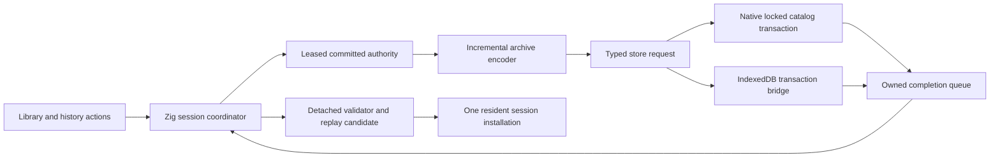
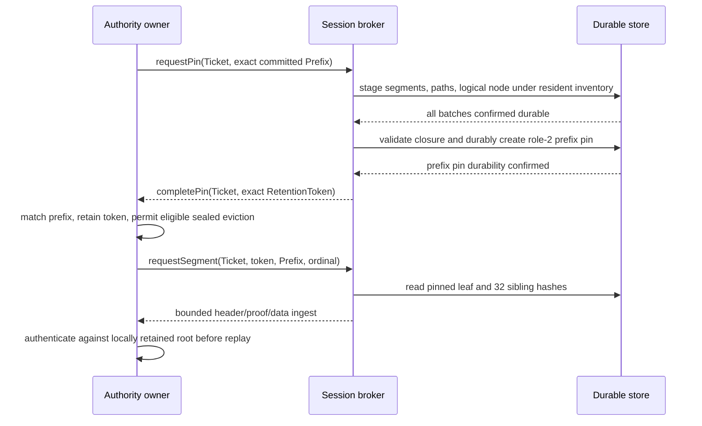

# NYON expanded Zig game: durable sessions and portable histories

<!-- BEGIN 2026-10-19 rewrite decision -->
> **Historical; Zig continuation canceled 2026-10-19.** Preserve this source contract and evidence. Active recovery targets Rust stable1.99.1; see the 2026-10-19 Rust designs/plans. Historical review labels do not approve new Rust behavior. Tests and CI gates remain paused.
<!-- END 2026-10-19 rewrite decision -->


- Author: Abbey; reviewer: Donald J. Filimon
- Date: 2026-10-11
- Status: **Draft / Proposed — decisions selected under delegated authority; merged independent technical review and controller approval pending**
- Session container identity: `nyon.expanded-session.v1`
- Composed adapter profile: `nyon.fullscale-durable-adapter.v1`
- Compiler: `0.18.0-dev.146+35accc06e`
- Responsibility: new expanded-game persistence and session policy only

## Overview and current evidence

Persist an immutable, replay-verifiable session graph and a small transactional
catalog containing slots, branch cursors and the exact Continue selection. All
catalog-dependent writes use generation compare-and-swap (CAS). Native and
IndexedDB implementations expose the same asynchronous outcomes; a completed
transaction is the only basis for claiming a durable save. Loading constructs a
separate candidate authority and replaces the resident session only after full
validation and an ownership check.

The expanded roadmap requires this subsystem, but its existing planet-economy
and coordinated-galaxy work does not implement durable sessions. The coordinated
specification defines leased committed snapshots, input histories and bounded
replay; it explicitly defines no archive or branch schema. `zig/src/classic_store.zig`
currently provides Classic scenario/preferences raw persistence, not expanded
session persistence. `src/app/client_runtime/library.rs` and
`src/workshop/store.rs` are reference patterns for exact catalog opening and
abandonment reconciliation, not production dependencies of the new game.

The platform design supplies permitted native workers, browser transaction
bridges, typed completions and owner generations. Its legacy fallback/migration
and mode-specific archive rules do **not** apply to this clean compatibility
break. No existing user profile is opened, listed, read, imported automatically,
converted, overwritten or deleted. No new product source, test result, runtime
qualification, dependency or retirement authority is established by this draft.

## Goals and non-goals

Required: atomic save/selection, generation conflicts, exact selected-branch
Continue, immutable history branches, undo/redo, authenticated deterministic
replay and comparison, portable import/export, bounded work and memory,
truthful cancellation, crash recovery and preservation of the resident session.

Non-goals: cloud synchronization, multiplayer authentication, legacy import,
automatic schema migration, compressed archives, history pruning, implicit
checkpoint trust, filesystem-wide recovery searches or a generic store framework.
Future retention/checkpoint changes require reviewed extensions. Reaching a
history or archive limit is explicit and cannot discard accepted history.

## Dependencies and fixed decisions

These are proposed decisions selected under the [delegated design authority](../../qualification/2026-10-11-delegated-game-design-authority.md), not implemented APIs.
This revision integrates the full-scale authority and its initial economy codec;
merged independent review and controller approval are still required. The envelope
and storage policy are fixed here; gameplay bytes belong to their reviewed authority
specification. The prior scoped pin-lifetime PASS applies to SHA256
`6e113ae956f6c9cd189c136e0633f6eee08cce357d3357463615e6568b0ea751`,
not automatically to these new stream, capacity or provider interfaces.

| Dependency gate | Required evidence before implementation can consume it |
| --- | --- |
| Coordinated authority | Reviewed leased committed reads, complete canonical transcript extraction, bounded fresh replay, logical comparison, cancellation and cleanup |
| Expanded city/strategy/combat rules | Reviewed identity and complete genesis/command/receipt codec plus capacity limits; no invented extra simulation fields in this container |
| Platform storage | Native lock/atomic replace/durability probes and real IndexedDB transaction/ownership probes on each target |
| Release capacity | Complete 100,000-tick workload fits fixed v1 graph/transaction caps; streaming storage and measured quotas are qualified on required hosts |

An explicit Zig registry maps a rules identity to its encoder, validator, replay
builder, logical comparator, genesis-stream encoder and conservative tick-byte
bound. The integrated initial entry is `nyon.fullscale-galaxy.v1`, storage profile
`nyon.fullscale-storage.v1`. Its companion codec bounds initial genesis at 65,536
bytes, the initial framed genesis receipt at 136 bytes and each tick at 4,057,265
framed bytes. The session admits the full authority envelope of 32 MiB/tick so a
reviewed future identity within that envelope does not require another container.
Future city/strategy/combat identities must freeze all records and a conservative
bound before registration; reserved strategic capacity is not a gameplay codec.
Unknown identities return `UnsupportedRules`. Coordinated v0 retains its four-world,
4,096-receipt limit and can be a separate qualification fixture only; no persistence
wrapper widens its identity or calls it full-scale.

The full-scale authority's `Prefix`, `Ticket`, 32-level transport tree,
`requestPin`/`completePin`, authenticated `requestSegment`/`ingest` and shutdown
ownership dispositions are the mandatory bridge described below. They are Proposed
contracts, not existing exported Zig functions. Session and authority implementation
must consume the same reviewed composed profile before graph/provider dispatch. A separately
scoped catalog/ledger codec can proceed against their unchanged byte layouts.
For this composed profile the [normative authority bridge annex](2026-10-11-nyon-zig-durable-authority-bridge-design.md)
(SHA256 `dc73e20d6f6083db706b4803dafb32fd18edf1702ce58284b1ebbbf505e99d6a`) amends the exact base authority
revision `a8bc0d41767722b3215e2e6c334d06d5cf5cacc3107f28f83b3b4219ba6ce2f5`
and codec `c116655859eae999ee1529180521254a575570ba471099fc0ca2e00c8778b6b9`.
Its precedence explicitly replaces standalone synchronous begin copying and the
standalone publication selector with owned metered input and paired publication.
The base document remains separately owned and unchanged. Its M1/E10 description
of 1 MiB ticks / 144 GiB portable / 512 GiB namespace is historical evidence, not
normative in this profile; the present limits below and the annex govern. This
statement does not claim its owner has already updated M1. A merged independent
review must attest the final durable/annex/base/codec hash tuple before source
dispatch; the concrete typed bridge, ownership and budget contract is defined by
the annex, not left for an implementer to invent.

No old save format is migrated or silently widened: this still-unimplemented new
namespace keeps `nyon.expanded-session.v1`; any evidence it was implemented/frozen
with incompatible bytes blocks dispatch until an explicit new identity is selected.

## Architecture and ownership



The session coordinator owns pause/leave, durable selection, candidate
installation, undo/redo policy and reconciliation. The pure archive layer has no
filesystem/browser dependencies. Store adapters execute Zig-prepared byte writes
and CAS instructions; they never interpret gameplay or choose branches. Proposed
modules are `zig/src/expanded_session/` and `zig/src/platform/expanded_store.zig`;
the detailed implementation plan assigns actual file ownership after approval.

Each request carries never-reused request ID and session/library/transfer owner
generations. Generation overflow returns `IdExhausted`, never wraps. Completion
ownership is rechecked at installation. A stale result frees its owned buffers
once and cannot install a session. One public mutation lane and one load/transfer
lane are admitted; each owns its candidate and cleanup. Native workers retain
physical permits until actual completion even if the public outcome is abandoned.

Schematic contract, with exact Zig ABI spelling deferred to compiler validation:

```zig
const Expected = struct { namespace_generation: u64 };
const Mutation = union(enum) {
    save: PreparedSave,
    select: ExactSelection,
    create_branch: PreparedBranch,
    rename: PreparedRename,
    remove: PreparedRemoval,
};
const Outcome = union(enum) {
    committed: CommitReceipt, // request ID, new generation, exact selection
    conflict: u64,           // observed generation, no requested mutation
    cancelled,
    failed: StoreFailure,
    reconcile_required,
};
// begin copies/reserves admitted input; poll consumes the caller's remainder.
// cancel requests cancellation; abandon forgets delivery, never promises undo.
```

Every mutation includes the expected namespace generation and explicit slot/branch
identities; no "latest branch" lookup is allowed inside a write. Creation uses
checked monotonic slot/branch counters in the allocation ledger; native
reservation may consume gaps before CAS, while browser allocation and CAS commit
share one transaction. Archive content identities are SHA-256 digests of canonical bytes. They
identify integrity, not the human creator or trusted network origin.

## Namespace, catalog and atomic transactions

Native adapters receive an injected application-data root and append exactly
`nyon-expanded/session-v1/`. Browser uses a dedicated database
`nyon-expanded-session-v1`, schema version 1, stores `catalog`, `objects`, `pins` and `allocator`.
Do not use old application directories/database names even as fallback. Test
roots are injected disposable directories. An unavailable new root is an error,
not permission to search the machine. IDs determine internal names; labels and
import filenames never become path components.

The namespace catalog is one canonical bounded record containing generation,
an allocation-ledger watermark, up to 64 slots, up to 64 branches per slot, and optional
selection. A slot has an opaque ID, validated UTF-8 label, immutable archive
object digest and branch records. A branch has ID, label, tip node digest and
cursor node digest; cursor is an ancestor of tip. Selection is exactly
`{slot_id, branch_id, cursor_node_digest, archive_digest}` and must agree with
that catalog branch. Labels are 1..128 UTF-8 bytes, no C0 controls, and no identity
semantics. Catalog bytes are capped at 1 MiB before parsing. Counters are u64,
start at 1, and increment checked; zero is invalid except initial generation 0.

Catalog wire is exactly `magic[8]="NYONCAT1", version:u16=1, flags:u16=0,
body_length:u32, body_digest[32]`, followed by body:
`generation:u64, allocator_watermark:u64, slot_count:u16`, ascending slot records,
then `selection_presence:u8` and selection fields only when 1. A slot record is
`slot_id:u64, archived:u8, label_length:u16, label_bytes, manifest_digest[32],
branch_count:u16`, followed by ascending branch records with exactly
`branch_id:u64, label_length:u16, label_bytes, tip_digest[32], cursor_digest[32]`.
Selection fields are `slot_id:u64, branch_id:u64, cursor_digest[32],
manifest_digest[32]`. Archived/presence values are exactly 0/1. The body digest
covers every body byte; reject trailing bytes, unsorted/duplicate IDs, invalid
labels, impossible counts and selection disagreement. Stored branch lists must
match the referenced manifest. Next counters reside in the allocation ledger,
not ambiguous optional catalog fields. Initial empty catalog has generation 0,
watermark 0, slot_count 0, selection_presence 0.

A separate namespace allocation ledger prevents corrupt-catalog repair from
rewinding generation, slot, branch or request IDs. Native ledger is an append-only
fixed-record journal; IndexedDB `allocator` retains the equivalent immutable
ordinal records plus the current head in the same mutation transaction. Its key
`head` contains the latest 112-byte record; key `r:` followed by exactly 16 uppercase
hex ordinal digits contains that ordinal's immutable 112-byte record. Ordinal zero
has no stored record. Do not retain only the head: recovery/watermark validation
requires the full chain. Creating a record and advancing head is atomic with the
corresponding browser allocation; catalog commit adds its final generation record
in that same transaction. Every record is exactly
`magic[8]="NYONAL01", ordinal:u64, previous_digest[32], next_generation:u64,
next_slot_id:u64, next_branch_id:u64, next_request_id:u64, digest[32]` (112 bytes).
Digest covers the first 80 bytes; ordinal begins 1; previous digest is zero for
record 1. Record 1 is the persisted **anchor**: ordinal exactly 1, previous_digest
all zero, and all four next counters exactly 1. It reserves no ID/generation.
The first actual reservation is record 2, chained to the anchor digest; later
ordinals are contiguous, counters never decrease and at least one advances.
An advanced-counter record 1 is invalid even when rehashed. Virtual origin at
watermark 0 remains only an initial empty-catalog binding, never an allocation
record or substitute for the persisted anchor. Allocation persists/flushes the advanced
high-water record **before** any native catalog can reference allocated values;
failed transactions may leave gaps. Browser allocation and catalog commit share
one atomic transaction. Every ordinary mutation and repair consumes a fresh
generation from this ledger, never restoring a recovery generation verbatim.
Request ID is allocated before staging/pin publication. Branch IDs inside portable
graphs are graph-scoped; import assigns fresh catalog branch IDs and rewrites the
new manifest branch table consistently, without changing authority node digests.
Every catalog stores the ledger ordinal at its allocation commit; catalog generation
and every allocated ID must be below the validated next counter. Pins use the same
request counter and keep a unique ID even when their public operation is abandoned.

In a verified new namespace, native creation writes the anchor exclusively under
the namespace lock, flushes its file and containing directory, and confirms that
durability before appending any reservation. No allocated value may escape before
its own advanced record is also durable. An interrupted/malformed anchor follows
AllocatorRecoveryRequired; it is not silently replaced or treated as an empty
journal. A valid surviving anchor is revalidated and its required durability
confirmed before allocation resumes. IndexedDB stores the immutable anchor at
`r:0000000000000001`; if the first allocation shares the creation transaction, that
same atomic transaction stores record 2 and advances `head` to record 2. It may
instead commit the anchor/head at ordinal 1 first and allocate later. Neither
path skips anchor validation or allocates from a virtual record; records 1 and 2
must both exist after a committed first reservation. The 112-byte wire is unchanged
and matches the reviewed catalog plan's exact origin rule.

Generation provenance is stronger than merely being below a next counter. Every
catalog mutation reserves its generation **last**, in its commit ledger record.
The catalog watermark equals that record's ordinal; its `next_generation` equals
the predecessor record's `next_generation + 1` (checked), and catalog generation
is exactly `commit_record.next_generation - 1`. All other next counters are
nondecreasing. Validate the complete chain, head, exact watermark record and its
predecessor; a later head containing a larger counter does not authenticate an
arbitrarily chosen old generation at a new watermark. Initial generation 0 / watermark
0 is the virtual origin only, with all virtual next counters 1. An old recovery
catalog is validated against its original watermark and predecessor in the full
chain. Repair creates its own fresh generation commit record using the same rule;
it never rebinds recovery content to an unproven generation. This tightens semantic
validation without changing catalog or 112-byte allocation-record wire bytes.

Native journal inspection checks the full hash chain incrementally; cap 1,048,576
records (112 MiB on disk). A partial/corrupt tail or missing ledger with any
existing catalog/pins/objects returns AllocatorRecoveryRequired and blocks all
writes/repair. It does not guess high-water values or reset counters from recovery.
A separately reviewed operator repair must establish a safe high-water mark before
writes resume; no such destructive repair is authorized here. Reads/export of
validated histories remain available. This explicit fail-closed outcome preserves
never-reused IDs after unknown allocator damage.

Saving creates a new immutable manifest referencing staged graph objects and atomically updates the slot's
archive digest, affected branch record and selection in the **same** catalog
transaction. Updating a slot object requires remapping every existing branch to
nodes included in that object's graph; no old branch may become dangling. New
slots and imported slots are unselected until the same explicit transaction
selects them. Autosave updates the current selected slot/branch/cursor only.
Rename, remove and selection changes also use namespace CAS. Deleting the selected
slot clears selection in the same transaction. Archiving is metadata, not free
capacity; deletion is explicit. No automatic slot eviction.

### Native commit

Use a fixed namespace-local OS lock (advisory file lock on POSIX, lock-file byte
range via Windows APIs) shared by all new-game processes. Lock acquisition occurs
on an I/O worker with bounded timeout; contention returns `Busy`. Under lock,
re-read and validate current catalog, compare generation, and inspect exact
referenced objects. Initial absent catalog is generation 0 only when both current
and recovery catalogs are absent; a corrupt present catalog is not an empty store.

Stage each new immutable object to a unique exclusive temp file, flush it, and install
its digest filename atomically without overwriting a mismatching existing object.
Flush the object directory. Prepare the next complete catalog and a recovery copy
of the prior valid current catalog using exclusive temp files and flushes.
Ordinary mutation requires a validated current catalog; replace recovery first,
flush its directory, then atomically replace current
catalog and flush its directory. The current-catalog replacement is the visibility
commit point; report `committed` only after required durability operations succeed.
If replacement may have happened but final durability confirmation fails, report
`reconcile_required`, not `failed-before-commit` or `saved`. Release the lock after
the final observed outcome; cleanup error remains secondary.

Unreferenced objects/temp files from interrupted writes are harmless. Under the
same namespace lock, bounded garbage collection retains every object referenced
by current **or recovery** catalog and deletes only validated internal names;
unknown entries are left untouched with a diagnostic. No garbage collection runs
until both catalogs are read and reference sets checked. The storage adapter must
qualify OS-specific flush/replace behavior; unsupported durable replacement returns
`DurabilityUnavailable`, never success based on rename alone.

### Browser commit

Prepare and validate bytes outside the transaction. Open one readwrite transaction
covering catalog/objects/pins/allocator stores, read catalog generation, compare, put the prepared manifest and
next catalog, and store the previous catalog as recovery. Issue only IndexedDB
requests in its request callbacks; no awaiting codec/replay work within the live
transaction. Use strict durability when available and record supported semantics.
Success is transaction `complete`, never individual `put` success. Abort/quota
errors leave the prior transaction intact. Browser termination/OS crash/eviction
are separate qualification limits: transactional completion is not a promise
against origin eviction or unsupported power-loss durability.

## Portable container and immutable branch graph

### Logical ticks and portable bytes

Use a streamed, uncompressed `.nyon-session` container. A logical graph node is
one complete committed tick, payload length 1..33,554,432 bytes (32 MiB), never a
physical I/O allocation. A graph admits 131,072 such nodes across all branches;
100,000 ticks leave 31,072 additional retained nodes. Genesis authority bytes and
the separately framed initial receipt stream each admit 1..1,048,576 bytes. The
registered initial full-scale codec tightens these to 65,536 and exactly 136 bytes.
The portable cap is 5 TiB (5,497,558,138,880 bytes), with exact lower worst-case
bounds below. No valid tick is truncated, selectively filtered or rejected as a
gameplay outcome to fit storage. Storage admission can pause before a tick.

Canonical integers are unsigned little-endian, lengths/counts explicit below,
SHA-256 digests 32 raw bytes. No padding, native structs or optional default
fields. Header is `magic[8]="NYONSE01", version:u16=1, flags:u16=0,
body_length:u64, body_digest[32]` (52 bytes). The digest covers exactly body_length
bytes; reject unknown version/flags, overflow, truncation and trailing bytes.
Streaming validation completes before import publication. The body is exactly:

1. `container_identity_length:u16`, exactly `nyon.expanded-session.v1` (24 bytes),
   `rules_identity_length:u16`, rules UTF-8 bytes (1..128), `genesis_length:u32`,
   genesis authority bytes, `genesis_digest[32]`, `initial_stream_length:u32`,
   initial framed canonical receipt bytes.
2. `node_count:u32` (0..131,072), then nodes in ascending numeric tick then raw
   digest: `digest[32], parent_digest[32], tick:u64, payload_length:u32, payload`.
   The 76-byte header precedes the incrementally read/written payload; no contiguous
   payload slice or allocation is implied. Empty-input ticks still have records.
3. `branch_count:u16` (1..64), then ascending branch-ID records:
   `branch_id:u64, label_length:u16, label_bytes, tip_digest[32], cursor_digest[32]`.
4. `next_branch_id:u64, exported_active_branch_id:u64`; both nonzero, next ID
   strictly greater than every retained ID, active branch must exist. Genesis tick
   zero is a valid tip/cursor; each cursor is on its tip's ancestry.

Let E be the session logical genesis digest:
`H("NYON-ES1-GENESIS" || rules_id_length:u32 || rules_id ||
genesis_length:u32 || genesis_bytes)`. A tick digest is
`H("NYON-ES1-NODE" || parent_digest || tick:u64 || payload_length:u32 || payload)`.
Domains are exact ASCII without NUL or implicit length. These hashes are streamed
with at most 64 hash-input bytes per work unit; known u32 payload length precedes
the bytes, even for 32 MiB. Initial stream bytes are regenerated from genesis and
compared exactly, so they cannot be altered independently while keeping E valid.
The authority's genesis digest G is separately defined by its registered codec;
for full-scale, `G=H("NYON-FS1-GENESIS" || genesis_bytes)`. E and G are never
interchanged. Authority history heads, session logical nodes, physical object
addresses and transport roots are distinct identities.

Payload is the complete framed authority tick stream, including policy, rejected
inputs, events and commit. Genesis receipt bytes occur once at offset zero in each
ancestry stream; tick one begins at `initial_stream_length`. No candidate appears
in a published graph. Parent must exist at tick-1; every retained node is reachable
from a branch tip. Reject cycles, duplicates/conflicts and dangling references.
Imports reconstruct and replay every ancestry, including unselected branches;
a matching SHA alone does not establish semantic correctness.

### Physical segment and transport tree schema

For any node, its ancestry stream is initial receipt bytes followed by complete
tick payloads along its parent chain. Partition offsets at exact 1 MiB multiples;
records and tick boundaries may cross segments. All segments except the last have
1 MiB payload; the last has 1..1 MiB. Different branches and old partial-tail
versions are immutable and may share equal objects. A newly extended tail creates
a new object; it never overwrites an old prefix's tail. There is no per-tick padding,
per-segment gameplay record, compression or digest-affecting chunk schedule.

All physical objects use the existing 48-byte frame:
`magic[8]="NYONOBJ1", kind:u8, version:u16=1, flags:u8=0,
body_length:u32, body_sha256[32], body`. Address is SHA-256 of the entire frame
and body; body_sha256 covers exactly body_length. Unknown kinds/flags, trailing
bytes or a mismatching address/body digest reject. Exact kind bodies are:

| Kind | Body in order |
| --- | --- |
| 0 genesis | `rules_length:u16, rules_bytes, genesis_length:u32, genesis_bytes, initial_stream_length:u32, initial_stream_bytes, prefix:Prefix, stream_root_object_digest[32]` |
| 1 logical tick | `logical_digest[32], parent_logical_digest[32], tick:u64, payload_length:u32, prefix:Prefix, stream_root_object_digest[32]` (220 body / 268 framed bytes) |
| 2 logical graph radix index | Page format below |
| 3 manifest | Manifest format below |
| 4 inventory | Inventory format below |
| 5 stream segment | `G[32], ordinal:u64, length:u32, bytes[length]` (92 bytes total overhead; length 1..1 MiB) |
| 6 transport interior | `height:u8, left_presence:u8`, present left `object_digest[32], transport_hash[32]`, then `right_presence:u8`, present right `object_digest[32], transport_hash[32]` (at most 131 body / 179 framed bytes) |

`Prefix` is exactly `G[32], tick:u64, byte_count:u64, history_head[32],
transport_root[32]` (112 bytes). Its identity is
`H("NYON-FS1-PREFIX" || those 112 bytes)`. Prefix byte_count is checked and equals
parent.byte_count + payload_length; genesis prefix is tick zero and contains just
the registered initial stream. Node tick and prefix tick must agree. Full-scale
history head is the companion codec's receipt recurrence. The logical node's
payload is read as the range `[parent.byte_count, prefix.byte_count)` from its own
immutable stream root. Its SHA and every receipt/commit must validate.

This physical tree encodes the exact full-scale transport tree with 2^32 leaves.
Segment ordinal is u64 on wire but must be <2^32. A kind-5 object's transport leaf is
`H("NYON-FS1-SEG" || G || ordinal:u64 || length:u32 || H(bytes))`.
Empty leaf is `H("NYON-FS1-EMPTY")`; internal hash at height h=1..32 is
`H("NYON-FS1-NODE" || h:u8 || left_hash || right_hash)`. Empty subtree hashes
recur from that same rule. Presence is exactly 0/1, with no digest/hash fields
when absent; absent means the canonical empty subtree at the expected height.
Both-absent interiors are forbidden. Height-1 children are kind 5; other present
children are kind 6 at height-1. The root is height 32. Tree position fixes ordinal;
a leaf's G/ordinal/length must match its prefix range. Present child hashes are
recomputed, never trusted because a provider supplied them. Every occupied leaf
is a contiguous prefix from ordinal zero, and the last length matches byte_count.

A kind-1 object always references the root for its exact committed prefix, not a
later root paired with a shorter claimed length. Genesis uses the same rule. Save
GC follows every retained node's root, so old partial tails remain available for
undo/export. For appending a 32 MiB tick, at most 33 leaf objects change, including
replacement of the old partial leaf, and at most 33*32=1,056 interior objects are
created. Rebuild the union of these paths bottom-up, emit each final path node once
and retain unchanged subtrees; do not stage intermediate per-leaf tree versions.
Use a depth-32 traversal stack and bounded output batches, never a resident array
of every stream segment. Provider proof is exactly 32 sibling transport hashes,
bottom-up height 0..31, selected by the ordinal bits. Logical graph and stream
indexes are distinct: only the former has 131,072 entries and a RAM reservation.

The persistent radix index key is `tick:BE64 || logical_node_digest[32]` (40 bytes).
BE64 is the **sole numeric byte-order exception**, chosen so lexical key order is
numerical tick order; all ordinary fields remain little-endian. For any subtree,
a leaf is mandatory iff it has ≤256 records; otherwise an interior is mandatory.
Its prefix is the longest shared prefix of its keys from the root (0..40 bytes).
Page body is `kind:u8 (0 leaf,1 interior), prefix_length:u8, prefix_bytes,
entry_count:u16`, then ascending records. Leaf records are
`key[40], logical_tick_object_digest[32]`. Interior records are
`next_key_byte:u8, child_object_digest[32]`; each child groups exactly the keys
sharing that byte after the parent prefix. Require 2..256 interior children;
leaf count is 1..256. Child prefix must extend the parent plus grouping byte;
no redundant interiors, duplicate keys, empty subtree or mismatching prefix.
Empty graph has no index object. Rebuild/import must derive exactly these page
bytes from the key set. Page body ≤32 KiB, actual encoded-length allocation,
immutable pages; insertion copies ≤41 path pages and creates ≤256 split children: reserve
≤297 pages (9.28125 MiB at the conservative 32 KiB/page body ceiling), including
framing overhead separately. Split/merge construction is incremental and charged.

Manifest body is exactly `container_identity_length:u16, container_identity_bytes,
rules_identity_length:u16, rules_identity_bytes, genesis_object_digest[32],
node_count:u32, index_root_presence:u8`, optional index root object digest only
when presence=1, then `branch_count:u16` and the exact portable branch records,
`next_branch_id:u64, active_branch_id:u64`. Root presence is 0 iff node_count=0;
all presence values exactly 0/1. Manifest body ≤32 KiB. Its physical object
address is the catalog archive identity. Portable output orders logical records,
so physical allocation never affects portable bytes.

Every resident session and each separate save/capture/import/restore owner holds
its own durable mutable pin framed as
`magic[8]="NYONPIN1", version:u16=1, flags:u16=0, body_length:u32,
body_sha256[32], body`. Body is exactly `operation_id:u64, owner_token[16],
pin_role:u8` (0 resident session,1 operation,2 exact-prefix retention), `session_generation:u64,
base_manifest_presence:u8`, optional base manifest object digest only when 1,
`inventory_head_presence:u8`, optional inventory object digest only when 1,
`prefix_binding_presence:u8`, optional binding only when 1,
`reserved_namespace_bytes:u64, phase:u8` (0 staging,1 validating,2 capture,
3 reconciliation). Optional flags are exactly 0/1. Owner token is an opaque host
instance identity, never a pointer; operation ID provides namespace uniqueness.
Pin absent base/head is valid for an empty import before its first batch.
A binding is exactly `ticket:{owner_namespace:u64, owner_generation:u64,
job_id:u64, request_id:u64}, logical_boundary_digest[32],
boundary_object_digest[32], prefix:Prefix, stream_root_object_digest[32]`.
Role 2 requires presence 1 and roles 0/1 require 0. Its boundary object is kind 0
or 1 and must match all logical/prefix/root fields. A role-2 pin directly roots
that object and its complete stream closure even without a catalog/base manifest.
The token's opaque host pin ID is this pin's never-reused operation_id; ticket
request_id is authority-owned and is not silently replaced by the store ID.

An immutable inventory object's kind-4 body is
`previous_presence:u8`, optional previous inventory digest only when 1,
`count:u16` (1..256), then ascending unique `object_digest[32]` entries.
It lists **every planned/installed object in that physical batch**, including
new pages, stream segments and transport interiors disconnected from a complete
root; its predecessor chain retains all earlier batches. Duplicate entries across batches are legal
shared-object reuse. ≤256 objects and ≤4 MiB combined framed bytes are admitted
per batch. No GC derives staging safety merely from an incomplete index root.

Browser atomically puts the batch objects, immutable inventory object and updated
pin head in one readwrite objects/pins transaction; success is transaction complete.
Native performs the equivalent operation under the namespace lock with crash-safe
ordering: install/flush the inventory, atomically replace/flush the pin pointing
to it **before** installing any listed object, then install/flush batch objects.
Readers and GC acquire the lock; an interrupted batch may leave inventory entries
for missing objects, which pins permit and reconciliation reports. Every object
that did install is already durably pinned, including disconnected pages. A
native failed batch is never advertised complete; the prefix pin is not rolled
back if objects may have installed. Thus multi-file power failure is conservative
retention, not a fictional atomic filesystem transaction.

The resident-session pin is persistent and independent of every save capture.
Its own base manifest and inventory retain every durable resident graph object,
including newer ticks arriving while an older save runs, regardless of later
catalog slot deletion or recovery advancement. Every save
creates a distinct operation pin protecting its exact captured manifest, graph
and pending buffers; it never borrows or takes ownership of the resident pin.
Export/Continue/import/restore pins are also independent. Pin IDs are never reused.

Upload graph objects/pages in pinned batches, then CAS-publish manifest/catalog.
IndexedDB may release **only that save/import operation pin** in the final
readwrite catalog transaction. The resident-session pin and all unrelated capture
pins remain untouched. Native writes/flushes catalog first, confirms required
catalog durability, then removes the completed operation pin under namespace lock
and flushes the pin directory. Failed/uncertain catalog flush leaves the operation
pin intact for reconciliation; there is no multi-file atomic-delete assumption.
Failure flushing pin deletion is secondary and conservatively retains/reinstates
protection or returns reconciliation-required before GC can run. Confirmed catalog
closure already covers a successfully deleted completed-operation pin.

Current/recovery catalogs, base manifests and exact-prefix bindings in every pin,
and **every object named by every pin inventory chain** are GC roots. Inventory entries remain protected
even before a complete graph exists. GC walks completed closures and inventories
incrementally; malformed inventory stops deletion. Abandon retains both its
operation inventory and independent resident inventory until physical reconciliation.
A crashed owner's pin remains; explicit user recovery can release it only after
confirming its process/tab owner is gone, then rerun reference analysis. No expiry.

Resident inventory trimming is a separate counted operation, never a side effect
of save-N completion. After confirmed catalog durability, choose one current/recovery
manifest as the replacement resident base. An entry may be removed only when an
explicit reachability check proves that this manifest covers its **exact digest**;
the resident pin must retain that manifest as its own base. The replacement
inventory retains every resident graph object outside that base's closure,
including objects covered only by the old base and newer N+1 objects absent from
saved N. Build it under an independent trim-operation pin protecting the chosen
manifest, the old resident base and both old and new inventory chains;
freeze new tick admission during this bounded trim while existing physical batches
finish/reconcile. Before switching, recheck the captured resident base/head,
session generation and validated catalog generation/digest under store synchronization.
Conflict retains the old base/head and defers trimming. Switch the resident
base manifest and inventory head together in one pin record: native atomically
replaces/flushes that record before releasing the trim pin; browser switches both
fields and releases only the trim pin in one readwrite transaction. Uncertain
native replacement/flush retains the trim pin for reconciliation. Later catalog
deletion or recovery advancement cannot remove this pin-owned base or its closure;
a subsequent base change must repeat the same complete resident-coverage proof.
No captured save/export/restore pin is invalidated. Storage pressure can pause
ticking to let this safe trim drain.
Membership sets/iterators are charged and reserved within the existing index budget;
insufficient scratch returns Busy without changing protection.

For the race save-N / persist-N+1 / commit-N, N+1's confirmed prefix remains in
the resident pin. Commit-N releases only save-N's operation pin; it cannot clear
N+1's dirty marker. GC retains N+1 and export-N+1 reads it through its own capture
pin. If save-N is abandoned but wins, reconcile its exact catalog outcome first;
then release only its operation pin following the adapter's durable ordering.
Resident trimming still uses the coverage rules above; never treat a won older
save as proof of coverage for the latest resident head.

Healthy quit with Save waits for the exact latest resident capture to become
catalog-durable and for physical reconciliation/retirement; it then releases the
resident pin, since confirmed catalog closure covers all retained resident graph
objects. Explicit Discard or successful resident replacement stops tick admission,
drains/reconciles physical writes and preserves all outstanding operation pins,
then releases only the old resident pin. Unsaved objects may thereafter become
unreachable and GC-eligible; committed catalog history and independent captures
remain protected. Failed replacement retains the old resident pin and authority.
Replacement candidate establishes its own resident pin before installation;
stale/cancelled candidate cleanup releases only its own pin after physical drain.
Quit Cancel retains every owner. Native pin removal requires namespace lock and
directory flush; browser removal uses a pins transaction. Uncertain removal or
crash leaves conservative recovery work, never permission to reclaim a live owner.

### Exact-prefix acknowledgment and provider ownership

`authenticatedPrefix` means the authority's locally computed, committed `Prefix`;
it is not a provider's assertion. The adapter implements these exact value-level
operations from the full-scale contract. Ticket fields are checked u64 counters;
`RetentionToken={ticket:Ticket, prefix_identity[32], host_pin_id:u64}`. Pins retain
complete closures; an object-install receipt alone is never an eviction permit.



The broker drains the published prefix into immutable objects; each physical batch
is protected by the resident inventory ordering already specified. The node and
root are validated and durable before creation of a role-2 pin under the namespace
lock or one objects/pins/allocator IndexedDB transaction. Native flushes the pin
before returning success. `completePin` is delivered only after that exact pin is
durable. Any missing object, quota failure, uncertain flush or abandoned completion
keeps the prior closure and receipt cache, returns a typed wait/failure and applies
backpressure. A later completion cannot acknowledge an unrelated or newer prefix.
Catalog-dirty state and prefix-durable state are independent.

At most two descriptor tokens and one replay-source token are authority-owned.
Value leases share descriptor tokens; broker reference counts are checked, never
implicit aliases. The broker also has one active source request and one bounded
abandoned request/token set. It reserves capacity for the full four-item shutdown
disposition array before authority creation. A pending request retains its own
reference to the role-2 pin until physical disposal, even after the authority has
canceled, transferred or released its token. Closing authority ownership does not
free broker buffers or storage. Pins are removed only after all corresponding
owners and physical requests drain, using the existing adapter durability ordering.
Unknown completion/drop outcomes remain pinned and block replacement admission.

`requestSegment` validates Ticket, exact token binding and ordinal before I/O.
Its response is `ordinal:u64,length:u32`, exactly 32 raw sibling hashes bottom-up,
then exactly length bytes; no whole tick buffer is returned. The broker reads
≤64 KiB at a time and invokes authority `ingest` with ≤256-byte copies charged to
the shared remaining budget. Authority owns its 1 MiB verification window and proof
scratch in its existing reservation. It checks expected length and recomputes the
leaf/path against its own retained root before exposing any bytes to replay.
Wrong/stale Tickets are rejected before copying; the broker disposes their owned
buffers and releases request references only after physical completion. No callback
carries an authority pointer. `ProviderUnavailable`, `CorruptSegment`, cancellation
and disposal are distinct outcomes; none imply successful release.

Replay pins the source prefix first. The detached authority regenerates and compares
bytes and derives its own published prefix; its output is not archived a second
time. Its verified cache may rely on that owned source pin. When target tick ends
inside a source segment, authenticate the whole source segment but expose only the
target byte range. Successful take transfers source pin ownership with the target;
failed/cancelled take drains only the target and its source reference. A fork obtains
its own exact-prefix token (including an immutable partial-tail object for that
boundary) before append; it cannot borrow a longer prefix or a canceled source pin.
Replacement retirement and `takeShutdownDispositions(out[4])` transfer each token
exactly once to the broker. The resident base/inventory retention proof above remains
required; prefix tokens add owners and never authorize clearing another owner's pin.

### Stream reservations and publication

There are two fixed unsaved-node **descriptors**, each holding parent/node digests,
byte ranges, exact Prefix, request state and an owned authority history-window lease
or retained prefix token. They never contain complete tick payload copies. Copies
use the authority's existing 64 MiB committed cache and 32 MiB candidate stream,
counted only as authority memory. The store owns only bounded segment/I/O windows.
A descriptor cannot borrow a stack slice or an unretained authority generation.
Its authority cache references remain until durable prefix acknowledgment or an
explicit discard/replacement drain. At most two descriptors exist; cache availability
may require backpressure sooner than that, especially with a live partial tail.

Before a gameplay candidate begins, `reserveAppend` reserves a free descriptor,
one prospective unique logical node, ≤297 graph index pages including frames,
one manifest, ≤33 changed physical segments, ≤1,056 transport interiors and
inventory overhead using the conservative peak bound below. Authority independently
reserves its exact next-tick bound (4,057,265 initial, at most 32 MiB for reviewed
extensions) in its existing candidate/cache slots. The current partial tail remains
resident; up to 32 new free cache slots plus that tail suffice for a maximum tick.
Neither owner may count the other's reservation as free capacity. Insertion scratch
is reserved once; another insertion stays blocked until ownership transfer finishes.

Admission is tagged `gameplay_append` or `source_replay` before candidate begin;
the tag cannot change after a quota failure or after output is known. A gameplay
result is separately `append_new` or `reuse_existing`. Absent logical key inserts
once and increases unique-node count by one. A present key requires full canonical
closure/metadata/transcript byte equality against the captured parent plus frozen
candidate, including exact Prefix and physical boundary binding, as specified by
the annex. Matching hashes alone do not permit reuse. Any conflict fails closed;
no salted key, duplicate insertion or truncation is allowed. Verified reuse retains
that exact existing closure and unchanged radix/count, then returns unused insertion
and payload/transport growth reservations through charged cleanup before pair-ready.
Required metadata and independent closure ownership remain reserved.

Both gameplay results apply the explicit target branch/cursor/tip update. A fork
keeps the old branch and uses a normally allocated new branch ID; target tip/cursor
become the candidate logical digest. Reuse creates no duplicate node/index entry;
it still admits and accounts for actual manifest/catalog, branch-ID and pin costs.
Publication makes the resident metadata dirty; save later uses normal durable CAS.
Conservative pre-begin growth admission remains required even for an unknown future
reuse result: at full graph/append quota, gameplay pauses before execution. This
profile does not promise identical-input gameplay reuse admission at that full cap.

Read-only restore initializes through `reserveReplayOrigin` over the existing
source graph; each later step calls `reserveReplay` with its already retained exact
source capture/node/Prefix binding. Even target genesis creates no duplicate durable
genesis/manifest and retains the full source unique-node count/index. It reserves the target's real candidate/cache/input,
paired view/control, bounded existing-index traversal and provider lane/window
resources, but no new unique node, insertion pages, durable manifest, stream/tree
objects, inventory or physical append quota. This works at 131,072 source nodes and
without free append space. Source count/index/branch records/catalog remain unchanged;
only bounded private target-cursor metadata advances with the paired authority.
No new output archive or per-step durable pin/ledger allocation occurs. Existing
source pin references are retained/transferred explicitly through local cleanup and
physical request disposal; verified target cache may use the source backing, even
when the target ends inside a fully authenticated longer source segment.

Creating the initial source capture still needs its normal admitted pin/metadata
cost, and replay can return Busy for actual memory/lease/lane/scratch exhaustion or
typed source/provider failures. Read-only replay's admission cannot return a node/
append-space capacity error merely because the retained graph is full. Import
staging and later gameplay/metadata writes retain their own normal quota and CAS
requirements; no caller can relabel a write as source replay. Export/comparison uses
retained captures and bounded transfer resources with the same no-append rule;
export destination capacity is separately required.

The normative `nyon.fullscale-durable-adapter.v1` bridge is specified in the
linked annex. Command producers first use `openInput` / `writeInput` / `sealInput`
to copy at most 256 bytes/unit into one authority-owned 2 MiB staging partition.
At the maximum 1,024 envelopes, explicit route/length/body framing is 1,054,720
bytes and requires at least 4,120 copy units. No candidate begins during that copy.
`beginFromOwnedInput` moves ready input ownership after the mode-specific
`reserveAppend` or `reserveReplay`; it never calls the standalone bulk-snapshot begin. Producer spans are retained only for a
single bounded call; zero allowance copies nothing and changes no state.

The private `PreparedTranscriptCursor` reads only a frozen matching candidate via
copied ≤256-byte windows, checked Ticket/parent/candidate/graph generations and a
never-reused cursor epoch. Repeat metered passes are allowed; public query and store
APIs cannot access that cursor or any candidate slice. Authority independently
computes the session node hash from its own exact bytes and parent. The pure graph
encoder prepares an immutable seal, offers its GraphRef by an explicit ownership
move, and charged acceptance checks every expected length, Prefix, generation and
logical digest before making the pair ready. Closed cursor and completed hash/fold
states are mandatory. Cancel invalidates capabilities and drains each owner's
buffers/references through shared work; no committed frontier is reconstructed.

The unselected PairedDescriptor already owns the prepared authority root/context
and matching graph reference before publication. One `selected_pair_slot` change
is the sole publication event for resident reads, graph queries and snapshot leases.
There is no authority switch followed by graph installation. The composed backend
cannot independently select/publish a root or accept standalone begin. Old PairLease
values retain old authority + graph + Prefix; new leases see the new complete pair.
The one detached replay target has a private paired domain and uses source_replay
reservations plus replay_existing seals over authenticated retained source nodes.
Successful replacement
moves its ready paired refs into the stable resident controller before one selector
change; failed/stale replacement preserves the whole old pair. All fixed partitions,
acknowledgment states, cancellation and source integration gates are normative in
the annex. Actual Zig layout/source/runtime qualification remains pending.

A gameplay unsaved-node descriptor retires only after exact-prefix acknowledgment, transferring its backing
to the independent durable token; any remaining capture owns its own reference.
Before cache reuse, verify no active window lease still references those bytes.
Save capture of an unsaved boundary takes an independent reference and can remain
pending while the physical broker drains. Uncertain writes, slow I/O, quota or an
abandoned source retain permits and stop further ticks as needed. They never skip a
tick, emit a gameplay rejection, grow queues or fabricate durable acknowledgment.

Import persists bounded batches under its operation pin while incrementally
validating every node through reviewed parent replay. Only one target authority is
admitted. Complete body hash, graph and replay validation precede final catalog CAS.
Export has its own capture pin, streams 64 KiB chunks and first makes a bounded
full pass for body length/hash before writing the header; it requires neither seek
nor a full-file Blob. Unsaved capture stays pending until its source is pinned or
retained by its independent authority window leases. Missing approved browser
stream input/output returns `StreamingTransferUnavailable`.

### Exact endurance and storage ceilings

Use checked u64 arithmetic for all length/count products, offsets, additions,
reservations and namespace sums before converting individual bounded chunks to
usize/u32. Logical node count and bytes include all retained branches. Segment
ordinal <2^32 is checked independently even though this graph cap cannot reach it.
At max depth, `byte_count <= 1 MiB + 131,072*32 MiB = 4,398,047,559,680`, hence
at most 4,194,305 segments in any ancestry, well below 2^32. No 32-bit Wasm code
casts an entire file length or namespace sum to usize.

Portable maximum including the 52-byte header, maximum identities, both 1 MiB
genesis fields, 64 maximum labels/branches and scalar fields is exactly bounded by
`C(N) = 2,110,350 + N*(33,554,432 + 76)` bytes:

| Retained full-size nodes | Tick payload bytes | Complete portable upper bound |
| --- | ---: | ---: |
| 100,000 | 3,355,443,200,000 | 3,355,452,910,350 |
| 131,072 | 4,398,046,511,104 (4 TiB) | 4,398,058,582,926 |

The 5 TiB container ceiling therefore supports every admitted node at the full
32 MiB envelope. This is exact arithmetic over conservative independent maxima,
not a claim that current gameplay emits 32 MiB/tick. The initial codec's separate
4,057,265-byte bound remains enforced by its registry validator.

Persistent physical overhead is bounded even if every old partial tail, path,
index insertion page and inventory remains retained throughout the run. A batch
contains ≤256 objects and ≤4 MiB of combined framed object bytes; a full 1 MiB
segment has 92 extra bytes, so at most three full segments fit a batch. Batch
inventory is additional, at most 8,275 framed bytes, explicitly accounted. A
conservative one-object-per-batch calculation upper-bounds inventory by 115 bytes
per staged object (including its predecessor); batching more objects reduces that.
No empty or duplicate-only inventory batch is created. Prefix staging, streaming
chunks and physical batches are substeps of one allocated operation ID; they do
not allocate a new persistent request ID per object/chunk. Each prefix pin, save
operation, trim and catalog allocation still consumes the checked ledger entries
it actually needs. The endurance storage trace must include ledger occupancy below
its unchanged 1,048,576-record cap; arbitrary metadata churn is not free capacity.
Per logical node:

| Newly staged retained bytes | Conservative calculation | Bytes |
| --- | --- | ---: |
| Stream leaves, including old partial-tail replacement | 33*(1,048,576+92) | 34,606,044 |
| Transport path interiors | 1,056*179 | 189,024 |
| Logical node | 48+220 | 268 |
| Logical index insertion/split pages | 297*(32,768+48) | 9,746,352 |
| Manifest | 32,768+48 | 32,816 |
| Inventory records | (33+1,056+1+297+1)*115 | 159,620 |
| **Per-node upper bound** | **Sum** | **44,734,124** |

Genesis/initial tree/manifest/inventory and fixed graph metadata reserve 8 MiB.
Thus `P(N)=8,388,608+44,734,124*N`: 100,000 nodes require at most
4,473,420,788,608 framed logical storage bytes; 131,072 require at most
5,863,399,489,536 (less than 8 TiB). This deliberately charges even obsolete
insertion pages retained by inventories; trimming is not needed to make endurance
arithmetic pass. An 8 TiB full-graph reservation includes margin for temporary
objects, repeated metadata-only saves and inventory rebuilding. Metadata churn
consumes its actual reservation; it cannot grow without bound or consume reserved
future tick bytes. Backpressure/GC must reclaim provably unreferenced churn first.

The namespace format/accounting ceiling is **32 TiB = 35,184,372,088,832 bytes**,
including current/recovery, resident/operation/prefix pins, inventories, temps,
allocator and diagnostics. Its supported worst-case admission witness is three
independent 8 TiB graph reservations (resident including shared current/recovery
versions, a separate retained recovery graph, and one independent streamed import),
plus 8 TiB for cleanup/metadata/host allocation overhead reservations. The 5 TiB
portable and 32 TiB namespace values are parser/accounting ceilings, not minimum
space reservations or a claim that an ordinary native/browser host supplies them.
The three-graph witness proves representability under those ceilings; hosts reserve
only the concrete admitted retention target and operation peaks. Physical
allocator/block overhead is additionally charged using the adapter's reported
worst-case per-object charge before admission; if it exceeds that reserved margin,
return StoreFull before staging. Do not label framed-byte arithmetic actual disk
usage. A shared object is charged once physically; overlapping reservations remain
conservative until confirmed deduplication. All 64 slots are allowed, but aggregate
admission never promises 64 simultaneous maximal graphs.

Before a qualified endurance run, fix its complete command/event workload and
conservative storage trace, reserve the trace target and operation peaks against
actual named-host quota, and record that admission evidence. The all-32-MiB-node
case is a separate maximum-envelope arithmetic/streaming-capacity witness; it is
not substituted for or falsely described as a practical gameplay run. The real
100,000-tick fixture still uses all approved gameplay capacities and complete
actual receipts. At begin, unavailable target/peak quota produces Busy with
StoreFull or QuotaUnavailable detail at the session UI, preserving the whole history;
it never changes rules or lowers admitted command/entity caps. Ordinary saves reuse
unchanged objects. No slot, branch or acknowledged
prefix is evicted to make room. For new gameplay at the graph cap return ArchiveFull
before the next candidate; at unavailable append quota return StoreFull with the
resident state intact, including a potentially identical result not yet executed.
This conservative gameplay rule does not apply to source_replay: retained-graph
restore/replay/comparison/export admits no unique-node or physical append growth
and remains possible at the cap with its real bounded read resources and source
ownership. Genuine metadata/import/output writes still require their own quota.
This pause is a storage outcome, not a rejected valid game command. Explicit release
of obsolete owners and proven-safe GC may free capacity; accepted history is never
silently pruned. The 1,000,000-tick authority horizon does not promise retaining all
one million nodes under this 131,072-node profile. Required endurance is 100,000
complete real ticks with the full fixture, not placeholder/empty records.

**Unverified host acceptance:** no native filesystem, browser quota, power-loss
behavior, physical allocation overhead or actual 100,000-tick run is established
by these ceilings. Qualify named hosts at the declared retention/load, record
available/peak charged space and reject an unsupported host profile explicitly.
A browser's smaller quota may stop a session below the numeric ceiling. Failure to
fit the real required endurance trace is failed host qualification, never permission
to reduce gameplay; inability to hold the synthetic maximum-envelope history alone
is not a claim that the real workload failed. Both results must be reported separately.
Practicality risk is High: multi-terabyte format capacity is representable but may
be unavailable on every intended browser or typical native host; no actual required
workload storage/quota result is established here.

## Branching, undo/redo, replay and comparison

Undo moves the branch cursor to its parent; redo moves to the unique next node
on the path from cursor to that branch tip. These are entire committed ticks,
including automatic economy/combat consequences. Undo cannot edit an individual
receipt or pretend autonomous work did not happen. Genesis has no undo; tip has
no redo. Paused history inspection does not submit gameplay commands.

Submitting gameplay while cursor precedes tip first creates a new branch with a
new ID, retaining the original branch and its redo path. At 64 branches return
`BranchCapacity` before accepting the command. An explicit fork at any retained
node follows the same rule; renaming changes only labels. No branch merge or
silent redo deletion is provided. Changes remain resident/dirty until saved;
UI distinguishes resident selection from last durable Continue selection.

Cursor change/fork restores into a detached candidate, validates fully, and
installs only for the unchanged session owner. Failed restore preserves resident
state, its pending commands and dirty marker. Successful replacement pauses and
clears prospective timer debt; no uncommitted command is moved into another
branch implicitly. User must resolve pending authoring before a branch/cursor
replacement: apply/cancel explicitly through existing authority admission policy.
Replay preview and comparison use detached owners and never change durable
selection. Compare same-rules nodes by complete logical authority records and
heads, including absent/added entities; differing rules return `IncompatibleRules`
rather than a misleading scalar digest comparison. Export uses a leased committed
capture plus complete resident graph, including unsaved committed nodes; successful
export does not claim an in-store save.

## Exact Continue, recovery and failure semantics

Continue first captures `{generation, raw_catalog_digest, exact_selection}` in
a native locked read-and-pin operation or one IndexedDB **readwrite**
transaction covering catalog/pins/allocator, establishing the durable manifest pin
in the same transaction as selection capture before releasing synchronization. Build/validate the exact captured
branch cursor in a detached candidate. A separate final store read compares the
same generation, raw digest and selection; changed values return StaleSelection.
That successful synchronized final read is the **Continue capture linearization
point** and emits a capture receipt with captured generation, exact slot/branch/
cursor/manifest, session owner and never-reused request ID. No OS lock or IDB
transaction is held across UI installation.

Within the next bounded runtime publication step, require the same session owner,
matching capture receipt and no intervening locally observed catalog mutation or
invalidation. Any local doubt conservatively returns StaleSelection and re-lists.
Install exactly that candidate once, paused, and report
`OpenedCapturedSelection { captured_generation, exact_selection }`. An external
process may change selection after the capture point; that does not authorize
opening its newer branch and cannot make this captured branch wrong. The outcome
promises the exact selection at its recorded capture point, not an impossible
atomic transaction across persistent catalog and another process's memory.
No auto tick, archive-order fallback or timestamp inference is allowed.

Missing selection means NoSelection. Missing slot/branch/object or corrupt
selected path means RecoveryRequired; never open another branch. Recovery is an
explicit choice of the exact previous validated catalog selection. A normal
recovery action CAS-publishes a fresh catalog generation against a valid current
catalog. Corrupt-current repair uses a distinct request
`Repair { expected_raw_current_digest, expected_recovery_digest,
validated_recovery_manifest, expected_allocator_watermark }`.
Under namespace synchronization, reread and compare all four captured values,
validate the allocation ledger, reserve a fresh generation, preserve the corrupt
raw current as a bounded diagnostic object, then atomically replace only current
catalog with validated recovery content and the fresh generation.
**Do not replace the last valid recovery catalog during repair.** Its referenced
objects remain retained through every crash point. A subsequent ordinary mutation
may advance recovery only from its now-valid current catalog. If current exceeds
1 MiB or cannot be safely captured, refuse repair with RepairInputTooLarge rather
than truncating diagnostic bytes. Any digest/watermark change returns conflict;
failed repair preserves the resident session and prior recovery. No automatic
repair, old-namespace scans or copy-on-read migration is allowed.

Cancellation before commit aborts if the adapter can prove no commit. Cancellation
that loses the race returns committed/reconcile-required and must be reported
truthfully. Abandon releases public delivery ownership only. Retain a per-namespace
reconciliation barrier until physical completion, then reload the catalog and
inspect the request's exact expected/new digest and generation before permitting
another dependent mutation. Never retry the abandoned write automatically.
Conflicts and failures leave the resident session dirty; only a matching confirmed
save capture clears its dirty boundary. A later resident tick cannot be marked
saved by an older completion. A successful object write without catalog publication
never changes Continue.

Graceful quit waits asynchronously for explicit save/discard/cancel choice and
any won-commit reconciliation; UI never joins a worker. Browser unload is best
effort and cannot be the sole save trigger. Autosave is requested after each
committed boundary, coalesced to the newest capturable committed boundary when
the lane is busy; the UI exposes the newest durable tick and dirty status.
No "all changes saved" claim precedes completed catalog commit.

## Work, limits, observability and security

One outer Zig runtime update initializes one allowance (host default 1,024,
admitted 0..1,024). Authority, extraction, encode/hash, validation, replay,
comparison, session publication and retirement share its **remaining** units;
no sibling gets a fresh allowance. The stricter outer limit constrains the
full-scale authority's standalone admitted poll range. The composed profile has
no synchronous command-snapshot exception: owned input admission, producer encoding,
copy/parse and candidate begin all consume this same allowance as the annex defines. Zero allowance performs no cursor
or terminal-publication work. Use ≤256-byte copy/encode, ≤64-byte hash input,
one bounded node/record/index operation per unit; meter errors and cleanup too.
I/O executes asynchronously with ≤64 KiB transfer chunks and bounded ticket/
byte reservations; kernel/IndexedDB transaction duration is waiting time, not
fictional charged CPU work. Foreign callbacks enqueue only.

Admit at most 128 MiB (134,217,728 bytes) reserved store/transfer transient
memory per process, one import and at most two physical requests per namespace.
Abandonment retains physical permits. Before any admission sum exact owned buffer
capacities, including every foreign-runtime copy; unknown copy cost rejects that
adapter path. The conservative simultaneous allocation partition is:

| Store/transfer reservation | Bytes |
| --- | ---: |
| Three logical graph/index owners at 24 MiB (resident, capture, one restore/comparison) | 75,497,472 |
| Two physical batch byte arenas at 4 MiB | 8,388,608 |
| Six transport buffers at 64 KiB (three/request) | 393,216 |
| One insertion reserve: 297 framed 32 KiB index pages | 9,746,352 |
| Two 1 MiB segment/partial-tail assembly windows | 2,097,152 |
| Stream Merkle path/hash/control scratch | 2,097,152 |
| Two manifest body buffers at 32 KiB | 65,536 |
| Current/recovery catalog buffers at 1 MiB | 2,097,152 |
| Bounded inventory/GC/validation/trim scratch | 8,388,608 |
| Broker, pin/ticket controls, two unsaved descriptors and framing | 1,048,576 |
| **Assigned maximum** | **109,819,824** |
| **Unassigned reserve for measured adapter copies/overhead** | **24,397,904** |
| **Hard maximum** | **134,217,728** |

All payload copies live inside these arenas; inventory/frame copies consume the
control/scratch allowance, never hidden extra batch allocations. Up to 24 MiB per
logical index includes iteration/reachability state; stream trees remain on disk
with bounded path windows. Neither GC nor pin trimming materializes all stream
object hashes in RAM. Use resumable closure/inventory traversals and repeated
membership queries when necessary; bounded memory does not claim fast full scans.
Insufficient scratch yields Busy before protection changes. No full portable file,
whole-tick copy, full segment index, second detached target or third authority is
admitted. Additional capture/index owners return Busy.

Authority memory is separately reserved exactly once: source plus one target is
377,618,432 bytes under the full-scale contract, including each authority's cache,
candidate stream, provider window and scratch. Adding the entire 128 MiB store cap
gives 511,836,160 bytes (488.125 MiB) before host UI/GPU/allocator overhead. Borrowed
cache leases count as references, not duplicate payload allocations; explicit
copies are charged to the owner that allocates them. These are requested-byte
bounds, not measured process RSS. Cleanup survives session removal and must drain
before lane reuse; OOM/Busy preserves current authority. Namespace/actual host space
must independently pass the storage admission rules above.

Expose request/owner IDs, phase/cursor, consumed units, reserved/requested bytes,
archive occupancy, namespace generation, selected IDs, durable tick, dirty tick,
CAS conflict, commit uncertainty, recovery status and abandonment reconciliation.
Local diagnostic logs contain typed errors and opaque IDs, not transcript bytes,
labels, absolute paths or exported player records. No network telemetry.
Untrusted imports cannot control paths, allocation sizes beyond caps or runtime
policy. Refuse symlink/reparse traversal inside the injected namespace using
OS-relative secure open primitives. SHA-256 supplies integrity only; an attacker
able to replace local files can create another internally valid game. No signing,
encryption or authentication claim is made.

| Risk | Severity and mitigation |
| --- | --- |
| Partial object/catalog commit | Critical: immutable objects and one CAS publication point; interrupted-write tests |
| Wrong Continue target | Critical: exact IDs/cursor/object and final generation check; no fallback |
| Abandoned write later wins | High: retained physical permits and explicit reconciliation barrier |
| Host copy/replay monopolizes UI | High: shared cursor work, worker I/O and measured poll latency |
| Real host cannot retain the required trace | High: 5/32 TiB are ceilings only; measure complete real workload storage against named-host quota, report failed qualification, preserve history on backpressure |
| Archive fills before final-game endurance | High: full 32 MiB/node arithmetic, target reservation, explicit StoreFull/backpressure and named-host endurance gate; no reduced gameplay fixture |
| Recovery deletes current history | Critical: explicit repair CAS/raw digest check and dual-catalog reference-safe GC |

## Alternatives considered

1. Mutable full snapshots with a latest-save filename simplify loading but cannot
   establish replay integrity or exact branch history; rejected for v1.
2. Separate selection and session stores permit target-save success followed by
   selection failure. A single namespace catalog transaction avoids that partial
   global Continue state and is selected, at the cost of namespace-wide contention.
3. Append-only journal plus trusted checkpoints scales histories further but
   requires a new authority checkpoint validation and retention contract. Immutable
   segmented transcripts are selected instead: they support 100,000 ticks without
   trusting serialized state or inventing gameplay checkpoint rules.
4. Automatically importing old profiles makes onboarding easier but violates the
   approved clean compatibility break and is rejected.

## Rollout and acceptance

After merged independent technical review and controller approval under delegated
authority, write the detailed
implementation plan and independent archive fixtures. Implement pure container/
session policy first against an injected fake store; then native, then actual
IndexedDB, then host Library/Continue/quit integration. Keep the expanded entry
point isolated from all old namespaces. A rollback disables the new entry point;
it preserves new and old data and does not downgrade an archive version.

Required future proof:

- Independent hex/hash fixtures for portable bytes, E versus G, logical nodes,
  segment leaves, partial-tail versions, transport paths, exact Prefix/tokens,
  catalog and branch graph; malformed lengths/tags/UTF-8/trailing/unsupported cases.
- Split both a framed record and a tick across a physical segment; budgets/chunk
  sizes must preserve logical node, history-head and transport-root results. Full
  32 MiB node length/hash must never request a contiguous payload allocation.
- Independent arithmetic/layout witnesses for C(N), P(N), 33 leaves, 1,056 path
  nodes, inventory/frame overhead, 128 MiB accounting and checked 32-bit Wasm casts.
- Fork identical policy/input from the same retained parent on two branches: exact
  closure equality permits reuse with unchanged unique-node count/index; divergence
  adds one node. Verify both branch records, export/import, undo/redo and independent
  pins. Corrupt/conflicting existing bytes fail closed despite a matching lookup key.
- Replay/restore/compare and export retained history at exactly 131,072 nodes with
  no free append-space allowance, including a target within a longer source segment.
  No source-replay insertion/object/pin allocation occurs per step. Cancel provider
  work and retain its source reference until disposal. Actual capture/metadata,
  transfer-destination and resident scratch costs remain admitted. New gameplay at
  the cap retains its explicit conservative pause; no gameplay-to-replay fallback.
- Prepare/cancel/retry the GraphPrepared barrier at every charged cut point; no
  public authority/graph split state or dangling candidate/history lease.
- Delay/corrupt/stale/duplicate completePin and source responses; retain full
  exact-prefix closures across branch deletion, undo, replacement, GC, partial
  tails, source cancel/disposal and all four shutdown dispositions.
- Budgets 0/1/7/1,024 and mixed budgets yield identical bytes and final outcomes;
  instrument setup/copy/hash/replay/error/retirement work and allocation reservations.
- Save/conflict/fork/undo/redo/export/import/replay/comparison at branch and archive
  limits and 100,000 real continuous ticks; adversarial unselected branch must fail complete import validation.
- Inject native interruption at every write/flush/replace stage, final-flush
  uncertainty, quota/device full, missing object, damaged current/recovery,
  two-process CAS races and reference-safe bounded cleanup.
- Exact save-N / persist-N+1 / commit-N / GC / export-N+1 fixture verifies
  resident inventory, dirty marker and independent capture lifetime; repeat with
  abandon-before-won-commit, catalog-flush uncertainty, trimming conflict, quit
  save/discard/cancel and successful/failed resident replacement.
- Exact trim → external slot deletion → recovery advancement → GC → resident replay/export
  fixture removes all catalog references to the covering manifest and proves the
  resident pin's base plus inventory still retain the complete resident graph.
  Repeat after a base change with resident objects covered only by the old base.
- Real IndexedDB transaction abort, multi-tab CAS, quota, kill/restart, offline,
  abandoned-won-commit and memory growth across Wasm transfer callbacks.
- Save branch A, select B at an older cursor, quit the process, then Continue
  exactly B's cursor; missing/corrupt B must never install A. Race final catalog
  recheck against selection mutation and session replacement.
- Failed/stale load/import/cursor restore preserves full active state and pending
  commands; confirmed older save cannot clear newer dirty state.
- Native/browser repeated abandon/start remains within physical tickets and bytes;
  branch/candidate cleanup continues with no installed session.
- Named-host loaded-history latency/memory/endurance measurements and complete
  gameplay save/quit/reopen parity across required hosts. Planned UI poll target:
  p95 ≤2 ms, maximum ≤8 ms with 1,024 units, measured separately from I/O wait.
- The scoped Rust-blocked Zig gate and full replacement delivery gates pass with
  exact commands/exit codes recorded after implementation. No gate was run for
  this documentation-only proposal.

## Open questions and references

Selected save-policy decisions include the clean namespace, single catalog CAS,
logical whole-tick nodes over 1 MiB physical segments, 32 MiB tick envelope,
131,072 nodes, 5 TiB portable / 32 TiB namespace caps, whole-tick undo/fork, complete
import replay, no checkpoint/pruning, explicit recovery and truthful dirty state.
They were selected under delegated design authority. This revised document requires
fresh merged independent review and controller approval; the prior pin-lifetime
PASS does not cover the new bridge or capacity arithmetic.

The composed bridge is now a normative amendment with explicit precedence over
the standalone base's publication/copy clauses and historical M1. Remaining gates
are independent review of the exact final hash tuple; pinned-compiler layout and
source adoption of the annex's owned-input/private-cursor/paired-selector contract;
reviewed future city/combat codec bounds; and actual adapter/host qualification.
None may be replaced by a smaller payload limit, inferred checkpoint, borrowed pin,
uncharged input snapshot or standalone authority publication. The metadata origin
also requires the persisted all-ones anchor before record-2 allocation, as in the
reviewed catalog plan. No gameplay/runtime result is inferred from these amendments.

- [Expanded roadmap](../plans/2026-10-11-expanded-zig-rewrite.md)
- [Expanded acceptance audit](../../qualification/2026-10-11-expanded-rewrite-acceptance.md)
- [Normative composed authority bridge](2026-10-11-nyon-zig-durable-authority-bridge-design.md)
- [Full-scale authority and provider contract](2026-10-11-nyon-zig-fullscale-authority-design.md)
- [Full-scale initial economy codec](2026-10-11-nyon-zig-fullscale-authority-codec.md)
- [Prior scoped durable-session review](../../qualification/2026-10-11-expanded-durable-session-design-review.md)
- [Delegated design authority](../../qualification/2026-10-11-delegated-game-design-authority.md)
- [Coordinated galaxy contract](2026-10-11-nyon-zig-coordinated-galaxy-design.md)
- [Platform/runtime contract](2026-10-09-nyon-zig-platform-bindings-design.md)
- `zig/src/classic_store.zig`, `src/workshop/store.rs`, `src/app/client_runtime/library.rs`

## Revision Summary

Initial Proposed design, revised for independent blocking findings. Fixes new
namespace and streamed segmented envelope, exact captured-generation Continue,
atomic object/catalog CAS, replay-derived branch restoration, native/browser
failure and abandonment semantics, shared-budget work, and future proof gates.
It changes only this design file and claims no product implementation or tests.

Revision fix 1: replaced the 32 MiB whole-history/65,536-node limit with immutable
segmented history, 131,072 nodes and 144 GiB portable streams supporting the
required 100,000 ticks. Added exact canonical container/catalog/page layouts,
Continue capture linearization, separate raw-digest repair with allocation-ledger
continuity, crash-safe retention of recovery and pins, and pre-tick resident graph
reservations. These remain Proposed rules; no implementation or runtime proof.

Revision fix 2: Continue capture/pin is readwrite and atomic in IndexedDB;
genesis payload is capped at 1 MiB with full-scale codec acceptance; native and
browser batches retain every object through immutable staging inventories;
physical object/pin/page framing and radix key ordering are exact; unsaved ticks
have a two-entry queue with durable-prefix backpressure. Native reserved-ID gaps
are now consistent with the ledger. No product code or tests changed.

Revision fix 3: separated persistent resident-session pins from operation pins,
restricted completed-save release to its own capture, added native post-flush
release/reconciliation ordering, exact covered-object inventory trimming, and
quit/discard/replacement ownership. Added save-N/persist-N+1/commit-N/GC/export
and abandonment race fixtures. Proposed only; no product implementation or tests.

Revision fix 4: trimming transfers coverage to the resident pin's own base manifest
and switches that base together with its inventory head. Repeated trims preserve
old-base-only resident objects; catalog deletion and recovery advancement cannot
end a live resident graph's protection. Added the exact trim/deletion/recovery/GC/
resident replay/export fixture. Proposed only; no product implementation or tests.


Revision fix 5 (full-scale reconciliation): replaces the incompatible 1 MiB whole-
tick / 144 GiB portable / 512 GiB namespace profile with ≤32 MiB logical ticks,
immutable 1 MiB ancestry segments, exact transport-tree object bytes, independently
owned exact-prefix tokens and authenticated provider windows. Adds explicit prepared
publication bridging, descriptor-only unsaved queues, complete 100,000/131,072-node
portable/physical arithmetic, 5 TiB portable / 32 TiB namespace admission and exact
128 MiB store accounting without duplicating authority history memory. Preserves
catalog/112-byte ledger bytes and the reviewed atomic resident-base/inventory trim
contract; tightens generation provenance to the final allocation record and its
predecessor at the exact catalog watermark, retaining browser ordinal records for
that proof. Decisions are delegated; merged technical review/controller approval,
implementation and all runtime/host quota acceptance remain pending.


Revision fix 6 (DSR-1/2/3 and metadata origin): adopts the normative composed
adapter annex with a private checked candidate cursor, owned GraphSeal acceptance,
one paired selector for authority/context/graph, and complete charged input staging
before candidate begin. Exact base/codec/annex identities and precedence classify
M1's earlier limits as historical without editing the other owner's documents.
Restores the reviewed persisted ordinal-1 all-counters-1 anchor and record-2 first
allocation, with native flush ordering and atomic IndexedDB anchor/reservation.
Stream wire, capacity arithmetic and reviewed resident pin blocks are unchanged.
Independent technical re-review, source integration and runtime acceptance remain
pending; this revision is a specification correction, not product qualification.

Revision fix 7 (DSR-4/5): separates gameplay append_new/reuse_existing results from
immutable gameplay_append/source_replay admission. Exact existing-node reuse proves
complete canonical closure and byte equality, preserves unique count/index and
returns unused growth while applying explicit branch metadata. Source replay has
its own bounded read reservation with no append-space growth, including at the
source graph cap. Conservative gameplay pre-begin capacity still pauses unknown
reuse at the cap; it is not represented as solved. Reviewed pin/anchor/publication
rules and numeric/wire limits remain unchanged. Independent review is pending.
