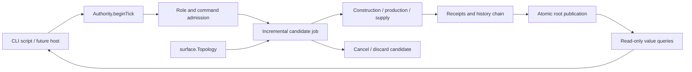
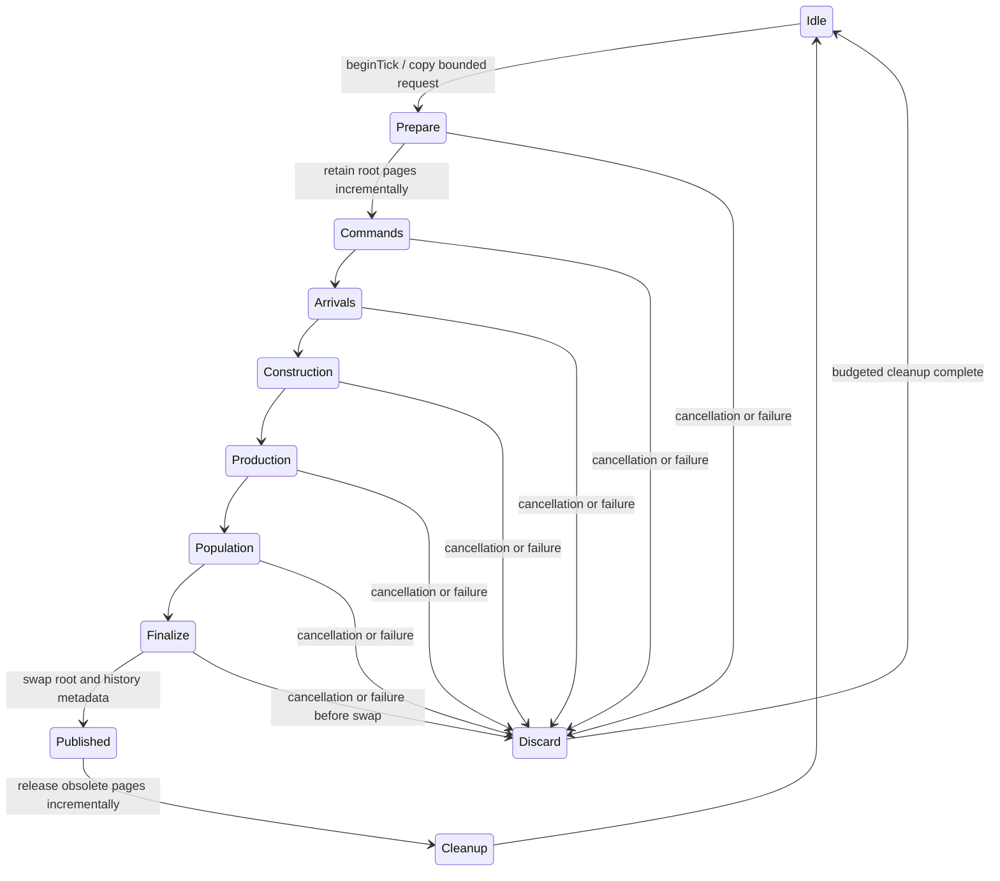

# NYON Zig: one-planet settlement and economy authority

- Author: Abbey; written review: Donald J. Filimon (approved); independent review: revision re-reviewed, all five findings addressed
- Date: 2026-10-11
- Status: **Approved specification — implementation plan approved 2026-10-11 02:47 EDT; scoped implementation complete and qualified; expanded game remains Partial**
- Proposed rules identity: `nyon.planet-economy.v0`
- Required compiler: exactly `0.18.0-dev.146+35accc06e`
- Scope: the next pure authority vertical slice and its command-line acceptance story

## Overview

Build a small configurable authority island in Zig: one seeded six-face planet, civilization-owned settlements, cell footprints crossing cube seams, paid construction, deterministic workforce and production, population food supply, local freight, and inspectable history receipts. A scripted command-line journey must demonstrate those systems together. This document chooses every rule needed by that journey and defines bounded incremental execution before scaling the world.

The expanded rewrite direction is user-approved; **Donald approved the numeric defaults and new gameplay rules below on 2026-10-11 at 02:27 EDT**. This permits detailed implementation planning; it is not proof that cities, saves, or graphical hosts exist. The detailed plan still requires human review before product implementation. The island is a new rules identity; it does not inherit Classic or Living V2 simulation semantics, identifiers, serialized records, frozen digests, or random draw order.

## Current evidence and motivation

Source inspected on 2026-10-11:

| Current source contract | Consequence for this proposal |
| --- | --- |
| `zig/src/surface.zig`: `Face`, `Direction`, `Cell`; `Topology.init`, `cellId`, `fromId`, `neighbor` | Reuse integer adjacency and validated IDs. No mesh, terrain, ownership, footprint, or transported orientation API exists. |
| `surface.Topology`: side 1..65535; face order +X, -X, +Y, -Y, +Z, -Z; ID = face*side²+y*side+x | Keep this topology contract. The economy island imposes a smaller admission range, not a topology change. |
| `zig/src/play_role.zig`: `SessionPolicy.init/admit`, `CivilizationId`, explicit creator/ruler/autonomous provenance | Apply this admission first, then command-specific ownership and economic checks. Existing role admission does not waive costs. |
| `zig/src/main.zig`: `surface-neighbors SIDE CELL_ID` prints east/west/north/south IDs | Add a separate future economy demo command; do not repurpose Classic `play` or `trace`. |
| `zig/build.zig` checks the exact compiler string; `zig/tools/check.sh` blocks cargo/rustc/rustup | Implement and qualify this slice without Rust or new dependencies. |
| `docs/qualification/2026-10-11-zig-rewrite.md` describes the foundation and remaining rewrite | Its recorded gate results apply to that implemented surface, not this proposed island. No new gate run is claimed here. Repository-wide CI still includes Rust; a scoped Zig gate does not establish the final Rust-free repository acceptance. |

Existing `zig/src/model.zig`, `simulation.zig`, `economy.zig`, `generator.zig`, and `classic_*` modules implement prior behavior. They are not the authority for this rules identity. Reusing their state layout, clock, or digest implicitly would prematurely constrain the expanded game. This slice imports only Zig standard library, `surface.zig`, and `play_role.zig` from outside its new module tree.

## Goals, exclusions, and continuing full-game requirements

This slice must establish deterministic state transitions, explicit role/provenance admission, connected cell ownership, honest local supply chains, bounded jobs, cancellation without partial publication, and an independently checkable end-to-end CLI story.

The complete game still requires the following dependencies. Deferral here does not remove them from the approved rewrite:

| Later dependency | Contract this slice must leave usable |
| --- | --- |
| Galaxy/system generation and galaxy → system → planet → cell → city navigation | Planet-scoped IDs and view queries; no global UI selection in authority. This slice has one planet, no implemented navigation hierarchy. |
| Detailed city production, service networks, ecology, power, research and policies | Versioned recipes, integer inventories, workforce allocation and explicit phase ordering; this slice supplies only food/material and three building kinds. |
| Diplomacy, multiple civilizations, fleets, interplanetary logistics | Typed civilization/planet/settlement IDs; local freight does not imply ownership or movement rules between planets. |
| Tactical ground combat and strategic combat | Future commands and phases require a reviewed clock/ownership extension. No health, combat, terrain combat bonus or unit rule is invented here. |
| Creator, ruler and combined graphical play | Every command retains provenance; explicit grants cannot masquerade as earned ruler production. |
| Canonical history/replay, branches, exact Continue and portable saves | Stable logical receipts and command envelopes; durable wire format and branch identity remain separate design work. |
| macOS desktop first; Windows, Linux and browser delivery | Pure allocation-owned integer authority with no OS calls; later platform/render/input/IME/audio/accessibility hosts drive the same job API. |
| Final Rust-free product and tooling | No Rust runtime/library/generator/shader tool/required gate dependency may be introduced here. Existing Rust is retired only after replacement proof. |

This slice does not read, migrate, overwrite or delete existing user data. Its in-memory identity is new; no save slot, filesystem path, autosave, IndexedDB adapter or persistence completion is specified or claimed.

## Alternatives and recommendation

1. **Recommended: configurable authority island.** Separate `planet_economy/` modules; fixed versioned rules, bounded configurable capacities and planet seed. Fastest way to prove a coherent new game loop without coupling it to a renderer or old rules. The trade-off is an intentionally limited population and recipe model that later needs versioned extension.
2. **Extend Classic/Living state directly.** Existing history and CLI scaffolding may reduce initial wiring. It also imports frozen semantic assumptions, save identity ambiguity and large unrelated surfaces. Reject for this slice; reuse algorithms only after independent review and tests, not by aliasing old state types.
3. **Build a generic entity/component economy framework first.** Flexible arbitrary recipes and schemas could support the eventual game, but enlarge validation, scheduling, wire identity and migration work before proving one settlement. Defer until actual additional rules demonstrate the abstraction needed.

## Architecture and ownership

Proposed modules (not current files): `zig/src/planet_economy/{root,ids,rules,state,command,job,history,view}.zig` and focused test modules. Public exports are wired through `zig/src/root.zig` only after approval.



`Authority` owns its allocator allocation, current root, immutable rules, cell/entity pages, bounded history storage and at most one active job. It is non-copyable by convention and has one owner/thread. No raw pointer to an interior page escapes. Queries return value records, or fill caller-owned slices in bounded pages of at most 64 rows. A view includes `Revision`; continuing a paged query with another revision returns `StaleView`.

A job borrows its authority until completion/cancellation and cleanup. `deinit` requires no live job; a host must cancel and drain first. No callbacks, global RNG, filesystem, system clock, logging, thread spawning or platform APIs occur in the authority. Allocation failure during construction leaves no authority. Polling does not allocate.

### Proposed limits and representation

The values here were accepted in written-spec approval on 2026-10-11. Limits are deliberately small enough for exhaustive seam tests and a browser-hostable authority, while exceeding the two-settlement demo. Default entity/history capacities are the stated maxima; lower capacities may be selected at initialization; increasing a hard bound requires a reviewed rules/capacity revision. In particular, side 4..32 is this slice's admission bound, not a reduction of the final game's intended planet sizes or the existing topology API.

| Dimension | Proposed admitted range / hard limit |
| --- | --- |
| Planets | Exactly 1, `PlanetId(1)` |
| Side | 4..32; default 8; demo 4; at most 6,144 cells |
| Civilizations | Exactly one present civilization, `CivilizationId(7)`; distinct typed IDs still used |
| Settlements | 1..64 capacity; initially zero; at most 64 present |
| Buildings / projects | At most 256 combined, at most 32 per settlement; hall is not a building slot |
| Population | 0..32 per settlement; base housing 4; total at most 2,048 |
| Inventory | Food and material each `u32`, 0..65,535; incoming reservations count against cap |
| Freight | At most 64 active; 1..64 edges, 2..65 cell IDs, no repeated cell; quantity 1..256 |
| Commands | 0..64 per tick; each logical encoded command ≤1,024 bytes |
| Tick | `u64`, starts completed tick 0; max admitted target tick 1,000,000 in this island |
| History | At most 4,096 receipts, each ≤1,024 bytes; no implicit eviction |
| Tick receipt staging | At most 1,024 receipts / 1 MiB; bounded independently of retained history |
| Memory | Authority-owned requested allocation ≤16 MiB, including pool, roots, commands, scratch and history; expose actual requested bytes |
| Poll budget | Host default 256 work units; accepted 0..4,096 per call; one counter shared by all job phases |

No giant inline `World` value is copied by assignment. Use heap-owned bounded pages, **2,048 page references per root**, two roots and a preallocated 4,096-slot page pool. Page payload is 256 bytes. A multi-page entity, notably a freight path or command payload, is traversed with its own cursor. The larger directory intentionally favors simple fixed slots over fragile packing.

The following conservative layout is normative for capacity planning. Slot strides include padding and fragmentation; stored records must fit their stride by compile-time assertion. Logical IDs stay strongly typed at API boundaries. Cell index implies its local ID; the one planet is implicit inside a root. Claims store full `u64` settlement/building IDs; freight routes store validated local `u64` IDs, restoring PlanetId(1) on queries. No ID is truncated. Each route reserves three whole pages even when short.

| One-root entity region at simultaneous maxima | Reserved bytes | 256-byte pages |
| --- | ---: | ---: |
| Immutable terrain: 6,144 cells × 1 byte | 6,144 | 24 |
| Cell claims: 6,144 × 32-byte slot | 196,608 | 768 |
| Settlements: 64 × 256-byte slot | 16,384 | 64 |
| Buildings/projects: 256 × 128-byte slot | 32,768 | 128 |
| Shipment headers: 64 × 128-byte slot | 8,192 | 32 |
| Shipment routes: 64 × 3 pages (65 × 8-byte IDs fit within 768 bytes) | 49,152 | 192 |
| Root state/configuration and fixed lookup metadata | 2,048 | 8 |
| **Total addressed payload per root** | **311,296** | **1,216** |

Lookup tables outside these regions are forbidden unless included in the scratch bound below; bounded cursor scans are acceptable. Claims include occupant kind, settlement and optional building identity; a hall has no building ID. Two maximally distinct roots need at most 2,432 pages. The 4,096-slot pool therefore covers their simultaneous existence, one in-progress page clone, and cleanup slack; shared terrain/pages reduce use further. Replace a candidate page reference and release its obsolete candidate reference before cloning another page, so repeated writes cannot accumulate third versions. Cleanup must drain before another job begins.

| Whole-authority reservation, including both roots | Bytes |
| --- | ---: |
| Page pool: 4,096 × 272-byte slot (256 payload + 16 metadata/padding) | 1,114,112 |
| Two directories: 2 × 2,048 × 8-byte page references | 32,768 |
| Retained receipt slots: 4,096 × 1,024 | 4,194,304 |
| Retained receipt lengths/index metadata: 4,096 × 4 | 16,384 |
| Candidate receipt slots: 1,024 × 1,024 | 1,048,576 |
| Candidate receipt lengths/index metadata: 1,024 × 4 | 4,096 |
| Owned command envelopes: 64 × 1,024 | 65,536 |
| Command offsets/lengths/order metadata | 4,096 |
| Bounded working scratch, including encoding/hash, command effects and replay extraction | 2,097,152 |
| Authority/builder/cursors/free-list control/alignment allowance | 65,536 |
| **Total maximum requested storage** | **8,642,560** |
| **Remaining below 16 MiB ceiling (16,777,216 bytes)** | **8,134,656** |

The maximum side/capacity combination must construct successfully when the allocator can provide this reservation. `CapacityUnsupported` is allowed only for an out-of-range configuration; it must not silently reject an advertised combination. Assert this accounting against actual layout and test maximum construction, dirtying every mutable page, cancellation, and publication. Pool exhaustion within admitted bounds is an invariant defect, not ordinary capacity admission. Real allocator overhead/latency and measured peak live use remain qualification evidence to collect; the table guarantees the planned requested-byte envelope, not measured performance.

Proposed strong wrappers: `PlanetId = enum(u32)`, `SettlementId/BuildingId/ShipmentId = enum(u64)`, `Tick/Revision/CommandSequence = enum(u64)`, and `CellId = struct { planet: PlanetId, local: u64 }`. Reuse `play_role.CivilizationId`, not an integer alias. Entity IDs start at 1, increase only on successful entity creation, and are never reused. Removed/completed shipment slots may be reused with a fresh ID. Zero is invalid. Checked exhaustion rejects creation without consuming an ID. Revision starts 0 and advances once per published tick.

## Topology, generation and footprints

Initialize with `(rules_identity, seed:u64, side, capacities)`. Genesis contains the present civilization, immutable planet, zero settlements, no items or population. Cells are generated incrementally in ascending local ID; each has `terrain = rocky` iff `(seed % 4 + local_id % 4) % 4 == 0`, otherwise `fertile`. Both terrains are passable and buildable. The deliberately transparent formula is a testable placeholder generator, not a claim of complete planetary ecology. Seed remains the full `u64` identity even though this first terrain formula uses only two bits; document that seeds with equal low bits share terrain.

The creation job must validate every generated cell: ID round trip, four valid/distinct neighbors, and exactly one return direction from each neighbor. Check expected total `6*side²` using checked widened arithmetic. Include all corners and seams. Initialization is not published until generation and validation finish; cancellation exposes no partly valid world.

The fixed face bases below are **current topology facts**, not new renderer coordinates:

| Face | Normal | Right / increasing x | Up / increasing y |
| --- | --- | --- | --- |
| +X | (1,0,0) | (0,0,-1) | (0,1,0) |
| -X | (-1,0,0) | (0,0,1) | (0,1,0) |
| +Y | (0,1,0) | (1,0,0) | (0,0,-1) |
| -Y | (0,-1,0) | (1,0,0) | (0,0,1) |
| +Z | (0,0,1) | (1,0,0) | (0,1,0) |
| -Z | (0,0,-1) | (-1,0,0) | (0,1,0) |

For this slice a hall, quarry or house occupies one cell. A farm occupies its anchor plus `Topology.neighbor(anchor, facing)`, with facing in the anchor's local frame. Preserve both resolved cells and the original anchor/facing. Either cell may lie on another face. All footprint cells must be distinct and unoccupied, including reserved construction cells. Farm anchor must be fertile; quarry anchor rocky; house/hall accept either terrain. A new building footprint must share at least one cardinal edge with any cell already belonging to its settlement, including a reserved project. Ownership is claimed for all footprint cells atomically. There is no radius claim, diagonal adjacency, overlapping hall or disconnected building.

There is no general rotated rectangle or global compass in this slice. `neighbor(..., east)` followed by another `east` on a new face does **not** promise continuation of the same transported direction. Longer footprints, road headings, vehicles and tactical orientation require an explicit reviewed frame-transport API before implementation. Freight uses an explicit list of cell IDs validated by adjacency and therefore does not assume compass preservation.

No demolition, topology edit, settlement deletion or ownership transfer is admitted yet. This keeps connected-claim and in-flight-route invariants stable. Population reaching zero does not delete claims or buildings.

## Commands, roles and economic admission

A trusted local host constructs `SessionPolicy` for each requested tick, including an explicit startup handoff when entering ruler play. CLI text cannot replace it inside a command. Every command envelope carries `sequence`, `provenance`, nullable `actor`, and a tagged payload. Call the existing `SessionPolicy.admit` first. Ruler commands must operate on settlements owned by the admitted actor; endpoints of freight must have that same owner. Autonomous provenance never enters the public command API; internal economic events are generated only by phases.

**Creator bypass is explicit per command.** Ordinary `found`, `build` and `ship` require ruler provenance even in combined mode and always pay their stated costs. Creator-only play uses `author_settlement`, `grant`, `author_build` and `author_ship`, all with creator provenance, null actor and mandatory `economic_bypass = true`; absence/false returns `ExplicitBypassRequired`. Their target civilization/settlement is a target, not an impersonated actor. Authoring bypasses only the economic/time rules named below; topology, valid references, occupancy, connectivity, terrain, capacity and checked arithmetic still apply. Creator can found settlements, create all three building kinds and exercise freight without selecting ruler mode or acquiring earned inventory.

Admission first rejects prohibited provenance/actor with `SessionPolicy.admit`. Next, inspect only the payload tag and reject a tag/provenance mismatch as `CommandProvenanceMismatch`, before inspecting command-specific fields. Thus creator provenance under ruler policy returns `CreatorForbidden`; ruler provenance with `grant` passes role admission but returns `CommandProvenanceMismatch`. For a correctly tagged creator command, check the explicit bypass flag immediately after this tag gate, before target/resource validation. All minted resources/population and waived material/construction time have creator receipts; they cannot be labeled as earned ruler effects.

| Command | Proposed effect and complete additional admission |
| --- | --- |
| `author_settlement(owner, anchor, population, food, material, economic_bypass)` | Owner must be the present civilization; free valid anchor; population 0..4; bounded inventories; settlement capacity. Creates hall/claim and explicit opening grants immediately. May be used after genesis; no hidden initial stock. |
| `grant(settlement, food, material, population, economic_bypass)` | Nonnegative deltas, at least one nonzero; each inventory total plus reserved incoming ≤65,535; population total ≤current housing and 32. No costs, explicitly minted and receipted. No negative grant/removal. |
| `author_build(settlement, kind, anchor, facing?, economic_bypass)` | Target must exist and belong to the present civilization. Apply the same footprint, terrain, connectivity, facing and building capacities as `build`. Create an **active** building immediately, debit no material and skip both construction ticks. Receipt records its ID/footprint, `material_waived` equal to recipe cost, and `construction_ticks_waived=2`. A farm/quarry still needs workers and output space in production; a house raises housing immediately, including for a later grant in this batch. |
| `author_ship(source, destination, resource, amount, path, cargo_source, economic_bypass)` | Apply the same target-owner, path, amount, incoming-capacity, freight-capacity and horizon checks as `ship`, with target ownership checked against the present civilization instead of a player actor. `cargo_source` is mandatory: `transfer` debits sufficient existing source stock exactly as `ship`; `mint` creates the cargo directly in transit and debits nothing. Receipt states transfer versus minted quantity. Both reserve destination capacity, depart this tick and arrive after the same path-edge delay. Minting never transiently credits the source and does not require its storage space. |
| `found(source, anchor)` | Source owned, population ≥2, food ≥4, material ≥20; valid free anchor; settlement capacity. Debit those resources and move exactly 2 population to new settlement, whose stock starts food=4/material=0. Material is consumed. New hall housing=4. Anchor may be anywhere on this one planet: expedition time/range is explicitly deferred, not simulated freight. |
| `build(settlement, kind, anchor, facing?)` | Valid owned settlement and footprint; building/project capacities; enough material for full recipe. Facing required only for farm, forbidden otherwise. Debit material and reserve cells immediately; create a 2-tick project. No construction workers, cancellation or refunds in this version. |
| `ship(source, destination, resource, amount, path)` | Distinct owned settlements; valid nonrepeating path starting at source hall and ending at destination hall; each pair cardinally adjacent; intermediate cells unclaimed or owned by same civilization; sufficient stock and incoming capacity; freight capacity. Debit source, reserve destination capacity, create shipment. No fee or transport workers in this first rule set. |

Settlement names/text and arbitrary recipe input are excluded from authority; the CLI labels IDs A/B for narration. Users cannot submit raw internal IDs for new entities: accepted commands allocate them.

### Explicit authored bootstrap and ruler handoff

Zero-settlement genesis is a neutral authoring state, not a playable ruler start. The host's proposed `ruler-start.v0` preset is an explicit input program: create seed 2 / side 4 with the admitted default capacities; at ordinary tick 1 use `SessionPolicy.init(.creator, null)` to submit sequence 1, `author_settlement(owner=7, anchor=70, population=4, food=12, material=20, economic_bypass=true)`. Its creation/grants and tick are fully receipted. Tick 1 includes normal food consumption, leaving population 4, food 8, material 20 and fed streak 1. It is not a hidden pre-tick balance injection.

After tick 1 publishes and cleanup drains, the host enters ruler play with `SessionPolicy.init(.ruler, civilization7)`. That selection does not reset the world, counters, revision or tick and grants no resources. It takes effect in the next published tick's trusted-policy input receipt; a failed or canceled batch cannot publish a policy transition. The first concrete ruler action at tick 2 is sequence 2, `build(settlement=1, farm, anchor=71, facing=east)`, costing 6 material. A creator session can use its own authored setup instead; combined mode can use the existing one-batch demo. A ruler-only host must request this explicit authored preset (or a separately receipted valid authored setup) before offering playable ruler controls. Pure ruler provenance cannot bootstrap an empty world by itself, and the host must not claim it can.

The preset is disclosed as authored startup in the CLI and replay config plus tick input; its assets always retain creator provenance. No policy is inferred from command actor or provenance. Subsequent ticks may use a trusted host-selected policy, which is recorded even for empty batches. This defines local handoff, not multiplayer authentication.

### Ordering, rejection, and retry

`beginTick` copies a bounded batch and policy into the owned command buffer. It targets exactly `completed_tick+1`, requires the expected revision, and returns `Busy` while a job or cleanup is live. Empty batches advance time and preserve the sequence watermark. There is no background queue and no automatic catch-up.

Sequences are strictly positive, globally increasing across published ticks, and unique within a batch. Sort by numeric sequence using incremental insertion sort (at most 2,016 pair comparisons). Every supplied sequence must exceed the last published batch's maximum; gaps are allowed. Duplicate/old sequence, wrong revision, invalid envelope encoding or excessive batch size rejects the **entire batch before gameplay**, without receipts, counters or tick changes. Retrying a committed batch gets `SequenceAlreadyPublished`; retrying a canceled batch is allowed.

Once structurally admitted, evaluate commands in sorted order against the candidate resulting from earlier accepted commands. A gameplay rejection creates one rejection receipt and continues. It consumes its sequence on publication, but no resource/entity ID. Role → payload tag/provenance → explicit creator bypass flag → target existence → ownership → argument range → topology/footprint/path → capacity → resources is the rejection precedence. Within footprint/path validation inspect ordered cells/edges; report the first invalid entry. Complete all checks and compute effects in command-local scratch before applying any command effects. Do not reserve cells, debit stock, create an ID or append an accepted receipt until every check succeeds.

Allocation/internal invariant failure aborts the entire candidate tick. `HistoryFull` or staging/pool exhaustion also aborts the tick, preserving the previous state and sequences. Rejected gameplay commands alone do not abort a tick. No accepted command is announced before publication.

## Tick scale and deterministic phases

One economy tick represents **one game hour**. It is an integer simulation unit, not a real-time deadline; hosts explicitly request it. All arithmetic is checked integer arithmetic; no floating point or wall time affects outcomes. Later tactical substeps require a reviewed relationship to this clock. This slice cannot claim an integrated combat clock.

For target tick T:

1. **Commands:** process sorted batch. New grants, settlements, projects and shipments become visible to later commands and later phases of the same candidate.
2. **Freight arrivals:** ascending ShipmentId; arrivals with `arrival_tick == T` credit all cargo and release the same reservation, then remove the active shipment. Shipments created at T use `arrival_tick = T + path_edge_count`, so none arrive at departure. Reject admission if arrival exceeds tick horizon. No per-cell movement mutation is needed; query position as `path[min(T-departure_tick, edge_count)]`.
3. **Construction:** ascending BuildingId; authored-active buildings skip this phase; decrement every unfinished project's remaining ticks once. Projects admitted at T go from 2 to 1 at T, become active at T+1, and may produce immediately in that completion tick.
4. **Workforce and production:** ascending SettlementId, then active buildings ascending BuildingId. All current population supplies one worker each, including population granted/founded this tick. Reset free workers each tick. Housing buildings need no workers. For a producer: test workforce first, then whole-output capacity including incoming reservations. If either fails, emit one idle receipt with that reason and consume no worker. Otherwise reserve its full workforce for this tick and credit its full output. Unused workers vanish at tick end; no cross-settlement work or food inputs. Every active producer emits exactly one produced/idle receipt each tick.
5. **Food and population:** ascending SettlementId, after production/arrivals. Consume `min(food, population)` food. Emit supply receipt with needed, consumed, shortage. If population is zero, reset both counters to zero and stop. Full supply resets hunger to zero and increments fed streak; shortage resets fed streak and increments hunger. On hunger reaching 3, lose exactly one population and reset hunger to zero. On fed streak reaching 8, add one population only if below housing and 32; always reset streak to zero, recording growth or housing-blocked. New population first demands food/works on the next tick; death affects next tick's workforce. Partial shortage counts as one hungry tick regardless of amount. Starvation does not otherwise reduce production efficiency in this intentionally small model.
6. **Finalize:** append tick-complete receipt, finish history chain, verify dirty-record invariants, and atomically publish revision, tick, state, receipts and last sequence together. No client observes intermediate phases.

| Building | Footprint | Material cost | Construction ticks | Workers/tick | Output/tick or housing |
| --- | --- | --- | --- | --- | --- |
| Farm | 2 adjacent cells, fertile anchor | 6 | 2 | 2 | 6 food |
| Quarry | 1 rocky cell | 4 | 2 | 2 | 2 material |
| House | 1 cell | 8 | 2 | 0 | +4 housing once active |

Housing is `min(32, 4 + 4*active_houses)`. Building completion never directly creates population. Production at full capacity waits without discarding output. There is no partial work, spoilage, resource loss in transit, energy, maintenance, currency, tax or automatic route replenishment. Those are later explicit rules, not inferred mechanics.

## Incremental execution, budgets, and atomic publication

The host supplies a single `WorkBudget` to creation, tick execution, cleanup and optional history verification. Every loop uses that same remaining counter; helpers must not create fresh budgets. Zero budget changes no state, cursor, receipt length or revision. Scheduling may change the number of polls, never the final receipts or state.

One work unit permits exactly one bounded primitive: copy/zero at most 256 bytes; validate one topology edge; compare/swap one bounded index; evaluate one fixed-size record; mutate one fixed-size record after admission; or hash at most 64 input bytes. A multi-record action has multiple explicit cursor steps. Counter decrement occurs before work. A page allocation from the preallocated free-list and a single refcount adjustment each cost one unit. Command path checks, root-directory copying, page cloning, receipt encoding, sorting, genesis terrain generation, invariant checks and disposal all consume units. No nested scan, full-world equality/hash/copy, unmetered sorting or allocator call is permitted inside `poll`.

The work-unit contract bounds operations and bytes, not scheduler latency. Proposed host target: ≤2 ms p95 for 256-unit polls on the developer macOS machine after warmup; report hardware/configuration, maximum and p95 rather than claiming this without measurement. If a primitive exceeds the target, split it or reduce the host budget without changing rules.



The active root remains readable while a candidate copies directory entries and retains pages incrementally. Writes clone only touched pages, with page-sized bounded work. Immutable terrain pages remain shared. Before publication, candidate receipts are staged outside visible history, then copied incrementally into the unused tail of a separate preallocated append-only history buffer. These bytes remain invisible until its published count changes. Cancellation may leave unreachable tail bytes, which the next candidate overwrites; published bytes never change. The entity page directory therefore does not need to address all 4 MiB of history. The final swap is a constant-size metadata/root-pointer change costing one unit; it cannot allocate or fail. Root metadata includes published history count, chain head and last published trusted policy, so history, policy and state cannot disagree.

`cancel(job_id)` only sets cancellation intent. On the next poll, before any further primitive (including the publication primitive), discard the candidate and drain its owned references using the shared budget. Queries still return the prior revision. If publication already occurred, cancellation returns `AlreadyPublished`; it cannot undo a committed tick. A host must not present a canceled result as success. Cleanup must finish before the lane is reusable, even after publication. Old root storage is released through cursors, not a recursive/unbounded destructor.

The concrete storage table covers worst-case dirty pages at all advertised simultaneous capacities, independent receipt staging and both directories. Running out of pool slots within those bounds is an implementation invariant failure, never an invitation to mutate the published root. Verify the 8,642,560-byte planned reservation and 16 MiB ceiling with allocator accounting; these are layout requirements, not measured results.

## History and minimal public interfaces

Each receipt has rules identity, tick, per-tick ordinal, event tag, nullable command sequence, provenance and bounded typed payload. Public command receipts include the full admitted envelope and accepted effects/allocated IDs or rejected reason; internal event receipts have autonomous provenance and no player actor. Each published tick starts with one trusted-policy/input receipt containing target tick, expected prior revision, previous policy (absent for first tick), this tick's complete policy (role and optional civilization), and structurally admitted envelope count. Its provenance is autonomous because it is host input metadata, not a player command. This receipt precedes command receipts; subsequent events follow phase order, then IDs. Genesis emits a config/civilization receipt. Creator settlement/grant receipts show every minted item and population delta; author-build receipts show waived cost/time; author-ship receipts distinguish minted cargo from transferred stock. Consumption, construction costs and starvation are losses with explicit causes; founding transfers and freight transfer retain their source/destination IDs.

Use a standard-library SHA-256 chain over receipts, **not a full state hash per tick**. Define the internal canonical receipt encoding before code: ASCII domain `NYON-PE0-RECEIPT` (16 bytes), event tag `u8`, tick `u64`, ordinal `u16`, provenance `u8` (matching `play_role`), optional sequence as presence `u8` plus `u64` when present, then tag-specific payload. All integers little-endian, booleans 0/1, enums explicitly assigned tags, lengths `u16`; absent values omit their payload. Encode logical fields, never Zig padding or pointers. In the implementation plan, pin a complete tag/field table and independent hex vectors before implementing the encoder; that wire-detail prerequisite does not authorize a durable save format.

Chain starts `SHA256("NYON-PE0-HISTORY")`; next head is `SHA256(previous_head || u32_le(receipt_length) || receipt_bytes)`. Hashing is cursor-driven in ≤64-byte units. The chain proves receipt integrity relative to its supplied starting head, not authenticity, persistence or standalone replay completeness. **Replay input is creation config plus every published tick's trusted policy and complete structurally admitted envelope batch**, including gameplay-rejected commands and explicit empty batches. Config includes rules identity, seed, side, all capacities and optional disclosed startup-program label (`ruler-start.v0` or absent); the label grants nothing and the actual authored envelopes remain required. Store envelopes in canonical sequence order; input arrival order is deliberately not semantic. Preserve each tick boundary, target tick and prior revision, not only a flattened command list. Whole-batch structural failures and canceled/aborted candidates are absent from published replay, including their attempted policy changes. Published gameplay rejections remain present and consume sequences as specified.

Retain this input without an unbounded second log: genesis supplies config; tick-input receipts supply trusted policies/counts; each accepted/rejected command receipt supplies its complete envelope; tick-complete closes the record. Empty ticks still have input and complete receipts. Replay extraction visits these bounded receipts incrementally. A replay into a fresh authority must reproduce every logical query result, rejection, sequence watermark, receipt byte and chain head. Policy is part of the input and must never be reconstructed from an envelope's provenance. A later durable archive must separately define authentication, complete history, schema versioning, branches and compatibility.

Proposed interface shape (illustrative Zig declarations; implementation supplies exact bounded types):

```zig
pub const WorkBudget = struct { remaining: u16 };
pub const JobId = enum(u64) { _ };
pub const Progress = union(enum) {
    pending: struct { phase: Phase, units_used: u16 },
    published: TickSummary, // owns values; cleanup may still be pending
    canceled,
    failed: Failure,
    idle,                  // cleanup complete; lane available
};

pub fn beginCreate(allocator: std.mem.Allocator, config: Config) !Builder;
pub fn pollCreate(builder: *Builder, budget: *WorkBudget) CreateProgress;
pub fn cancelCreate(builder: *Builder) void;
// Builder transfers sole ownership once ready; cancellation is drained first.
pub fn takeAuthority(builder: *Builder) !Authority;

pub fn beginTick(self: *Authority, expected: Revision,
    policy: play_role.SessionPolicy, batch: []const Envelope) !JobId;
pub fn poll(self: *Authority, job: JobId, budget: *WorkBudget) Progress;
pub fn cancel(self: *Authority, job: JobId) CancelResult;
pub fn settlement(self: *const Authority, id: SettlementId) !SettlementView;
pub fn cell(self: *const Authority, id: CellId) !CellView;
pub fn receipts(self: *const Authority, revision: Revision,
    cursor: ReceiptCursor, out: []ReceiptView) !ReceiptPage;
pub fn deinit(self: *Authority) void;
```

`beginCreate` allocates/reserves bounded storage and validates small config fields; expensive generation and initialization are in `pollCreate`. OS allocator time during this explicit setup operation is outside the poll latency target. `beginTick` may inspect/copy at most 64 KiB of bounded envelopes synchronously; it must not sort, traverse world state, or validate paths there. Batch encoding/sequence validation and sorting occur in the budgeted prepare phase; their failure is still whole-batch rejection. This is the only synchronous request-copy allowance; expose it for later host profiling. Borrowed input expires after `beginTick` returns. `published` is delivered once; later polls clean up then return `idle`. Failure/cancellation is likewise delivered once, with cleanup status inspectable. Stale JobId always returns `StaleJob`, never operates on a replacement.

## Independent vectors and command-line acceptance

The future command is `nyon-zig planet-economy-demo --seed 2 --side 4 --budget 256`. Its built-in story is small command input passed through public admission, not a preconstructed world or privileged state mutation. It prints config/proposal identity, each published tick's receipts and the table below, then exits nonzero on any mismatch. No profile argument, save or UI is involved. Optional `--story combined|creator|ruler-start|policy-replay` selects the acceptance fixtures below; omitted means `combined`, preserving the original command and eight-tick story. Each story creates a fresh authority and uses the public APIs; `ruler-start` discloses its authored bootstrap before the ruler phase.

### Independent topology witnesses

At side 4, derive IDs directly from the published face bases and formula:

- +Z(3,1), ID 71, east → +X(0,1), ID 4; the farm footprint `[71,4]` crosses that seam.
- +Z(2,3), ID 78, north → +Y(2,0), ID 34.
- +X(2,3), ID 14, north → +Y(3,2), ID 43. The reverse direction on +Y is east, **not south**; this guards against opposite-direction assumptions.
- +Z(2,1)=70 → east 71 → east 4 → east 5 is a three-edge path for this particular equatorial seam; the general route validator still uses IDs and adjacency.

At seed 2, farm anchor 71 is fertile because `(2+3)%4=1`; quarry anchor 74 is rocky because `(2+2)%4=0`. The farm's second cell 4 need not be fertile. The quarry is north of hall 70 and the farm is east of it, satisfying connected placement.

### Script and exact expected outcomes

Use combined policy with selected civilization 7. At tick 1 submit these increasing sequences (IDs shown are expected outputs):

1. Creator, actor null, explicit bypass: author A at cell 70 with population 4, food 12, material 20 → SettlementId 1.
2. Creator, actor null, explicit bypass: author B at cell 5 with population 2, food 6, material 0 → SettlementId 2.
3. Ruler actor 7: build farm at 71 facing east in A → BuildingId 1, footprint 71/4, cost 6.
4. Ruler actor 7: build quarry at 74 in A → BuildingId 2, cost 4.
5. Ruler actor 7: ship 4 food A→B on `[70,71,4,5]` → ShipmentId 1, arrival tick 4.
6. Ruler actor 7: build house at 71 → rejection `OccupiedCell`; no resource or ID consumed.
7. Creator actor null: grant B one food with bypass false → rejection `ExplicitBypassRequired`.

Ticks 2..8 use empty batches. Two projects finish and first produce at tick 2. A allocates two workers to farm, two to quarry. B has no producers.

| Published tick | A population | A food | A material | B population | B food | B hunger | Freight |
| --- | --- | --- | --- | --- | --- | --- | --- |
| 1 | 4 | 4 | 10 | 2 | 4 | 0 | in transit, at 70 |
| 2 | 4 | 6 | 12 | 2 | 2 | 0 | in transit, at 71 |
| 3 | 4 | 8 | 14 | 2 | 0 | 0 | in transit, at 4 |
| 4 | 4 | 10 | 16 | 2 | 2 | 0 | delivered at 5, no active shipment |
| 5 | 4 | 12 | 18 | 2 | 0 | 0 | none |
| 6 | 4 | 14 | 20 | 2 | 0 | 1 | none |
| 7 | 4 | 16 | 22 | 2 | 0 | 2 | none |
| 8 | 4 | 18 | 24 | 1 | 0 | 0 | none |

At tick 8 A's eight fully supplied ticks trigger housing-blocked growth and reset fed streak. B loses one population after three shortages. No cell or building disappears. Total food: creator grants 18 + farm production 42 − consumed 42 = ending 18; freight is a transfer. Total material: grant 20 − construction 10 + quarry production 14 = ending 24. Total population: grants 6 − starvation 1 = ending 5. These arithmetic expectations are independently derived, not captured from the implementation.

### Separate creator-only acceptance fixture

Run a fresh seed-2/side-4 authority with creator policy and no selected civilization for **every** tick. At tick 1 use sequences 1..6: author A at 70 (population 4, food/material 0/0); author B at 5 (population 2, food/material 6/0); author an active farm at 71/east; author an active quarry at 74; author an active house at 69; author-ship 4 food A→B on `[70,71,4,5]` with `cargo_source=mint`. Every command has explicit bypass true and creator provenance/null actor. House 69 adjoins hall 70; A housing is immediately 8. Material costs 6+4+8 and six construction ticks are explicitly waived; 4 food is explicitly minted in transit. No creator operation requires ruler admission.

At tick 1 A ends population 4, food 2, material 2; B ends population 2, food 4. Empty creator ticks 2/3/4 leave A food 4/6/8 and material 4/6/8; B food 2/0/2, with arrival at tick 4. Assert creator provenance on all six command receipts, unchanged zero starting material before autonomous production, active building states without projects, the mint receipt and shipment reservation. Also test `cargo_source=transfer` rejects insufficient stock atomically, and succeeds/debits when stock exists; bypass does not silently change that explicit choice.

### Separate ruler-bootstrap and policy-aware replay fixtures

Execute `ruler-start.v0` exactly as specified. Tick 1 publishes creator-authored stock and normal consumption. Tick 2 runs only the paid ruler farm build; expected end state A: population 4, food 4, material 14, project remaining 1. Tick 3 is an empty ruler batch; the farm completes and produces, leaving population 4, food 6, material 14. Verify creator→ruler policy transition at tick 2, the creation grant receipt, ruler cost receipt, all three tick boundaries, and fed streak 3. This is ruler play after an explicit authored start, with no creator envelope accepted through ruler admission.

For a policy-sensitive replay witness, create two independent authorities with the identical tick-1 bootstrap. In each, tick 2 supplies identical sequence-2 envelope `grant(A, food=1, material=0, population=0, bypass=true)`, creator provenance/null actor. Recorded creator policy accepts it, ending A food 5; recorded ruler policy rejects `CreatorForbidden`, ending A food 4. Both publish sequence watermark 2. Tick 3 has an empty batch under the respective recorded policy, yielding food 1 versus 0. Extract config and all three complete tick records, replay each into a fresh authority, and require identical states/receipt bytes/chain heads to its own original; the two histories must differ. A separate ruler-provenance `grant` case rejects `CommandProvenanceMismatch` before payload validation.

Attempt an old-sequence batch and cancel a new sequence-3 batch before publication in each run. Neither attempt adds a replay tick, advances the watermark, records a policy transition or changes the head. Budgets 1 and 256 must reproduce both replay witnesses. No archive/save implementation is implied.

### Additional mandatory tests

- Every side 4..32: exhaustive ID round trips, distinct/reciprocal neighbor checks; verify every directed face seam and corner against an independently written basis/table oracle. Existing reciprocal tests alone cannot prove orientation.
- Reject economy side 0, 1, 3, 33 and maximum topology-sized side; preserve existing topology range tests unchanged. Reject wrong planet and first out-of-range cell ID.
- Seam farm admission, overlap on its second cell, disconnected placement, terrain mismatch, invalid facing usage, insufficient material and exact-capacity admission; every rejected command leaves all economic fields and entity counters unchanged.
- Ruler/creator/combined matrix including autonomous spoof, wrong actor and false bypass. Combined ruler building still pays. Explicit creator grants/authored buildings/authored freight carry complete provenance, retain structural validation and never change paid ruler costs.
- Founding cost/transfer conservation; empty source, too few settlers, material/food deficit, and cell collision. A newly founded settlement consumes its moved food in its founding tick.
- Production worker shortage versus output-capacity precedence; waiting producer releases workers to later buildings; incoming reservations block output; house completion raises capacity only once.
- Population full/partial/zero supply, growth at exactly eight ticks, death at exactly three shortages, zero population and house cap 32.
- Freight same endpoint, wrong owner, repeated cell, nonadjacent edge, capacity/full destination, exact arrival, seed-invariant path topology, and 64-edge bound. Arrival is independent of poll count.
- Run the entire demo with budgets 1, 7, 256, 4096 and alternating zero/nonzero; compare all logical state and receipt bytes, including sequence and chain heads.
- Cancel at every cursor phase and immediately before publication; compare prior revision, inventories, IDs, claims, history and sequence watermark; resubmit the same batch and obtain the original expected result. Cancel after publication yields `AlreadyPublished`.
- Construct all simultaneous maximum capacities within the concrete byte/page table, then dirty all mutable pages across two roots and drain/cancel without exhausting the pool; exhaust configured entity/receipt bounds and tick horizon; failed candidates preserve prior state and permit inspection. Inject allocator failure only during setup, assert no leak; polling must record zero allocation attempts.
- Independently authored little-endian receipt hex and chain vectors, including creator grants and a rejected command; verify using standard-library hashing in a separate small test fixture. Pin complete encoding tags before dependent implementation.

## Security, privacy and failure risks

There is no network authentication in this local island. Trusted host policy is the authority boundary, and the public API must not accept an envelope-supplied replacement policy. Future multiplayer requires separate authenticated identity and authorization design. All external command fields are bounded and validated; receipts contain only IDs, enums and quantities. No usernames, paths, tokens or legacy save content enter history.

| Risk | Severity | Mitigation / evidence required |
| --- | --- | --- |
| Creator grants silently become earned ruler resources | High | Explicit bypass-only command tags, role-first admission and creator receipts; adversarial matrix tests. |
| Canceled or failed jobs leak partial world/history | High | Immutable published root, candidate pages, atomic metadata swap, cancellation at every phase and invariant comparison. |
| Seam orientation yields invalid city footprints or routes | High | Two-cell footprints only, ID paths, independent directed-seam witnesses; frame transport deferred explicitly. |
| Poll hides full copies, scans or hashing | High | Meter every cursor primitive, allocator accounting, max-capacity budget-one tests and latency measurement. |
| Recipes create unfair starvation/workforce behavior | Medium | Publish exact order and reduced model; written rules approval before coding; later balancing requires versioning. |
| History reaches capacity | Medium | Explicit `HistoryFull`, no tick publication or silent eviction; later archive/checkpoint design needed for long campaigns. |
| Treating CLI success as complete game or migration | High | Separate acceptance labels; no save/host/full-game claims from this slice. |

## Observability and qualification

Expose deterministic summaries: tick/revision, accepted/rejected count, phase, budget consumed, pages copied, peak live pages, history occupancy, production idle reasons, shortages, freight departures/arrivals and chain head. The host may time polls and log metrics; durations and counters about execution scheduling are excluded from canonical receipts. No authority-side log I/O. CLI error categories distinguish invalid input, rejected gameplay, resource/history limit, cancellation and invariant failure.

After implementation, run from the canonical checkout:

```sh
zig/tools/check.sh
```

Extend that existing gate with the new authority tests and demo verification, maintaining exact pin and Rust subprocess blockers. The new independent fixtures and checker must be Zig/std-only; do not add a Rust differential dependency or new package. Existing gate scripting remains existing tooling, not a new production dependency. Record actual exit status and untruncated log file; a piped tail is not gate proof. Run `git diff --check` for documentation/source whitespace separately.

Qualification must distinguish: pure unit/integration semantics, cancellation/capacity/allocator evidence, CLI story, cross-target compilation and real host execution. The first implementation gate establishes no native graphics, live browser, accessibility, persistence, replay archive or full expanded-game acceptance. Do not invoke the historical Rust CI to establish this new slice.

## Rollout, approval and rollback

1. **Now: proposed design review.** Resolve the approval items below and pin receipt tags/field layouts with independent vectors in the implementation plan. Update this document with accepted decisions before dependent code.
2. Implement isolated rules/state/admission and topology validation; prove independent vectors and economic conservation.
3. Implement shared-budget jobs, atomic publication, history and cancellation; exercise capacity limits and varied schedules.
4. Add the complete CLI story and required Zig gate checks. Keep new command explicitly labeled `planet-economy.v0` and separate from Classic commands.
5. Only after this slice qualifies, design the next layer: durable new saves/history and richer city/galaxy integration, then graphical hosts. Rollback of this slice is disabling its new CLI entry/export; no existing save migration or data rollback is involved.

All steps after design approval are Proposed work. No dependency acquisition, commit, push, deployment or deletion is authorized by this document.

## Accepted defaults and self-review

The specification supplies defaults rather than leaving gameplay for implementers to invent. Donald approved: one-hour tick; side/capacity bounds; two commodities and recipes; frontier founding anywhere on the planet; three-tick starvation/eight-tick growth; free freight with explicit route; explicit creator authoring/bypass rules and receipted ruler bootstrap; policy-complete replay input; bounded non-evicting history; and the internal receipt encoding prerequisite. The final save schema, tactical substeps and orientation transport are deliberately future designs, not blockers to this narrow island.

Self-review: command order and same-tick availability are specified; construction completes at T+1 for a T command; arrival occurs at departure plus edge count; production precedes consumption; population changes affect next tick's workforce; creator admission does not waive ordinary ruler costs; creator-only authoring and paid ruler startup both have runnable fixtures; replay preserves policies, rejects and empty ticks; advertised simultaneous capacities have a concrete storage reservation; farm second-cell terrain is explicitly unrestricted; read queries observe one root; canceled jobs cannot publish; no whole world copy/hash is required per tick; history is bounded and may stop progress explicitly. Remaining measurement claims are targets, not verified performance. This document changes no source or saved user data.

## References

- [`surface.zig`](../../../zig/src/surface.zig): current topology and seam tests.
- [`play_role.zig`](../../../zig/src/play_role.zig): current role/provenance admission.
- [`main.zig`](../../../zig/src/main.zig): current CLI entry points.
- [`root.zig`](../../../zig/src/root.zig): existing module exports.
- [`build.zig`](../../../zig/build.zig), [`.zigversion`](../../../zig/.zigversion), [`check.sh`](../../../zig/tools/check.sh): current Zig build and gate.
- [Expanded rewrite qualification](../../qualification/2026-10-11-zig-rewrite.md): approved direction and scoped implementation record.
- [`AGENTS.md`](../../../AGENTS.md): existing repository constraints; explicit new rewrite direction governs the new island, while old frozen contracts remain untouched.

## Revision Summary — 2026-10-11, review fix 1

Addressed the first independent review's three blocking issues: creator-only construction/freight now have explicit authored variants; ruler startup uses an ordinary receipted creator tick followed by an explicit policy handoff; replay includes trusted policy and every structurally admitted command, including gameplay rejections and empty ticks. Added separate acceptance fixtures without changing the original eight-tick combined demo or seam witnesses. Also specified tag/provenance rejection precedence and a concrete maximum-capacity memory layout with 2,048-entry roots. Removed the review-owner placeholder. Status remains Draft / Proposed; independent re-review and Donald's written rules approval remain required.

## Independent review outcome

2026-10-11: the initial independent review found three role/startup/replay
blockers and two capacity/admission clarifications. Revision 1 addressed all
five. Scoped independent re-review found no open findings in the changed
sections. These are specification-review verdicts, not implemented gameplay,
allocator measurements, runtime tests or human approval.

Review artifacts are retained under
`.superpowers/sdd/2026-10-11-expanded-zig-rewrite/` as
`planet-spec-review.md`, `planet-spec-fix1-report.md`, and
`planet-spec-fix1-review.md`. Donald subsequently approved these new rules on 2026-10-11 at 02:27 EDT;
detailed-plan preparation and review are the next stage.

Written-spec approval: Donald selected **Approve specification** on 2026-10-11
at 02:27 EDT. This approval covers the revised artifact and its city/creator/
ruler/production/freight/replay rules; no product implementation is claimed.
