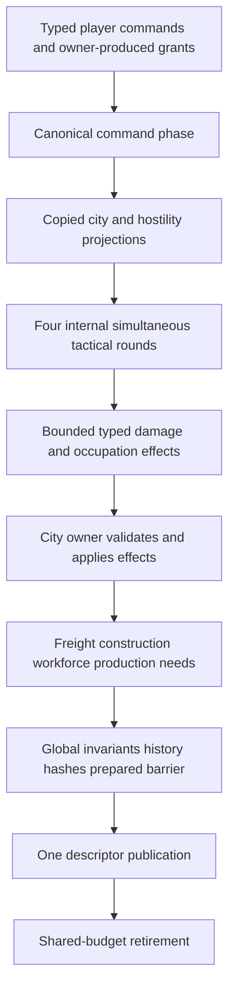

# NYON Zig: deterministic tactical ground combat

<!-- BEGIN 2026-10-19 rewrite decision -->
> **Historical; Zig continuation canceled 2026-10-19.** Preserve this source contract and evidence. Active recovery targets Rust stable1.99.1; see the 2026-10-19 Rust designs/plans. Historical review labels do not approve new Rust behavior. Tests and CI gates remain paused.
<!-- END 2026-10-19 rewrite decision -->

Date: 2026-10-11. Author: Abbey; independent written reviewer: pending.
Status: **Proposed, pending written review under the finishing plan.**
Compiler: `0.18.0-dev.146+35accc06e`.
Proposed subsystem identity: `nyon.tactical-ground.v1`.
Proposed integrated identity: `nyon.city-combat-galaxy.v1`.
Proposed storage extension: `nyon.city-combat-storage.v1`.
These names reserve a proposal; no existing rules identity acquires new semantics.

## Overview

Resolve ground units on the existing six-face cell graph with four simultaneous
resolution rounds inside each one-hour galaxy tick. Commands, autonomous orders,
movement, direct fire, objective control, retreat and city effects execute in the
unpublished candidate. Only the coordinator's single final descriptor publication
makes the whole tick visible. An internal round represents fifteen simulated
minutes, never an independently advanced clock, public revision or saved state.

This proposal chooses a small, inspectable combat ruleset: three unit classes,
cardinal direct-fire rays transported across cube seams, terrain cover and movement
cost, explicit objectives, and withdrawal into an on-world reserve. City authority
supplies copied projections and applies typed effects. It retains its own recipes,
inventories, population and ownership invariants. Paid troop commissioning uses the jointly proposed city-owned training contract below.
Strategic hostility and the merged city profile require reviewed integration;
creator-authored unit fixtures are qualification tools, not substitutes for that work.

## Current evidence and motivation

- `zig/src/surface.zig`, `Topology.cellId/fromId/neighbor`, supplies integer topology:
  local cell `face*side*side + y*side + x`, faces `+X,-X,+Y,-Y,+Z,-Z` numbered0..5.
  Side4 cell71 (+Z,3,1) east is cell4 (+X,0,1). The module includes seam/reciprocity
  tests; reading their source is not a fresh test result.
- `zig/src/planet_economy/types.zig` defines terrain `fertile=0, rocky=1`.
  `rules.terrain(seed,cell)` is rocky exactly when
  `(seed%4 + cell.local%4)%4 == 0`. Neither terrain enum nor formula changes here.
- `zig/src/coordinated_galaxy/{ids,types}.zig` has qualified cell/entity IDs,
  copied values, leases and a **four-world v0** configuration. Its phased global
  transaction design is a reuse contract; the live implementation remains owned
  by another session. No current tactical API was found in these inspected modules.
- `zig/src/play_role.zig`, `SessionPolicy.admit`, rejects externally supplied
  autonomous provenance and distinguishes creator/ruler/combined authority.
- The [finishing plan](../plans/2026-10-11-finish-nyon-in-zig.md) and
  [expanded roadmap](../plans/2026-10-11-expanded-zig-rewrite.md) require tactical
  ground combat and full-scale deterministic qualification, not old hull combat.

The [coordinated v0 design](2026-10-11-nyon-zig-coordinated-galaxy-design.md),
[seeded galaxy design](2026-10-11-nyon-zig-seeded-galaxy-design.md) and
[full-scale storage proposal](2026-10-11-nyon-zig-fullscale-authority-design.md)
remain separate versioned contracts. The last proposal's 512-world envelope and
page headroom are Proposed inputs to the merged layout review, not measured
available memory or proof of implemented scale.

## Goals and scope boundaries

Provide deterministic tactical movement across every seam and corner, simultaneous
fire including mutual destruction, terrain-aware targeting, player/autonomous rule
parity, explicit retreat, objective outcomes and settlement occupation. Specify
bounded work, canonical replay, rejection order and independent arithmetic witnesses.
All 512 enrolled worlds participate in every global phase regardless of visibility;
combat work on an empty world includes its charged phase-entry check.

This version has no tactical free-running clock, physics collision, projectile
integration, floating-point hit chance, fog-of-war, ammunition, indirect fire,
area damage, tactical aircraft or terrain deformation. All tactical information
is public to local players. Strategic war authorization, troop transport between
worlds and city recipes belong to their owning reviewed
systems; the jointly proposed city training seam is specified below. They remain required integration work; this scope does not remove them
from the finished game.

## Capacities and canonical state

Full-profile limits are fixed in genesis, not adapted to host speed. Global and
per-world caps constrain counts simultaneously; not every world can reach its
local maximum at once. All size arithmetic is checked u64 before host conversion.

| Dimension | Proposed admitted limit |
| --- | --- |
| Systems/worlds/civilizations | 64 / 512 / 16, matching full-scale manifest proposal |
| Surface side/cells | 4..32 / at most6,144 per world |
| Units, including reserve and training reservations | 4,096 global /256 per world |
| Objectives | 2,048 global /16 per world |
| Theater records | One per enrolled world, at most512; no separate battle instance map |
| City damage/occupation effects | 4,096 distinct damage targets plus2,048 capture attempts per tick |
| Commands | Share global1,024/tick and per-world64/tick; body at most1,024 bytes |
| Order lifetime | One standing order/unit; changes only at global command phase |
| Internal rounds | Exactly4/tick; no independently persisted round cursor |
| Retreat extraction | Two consecutive rounds at a friendly intact hall cell |
| Clock and work | Existing hour/tick, horizon1,000,000; poll allowance0..4,096 |

`UnitId` is a distinct never-reused global u64, realm zero; location is mutable
`PlanetId` plus optional qualified cell. This avoids future transport renumbering.
`ObjectiveId` is a distinct global u64; theater is keyed by immutable PlanetId.
Zero is never an entity ID. Checked next-ID exhaustion rejects the allocating
command without consuming an ID, grant or quota; later commands still execute.
Dead units are removed after the damage barrier, freeing quota but never IDs.
Their full crew is an explicit tactical casualty sink; partial HP damage removes
no crew. Living and reserve units retain full crew. Creator authoring explicitly
records the corresponding crew mint; training transfers existing crew custody.
Reserve units retain quota, owner, class and HP; they have no occupied cell.

A unit owns: id, owner, world, class, crew:u8 (infantry1; armor/artillery2), HP, deployed/reserve state, optional cell,
standing order, movement credit0..2, cooldown0..3, withdrawal streak0..2,
eligible-deploy tick, and creator/deployment provenance. An objective owns: id,
world, issuer civilization, kind, qualified cell, optional qualified hall target, optional controlling
civilization, streak0..12, completed flag and completion tick. Theater owns:
world and per-civilization cumulative hold victories (u32). Orders are tagged
`auto`, `hold`, `move(goal)`, `attack_unit(id)`, `attack_structure(ref)`,
`retreat(hall_ref)`. `auto` is the initial standing order. No pointer, page handle,
host timestamp, UI selection or poll cursor enters these records.

At most one deployed living unit occupies a cell, including friendly units.
A unit may share a cell with a city footprint: the city projection is passable
in this version. Objective cells may overlap unit/city cells, but two unfinished
objectives cannot share one cell. Completed objectives retain quota until an
explicit owner-authorized remove-objective command; no automatic history deletion.

### Unit and terrain rules

| Class tag | Max HP | Base damage | Armor | Ray range | Cooldown after fire | Movement credit gained/round |
| --- | ---: | ---: | ---: | ---: | ---: | ---: |
| infantry=0 |100|24|1|2|1|2|
| armor=1 |200|40|8|3|2|2|
| artillery=2 |80|32|0|6|3|1|

There are no upgrades in this identity. HP is integer1..max for a living record.
Damage has no randomness and does not diminish with attacker HP. Artillery uses
direct fire and needs the same ray test as other classes.

Fertile destination costs1 movement credit and contributes0 cover; rocky costs2
and contributes2 cover. A completed city footprint with copied `cover=true`
contributes2 additional cover; maximum cell cover4. Ruined structures contribute0.
The overlay is derived on demand from immutable terrain plus qualified city
projection; no unbudgeted tactical terrain array, new terrain seed or mutation
of v0 exists. One or more covering footprints still contribute only2 city cover.
Moving gains `min(2,credit+gain)` at round start; a successful move spends its
destination cost. Failed moves spend nothing. Deployed units start with credit0;
reserve deployment sets credit0/cooldown0 and can act that tick.

## Architecture and fixed phase order

Proposed modules are `zig/src/tactical_ground/{types,rules,ray,orders,resolution,
objectives,history,view}.zig`; no files are created by this design. Their only
inputs are standard-library values, pure surface rules and coordinator-owned
copied projections. They cannot call city mutation APIs or a platform service.

The exact numeric global phase registry,command/event/state codecs and
hostility producer contract are normative in the
[composition annex](2026-10-11-nyon-zig-expanded-city-economy-design.md#composition-authority-and-immutable-selected-revisions--fix3).
This tactical document supplies combat formulas under that registry; conflicting
standalone base or earlier tactical phase statements do not override it.

Hostility validates in phase0 before public commands1; phase2 copies city values
and the same hostility frame. For each round0..3 execute all worlds at phase3
start counters,4 intents,5 move proposals,6 arbitration,7 position install,8 shots,
9 damage accumulation,10 damage application/deaths,11 withdrawal,12 objectives.
Complete each all-world barrier before advancing; repeat3..12 exactly four times.
City effects13 follow all rounds,then freight14,infrastructure15,operations16
(training after construction),needs17,validation/hash/commit preparation18,
prepared barrier19,one descriptor publication20,and retirement21. No additional
phase or final-row-diff event is introduced. The production hostility provider
remains required/unqualified; fixture provider is explicitly test-kind and cannot
satisfy finished-game diplomacy acceptance.

Prepare, simulation, copying, hashing, staging, install, abort and cleanup consume
one remaining allowance. Budget0 performs no counters, initialization, ID changes
or work. The candidate contains persistent results; temporary round buffers are
candidate-owned and invisible. A prepublication cancel discards all four rounds
and all city effects, restoring the exact prior global state. Postpublication
cancel returns `already_published`. Old leased views observe the entire old tick;
new views observe the entire new tick. No per-world/round publish function exists.

## Movement, seams and line of sight

A move intent has one same-world goal. Route distance is exact unweighted
cube-graph edge distance,ignoring units and terrain costs; all cells are passable.
The annex's fixed-layout orbit-distance index is the selected accelerator,subject
to independent equivalence/layout proof before implementation approval. It replaces
per-unit BFS; no runtime unbounded/full-field search is admitted as fallback.
Select adjacent cell minimizing(distance,**original** local CellId),strictly
reducing distance. Goal equality produces no proposal. Terrain affects credit,
not graph distance. Do not choose a different neighbor when the selected one is
occupied or unaffordable. Index/canonicalization choices may not change ties.
The annex's canonical event table selects occupied before insufficient credit,
then arbitration; it records the attempted neighbor even when entry fails.

All proposals read the same pre-move occupancy. A destination occupied at that
barrier rejects entry even if its occupant proposes leaving: swaps and following
chains wait. For an initially empty cell with multiple affordable proposals,
lowest UnitId wins. Losers stay and retain credit. A unit moves at most one cell
per round. Sorted comparison makes the bias explicit and replayable; no faction,
UI priority, hash iteration or random tie-break enters conflict resolution.

The ray operator begins in each source-local direction in order east, west, north,
south. Within a face it continues in that direction. On crossing a seam, transport
its forward tangent to **negative old-face normal**, expressed in the new face's
right/up basis. The unique matching signed basis selects its new cardinal
heading. Repeatedly call `Topology.neighbor` with that transported heading. Do not
keep the same direction enum across a rotated seam. The six bases are exactly
those in `surface.zig`, not the renderer's coordinate system.

A target is visible if one of these four rays reaches its cell within class range.
Stop a ray before a revisited cell or after range steps. A living unit or city
`cover=true` cell stops further traversal, but may itself be the endpoint target.
Fertile/rocky terrain alone never blocks a ray; it modifies damage at the endpoint.
A friendly unit blocks fire behind it. Multiple valid rays choose lowest
`(step_count,source_direction_tag)`; no curved BFS sightline or corner-cutting is
allowed. Diagonal cells are not directly targetable unless they lie on a transported
cardinal ray. The UI must display exactly this four-direction firing envelope.
Structure targeting uses the nearest visible footprint cell, tie numeric CellId;
an occupying unit on that endpoint prevents structure targeting, avoiding shooting
through a unit to a building. No friendly fire or friendly structural damage.

All ray/route operations use qualified worlds. A cell local ID present on another
world is never adjacency, visibility or occupancy evidence. Seam reciprocity does
not imply opposite direction enums: cardinal heading transport is tested separately.

## Orders, targeting and simultaneous fire

The last **accepted** order command for a unit in canonical sequence order sets its
standing order; rejected commands leave the earlier order. `hold` never moves and
auto-selects the nearest visible hostile deployed unit, ties UnitId. `move` never
fires; upon reaching its goal it becomes `hold` at the next round's intent phase.
`attack_unit` stays still and fires only at that living hostile same-world target;
a dead/withdrawn/nonhostile target changes the order to `hold` at the next intent
phase. Out-of-range/occluded targets retain the attack order with no shot.
`attack_structure` stays still and attacks only its one frozen qualified structure
target throughout the tick; invalidation at a later tick changes it to `hold`.
`retreat` never fires and follows the retreat rules below.

At round start decrement cooldown by1 down to0, then gain movement credit. Fire
requires cooldown0, deployed alive status in the post-move snapshot, a permitted
hostile target, a clear ray and no successful move this round. Fire sets cooldown
to the class value. Player and generated intents go through this identical test.

A unit hit deals `max(1,base_damage - defender_armor - endpoint_cover)`, computed
in signed i32 then converted to u32. A structure hit deals
`max(1,base_damage - endpoint_cover)`; city integrity uses the same damage unit
as one HP. Sum unit-target damage in checked u32; maximum round aggregate is
`4,096*40 = 163,840`, well below u32. Apply `HP=max(0,HP-sum)` simultaneously.
Every attacker alive at the shot barrier fires even if killed in that same round.
Dead units cannot withdraw, control objectives or fire in the next round.

The annex's [canonical tactical event field selection](2026-10-11-nyon-zig-expanded-city-economy-design.md#canonical-tactical-event-field-selection--fix4)
is normative for phase4 intent/termination,phase8 target and diagnostic ordering,
and phase12 receipt defaults. Nearest visible targets use clear transported-ray
step count,then UnitId. A terminated attack/retreat becomes hold but has no
replacement action until the next round; a move already at its goal uses hold
this round. Cooldown suppression uses existing none14 before range/occlusion.
UnitRound.Order is the concrete resolved intent,while persistent standing auto
remains auto. Terminal death/reserve reason overrides retain actual prior move/
shot evidence. These are receipt-selection rules within the existing phases.

City damage accumulates across four rounds in checked u32; maximum sum is655,360/tick.
The outgoing city amount is `min(1000,raw_sum)` encoded u16, because maximum city
integrity is1000. UnitRound receipts retain every uncapped shot amount. Each unit
can have only one structure target that tick, so at most4,096 distinct damaged
structure references occur. Autonomous intent selection never attacks structures;
it attacks units or moves toward objectives. Even an overkilled city target may
receive later-round shots because its projection is frozen; no hidden early city
mutation changes the event sequence.

## Autonomous resolution and hostile relationships

The annex defines one exact `HostilityFrame` input. Its complete unordered
civilization-pair table is validated against source revision and target tick
before public commands; the same frame supplies command admission and all four
rounds. Strategic production is an explicit unmet release-readiness gate,not
implicit hostility between different owners. The interface,phase and recorded
frame bytes are fixed; no implementation may insert a later strategy phase or
accept a public hostility override. Missing/stale/malformed frame aborts candidate.

For a unit whose standing order is `auto`, derive exactly one intent each round:

1. At HP at or below `maxHP/5`, choose retreat to the nearest friendly intact hall,
   ordered by exact graph distance then qualified target ID. If none exists, hold.
2. Otherwise select the nearest visible hostile unit, ties UnitId, and attack it.
3. Otherwise choose the nearest incomplete objective whose controlling owner is
   absent or hostile, ties ObjectiveId, and move toward its cell. For an occupy
   objective, also require its projected city owner hostile.
4. If none exists, hold.

The generated intent records owner/unit and reason but consumes no public sequence
number and cannot replace the standing `auto` order. External autonomous provenance
remains forbidden by `SessionPolicy.admit`. An autonomous and player intent with
the same fields, snapshot and counters have identical movement/fire outcomes.
There is no cognition speed, hidden resource subsidy, extra substep or AI-only hit
rule. An explicit player order persists until changed or its stated termination;
low HP does not override a manual non-auto order.

## Retreat, objectives and occupation

A retreat command names a qualified friendly hall with projected integrity>0.
At intent time a missing, ruined or no-longer-friendly hall terminates retreat to
`hold`, clears withdrawal streak, and emits `RetreatUnavailable`. At other cells
it uses the ordinary movement proposal. On the hall cell after damage, a living
unit gains one withdrawal streak only if there is no hostile living unit at that
cell or any of its four neighbors. Otherwise streak resets0. Leaving the cell or
changing away from retreat also resets0. At streak2 it enters reserve, clears cell,
credit/cooldown/streak, preserves HP and class, and sets eligible-deploy tick to
current target tick+1. No refund, repair or crew return is implied.

A ruler may redeploy its reserve unit only on the **same world**, at a friendly
intact hall cell that is unoccupied in command phase, at/after eligible-deploy tick.
It preserves HP and ID. Occupation later in the same tick does not retroactively
undo admission; such a deployed unit follows normal hostile interaction next tick.
Reserves are world-held, not hall-owned, and are not converted by city occupation.
No cross-world move or off-map erasure substitutes for strategic troop transport.

Creator authors objective kind `hold` or `occupy_hall` with an explicit qualified
cell. Creator specifies a present issuer civilization; ruler issuer must equal actor.
Ruler objective designation can create `occupy_hall` only for a projected
hostile intact hall; `hold` can designate any valid cell. Ownership of this
mission declaration is stored as `issuer`; only issuer ruler or creator may remove
it. Its eventual controller need not be issuer. For occupy_hall require a present
hall Target(kind=hall),same world,`objective.cell == hall.cell`,and at most one
unfinished objective for that qualified hall. Hold requires absent hall. All
unfinished objective cells are also unique. Exact composed precedence/codes are
in the annex: mismatched hall cell43,unexpected hold hall44,duplicate unfinished
hall45,duplicate unfinished cell46. Decoder validates the same cross-record
invariants,so admitted objectives cannot produce duplicate hall effects.

After damage/withdrawal each round, examine living deployed units on objective
cell and its four neighbors. Exactly one civilization must be present, and that
civilization must have a unit on the objective cell. Any other civilization in
that five-cell area contests it, including a neutral civilization. No qualified
controller resets controller absent/streak0. Same controller increments streak;
a changed controller starts at1. `hold` completes at12 consecutive rounds,
emits one victory, increments that civilization's theater hold victories and never
scores again. Checked victory overflow aborts the candidate before publication.

`occupy_hall` can progress only for a civilization hostile to the projected hall
owner. Threshold4 consecutive rounds stages one tactical capture attempt,not yet
a city effect. Freeze that objective's progression after the attempt for the
rest of that tick, but do not mark it completed until the city effect succeeds.
The phase12 receipt is success0 with staged controller/streak4,including the
final round if still eligible. Intermediate absence after staging does not reset
it; only the final check below may cancel it. The annex's field table is the
sole source for every outcome/default and its ordered predicates.
The occupying civilization must still have a living deployed unit on the hall
and no other civilization within the five-cell area at the **end of round3**;
otherwise cancel the attempt,reset controller/streak0,and emit tactical
ObjectiveRound(lost_control) only; no city effect/result exists for that attempt. Thus a defeated early-round
occupier cannot capture an abandoned settlement at publication.

City applies damage before occupation. If damage reduced the hall to zero,
return correlated CityEffectResult(blocked_destroyed_hall); end-round lost
control was already handled tactically without a city input. City emits the sole
result; tactical consumes its matching ObjectiveId exactly once. These are
gameplay outcomes,not corrupt input. A successful city-owner transfer completes the objective and records its
completion tick. A blocked attempt clears controller/streak and may retry next
tick. No unit changes owner; city inventories and existing qualified identities
are preserved by the city contract. The city decides its one-tick occupation
operating freeze in its own phase. No implicit surrender, looting, deletion or
ownership of neighboring settlements occurs.
Phase13 changes the canonical objective but emits no second ObjectiveRound.
Its sole completion/block receipt is city result35; tactical tag11 is unused.

## Public interfaces and city owner boundary

The annex's “One private city/tactical seam and sole emitters” is the
single normative interface. It fixes Context(source_revision,target_tick),
qualified Target/city/cell types,crew:u8,positive effect IDs1..N,occupation
ObjectiveId correlation and the DeploymentGrant hall **Structure(kind0,city ID)**. No duplicate
illustrative type definition here may diverge from it. All records are owner-
private copied values; implementation may pack scratch but widens the same values.

Tactical emits each canonical effect input once after final-round eligibility.
City validates the entire batch,applies damage then occupation,and emits exactly
one result per attempted application. Tactical consumes that result to complete
or reset exactly the originating objective; it emits no duplicate result receipt.
Damage targets sort(planet,kind,id),then occupations(target,ObjectiveId).
Batch count<=6144,distinct damage<=4096,occupations<=2048,amount1..1000;
raw shot damage remains in UnitRound and outgoing total clamps1000. Duplicate,
missing,wrong-kind/world/owner/context/objective/producer data aborts unpublished
global state and drains candidates under budget; stale input is never silently
applied or acknowledged. Prepublication cancellation preserves previous state.

City projections cover activated completed **nonroad** structures only,all cells
passable,cover for intact structures except farms/solar,and capturable intact halls.
Completed roads have fixed integrity1000 and are neither attack targets nor
projection entries; a road-target internal effect aborts the whole batch.
Their values freeze after commands for all four rounds. A newly completed building
activates next tick. City effects do not retroactively change cover this tick.

Public variants are `set_order(unit,order)`, `deploy_reserve(unit,hall)`,
`designate_objective(issuer,kind,cell,hall?)`, `remove_objective(id)`, and creator-only
`author_unit(owner,class,cell,hp,economic_bypass=true)`. Creator bypass is explicit
history provenance, with no claim that resource costs were paid. Even creator
commands obey quotas, occupancy, valid owners/cells, HP and typed target rules.
Creator-authored unit allocation sets movement credit0,cooldown0,withdrawal0,
order auto,eligible_tick=target tick,origin creator and absent producer; it starts
deployed at its admitted cell with the specified HP and full class crew. New
objectives have controller absent,streak0,completed=false,completion_tick absent.
The annex's [canonical unit creation fields](2026-10-11-nyon-zig-expanded-city-economy-design.md#canonical-unit-creation-fields--fix4)
is the sole complete mapping for every creator and trained-reserve key/payload
field; these sentences summarize it without supplying another default source.
Creator may operate any present unit/objective; ruler commands require policy-selected civilization ownership; combined mode keeps
creator and ruler provenance distinct. No public `damage`, `occupy`, deployment
grant or autonomous-command variant exists.

### Jointly proposed paid recruitment

The [expanded city proposal](2026-10-11-nyon-zig-expanded-city-economy-design.md)
owns `recruit(city,class)`, training records, prices, crew and work allocation.
The agreed proposal has TrainingId `{planet,local:u64}`, at most2,048 jobs globally,
32/world and4/city. Costs/durations are city rules, repeated here only to freeze
this cross-owner agreement:

| Class | Goods paid | Population committed | Required staffed ticks |
| --- | --- | ---: | ---: |
| Infantry |8 food +2 tools|1|2|
| Armor |8 food +8 alloy +4 tools|2|4|
| Artillery |8 food +6 alloy +6 tools|2|3|

Admission requires intact friendly hall and at least one city resident after crew
debit. In the same unpublished command transaction, reserve one global/world unit
slot and a unique future UnitId **before** debiting goods/population. Live+reserve
units+training reservations must remain≤4,096 globally and≤256/world. UnitId is
never reused even if training is canceled. City job quota is checked before combat
roster quota; combat quota before unit ID, then city goods/crew. Any rejection
preserves all resources, counters and reservations. Reservation metadata is stored
in the owning training record, not an extra tactical page; the city's persistent
record is necessary canonical state and is included in its own storage envelope.

Training requires two city-assigned workers per staffed tick after construction,
before production; visit TrainingId ascending. Ruined hall or occupation this tick
pauses work. Completion occurs after all combat rounds: one typed grant converts
the reserved slot into a full-HP **reserve** unit with the reserved ID, current city
owner, class, and eligible-deploy tickT+1. No cell occupancy is needed at completion.
All remaining initial fields are exactly the annex's creation table: auto order,
zero credit/cooldown/withdrawal,origin training and present qualified historical
producer. The existing grant and class tables supply every nonzero value.
The new reserve cannot fight or deploy that tick. City job removal, grant consumption,
unit creation and quota conversion are one candidate transaction. Failure is an
invariant abort of the global tick; prior reserved quota removes ordinary completion
capacity races. Grant producer TrainingId is consumed exactly once; no duplicate
callback or replay may create a second unit. No additional costs at completion.

Occupation transfers pending city jobs with their city and pauses them that tick;
the eventual grant uses the new owner, and reserved world/global quota remains.
Canceling training returns all committed crew and floor(each paid good/2), with
population ceiling512 (return may exceed housing), and only when each good
satisfies `stock + incoming + refund <= current functional capacity` (maximum4096
per commodity in rich-city). A return exceeding either bound rejects and preserves
job/reservation. No forced inventory overflow is authorized by training cancellation. Successful cancellation releases unit quota but not the
burned ID. All refund/crew mutation belongs to the city phase. Tactical code never
reads or writes city recipes/inventories. Strategic transport of trained units
between worlds requires a separate reviewed custody contract.

The city emits training command/completion/cancel receipts within its bound;
tactical `UnitRound` begins only the next tick for newly completed units. Tactical
state digest includes the new reserve in the completing tick. The annex's fixed event registry includes city grant/reservation outcomes once.
The annex's family1 accepted-event table is normative: every tactical command
has zero city debit/credit and waiver vectors. Only author_unit reports full class
crew as population_moved,an explicit mint into its new unit. Reserve deployment
reports zero and never charges people twice. City training and cargo outcomes
use the snapshot's exact family0 mapping without a tactical duplicate.
Grant validation compares current TrainingId,reserved UnitId,city/hall/world,
current owner,class,crew,remaining0 and eligibility T+1 before atomic conversion.
Wrong or stale producer aborts globally; canonical replay derives,never trusts,
a supplied grant. No second tactical grant event is emitted.

## Admission and rejection precedence

The annex's complete structural and gameplay precedence table is normative for
all composed commands. Unknown enum/tag/optional/length bytes are structural;
well-encoded autonomous provenance2,wrong actor or creator/ruler denied by a valid
policy are ordinary per-command rejections1..6 under the base registry
(CreatorForbidden1,InvalidActor2,RulerForbidden3,CivilizationRequired4,
WrongCivilization5,InternalCommandOnly6). Mixed legal recruit+forbidden
known-autonomous tactical input publishes the recruit and rejection6; provenance
byte3 aborts the batch. Published rejections consume sequence,structural/canceled
batches do not. Global quota precedes world quota in this new composition,explicitly
differing from initial W; that initial codec remains unchanged.

Objective required-hall/cell/unique-hall checks precede unique-cell and occupancy
checks as listed in the annex. Same-world,class/HP/state,hostility,owner,roster,
ID and resource checks use the shared codes,not a parallel tactical registry.
Range,cooldown,move conflict and changing LOS remain round outcomes,not command
rejections. No cross-world or wrong-kind fallback lookup is allowed.

## Memory, work and history accounting

One unit,objective or theater must fit its explicit256-byte page schema.
Tactical contributes at most4096+2048+512=6656 record pages; training contributes
2048 in the city owner. Combined conservative full-scale envelope95504 pages/root
fits the already allocated pool numerically; this is not a compiled layout proof.
Source+replay requested bytes394395648 include existing8MiB core scratch plus
8MiB tactical per authority,not an extra city allocation. The annex fixes every
scratch byte range and nonoverlapping lifetime,including distance fields,city
copies,effects,provider windows,codec buffers and round arrays. Its compiled
native/Wasm layout and counting allocator gates remain mandatory before approval.

The selected exact orbit-distance index replaces100,663,296 worst-case per-unit
BFS vertex visits with bounded transform/query work,retaining original CellId
movement ties. The independent proof must cover all48 cube automorphisms,all
side4..32 source/goal pairs,orbit counts,byte-distance ceiling and full layout;
no equivalence claim is made merely from the count formula. Autonomous nearest
hall/objective still performs bounded candidate comparisons; snapshots,city
operations,flat-index moves,history/hashing and cleanup still cost work.
CCM-07 remains open until equivalent algorithm proof and named-hardware complete
maximum-load tick measurements,including Wasm. Short256-unit polls cannot stand
in for the full authority p95<=5ms target. Caps/clock are unchanged.

Every compare,neighbor,transform/cell lookup,ray,sort,copy/hash,page and reference
operation charges the shared allowance. No poll allocation or per-unit hidden
scratch. At zero budget no cursor,reference or terminal state changes. Setup
failure releases exact reservations; ordinary and fault cleanup follow the shared
owner ledger. No background build or mutation changes the distance index.

One composed event grammar is frozen in the selected base plus annex: tactical
owns UnitRound64,ObjectiveRound65,Theater66 and city effect input34/batch36;
city owns effect outcome35,training32 and DeploymentGrant33; each command-family
owner emits its outcomes5/6; coordinator owns input4/12/67 and commit11. The header has exactly19 bytes
plus4 length bytes; round is a payload field. There is no duplicate city result,
training grant or final-row-diff stream. UnitRound and ObjectiveRound emit at12,
effects/results13,training/grants16,theater and prepared commit18.
Conservative combined bound12,746,752 bytes/tick is below32MiB arithmetically;
the bounded1,123-byte hostility frame uses existing65,536-byte header/slack.
Independent maximum-encoding/multiplicity proof remains required. No initial W
transcript is added. Complete segmented histories and explicit backpressure
remain required for long campaigns; no visibility filtering,dropped events or
lossy battle transcript.

## Save, replay and malformed data

Genesis binds integrated rules identity, tactical identity, exact limits, class
constants, terrain/ray rules, phase registry and initial manifests. Initial units
and objectives are absent unless authored by ordinary creator-provenance commands;
there is no silent genesis army. Canonical unit/objective/theater records sort by
numeric typed IDs. Encode integers little-endian at specified field widths, enum
tags explicitly, optional as0/1 plus payload only when present; unused storage
bytes are zero and excluded from logical wire. No raw Zig struct serialization.
The annex supplies the full composed field/tag/length grammar,realm-zero unit/
objective/global counter records,per-world training counters and the base NYON-RC1-GENESIS/STATE/HISTORY domains.
Initial W remains its separate two-resource identity; it cannot load these records.
Independent literal hex vectors and compiled encoders remain validation gates.

The durable session stores only completed global ticks. Unit credit, cooldown,
reserve status, deployment eligibility, standing order, objective streak/owner,
completion and theater scores survive save/reopen. Effect buffers and internal
round/cursor state never persist. Replay recomputes autonomous intents and effects,
compares every canonical outcome and global digest, and rejects altered counters,
missing rounds, reordered effects or invalid references. A storage/import failure
preserves the active session. Unknown identity/version fails explicitly; no old
v0/island/profile data is opened or migrated by this feature.

Untrusted decoder precedence is length/frame cap before allocation, identity/version,
counts/quota and checked byte arithmetic, enum/optional tags, sorted unique IDs,
qualified references, numeric bounds, occupancy uniqueness, then cross-record
ownership/state invariants and complete replay. The loader constructs a separate
candidate/target and never partially installs. No checksum alone proves semantic
validity. Effect IDs are scoped to their tick; grant IDs and unit IDs never wrap.

## Independent witnesses and required validation

These are acceptance obligations, not passing test claims:

| Witness | Independently computed result |
| --- | --- |
| Seam move, side4 | Cell71 (+Z,3,1) east→cell4 (+X,0,1); transported forward points -Z, which is +X-face east; next cell5 |
| Rotated seam, side4 | Cell14 (+X,2,3) north→cell43 (+Y,3,2); transported heading is west on +Y, next cell42 |
| Terrain seed2 | Cell4 fertile: `(2+0)%4=2`; cell6 rocky: `(2+2)%4=0`; new overlay does not change either enum |
| Credit | Artillery credit0 gains1; rocky entry needs2 and waits; next round gains to2, enters, credit0 |
| Same destination | Unit7 and unit9 propose empty cell4 with enough credit; unit7 enters, unit9 stays; occupied-cell swap makes both stay |
| Damage | Infantry hits rocky armor under city cover: `max(1,24-8-4)=12`; armor hits fertile infantry: `40-1=39` |
| Mutual destruction | Adjacent infantry each HP23, no cover, cooldown0: each deals23 and both are removed after shot barrier |
| Cooldowns over four rounds | Ready armor fires rounds0,2; ready artillery fires rounds0,3; ready infantry fires all four, if targets remain |
| Hold | One uncontested infantry on cell for12 rounds completes exactly at third global tick; neutral adjacent unit resets streak |
| Occupation | Hall integrity50, pending damage64 and valid4-round control: damage sets0, occupation blocked; owner/inventory unchanged |
| Reserve | Two safe hall-end rounds create reserve with same ID/HP; deployment same tick rejected; next tick same-world owned hall allowed |

The seam oracle must implement face-plane/basis arithmetic independently rather
than import `ray.zig`/`surface.zig`. Exhaust all directed seam edges and corners for
sides4,5,8,16,32, transport forward/back, and compare cell IDs and rays. Include ray
wrap/revisit, intermediate friendly unit, endpoint cover, endpoint occupied structure,
diagonal no-shot and same local IDs on different worlds.

Required tests additionally cover:

- All order variants, every role/provenance, equal player/autonomous intents,
  AI low-HP threshold20/40/16, no retreat hall, deterministic objective/target ties,
  no-war false hostility, accepted-last-order and rejected-later-order preservation.
- Four rounds on all512 worlds;4,096 units and2,048 objectives, all legal class mixes,
  maximum city projection/effects/history demand, exact-capacity and one-over rejection.
  A full-world256-unit fixture proves no uncharged all-unit or BFS initialization.
- Atomic mutual fire, destroyed target before next round, move/firing exclusions,
  credit caps, impossible swaps, occupied extraction, contested occupation,
  end-round loss of occupier, ruined hall, city ownership change and reserve isolation.
- Malformed world/entity/kind/tag/HP/cooldown/credit/optional/count, duplicate IDs,
  duplicate occupied cells, cross-world targets, forged external autonomous/effect
  inputs, duplicate/missing grant, arithmetic overflow, next-ID exhaustion and
  tick1,000,000 horizon. Invalid commands emit the first stipulated rejection.
- Cancel at every cursor boundary, including damage accumulated but unapplied,
  unit removals, staged occupation, partial city effect application and immediately
  before publish; old snapshot/history/policy/sequence unchanged. Retry produces
  exactly one outcome stream. Postcommit cancel and cleanup-fault preserve new state.
- Leases across publication, old-root backpressure, zero-budget polls, injected
  allocation/setup/refcount faults, no poll allocations, free-once destruction.
- Budgets0/1/7/256/4096 and mixed schedules in Debug/ReleaseSafe/ReleaseFast; exact
  canonical transcript/state parity, unrelated selected world, paused host and
  differing render cadence. Save at each completed tick then exact Continue/replay.
- Independent logical/hex arithmetic fixtures, maximum-record layout/encoding,
  source-plus-replay memory accounting,32MiB combined tick bound and shared-budget
  instrumentation. Production generators/verifiers use owned Zig in final delivery.

The scoped implementation gate is `zig/tools/check.sh` from repository root; it
checks the exact compiler and blocks Rust subprocesses. This docs-only task has
not run it and adds no executable tests. The historical root Rust gate cannot
qualify a proposed Zig combat subsystem. Native/browser/manual, memory, timing and
cross-platform determinism remain unverified until actual implementations exist.

## Security, observability and risks

The trusted local host policy is the authority boundary; this is not network
multiplayer authentication. Never accept city pointers, grant/effect bytes or
hostility overrides from player envelopes. Archive decoding is adversarial input:
validate limits before allocation and publish only a completely validated target.
No names, chat, paths, secrets or network telemetry enter tactical canonical records.
Creator military authoring is explicit provenance, never concealed resource bypass.

Expose copied unit/goal/range/cover/cooldown values and typed move/fire rejection
reasons; UI previews use the same pure formulas. Diagnostics include phase/world/
round/cursor, consumed units, distance lookups/ray cells, contention counts, retained
leases, effects/history capacity, scratch bytes, abort reason and cleanup faults.
Host timing is separate from replay. Alert the host on cleanup fault or capacity
exhaustion; no background remote logging is introduced.

| Risk | Severity | Mitigation / acceptance condition |
| --- | --- | --- |
| Mixed-round/world/city publication | Critical | Single descriptor; cancellation and retained-view tests at every barrier |
| City/combat ownership disagreement | Critical | Copied qualified values; complete typed effect validation; owning phase only |
| City profile conflict or missing hostility producer | High | Use the pinned rich-city composition and fixed producer contract; qualify producer |
| Exact-distance strategy lacks full-tick feasibility proof | High | Named-host maximum-capacity measurement and equivalent algorithm review; no reduced cap claimed as completion |
| City plus combat exceeds draft storage | High | Shared layout/page/history witness; explicit versioned cap adjustment before approval |
| Cardinal-only fire surprises player | Medium | Visible ray overlay and seam tutorials; any diagonal/unfolded ray change requires new rules identity |
| UnitId contention bias stalls columns | Medium | Explicit rule, blocked-move UI; full congested fixture; never silently add random arbitration |
| History growth at maximum load | High | Complete segmented transcript and explicit backpressure; no dropped round events |

## Alternatives considered

1. **Independent tactical timer and asynchronous battle publication.** Smooth local
   control is attractive but creates two authorities, cannot atomically coordinate
   production/occupation and makes replay depend on host timing. Rejected.
2. **Continuous geometry, projectiles and ray intersections.** Richer aiming but
   requires exact numeric geometry, seam coordinate transports, collision ordering
   and considerably larger state/qualification. Deferred to a versioned extension;
   discrete transported cardinal rays make this ruleset independently computable.
3. **Sequential initiative combat.** Cheaper in scratch and familiar turn ordering,
   but early actors suppress simultaneously eligible attacks. Rejected; frozen
   move/fire snapshots and summed damage preserve simultaneous mutual destruction.
4. **Distance-only attacks or shortest-path LOS.** Simple BFS reuse, but permits
   shots around corners/obstacles. Rejected; exact graph distance controls movement only.
5. **Stacks or friendly swaps.** Better throughput but complicates occupation and
   collision resolution. Single occupancy and no entry into preoccupied cells are
   selected, with predictable congestion exposed to the user.

## Rollout, approval and integration questions

Written review must accept the four internal rounds, cardinal rays, numerical
class table, shared occupancy/conflict rules, objective thresholds, retreat reserve,
city effects and caps together with the annex's exact shared phase/producer/codec
contract. Then validate its layout/event bounds and write the detailed plan. Only after that approval may one
implementation agent mutate shared authority, with independent review per task.
This document dispatches no implementation and claims no user review has occurred.

Qualify pure rules first, then coordinated cancellation/replay/storage, then a real
ruler journey from paid troop creation through seam movement, fire, retreat,
occupation, save, process exit and exact Continue. Creator qualification fixtures
alone cannot close this journey. Final delivery includes macOS, Windows, Linux,
WebGPU and WebGL2 with input/accessibility/performance checks from the finishing
plan. A host feature gate may hide the new-game entry while incomplete; it cannot
change admitted canonical combat behavior mid-session. Rollback disables entry
creation and preserves existing new-version saves for a compatible build; it
never rewrites them into v0 or accesses old profiles.

There are no unspecified phase/schema choices left to implementation. The annex
is the single composition manifest and overrides standalone conflicting text only
under `nyon.city-combat-galaxy.v1`. Remaining readiness gates are independent
merged review,compiled full layout/largest encoding,exact-distance proof,complete
maximum-load performance,and qualified strategic hostility production. Fixture
hostility or city/combat determinism does not claim delivered diplomacy.

### Selected city base and normative amendments

Use selected rich-city bytes pinned in the annex,with its population512,alloy
commodity,paid road buildings,capital start and tiered work rules. The annex's
training/integrity/occupation/service/over-capacity/stalled-freight/crew rules
match the sole frozen city base32c9e391 in the composed identity without editing
its standalone identity. Roads are nondamageable,freight rechecks launch-owner
endpoints then next edge,passive solar survives occupation,and crew is uniformlyu8. It also fixes one schema and sole emitter for every effect/result/grant.
The frozen base's exact canonical-default and accepted city-command custody
mappings govern all city creation/receipts. Other owners' files remain untouched;
later public drift is reported separately and must be reconciled before
implementation. A frozen review does not approve later public-base bytes. One shared-authority writer implements
only after all pre-dispatch gates are satisfied.

## References

- [Finish NYON in Zig](../plans/2026-10-11-finish-nyon-in-zig.md)
- [Expanded rewrite](../plans/2026-10-11-expanded-zig-rewrite.md)
- [Coordinated galaxy v0](2026-10-11-nyon-zig-coordinated-galaxy-design.md)
- [Seeded galaxy](2026-10-11-nyon-zig-seeded-galaxy-design.md)
- [Full-scale storage proposal](2026-10-11-nyon-zig-fullscale-authority-design.md)
- [Expanded durable sessions](2026-10-11-nyon-zig-expanded-durable-sessions-design.md)
- [Expanded acceptance ledger](../../qualification/2026-10-11-expanded-rewrite-acceptance.md)
- [Topology source](../../../zig/src/surface.zig)
- [Terrain rules](../../../zig/src/planet_economy/rules.zig)
- [Terrain and resource types](../../../zig/src/planet_economy/types.zig)
- [Coordinator IDs](../../../zig/src/coordinated_galaxy/ids.zig)
- [Coordinator values and limits](../../../zig/src/coordinated_galaxy/types.zig)
- [Role admission](../../../zig/src/play_role.zig)
- [Scoped Zig gate](../../../zig/tools/check.sh)

## Revision Summary — joint fix3

Adopt selected rich-city SHA256
`32c9e391e9f8936b8124a984b8c83f588aa51017ea8e987a0e551bff362c6668`
through the annex's byte-exact Fix3 snapshot. Adopt its canonical city defaults
and accepted city-command custody table; retain the exact family1 outcome table
without a competing city mapping. Fix2 snapshots/diffs are retained for review.
Its52-entry profile,phase0..21,city
command/state/event grammar and12,746,752-byte bound are the single composition.
Tactical fills reserved family1,kinds7..9,events64..66;hostility input67 is explicit
and bounded. Crew is u8,grant hall is Structure,roads cannot be targeted,solar
remains passive during occupation,and cargo uses exact stalled/cancelable rules.
No guaranteed captured-destination arrival or parallel fix1 codec remains.

CCM01–05/08–09 author fixes await merged rereview: exact hall-cell/unique binding,
sole correlated effect/result/grant schemas and emitters,stale abort,base freight
custody,structural versus ordinary policy rejection,complete composed bytes,
ruined/captured passive services and coupled crew/roster witnesses. CCM06 remains
partial until compiled native/Wasm layout and maximum encoding/peak proof.
CCM07 remains open until independent exact-distance validation and maximum-load
full-tick measurement. The controller's partial Python geometry comparison is
not Zig performance evidence. The separately reviewed
[distance feasibility plan](../plans/2026-10-11-tactical-distance-feasibility.md)
is a proposed proof path,not product dispatch or a passing gate. No product test,
compiler layout or performance test was run by this document worker.

## Revision Summary — scoped fix4

CCM-05 author response: adopted the annex's single canonical event-field and
unit-creation tables. Movement checks occupied before credit; phase4 intent and
termination, phase8 fire suppression/targeting and phase12 terminal defaults
now have explicit precedence. Phase12 threshold4 reports staged success0;
city35 alone completes or blocks capture at13. The annex contains exact scalar
and framed byte witnesses, including a staged capture whose temporarily vacant
hall is hit before final control is regained. All trained-reserve fields use
the existing validated grant/class rules with explicit zero/optional defaults.

This is an author fix awaiting scoped independent rereview. The selected frozen
base, six previously fixed findings, existing capacities and scratch lifetimes
remain intact. CCM-06 compiled layout/encoding/peak proof and CCM-07 complete
maximum-load native/Wasm tick gates remain unmet by this document change.
